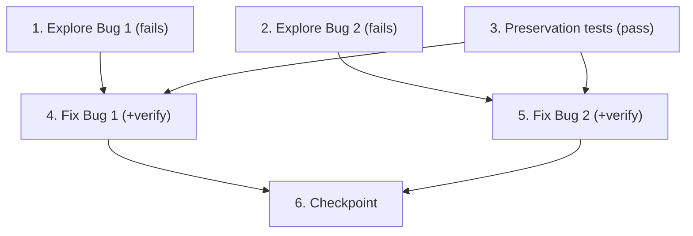

# Implementation Plan

## Overview

Two independent bugs under one spec. Tasks 1–2 are the bug-condition exploration tests (one per
bug) that MUST FAIL on unfixed code. Task 3 writes the preservation tests. Tasks 4 and 5 are the
two durable fixes with their verification sub-tasks. An operational unblock
(`ProjectionSync.sync_administration('h-dcn')`) exists but is NOT a code task — note it, do not
script it here. **Write and run exploration/preservation tests on the UNFIXED code before
implementing either fix.**

## Task Dependency Graph



- Tasks 1, 2, 3 are independent of each other and come first (tests on unfixed code).
- Task 4 (Bug 1 fix) depends on tasks 1 and 3.
- Task 5 (Bug 2 fix) depends on tasks 2 and 3. Tasks 4 and 5 are independent of each other.
- Task 6 depends on tasks 4 and 5.

```json
{
  "waves": [
    { "wave": 1, "tasks": ["1", "2", "3"], "dependsOn": [] },
    { "wave": 2, "tasks": ["4", "5"], "dependsOn": ["1", "2", "3"] },
    { "wave": 3, "tasks": ["6"], "dependsOn": ["4", "5"] }
  ]
}
```

## Tasks

- [x] 1. Write bug-condition exploration test for Bug 1 (stale scope projection)
  - **Property 1: Bug Condition** - Stale scope projection is propagated / reconciled
  - **CRITICAL**: This test MUST FAIL on unfixed code — failure confirms the propagation miss
  - **DO NOT attempt to fix the test or the code when it fails**
  - **NOTE**: This test encodes the expected behavior; it validates the fix when it passes later
  - **GOAL**: Surface counterexamples demonstrating a newer-in-MySQL scope change does not reach
    the projection and that an `enqueue_sync` drain failure is swallowed
  - **Scoped PBT Approach**: scope the property to the concrete confirmed case for reproducibility:
    projected `scopegrant#peter@pgeers.nl#region` = `["Utrecht"]` @ version 2026-09-23T08:29:06,
    source `{"region":["*"]}` @ updated_at 2026-10-28 13:22:18 (source strictly newer)
  - Assert: with the on-change drain forced to fail, the projected `values` do NOT advance to
    `["*"]` (symptom-1 reproduction), and `_fire_enqueue_sync` swallows the failure with no
    surfaced/retried signal (observe the current warning-and-return behavior)
  - Place near the `_reconcile_scopegrants` / `sync_administration` coverage in
    `backend/tests/unit/test_projection_sync.py`, and the drain-swallow observation in
    `backend/tests/unit/test_user_tenant_scope_service.py`
  - Run on UNFIXED code — **EXPECTED OUTCOME**: Test FAILS (proves the bug exists)
  - Document counterexamples (projection stays `["Utrecht"]`; drain failure invisible)
  - _Requirements: 1.1, 1.2, 1.3_

- [x] 2. Write bug-condition exploration test for Bug 2 (pagination undercount)
  - **Property 3: Bug Condition** - page_size means returned in-scope rows
  - **CRITICAL**: This test MUST FAIL on unfixed code — failure confirms Limit-before-scope-filter
  - **DO NOT attempt to fix the test or the code when it fails**
  - **NOTE**: This test encodes the expected behavior; it validates the fix when it passes later
  - **GOAL**: Surface counterexamples where returned in-scope rows < `min(page_size,
    total_in_scope)` because `Limit` bounds the RAW partition before the scope filter
  - **Scoped PBT Approach**: scope to concrete failing cases — a partition with more in-scope
    member rows than `page_size`, plus non-member child items sharing the `member#` prefix; assert
    `list_members_page(allowed_scopes, page_size=50)` returns up to 50 in-scope rows (and the
    scope-narrowed case returns `min(page_size, total_in_scope)`)
  - Place in `sam/tests/test_members_read_dispatch.py` (domain/dispatch) and
    `sam/tests/test_members_repository.py` (repository paging)
  - Run on UNFIXED code — **EXPECTED OUTCOME**: Test FAILS (raw `Limit`-then-filter under-returns)
  - Document counterexamples (e.g. page_size=50 yields fewer than 50 in-scope rows)
  - _Requirements: 4.1, 4.2, 4.3, 4.4_

- [x] 3. Write preservation property tests (BEFORE implementing either fix)
  - **Property 2: Preservation** - Already-consistent projection & non-paged behavior unchanged
  - **IMPORTANT**: Follow observation-first methodology — observe UNFIXED behavior, then encode it
  - **Bug 1 preservation** (in `backend/tests/unit/test_projection_sync.py` /
    `test_user_tenant_scope_service.py`):
    - Observe: a reconcile is a no-op for already-in-sync peers (`ledenadministratie`,
      `webmaster`); a staler source does NOT overwrite a newer projection row (version guard); a
      committed MySQL scope write stays committed when the drain fails
    - Write property-based tests asserting these hold across random in-sync / newer-projection /
      non-scope-grant inputs
  - **Property 4: Preservation** - Deny, isolation, and non-paged read unchanged
  - **Bug 2 preservation** (in `sam/tests/test_members_read_dispatch.py` /
    `test_members_repository.py`):
    - Observe: guaranteed-deny scope (empty map or `[]` dimension) → `([], None)` without paging;
      a tampered/stale cursor naming another tenant raises; the per-dimension AND rule, enrichment,
      and child-item exclusion are applied; the non-paged `list_members` result
    - Write property-based tests asserting these are unchanged across random scopes/page sizes
  - Run all on UNFIXED code — **EXPECTED OUTCOME**: Tests PASS (baseline behavior to preserve)
  - _Requirements: 3.1, 3.2, 3.3, 3.4, 6.1, 6.2, 6.3, 6.4, 6.5_

- [x] 4. Fix for Bug 1 — observable/retried propagation + reliable reconcile

  - [x] 4.1 Make the on-change drain failure observable/retried and ensure a periodic reconcile runs
    - In `backend/src/services/user_tenant_scope_service.py` (`_fire_enqueue_sync` /
      `_enqueue_sync`): keep the write decoupled (never break the MySQL write) but elevate an
      `enqueue_sync` failure from a swallowed warning to a surfaced/retried outcome (alert/metric
      signal and/or bounded retry)
    - Ensure the periodic reconcile `ProjectionSync.sync_all` runs so a missed on-change drain is
      backstopped within a bounded window; keep every put version-guarded via
      `_reconcile_scopegrants` (newer-wins; a staler source never clobbers)
    - Note (operational, NOT part of this code change): the interim unblock is a version-guarded
      `ProjectionSync.sync_administration('h-dcn')` rewriting the stale row to `["*"]`
    - _Bug_Condition: isBugCondition_projection(X) from design_
    - _Expected_Behavior: Property 1 — projection ends at new source values, version-guarded; drain
      failure observable/retried_
    - _Preservation: write survives propagation failure; in-sync peers untouched; newer-wins; non-
      scope-grant rows unaffected_
    - _Requirements: 2.1, 2.2, 2.3, 2.4, 3.1, 3.2, 3.3, 3.4_

  - [x] 4.2 Verify Bug 1 exploration test now passes
    - **Property 1: Expected Behavior** - Stale scope projection is propagated / reconciled
    - **IMPORTANT**: Re-run the SAME test from task 1 — do NOT write a new test
    - Run on FIXED code — **EXPECTED OUTCOME**: Test PASSES (projection reconciles to `["*"]`; drain
      failure surfaced/retried)
    - _Requirements: 2.1, 2.2, 2.3, 2.4_

  - [x] 4.3 Verify Bug 1 preservation tests still pass
    - **Property 2: Preservation** - Already-consistent projection & non-paged behavior unchanged
    - **IMPORTANT**: Re-run the SAME preservation tests from task 3 — do NOT write new tests
    - Run on FIXED code — **EXPECTED OUTCOME**: Tests PASS (no regressions)
    - _Requirements: 3.1, 3.2, 3.3, 3.4_

- [x] 5. Fix for Bug 2 — resolve scope into the paged read so page_size means in-scope rows

  - [x] 5.1 Make `list_members_page` return up to `page_size` in-scope rows
    - In `sam/members/repository/members_repository.py` (`MembersRepository` and
      `DynamoDbMembersRepository` `list_members_page`) and
      `sam/members/domain/_membership_reads.py` (`list_members_page`): either push scope into the
      Query as a `FilterExpression` and page via `LastEvaluatedKey` until `limit` in-scope rows are
      collected, OR skip the post-filter for an all-access (`["*"]`) caller (still excluding
      non-member child items)
    - Keep tenant isolation at the partition key; keep returning an honest next-page cursor across
      the (possibly multi-Query) page assembly
    - Keep the guaranteed-deny short-circuit (`([], None)` without paging) and the per-dimension AND
      rule and enrichment unchanged
    - _Bug_Condition: isBugCondition_paging(X) from design_
    - _Expected_Behavior: Property 3 — count(rows) = min(page_size, total_in_scope); all in-scope;
      tenant-isolated_
    - _Preservation: deny → ([], None); cursor isolation raises; AND rule / enrichment / child-item
      exclusion unchanged; non-paged list_members unchanged_
    - _Requirements: 5.1, 5.2, 5.3, 5.4, 6.1, 6.2, 6.3, 6.4, 6.5_

  - [x] 5.2 Verify Bug 2 exploration test now passes
    - **Property 3: Expected Behavior** - page_size means returned in-scope rows
    - **IMPORTANT**: Re-run the SAME test from task 2 — do NOT write a new test
    - Run on FIXED code — **EXPECTED OUTCOME**: Test PASSES (page_size=50 returns up to 50 in-scope
      rows)
    - _Requirements: 5.1, 5.2, 5.3, 5.4_

  - [x] 5.3 Verify Bug 2 preservation tests still pass
    - **Property 4: Preservation** - Deny, isolation, and non-paged read unchanged
    - **IMPORTANT**: Re-run the SAME preservation tests from task 3 — do NOT write new tests
    - Run on FIXED code — **EXPECTED OUTCOME**: Tests PASS (no regressions)
    - _Requirements: 6.1, 6.2, 6.3, 6.4, 6.5_

- [x] 6. Checkpoint - Ensure all tests pass
  - Run the paired test suites for both planes:
    `cd backend && source .venv/bin/activate && python -m pytest tests/unit/test_projection_sync.py tests/unit/test_user_tenant_scope_service.py -q`
    and the SAM members paging tests (`sam/tests/test_members_read_dispatch.py`,
    `sam/tests/test_members_repository.py`)
  - Ensure all tests pass; ask the user if questions arise.

## Notes

- **Do NOT implement the fix as part of this workflow.** This spec stops at task creation; the fix
  lands when the user starts tasks from `tasks.md`.
- **Exploration tests (tasks 1–2) MUST be written and run on the UNFIXED code first** — a FAILURE
  confirms each bug exists and encodes the expected post-fix behavior. Do not "fix" a failing
  exploration test.
- **Preservation tests (task 3) MUST PASS on the UNFIXED code** (observation-first) before either
  fix is applied, so they can catch regressions afterwards.
- **Operational unblock (not a code task):** a version-guarded
  `ProjectionSync.sync_administration('h-dcn')` rewrites the stale `scopegrant#peter@pgeers.nl#region`
  row to `["*"]` immediately. It is the interim unblock, not the durable fix (tasks 4–5 prevent
  recurrence).
- **Two planes:** Bug 1's trigger/observability is Flask/MySQL plane
  (`backend/src/services/...`, steering 30/31); Bug 1's projection write and all of Bug 2 are
  SAM/DynamoDB plane (`sam/members/...`, steering 35/39). Honor the change-with-tests contract on
  each plane — update the allocated tests in the same change.
