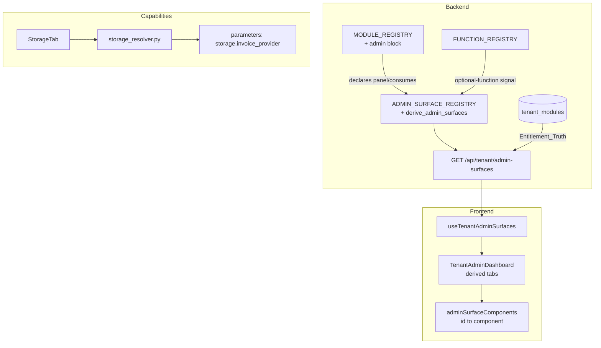

# Design Document: Admin Surface Registry

## Overview

Today the Tenant-Admin dashboard is a hardcoded JSX tab list with ad-hoc gating
(`TenantAdminDashboard.tsx`): nine tabs render unconditionally, Financial renders behind
`if hasFIN`, the Members 4-sub-tab panel behind `if hasMembers`, and Advanced behind a comment.
There is no data model of *which admin surface belongs to or is needed by which module*, so an
operator's screen is an accident of history rather than a design.

This spec introduces **one backend-owned registry of admin surfaces** (`ADMIN_SURFACE_REGISTRY`)
and a per-module **admin declaration** (`admin` block on `MODULE_REGISTRY`). The dashboard
**derives** its tab list from a pure function over (tenant entitlements, module declarations,
caller roles) and renders whatever that function returns. No `if`-ladder survives.

### Design rationale

1. **One source, two consumers.** The rule that decides whether a surface applies is needed by the
   backend (scoping/authorization) and the frontend (rendering). Keeping it in the backend gives a
   single source of truth and makes it testable with plain Python (no DOM).
2. **Declare, don't special-case.** A surface declares *when it applies*; a module declares *what
   it owns and consumes*. Everything else is derived. This mirrors the existing `MODULE_REGISTRY` /
   `FUNCTION_REGISTRY` idiom and the `storage_resolver` "config chooses, code runs" rule (steering 36).
3. **Purity.** `derive_admin_surfaces()` is a pure function — no DB, no env, no clock — so the
   model is a unit-testable algebra rather than a runtime tangle.
4. **Loud for the developer, safe for the operator.** Registry integrity is validated at startup and
   fails the boot; a frontend rendering failure degrades to the baseline surfaces only, and an
   unknown surface id renders a visible error instead of vanishing.

## Architecture



### Request flow

1. The user opens the Tenant-Admin dashboard with a current tenant selected.
2. `useTenantAdminSurfaces` calls `GET /api/tenant/admin-surfaces` with `X-Tenant` and
   `cache: 'no-store'`.
3. The route loads the tenant's `tenant_modules` (`is_active = TRUE`) and calls
   `derive_admin_surfaces(entitled_modules, roles)`.
4. The route returns the ordered surface descriptors.
5. `TenantAdminDashboard` maps the descriptors through `adminSurfaceComponents` into the tab list
   and the panels — one ordered array drives both.

## Components and Interfaces

### 1. Surface registry — `backend/src/services/admin_surface_registry.py`

A pure, import-safe module (no cloud SDK, no DB import at module top level — the same constraint
the `MODULE_REGISTRY` docstring enforces so latency-sensitive carriers can import it).

```python
from typing import Literal, TypedDict

SurfaceKind = Literal["always", "module", "capability", "role"]


class AdminSurface(TypedDict, total=False):
    id: str                 # stable key; also the frontend component key
    kind: SurfaceKind
    order: int              # ascending; ties broken by id
    label_key: str          # i18n key under tenantAdmin.tabs.*
    module: str             # kind == "module": the MODULE_REGISTRY key that owns this panel
    required_roles: list    # kind == "role": any-of; empty list == "no extra gate"


ADMIN_SURFACE_REGISTRY = {
    # --- always (platform baseline) ---
    "users":       {"kind": "always",     "order": 10,  "label_key": "tenantAdmin.tabs.users"},
    "functions":   {"kind": "capability", "order": 20,  "label_key": "tenantAdmin.tabs.functions"},
    "tenant-info": {"kind": "always",     "order": 30,  "label_key": "tenantAdmin.tabs.tenantInfo"},
    "sender":      {"kind": "always",     "order": 40,  "label_key": "tenantAdmin.tabs.senderSettings"},
    "pivot":       {"kind": "capability", "order": 50,  "label_key": "tenantAdmin.tabs.pivotViews"},
    "landing":     {"kind": "always",     "order": 60,  "label_key": "tenantAdmin.tabs.landingPage"},
    # --- module panels ---
    "financial":   {"kind": "module",     "order": 100, "label_key": "tenantAdmin.tabs.financial",     "module": "FIN"},
    "members":     {"kind": "module",     "order": 110, "label_key": "tenantAdmin.tabs.membersConfig", "module": "MEMBERS"},
    # --- capabilities (cross-cutting) ---
    "storage":     {"kind": "capability", "order": 200, "label_key": "tenantAdmin.tabs.storage"},
    "media":       {"kind": "capability", "order": 210, "label_key": "tenantAdmin.tabs.mediaAssets"},
    "templates":   {"kind": "capability", "order": 220, "label_key": "tenantAdmin.tabs.templates"},
    # --- role-gated generic surface ---
    "advanced":    {"kind": "role",       "order": 900, "label_key": "tenantAdmin.tabs.advanced", "required_roles": []},
}
```

`functions`, `pivot` and the three object capabilities are modelled as `capability`, not `always`:
each only has meaning when an entitled module declares it consumes them. `users`, `tenant-info`,
`sender` and `landing` are the genuine platform baseline.

**Startup validation** — `validate_admin_surface_registry()`, called from `app.py` beside the
existing `validate_function_registry()`:

- every `kind` is one of the four literals, every `order` is an int, every `label_key` matches
  `tenantAdmin.tabs.<name>`;
- ids are unique and non-empty, and every `module` surface names a `MODULE_REGISTRY` key;
- every module's `admin.panel` / `admin.consumes` / `admin.typed_editor` target resolves to a
  surface of the right kind, and no two modules claim the same typed namespace.

Any violation raises `ValueError` naming the offending id — the application fails to boot
rather than serving a half-configured dashboard.

### 2. Module admin declaration — `MODULE_REGISTRY` extension

Each module MAY carry an `admin` block. Absence means "this module contributes no admin UI and
consumes no cross-cutting surface".

```python
"FIN": {
    # ... existing keys unchanged ...
    "admin": {
        "panel": "financial",
        "consumes": ["storage", "templates", "pivot"],
    },
},
"MEMBERS": {
    # ... existing keys unchanged ...
    "admin": {
        "panel": "members",
        "consumes": ["storage", "media"],
        "typed_editor": {"namespace": "members", "surface": "members", "owner": "module"},
    },
},
"STR": {
    # ... existing keys unchanged ...
    "admin": {"consumes": ["storage", "pivot"]},
},
"ZZP": {
    # ... existing keys unchanged ...
    "admin": {"consumes": ["storage", "templates", "pivot"]},
},
"TENADMIN": {
    # ... existing keys unchanged ...
    "admin": {"consumes": ["functions"]},
},
```

The `typed_editor` declaration is what makes a module's typed config editor *supersede* the raw
Advanced table for its namespace (the rule from `Parameter redesign/analysis.md` §2.4) — derived
from the registry, never hardcoded in `ParameterManagement`. Its `owner` field is the part that
makes the **config-ownership boundary** enforceable: `flask` means the namespace lives in MySQL
`parameters`, `module` means it lives as a `config#*` row on the governance projection and is
written by the module's own Change-Op path (see §8). The registry stores only the **name** of the
env var that yields a module-plane editor's API base (`MODULE_REGISTRY.backing.api_base_env`,
resolved by `resolve_module_api_base`) — never a URL.

> **Capability honesty is a review obligation.** `consumes` must reflect real needs: a module that
> stores nothing must not declare `storage`, or the surface lies to the operator. Because the
> declaration is a one-line registry fact, it is cheap to keep honest and cheap to test.

### 3. Derivation — `derive_admin_surfaces()`

```python
def derive_admin_surfaces(
    entitled_modules: list[str],
    user_roles: list[str],
    registry=None,
    module_registry=None,
) -> list[AdminSurface]:
    """Pure: (entitlements, roles) -> ordered, de-duplicated applicable surfaces."""
```

Algorithm (single pass over the registry; no `if` on module identity anywhere):

1. Compute `consumed = union(m.cons["consumes"] for m in entitled_modules if registered)` and
   `owned_panels = {m["admin"]["panel"] for m in entitled_modules ...}`.
2. For each surface `s` in `ADMIN_SURFACE_REGISTRY`, include it when its kind rule matches:
   - `always` → include;
   - `module` → `s["module"] in entitled_modules` (equivalently `s["id"] in owned_panels`);
   - `capability` → `s["id"] in consumed`;
   - `role` → `not s["required_roles"]` or `set(s["required_roles"]) & set(user_roles)`.
3. Return the included surfaces sorted by `(order, id)`.

Notes:

- A module whose name is **not** in `MODULE_REGISTRY` is ignored at this layer (the same
  permissive posture as `module_backing_or_none`) so a legacy `tenant_modules` row from another
  tenant cannot abort a surface list; the endpoint logs it.
- The `functions` capability is declared by modules that ship optional functions. A tenant whose
  entitled modules declare no `functions` consumption gets no Functions tab — the honest outcome
  that the optional-functions spec implies but the flat list could not express.
- De-duplication is inherent (we iterate the registry once), so N storage-consuming modules still
  yield one Storage tab.

### 4. API contract — `GET /api/tenant/admin-surfaces`

Added to the existing `tenant_module_routes.py` blueprint (`tenant_module_bp`) beside
`GET /api/tenant/modules`, reusing its `get_current_tenant` / `get_user_tenants_from_jwt` helpers.

**Response 200**

```json
{
  "tenant": "h-dcn",
  "admin_surfaces": [
    {"id": "users", "kind": "always", "order": 10, "label_key": "tenantAdmin.tabs.users"},
    {"id": "financial", "kind": "module", "order": 100, "label_key": "tenantAdmin.tabs.financial"},
    {"id": "storage", "kind": "capability", "order": 200, "label_key": "tenantAdmin.tabs.storage"},
    {"id": "advanced", "kind": "role", "order": 900, "label_key": "tenantAdmin.tabs.advanced"}
  ]
}
```

**Behaviour**

| Condition | Response |
| --- | --- |
| No `X-Tenant` header | 400 `{"error": "No tenant specified"}` |
| Tenant not in the caller's verified tenant list | 403 `{"error": "Access denied to tenant"}` |
| No/invalid token | 401 (from `@cognito_required`) |
| Tenant has no active modules | 200 with the `always` surfaces only |
| Unexpected error | 500 `{"error": "Internal server error"}` (logged; no stack trace in the body) |

The response is sent with `Cache-Control: no-store` so a tenant switch never replays a previous
tenant's surface list (the same failure the `useTenantModules` comment guards against).

**Why a new endpoint instead of extending `/api/tenant/modules`:** the modules endpoint answers
"which modules may this *user* use here?" (intersection of tenant entitlement and user role
permissions). Surfaces must follow **tenant entitlement**, not the caller's module permissions, and
must also consult the caller's roles. Mixing the two into one response would conflate two different
questions and change an existing contract. Keeping them separate preserves backwards compatibility
(Requirement 4.8).

### 5. Frontend — hook, component map, renderer

**`frontend/src/hooks/useTenantAdminSurfaces.ts`** — mirrors `useTenantModules` exactly: tenant
captured at effect start, `cache: 'no-store'`, cancelled-flag discard of superseded responses, and
safe defaults on error.

```ts
export interface AdminSurface {
  id: string;
  kind: 'always' | 'module' | 'capability' | 'role';
  order: number;
  label_key: string;
}

export function useTenantAdminSurfaces(): {
  surfaces: AdminSurface[];   // [] while loading/error
  fallbackSurfaceIds: string[]; // always-kind ids, usable when the fetch fails
  loading: boolean;
  error: string | null;
};
```

**`frontend/src/components/TenantAdmin/adminSurfaceComponents.tsx`** — the total id → component map:

```ts
export const adminSurfaceComponents: Record<string, React.ComponentType<SurfaceProps>> = {
  users: UserManagement,
  functions: FunctionsTab,
  financial: FinancialTab,
  members: MembersAdminPanel,          // extracted from the current inline sub-tab block
  storage: StorageTab,
  media: MediaAssetAdminPage,
  templates: TemplateManagement,
  'tenant-info': TenantInfoTab,
  sender: SenderSettingsTab,
  pivot: PivotBuilderWithPreview,
  landing: LandingPageEditor,
  advanced: AdvancedTab,
};
```

`MembersAdminPanel` is a **pure extraction** of the current inline Members/TabPanel JSX into
`MembersAdminPanel.tsx` — the 4-tab internals are unchanged; only their location moves so the
component map can reference them by id.

**`TenantAdminDashboard.tsx`** becomes a renderer:

- fetch surfaces via the hook;
- on hook error, render only `fallbackSurfaceIds` (the `always` kind) plus a warning toast;
- map `surfaces` → `<Tab>` and → `<TabPanel>` from the **same** ordered array;
- a missing component for an id renders `<UnknownSurfacePanel id={...} />` and logs an error —
  never a silent drop.

### 6. Storage as a shared capability

Storage is the clearest example of a capability: **one tenant choice that many object-storing
modules consume**. The design keeps the three parts distinct, exactly as the backlog spec frames
it:

1. **Config once.** The tenant-scoped parameter `storage.invoice_provider`
   (`parameter_schema.py`: `google_drive` | `s3_shared` | `s3_tenant`, default `s3_shared`) is
   authored in the Storage surface. No second store, no per-module duplicate.
2. **Many consumers, one resolver.** `services/storage_resolver.py::resolve_storage_provider` is
   the single dispatch; FIN, Members and STR all call it. This is the steering-36 "config chooses,
   code runs" shape — the same pattern as the StrategyResolver noted in the Member-number-policy
   work. No `if tenant == ...` branch is ever introduced.
3. **Surface visibility.** `storage` renders iff an entitled module declares `consumes: [storage]`.
   A Members-only tenant that stores documents still gets Storage; a tenant whose modules store
   nothing does not. N consumers yield one Storage tab (single registry pass).

### 7. Advanced + typed namespace editors — one mechanism, two polish levels, two config owners

Both "Advanced" and a module's typed config editor are **namespace editors**, but they do not
necessarily edit the *same store*. Each namespace is owned by exactly one **config owner**, and a
surface's editor must target that owner:

| Namespace owner | Store | Who writes | Who reads | Editor |
| --- | --- | --- | --- | --- |
| `flask` | MySQL `parameters` (scoped user → role → tenant → system) | Flask, via `ParameterService` (+ optional one-directional projection) | Flask; the module plane only via a projected `config#*` row | **Advanced** (generic) or a Flask typed editor |
| `module` | DynamoDB governance projection (`config#*` rows) | the owning module, via its **Change-Op write path** (`MembersConfigWriteRepository`) | the module's projection reader | the module's **typed** editor only |

Consequences, which the registry must encode:

- `advanced` is the **generic Flask `parameters` editor** — a raw key/value table, registered as a
  `role` surface (catch-all) because raw parameters are dangerous to edit blind. It covers **only
  `flask`-owned namespaces**. It must never render a `module`-owned namespace: the `parameters`
  table is not that namespace's store, and a second door there is precisely the
  *two-writers-one-config* hazard that the module-plane cutover removed
  (`Members/02` Req: "the Advanced raw parameter editor offers no write path for any `members.*`
  key").
- A module MAY register a typed editor by declaring
  `admin.typed_editor: {namespace, surface, owner}`. Where a typed editor exists, the namespace is
  **excluded** from Advanced so there is exactly one editing door.
- **`members.*` is the canonical `module`-owned namespace.** `config#fields`, `config#scope` and
  `config#mail` are now authored by the module plane; `ProjectionSync` emits **zero** `config#*`
  rows (split ownership: the module plane owns every `config#*` row, `ProjectionSync` owns
  `tenant` / `module#` / `role#` / `scopegrant#`). The remaining MySQL `members.*` rows are the
  retired authoring path and are **not** an editing surface. Since Option B (see the section below)
  there is no Flask `members.*` config row left at all: the `scope_dimensions` validator mirror is
  retired.
- The exclusion set is derived from the registry —
  `{m["admin"]["typed_editor"]["namespace"] for m in MODULE_REGISTRY.values() if "typed_editor" in m.get("admin", {})}`
  — and handed to `ParameterManagement` (the backend route that feeds it filters rows by
  namespace), so adding a typed editor is a registry change, not a `ParameterManagement` edit.
- A save through the wrong door **fails closed**: `saveMembersParameter` already rejects
  `field_overlay` rather than falling through to the Flask parameter path; the same posture is
  required of any namespace whose `owner` is `module`.

### 8. Config ownership boundary, inside the three-plane model

Three delivery planes carry this feature (steering 40, "All-planes delivery"):

| Plane | Code | Role here |
| --- | --- | --- |
| **Frontend** | `frontend/src/**` | Renders the derived surfaces; **owns no namespace**; the only bridge (it performs each plane's write). |
| **Flask** | `backend/src/**` | The surface registry, the derivation, the `GET /api/tenant/admin-surfaces` endpoint; author of `flask`-owned config. |
| **Module** | `sam/**` ("Plane B") | Author of its own `config#*` rows via the Change-Op path; reader of the projection. |

Within those three planes, **config ownership is a two-way relation** — a namespace is owned by
`flask` or by `module` (see the ownership table in §7). That is a property of each namespace, *not*
a taxonomy of planes: naming the two owners "two planes" would hide the frontend, which is a plane
and which *does* write (as the bridge).

The two backend planes are separately packaged (`backend/src` and `sam/` MUST NOT import each other —
steering 36 rule 5) and **never call each other at runtime** (ADR 0005/0006: a Lambda must not
query MySQL). This spec adds no cross-plane coupling; it only *respects* the boundary:

1. **The registry is pure metadata.** `admin_surface_registry.py` reads no store and imports no
   plane code, and the derivation consumes `tenant_modules` (Flask-plane MySQL) only inside the
   Flask route — so the registry stays importable from both planes.
2. **The `admin` block is pure data.** `MODULE_REGISTRY` is already imported off-Flask (the
   pre-token-generation Lambda does `from services.module_registry import MODULE_REGISTRY`), so the
   added block must be JSON-serializable primitives only — no URLs, no callables, no store handles.
   Agreement of this shared vocabulary across planes is guarded by a test.
3. **The frontend is the only bridge — and since Option B it has no mirror leg left.** Where one
   logical edit spans both planes, the React app performs each plane's write separately,
   module-plane first (authoritative). That used to include a best-effort Flask *mirror* with
   surfaced retry; `scope_dimensions` was the last remaining instance and that mirror is **retired**
   (Members/02 R22.3/R22.4, Option B below). There is now no cross-plane mirror at all: one logical
   config, one writer. The Flask side READS the authoritative projected row instead.
4. **Wrong store = wrong door.** Advanced is a `parameters` editor and therefore never lists a
   `module`-owned namespace; a `module`-owned namespace's typed editor calls the module API base
   (env var name only — `MEMBERS_MODULE_API_BASE`, resolved by `resolve_module_api_base`) and never
   the Flask parameters route.
5. **Startup validation owns the invariant.** A surface whose editor plane disagrees with its
   namespace's owner — or two modules claiming the same namespace — is a boot-time `ValueError`,
   not a runtime surprise.

### 9. Surface reference (target state)

| id | kind | order | applies when | component |
| --- | --- | --- | --- | --- |
| `users` | always | 10 | any Tenant_Admin | `UserManagement` |
| `functions` | capability | 20 | an entitled module declares `consumes: [functions]` | `FunctionsTab` |
| `tenant-info` | always | 30 | any Tenant_Admin | `TenantInfoTab` |
| `sender` | always | 40 | any Tenant_Admin | `SenderSettingsTab` |
| `pivot` | capability | 50 | an entitled module declares `consumes: [pivot]` | `PivotBuilderWithPreview` |
| `landing` | always | 60 | any Tenant_Admin | `LandingPageEditor` |
| `financial` | module | 100 | FIN entitled | `FinancialTab` |
| `members` | module | 110 | MEMBERS entitled | `MembersAdminPanel` (typed editor for `members.*`) |
| `storage` | capability | 200 | an entitled module declares `consumes: [storage]` | `StorageTab` |
| `media` | capability | 210 | an entitled module declares `consumes: [media]` | `MediaAssetAdminPage` |
| `templates` | capability | 220 | an entitled module declares `consumes: [templates]` | `TemplateManagement` |
| `advanced` | role | 900 | any Tenant_Admin (see Decision D3) | `AdvancedTab` |

## Alignment with decision records (`docs/decisions/`)

This spec introduces no new platform decision; it conforms to the accepted ADRs. Mapping:

| ADR | What it settles | How this spec conforms |
| --- | --- | --- |
| **0003** — myAdmin is the platform base; apps are module-plane-backed modules | Two planes; the `MODULE_REGISTRY.backing` contract (optional block, "absence means in-process Flask", `api_base_env` **name** only — never a URL, fail-fast resolution, read-only accessors) | The `admin` block is an **append-only extension of that same registry entry**, following the S1 refinement's shape exactly: metadata only, env-var *name* for a module API base, never a URL. Requirements 2.1, 2.5; design §2, §8.2 |
| **0004** — verified-JWT-only, per-issuer JWKS | No unverified-header trust: failure → **401**; `X-Tenant` is only a *selector* among tenants the verified token already grants; roles from verified groups; tenant from verified `custom:tenants` | Requirement 4.3/4.5/4.7 — the endpoint resolves `X-Tenant`, validates it against the caller's verified tenant list, returns 401 with no valid token and 403 for an unlisted tenant, and is never cache-ambiguous |
| **0005** — MySQL is the tenant system-of-record; one-directional MySQL→DynamoDB projection | `tenants` / `tenant_modules` / `user_tenant_roles` are authoritative; a Lambda never makes a request-time MySQL query | Requirements 3.7, 4.4, 11.2/11.3 — Entitlement_Truth is `tenant_modules`; the derivation is pure metadata; only the Flask route touches MySQL |
| **0006** — resolved entitlement in the token via PreTokenGen reading the projection | A module Lambda answers "what may this user do?" without a MySQL hop | Design §8.2 — the added `admin` block stays JSON-serializable because `MODULE_REGISTRY` is imported by that off-Flask carrier |
| **0007** — active-tenant resolution at the module edge | `X-Tenant` selects among the caller's verified tenants and never grants one; unlisted → 403; never default-to-first | Requirement 4.3. **Nuance kept distinct:** the module edge validates against `tenant_keys` (the capability-scoped subset from `custom:entitlements`, ADR 0007); this Flask endpoint validates against `custom:tenants` (ADR 0004/0005 claim contract). These are different sets by design — this spec does not unify them |
| **0009** — `config#fields` CRUD: Change-Op writes, server-owned placement, read stays the Flat_View | Writes go by identity through a path `update_item` with a version guard; the **raw overlay shape never crosses the API boundary** | Requirements 7.2, 11.1/11.6 and design §7/§8.4 — a module-owned namespace is written by the module's Change-Op path only, and read through the module's projection reader / resolved view, never through a second editor |

### Outstanding governance item this spec inherits (not creates)

**ADR 0005's decision text is stale on the projection-writer invariant.** It states the sync is the
writer of the projection table and that the module plane *"never writes the projection or MySQL"*.
The split-ownership end-state contradicts the first half: the module plane authors its own
`config#fields` / `config#scope` / `config#mail` rows (ADR 0009's Change-Op path; `Members/02`), and
`ProjectionSync` now emits **zero** `config#*` rows. What still holds, and is what ADR 0005 was
protecting:

- the module plane **still has no MySQL client** — MySQL authority over `tenants` /
  `tenant_modules` / `user_tenant_roles` does not move, and there is still no two-way write /
  split brain to MySQL;
- what changed is narrower: the **projection table's single-writer rule** and the addition of
  module-authored `config#*` rows.

Steering 36 records this as the carve-out that *qualifies* ADR 0005; ADR 0009 records the write
mechanism. ADR 0005 itself was never amended. Per the steering 40 governance definition-of-done,
that amendment belongs in the same change set as the config-ownership work — tracked as a task in
`tasks.md` (phase 6). This spec conforms to the *effective* decision (steering 36 + ADR 0009); it
flags the ADR text so nobody has to rediscover the mismatch.

## Decisions (resolving the backlog's open questions)

| # | Question | Decision | Rationale |
| --- | --- | --- | --- |
| D1 | Which surfaces are truly `always` vs `capability`-consumed? | Only `users`, `tenant-info`, `sender`, `landing` are `always`. `storage`, `media`, `templates`, `pivot`, `functions` are `capability`. | They serve modules; a module-free tenant gets no editing UI it cannot use. |
| D2 | Where does the surface registry live — backend or frontend? | **Backend** (`admin_surface_registry.py`), exposed via an endpoint. | Entitlement truth and the surface declaration share one source; the rule is unit-testable without a DOM. |
| D3 | Should `advanced` be SysAdmin-gated? | **No, keep Tenant_Admin** at this time. | The route already scopes rows to the tenant + its active modules and masks secrets; gating adds friction without adding protection. Recorded so it is a decision, not an accident. |
| D4 | Relationship to `tenant_functions` (the Functions tab)? | Distinct but consistent: `FUNCTION_REGISTRY` is the *within-module toggle layer*; the surface registry is the *which-surfaces layer*. `functions` is a capability consumed by modules that ship optional functions. | Prevents conflating "is this sub-function on?" with "should this tab exist?". |
| D5 | How does `consumes` relate to entitlements (does it activate a module)? | It does **not**. `consumes` is display/scoping only. | No hidden coupling between UI presence and entitlement state. |
| D6 | What about a module with no admin UI (e.g. a future integration module)? | It declares no `admin` block; it contributes no panel and consumes nothing. | Optional by construction keeps the model honest. |
| D7 | Does "Advanced is the generic namespace editor" mean it covers **every** namespace? | **No.** Advanced covers `flask`-owned namespaces only, and its exclusion set includes every namespace claimed by a `typed_editor` on either plane. | The `parameters` table is a Flask store; offering it for a `module`-owned namespace would re-create the two-writers-one-config hazard the module-plane cutover removed (`Members/02`). |
| D8 | How is plane ownership recorded so it cannot drift? | `admin.typed_editor.owner` ∈ {`flask`, `module`}, validated at startup (`design.md` §8.5). | Makes the boundary machine-checkable instead of a convention in prose. |
| D9 | Who writes a namespace that spans both planes? | Exactly one plane is authoritative (`module` for `members.*`) and, since Option B, exactly one write happens: the cross-plane mirror is retired and the Flask side READS the projected row. | The planes never call each other at runtime (ADR 0005/0006); a best-effort mirror quietly made a second writer that the frontend had to keep in step by hand. |

## Correctness Properties

_A property is a characteristic or behaviour that should hold across all valid executions of the
system. Properties bridge the human-readable requirements and the machine-verifiable guarantees._

### Property 1: Derivation soundness (no surface without a valid reason)

_For any_ entitled-module set and role set, every surface returned by `derive_admin_surfaces()` SHALL
satisfy its own applicability rule — every `module` surface's module is entitled, every `capability`
surface is consumed by some entitled module, and every `role` surface's role requirement is met by
the caller.

**Validates: Requirements 3.1, 3.2, 3.3, 3.4**

### Property 2: Derivation completeness (no applicable surface omitted)

_For any_ entitled-module set and role set, every surface in `ADMIN_SURFACE_REGISTRY` whose
applicability rule is satisfied SHALL appear in the output.

**Validates: Requirements 3.1, 3.2, 3.3, 3.4**

### Property 3: Uniqueness and ordering

_For any_ inputs, the returned list SHALL contain each surface id at most once and SHALL be sorted
by `(order, id)` ascending.

**Validates: Requirements 3.5, 6.3**

### Property 4: Purity and determinism

_For any_ inputs, two calls to `derive_admin_surfaces()` with equal arguments SHALL return equal
lists, and the function SHALL not read a database, environment variable, or clock.

**Validates: Requirements 3.6**

### Property 5: Capability follows consumption, not a fixed list

_For any_ module set, the `storage` surface SHALL appear if and only if at least one entitled module
declares `consumes: [storage]` — including a Members-only tenant and excluding a tenant whose
modules store nothing.

**Validates: Requirements 6.1, 6.2, 3.8**

### Property 6: Registry integrity fails loud

_For any_ mutated registry or module declaration (duplicate id, unknown kind, missing order, missing
label key, `panel`/`consumes`/`typed_editor` pointing at the wrong kind, colliding typed namespace),
`validate_admin_surface_registry()` SHALL raise a `ValueError` naming the offending id, and SHALL NOT
raise for the committed registry.

**Validates: Requirements 1.5, 2.6, 8.1**

### Property 7: Component-map totality

_For any_ surface id the backend can emit, `adminSurfaceComponents[id]` SHALL be defined — i.e. the
frontend map's key set is a superset of `ADMIN_SURFACE_REGISTRY`'s key set.

**Validates: Requirements 5.2**

### Property 8: Tenant-switch isolation

_For any_ sequence of tenant switches, the dashboard SHALL render surfaces derived from the
*current* tenant only — a response for a tenant the user has switched away from SHALL be discarded.

**Validates: Requirements 5.5, 4.7**

### Property 9: Safe degradation

_For any_ frontend fetch failure, the dashboard SHALL render only the `always` surfaces and SHALL set
an error state — it SHALL never render a `module`/`capability`/`role` surface it could not confirm.

**Validates: Requirements 8.2**

### Property 10: Equivalence with today's behaviour

_For any_ representative tenant from {FIN-only, MEMBERS-only, both, neither}, the derived surface set
SHALL equal today's tab set adjusted by exactly the documented deltas (see below).

**Validates: Requirements 9.1, 9.2, 9.3, 9.4**

### Property 11: Plane fidelity (no editor touches the wrong store)

_For any_ surface and namespace, the plane of the surface's editor SHALL equal the namespace's declared owner: the `advanced` surface SHALL never include a namespace whose `owner` is `module`, a `flask`-owned namespace SHALL never be writable through a module-plane editor, and a save aimed at the wrong door SHALL be rejected without creating or updating a row in the other plane's store.

**Validates: Requirements 7.2, 7.5, 7.7, 11.1, 11.2, 11.6, 11.7**

### Property 12: Registry is plane-agnostic metadata

_For any_ import of `admin_surface_registry`, the module SHALL succeed without a database, without cloud credentials, and without importing plane-specific code, and the `admin` block of every `MODULE_REGISTRY` entry SHALL be JSON-serializable — so the registry is consumable by both planes and cannot encode a store.

**Validates: Requirements 1.3, 11.3, 11.4**

## Delta from today's behaviour (intentional changes)

The refactor is designed to be behaviour-preserving except for these deliberate, tested deltas:

| # | Today | After | Why |
| --- | --- | --- | --- |
| Δ1 | `storage`, `media`, `templates`, `pivot`, `functions` always render | Render only when an entitled module consumes them | Surfaces that serve modules should not appear for a tenant with no such module (Requirement 6) |
| Δ2 | Tab order is the order of JSX blocks | Order comes from `order` in the registry | One declarative ordering, stable across edits |
| Δ3 | FIN-only tenants lose `landing`/`pivot` to nothing; `hasFIN`/`hasMembers` gates are the only module logic | Derivation handles any number of modules and capability consumers | Removes the "accidental" surface differences called out in the backlog |
| Δ4 | A module could theoretically be entitled with no admin surface | A module with no `admin` block simply contributes nothing (no error) | Keeps future non-UI modules legal |

Each delta gets an explicit unit test (see Testing Strategy) so a reader can see the change is
intended, and the equivalence property (Property 10) pins everything else.

## Error Handling

| Scenario | Component | Response |
| --- | --- | --- |
| Duplicate surface id / unknown kind / missing order / missing label key | `validate_admin_surface_registry()` at boot | `ValueError` naming the id — application fails to start |
| `admin.panel`/`consumes`/`typed_editor` target of the wrong kind | Startup validation | `ValueError` naming the module and id — fail to start |
| Two modules claim the same typed namespace | Startup validation | `ValueError` naming the namespace |
| Unknown module name in a `tenant_modules` row | `derive_admin_surfaces` | Ignored for derivation; endpoint logs a warning (no abort) |
| Missing `X-Tenant` header | Endpoint | HTTP 400 `{"error": "No tenant specified"}` |
| Tenant not in the caller's verified list | Endpoint | HTTP 403 `{"error": "Access denied to tenant"}` |
| No/invalid token | Endpoint | HTTP 401 via `@cognito_required` |
| Tenant has no active modules | Endpoint | HTTP 200 with `always` surfaces only |
| Unexpected endpoint error | Endpoint | HTTP 500 `{"error": "Internal server error"}`, logged; no stack trace in the body |
| Frontend fetch failure / non-2xx | `useTenantAdminSurfaces` | `surfaces: []`, `error` set; dashboard renders `always` surfaces + warning toast |
| Frontend receives an unknown surface id | `TenantAdminDashboard` | `<UnknownSurfacePanel id=...>` rendered and error logged (no silent drop) |
| Frontend loads a superseded tenant's response | `useTenantAdminSurfaces` | Discarded via the cancelled-flag + tenant-at-start check |
| `storage.invoice_provider` unset/unreadable | `storage_resolver.resolve_storage_provider` | Falls back to its documented default (`s3_shared`), logs a warning |
| A `module`-owned namespace requested through Advanced | parameters route / `ParameterManagement` | Namespace excluded from the row set entirely — no write path is offered |
| Save targets a `module`-owned namespace through the Flask parameter path | `membersConfigService` / parameter service | Fail closed: caller-safe error, and no Flask row is created or updated |
| `typed_editor.owner` disagrees with the namespace's real store | Startup validation | `ValueError` naming the namespace and module — fail to start |
| Two modules claim the same typed namespace | Startup validation | `ValueError` naming the namespace |
| Module plane unreachable during a typed-editor save | Typed editor | `{ success: false, error }`; nothing is written elsewhere — there is no second plane to write |
| Flask side cannot read the authoritative `config#scope` row | `scope_vocabulary` resolver | The read FAILS LOUDLY (surfaced to the caller: picker 5xx, sync error); never a placeholder scope model |

## Option B — the Members/02 validator mirror is retired

_Status: implemented (see `tasks.md` §8)._ This is the follow-on the registry work made possible.

`Members/02` split config ownership so the module plane owns `config#scope`, but kept a
frontend-written copy in MySQL (`members.scope_dimensions`) for three Flask-side readers. The
registry made that copy structurally unnecessary: ownership is a property of the NAMESPACE, and
`members` is a `module`-owned namespace, so the Flask plane was reading a mirror of config it did
not own — through a second authoring door.

Option B deletes it:

- **One read seam.** `services/scope_vocabulary.py` resolves the vocabulary from the projected
  `config#scope` row through the existing read-only `ProjectionReader` (`load_scope_dimensions`
  plus a shared `dimension_index`).
- **Three readers repointed.** Grant validation (`user_tenant_scope_service`), the picker API
  (`tenant_admin_scope`), and the `scopegrant#` builder (`_projection_scopegrant`) all read that
  one seam.
- **The mirror and its allowances are gone.** `flask_mirror_keys` (accessor, boot validation, the
  `typed_editors()` exposure), the `module_registry` declaration, the `parameter_admin_routes`
  fail-open allowance, `_SCOPE_DIMENSIONS_PARAM_KEY`, the `members.scope_dimensions` schema entry,
  and the frontend's second write leg (`membersConfigService`, `MembersConfigEditor`). A
  `module`-owned namespace now fails closed for **every** key.

**Trade-off (accepted).** The projection is one-directional and eventually consistent, so the Flask
plane needs `GOVERNANCE_PROJECTION_TABLE` and sees a just-authored change after
`sync delay + read TTL`, not synchronously. That is the deliberate exchange: ONE writer with bounded,
documented staleness rather than two writers the frontend had to keep in step.

## Testing Strategy

### Backend property tests (pytest + Hypothesis)

Target the pure layer — `admin_surface_registry.py` — with ≥100 iterations each:

- **Derivation soundness/completeness** (Properties 1, 2): generate random entitled-module subsets and role sets; assert the output equals the set of registry surfaces satisfying their rule.
- **Uniqueness + ordering** (Property 3): generate random inputs; assert `sorted(output) == output` by `(order, id)` and ids are unique.
- **Purity/determinism** (Property 4): assert repeated calls are equal and that a sentinel DB/env patch is never touched.
- **Capability-follows-consumption** (Property 5): generate random `consumes` declarations; assert `storage` presence tracks consumption.
- **Registry validation** (Property 6): mutate a copy of the registry / module declarations with Hypothesis-generated defects; assert `ValueError` naming the id.
- **Plane fidelity** (Property 11): generate namespaces with `owner` ∈ {`flask`, `module`} and assert Advanced never emits a `module`-owned namespace and that every typed-editor target matches its owner's plane.
- **Registry purity** (Property 12): assert `admin_surface_registry` imports with no DB/credentials and that every `admin` block survives `json.dumps`/`json.loads` round-tripping unchanged.

Tag format: `# Feature: admin-surface-registry, Property {N}: {description}`.

### Backend unit tests (example-based)

- Committed registry covers exactly the twelve ids (Requirement 1.4) and passes validation.
- The four delta cases of §Delta from today are asserted explicitly (Requirement 9.4).
- `functions` capability appears only for a tenant whose entitled module declares it.

### Backend integration tests (Flask test client)

- `GET /api/tenant/admin-surfaces` with a FIN tenant returns baseline + `financial` + FIN capabilities.
- Missing `X-Tenant` → 400; unauthorized tenant → 403; no token → 401; module-free tenant → 200 with baseline only.
- Response carries `Cache-Control: no-store`.
- `GET /api/tenant/modules` response shape is unchanged (Requirement 4.8).
- Saving a `module`-owned namespace through the Flask parameters route (`PUT/POST /api/tenant-admin/parameters` with `namespace=members`) is rejected, and a follow-up read shows no created/updated Flask row.
- The parameters route's row set excludes every namespace claimed by a `typed_editor` (Requirement 7.3, 7.8).

### Cross-plane vocabulary guard (steering 36 rule 5)

The `owner` values and namespace names in `admin.typed_editor` are a vocabulary shared with the
module plane. Keep one source of truth and enforce agreement with a test that mirrors how
`members_config_validation` keeps its field-key set honest against the module's `fixed_fields` —
so a drifted namespace name or owner value fails loudly on the Flask side rather than silently
offering the wrong door.

### Frontend property tests (Vitest + fast-check)

- **Component-map totality** (Property 7): for every id in a checked-in mirror of the registry ids, `adminSurfaceComponents[id]` is defined.
- **Tenant-switch isolation** (Property 8) and **safe degradation** (Property 9) on the hook.

### Frontend component tests (Vitest + React Testing Library)

- Dashboard renders exactly the tabs returned by a mocked `/api/tenant/admin-surfaces` (no extras).
- A mocked FIN tenant shows Financial + its capabilities; a mocked Members tenant shows Members + its capabilities; storage appears once with two consumers.
- Fetch failure → baseline tabs only + toast.
- Unknown id → `UnknownSurfacePanel` rendered and `console.error` called.
- Existing states preserved: loading, access-denied, no-tenant, select-tenant.

### Manual/visual check

- Log in as a Tenant_Admin for a FIN-only tenant, a Members-only tenant, and a dual tenant; confirm tab sets match §Surface reference and that order is stable across a tenant switch.


