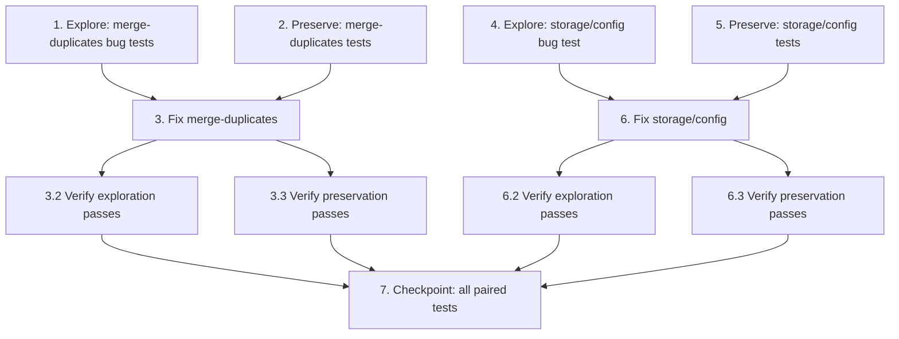

# Implementation Plan

## Overview

Two independent 500s on the Flask/MySQL plane, fixed as two separate, independently-shippable
task groups. Bug 1 (`POST /api/media-assets/merge-duplicates`) is Group A; Bug 2
(`GET /api/tenant-admin/storage/config`) is Group B. Each group follows explore → preserve →
implement → verify, and can be executed and shipped in isolation.

Execution conventions (WSL/bash, steering `41-shell-environment`):
- Always use an inline POSIX `cd` — never the `cwd` parameter:
  `bash -lc 'cd /home/peter/projects/myAdmin && <cmd>'`.
- Judge success by the command's stdout/stderr and the `<<<DONE marker=$?>>>` marker, not by the
  tool's reported exit code (this environment always reports `-1`).
- Activate the venv before pytest: `cd backend && source .venv/bin/activate && python -m pytest ... -q`.
- Change-with-tests contract (`30-backend-api-flask-mysql`): update the allocated test(s) in the
  SAME change; never weaken or delete assertions to go green; commit fixtures under
  `backend/tests/fixtures/`. If two tests contradict (one asserts old, one asserts new), STOP and
  surface the conflict — do not pick a side silently.

## Task Dependency Graph

The two groups are independent of each other and can be executed/shipped in either order.
Within each group, explore → preserve → implement → verify is strictly ordered.



```json
{
  "waves": [
    {
      "wave": 1,
      "tasks": ["1", "2", "4", "5"],
      "description": "Write explore + preserve tests for both bugs on UNFIXED code (independent, parallelizable)."
    },
    {
      "wave": 2,
      "tasks": ["3", "6"],
      "description": "Apply the two independent fixes and their verify sub-tasks (Group A fix depends on 1,2; Group B fix depends on 4,5)."
    },
    {
      "wave": 3,
      "tasks": ["7"],
      "description": "Final checkpoint: run the full paired test set for both bugs; depends on 3 and 6."
    }
  ]
}
```

## Tasks

---

## Group A — Bug 1: POST /api/media-assets/merge-duplicates (independently shippable)

- [x] 1. Write bug condition exploration tests for merge-duplicates (BEFORE the fix)
  - **Property 1: Bug Condition** - Merge raises/drops on the failing path
  - **CRITICAL**: These tests MUST FAIL (or expose the silent drop) on unfixed code — failure confirms the bug exists
  - **DO NOT attempt to fix the test or the code when it fails** at this step
  - **NOTE**: These tests encode the expected post-fix behavior — they validate the fix when they pass later
  - **GOAL**: Surface counterexamples that demonstrate the two coupled defects (P1 ignored `_delete_raw` result, P2 over-narrow `except IntegrityError`)
  - **Scoped PBT Approach**: scope the property to concrete reproduced inputs — a well-formed group `keep="ast_01M5ETNER53YMN4ZPM7KKMZ2FN"`, `dups=["ast_01M5ETN15MM6ZWXWZT37B5543G"]`, both tenant-owned
  - Unit tests — add a new `TestMergeDuplicates` class to `backend/tests/unit/test_media_asset_service.py`, driving `MediaAssetService.merge_duplicates` with the module `mock_db` + autouse env/boto3 fixtures, `mock_db.transaction.return_value.__enter__ = MagicMock(return_value=(cursor, conn))`, and `_delete_raw` patched:
    - `test_merge_duplicates_reattach_unexpected_dberror_propagates` — cursor's re-attach `INSERT` raises a non-`IntegrityError` `DatabaseError`; unfixed code lets it propagate out of the service (EXPECTED FAILURE: raises instead of returning a result) — this is the primary reproduce-the-bug case
    - `test_merge_duplicates_s3_delete_fails_tolerated_and_logged_still_succeeds` — `_delete_raw` returns `False`; unfixed code ignores the boolean and deletes the DB row with no `_maslog()` warning (EXPECTED FAILURE on the tolerate-and-log assertion)
  - Property test — add `backend/tests/unit/test_media_asset_merge_props.py` (`*_props.py` naming): generate random well-formed duplicate-group inputs and assert fix-checking — valid groups return `success:true` with `kept == keep_asset_id` and no unhandled exception (EXPECTED FAILURE on unfixed code)
  - API tests — add to `backend/tests/api/test_media_asset_routes.py` (patch `routes.media_asset_routes._get_service`):
    - `test_merge_duplicates_success_returns_200` — valid group → 200 `{"success": true, "kept": ..., "merged": N, "deleted": N}` (EXPECTED FAILURE on unfixed code)
  - Run on UNFIXED code: `cd backend && source .venv/bin/activate && python -m pytest tests/unit/test_media_asset_service.py::TestMergeDuplicates tests/unit/test_media_asset_merge_props.py tests/api/test_media_asset_routes.py -q`
  - **EXPECTED OUTCOME**: tests FAIL (this is correct — it proves the bug exists)
  - Document counterexamples found (unhandled `DatabaseError` escaping the service; dropped S3-failure signal) to confirm the root cause
  - Mark complete when the tests are written, run, and the failures are documented
  - _Requirements: 1.1, 1.2, 1.3 (Bug Condition / Fix Checking, design Property 1)_

- [x] 2. Write preservation tests for merge-duplicates (BEFORE the fix)
  - **Property 2: Preservation** - Non-buggy merge inputs behave identically
  - **IMPORTANT**: Follow observation-first methodology — observe behavior on UNFIXED code for non-bug-condition inputs, then encode it
  - These tests MUST PASS on unfixed code (they capture the baseline to preserve)
  - Unit tests — in the same `TestMergeDuplicates` class in `backend/tests/unit/test_media_asset_service.py`:
    - `test_merge_duplicates_keep_asset_not_found_returns_error` — keep asset absent for tenant → `{"success": false, "error": "Keep asset '<id>' not found"}` (service), route maps to 400 (3.1)
    - `test_merge_duplicates_self_reference_skipped` — a duplicate ID equal to the keep ID is skipped; the kept asset is never deleted (3.2)
    - `test_merge_duplicates_reattach_integrityerror_skipped_merge_succeeds` — an already-present reference raises `IntegrityError`, which is tolerated and that reference skipped; merge still `success:true` (3.3)
    - `test_merge_duplicates_wrong_tenant_duplicate_skipped` — non-existent / wrong-tenant duplicate IDs skipped, not raised → `{"success": true, "merged": 0, "deleted": 0}` (2.3)
    - Tenant-isolation assertion: every executed statement carries `administration = %s` with the resolved tenant value (6.5-equivalent for this plane)
  - Property test — in `backend/tests/unit/test_media_asset_merge_props.py`: generate random inputs incl. self-references, wrong-tenant IDs, empty duplicate lists, and already-present references, asserting skip / `IntegrityError`-tolerance semantics are invariant (preservation)
  - API tests — in `backend/tests/api/test_media_asset_routes.py`:
    - `test_merge_duplicates_missing_keep_asset_id_returns_400` — deliberate validation 400, unchanged (2.4)
    - `test_merge_duplicates_missing_duplicate_ids_returns_400` — deliberate validation 400, unchanged (2.4)
    - `test_merge_duplicates_service_not_found_returns_400` — service `success:false` mapped to 400 (3.1)
    - `test_merge_duplicates_unexpected_exception_returns_500_generic_with_error_id` — residual unexpected exception → `error_response(e, "Merge duplicates error", status=500)`; assert body is `{"success": false, "error": "Merge duplicates error", "error_id": <uuid>}` and that `str(e)` is NOT present (2.5)
  - Run on UNFIXED code: `cd backend && source .venv/bin/activate && python -m pytest tests/unit/test_media_asset_service.py::TestMergeDuplicates tests/api/test_media_asset_routes.py -q -k "not reattach_unexpected_dberror and not s3_delete_fails and not success_returns_200"`
  - **EXPECTED OUTCOME**: these preservation tests PASS (confirms baseline behavior to preserve)
  - Mark complete when the preservation tests are written, run, and passing on unfixed code
  - _Requirements: 2.3, 2.4, 2.5, 3.1, 3.2, 3.3, 3.4, 3.5 (design Property 2)_

- [x] 3. Fix merge-duplicates (delete-tolerance + precise IntegrityError catch)

  - [x] 3.1 Apply the fix in `backend/src/services/media_asset/lifecycle.py::merge_duplicates`
    - Capture `deleted = self._delete_raw(bucket, s3_key)`; when `deleted` is `False`, log a warning via `_maslog()` (key: tenant + dup_id + s3_key) and **continue** removing the DB row — the merge still succeeds (delete-tolerance pattern, P1)
    - Keep the re-attach tolerance as `except IntegrityError` only — do NOT broaden to a bare `except`; genuinely unexpected `DatabaseError`s must still propagate so they flow to `error_response` (P2 / 2.5)
    - Make no change to tenant isolation or parameterization — every statement stays `%s` with `administration = %s`; no hardcoded tenant
    - No route change for the happy path — the route already maps `success:true`→200, `success:false`→400, and wraps residual errors in `error_response(..., "Merge duplicates error", status=500)`
    - _Bug_Condition: isBugCondition_merge(input) — keep asset exists for tenant, non-empty duplicate list, merge raises/drops_
    - _Expected_Behavior: merge completes → `{"success": true, "kept": "<keep>", "merged": N, "deleted": M}`; failed S3 delete tolerated+logged; unexpected errors still surface via error_response_
    - _Preservation: validation 400s, keep-not-found 400, self/wrong-tenant skip, IntegrityError tolerance, auth decorators, sibling endpoints, parameterized tenant isolation_
    - _Requirements: 2.1, 2.2, 2.3, 2.5 (design Property 1)_

  - [x] 3.2 Verify the merge-duplicates exploration tests now pass
    - **Property 1: Expected Behavior** - Merge succeeds for a valid duplicate group
    - **IMPORTANT**: Re-run the SAME tests from task 1 — do NOT write new tests
    - `cd backend && source .venv/bin/activate && python -m pytest tests/unit/test_media_asset_service.py::TestMergeDuplicates::test_merge_duplicates_reattach_unexpected_dberror_propagates tests/unit/test_media_asset_service.py::TestMergeDuplicates::test_merge_duplicates_s3_delete_fails_tolerated_and_logged_still_succeeds tests/unit/test_media_asset_merge_props.py tests/api/test_media_asset_routes.py::test_merge_duplicates_success_returns_200 -q`
    - **EXPECTED OUTCOME**: tests PASS (confirms the bug is fixed)
    - _Requirements: Expected Behavior Properties from design (Property 1: 2.1, 2.2, 2.3)_

  - [x] 3.3 Verify the merge-duplicates preservation tests still pass
    - **Property 2: Preservation** - Non-buggy merge inputs behave identically
    - **IMPORTANT**: Re-run the SAME tests from task 2 — do NOT write new tests
    - `cd backend && source .venv/bin/activate && python -m pytest tests/unit/test_media_asset_service.py::TestMergeDuplicates tests/api/test_media_asset_routes.py -q`
    - **EXPECTED OUTCOME**: tests PASS (confirms no regressions)
    - Confirm all merge-duplicates tests still pass after the fix (no regressions)
    - _Requirements: Preservation Requirements from design (Property 2: 2.4, 2.5, 3.1, 3.2, 3.3, 3.4, 3.5)_

---

## Group B — Bug 2: GET /api/tenant-admin/storage/config (independently shippable)

- [x] 4. Write bug condition exploration test for storage/config (BEFORE the fix)
  - **Property 3: Bug Condition** - Stale-source read 500s on a plain read
  - **CRITICAL**: This test MUST FAIL on unfixed code — failure confirms the bug exists
  - **DO NOT attempt to fix the test or the code when it fails** at this step
  - **NOTE**: This test encodes the expected post-fix behavior — it validates the fix when it passes later
  - **GOAL**: Surface the counterexample — an authenticated Tenant_Admin receiving a 500 on a plain read because the handler queries the superseded `tenant_config` table/`is_secret` column
  - **Scoped PBT Approach**: scope to the concrete reproduced case — authenticated Tenant_Admin, `tenant_config` SELECT raises a table/column-missing `DatabaseError`
  - API test — in `backend/tests/api/test_tenant_admin_storage.py`, class `TestTenantAdminStorageConfig`, patch `routes.tenant_admin_storage.DatabaseManager` so `execute_query` raises a `DatabaseError` ("table/column missing"), with `get_current_tenant` patched to a test tenant:
    - `test_get_config_source_unavailable_returns_500_generic` — unfixed handler returns 500 `{"error": "Tenant storage request failed", "error_id": <uuid>}` with NO `success` key; assert `str(e)` is NOT present (reproduces the bug on unfixed code)
  - Run on UNFIXED code: `cd backend && source .venv/bin/activate && python -m pytest tests/api/test_tenant_admin_storage.py::TestTenantAdminStorageConfig -q`
  - **EXPECTED OUTCOME**: the reproduce case shows the masked 500 on the stale `tenant_config` read (this is correct — it proves the stale-source bug exists)
  - Document the counterexample (authenticated Tenant_Admin 500 on a plain read) to confirm the stale-source root cause
  - Mark complete when the test is written, run, and the failure/500 is documented
  - _Requirements: 4.1, 4.2, 4.3 (Bug Condition / Fix Checking, design Property 3)_

- [x] 5. Write preservation tests for storage/config (BEFORE the fix)
  - **Property 4: Preservation** - Non-buggy storage/config inputs behave identically
  - **IMPORTANT**: Follow observation-first methodology — observe behavior on UNFIXED code for non-bug-condition inputs, then encode it; keep the `include_success=False` error shape throughout
  - Unit tests — add/adjust in `backend/tests/unit/test_storage_routes.py` (and `test_storage.py` if it owns the config read) for the service-layer read logic (namespace → folder-id filter → map):
    - `test_storage_config_reads_from_parameters_namespace` — reads the tenant's `storage` namespace via `ParameterService` (new source)
    - `test_storage_config_filters_only_literal_folder_id_suffix` — only keys ending in the literal `_folder_id` are included (`str.endswith("_folder_id")`), excluding a wildcard over-match key like `xfolder_id` (5.3 / 4.3)
    - `test_storage_config_empty_namespace_returns_empty_map` — no folder-id params → empty `config` map (6.3)
  - Property test — add `backend/tests/unit/test_storage_config_key_filter_props.py` (`*_props.py`): generate random mixes of `storage`-namespace keys (folder-id and non-folder-id, incl. tricky `xfolder_id` vs `x_folder_id`) and assert only literal `_folder_id`-suffixed keys appear, values returned as-is
  - API tests — in `backend/tests/api/test_tenant_admin_storage.py`, class `TestTenantAdminStorageConfig`:
    - **Update** `test_get_config_returns_data` to mock the NEW source (`parameters` via `ParameterService` / the service read) instead of `DatabaseManager.execute_query` on `tenant_config`, asserting the same 200 + keys-as-is contract. The old assertion against the `tenant_config` mock must NOT be left asserting the removed behavior (change-with-tests). If this contradicts the exploration test, STOP and surface it — do not silently pick a side
    - **Add** `test_get_config_empty_returns_200_empty_config` — tenant with no folder-id params → 200 with empty `config` object, never 500 (6.3)
    - **Add** `test_get_config_excludes_wildcard_overmatch_key` — `xfolder_id` excluded, `google_drive_invoices_folder_id` included (5.3)
    - **Keep** `test_get_storage_config_unauthenticated_returns_401_or_403` unchanged — auth enforced before any lookup (6.1)
    - Residual-error-shape assertion (keep `include_success=False`): a residual unexpected error → 500 bare `{"error": <generic>, "error_id": <uuid>}` with NO `success` key and no `str(e)` (5.5)
  - Commit any fixtures under `backend/tests/fixtures/`; never point a test at a git-ignored scratch file
  - Run on UNFIXED code: `cd backend && source .venv/bin/activate && python -m pytest tests/unit/test_storage_routes.py tests/unit/test_storage_config_key_filter_props.py tests/api/test_tenant_admin_storage.py::TestTenantAdminStorageConfig::test_get_storage_config_unauthenticated_returns_401_or_403 -q`
  - **EXPECTED OUTCOME**: auth / shape preservation tests PASS on unfixed code; the new-source tests may fail until the fix lands (they target the post-fix read path) — note which are baseline vs fix-validating
  - Mark complete when the preservation tests are written, run, and the baseline (auth + error-shape) ones pass on unfixed code
  - _Requirements: 5.4, 5.5, 6.1, 6.2, 6.3, 6.4, 6.5 (design Property 4)_

- [x] 6. Fix storage/config (service-layer read + precise folder-id filter)

  - [x] 6.1 Apply the fix in `backend/src/routes/tenant_admin_storage.py::get_storage_config`
    - Replace the raw `SELECT ... FROM tenant_config` with a service-layer read of the tenant's `storage` namespace — e.g. `ParameterService(db).get_params_by_namespace("storage", tenant)` (prefer reusing an existing `get_tenant_config`-style accessor over new direct SQL); build the `{config_key: config_value}` map keeping keys as-is (6.2). This removes all dependency on the `tenant_config` table and its `is_secret` column (root cause (a)/(b))
    - Enumerate folder-id keys precisely: include only keys ending in the literal suffix via `str.endswith("_folder_id")`, eliminating the `LIKE '%_folder_id'` wildcard over-match (5.3 / 4.3). If any SQL LIKE is retained, escape it: `LIKE '%\\_folder_id' ESCAPE '\\'`
    - Validate the resolved tenant: if `get_current_tenant(request)` returns a falsy value, return a clear, caller-safe response consistent with tenant-isolation rules — NO silent hardcoded default (5.4)
    - Keep tenant isolation + parameterization: the service-layer read is tenant-scoped (`scope='tenant', scope_id=tenant`, parameterized); no hardcoded `administration` (6.5)
    - Preserve the error convention: the `except Exception` path stays `error_response(e, "Tenant storage request failed", status=500, include_success=False)` (5.5)
    - Do NOT touch the siblings `/folders`, `PUT /config`, `/test`, `/usage` — out of scope (6.4)
    - _Bug_Condition: isBugCondition_config(input) — authenticated Tenant_Admin, get_storage_config raises an unhandled exception_
    - _Expected_Behavior: 200 `{"success": true, "tenant": "<t>", "config": {<folder_id keys>: <values>}}` read from the current source; empty config → 200 empty map; unresolved tenant → caller-safe outcome_
    - _Preservation: auth 401/403, keys as-is, empty-config 200, sibling endpoints, `administration = %s` isolation, `include_success=False` error shape, never `str(e)`_
    - _Requirements: 5.1, 5.2, 5.3, 5.4, 5.5 (design Property 3)_

  - [x] 6.2 Verify the storage/config exploration test now passes
    - **Property 3: Expected Behavior** - Storage config read returns 200 with the folder-id map
    - **IMPORTANT**: Re-run the SAME test from task 4 — do NOT write a new test
    - `cd backend && source .venv/bin/activate && python -m pytest tests/api/test_tenant_admin_storage.py::TestTenantAdminStorageConfig -q`
    - **EXPECTED OUTCOME**: the read path returns 200 from `parameters`; any residual-error case still returns the generic 500 with `include_success=False`
    - _Requirements: Expected Behavior Properties from design (Property 3: 5.1, 5.2, 5.3)_

  - [x] 6.3 Verify the storage/config preservation tests still pass
    - **Property 4: Preservation** - Non-buggy storage/config inputs behave identically
    - **IMPORTANT**: Re-run the SAME tests from task 5 — do NOT write new tests
    - `cd backend && source .venv/bin/activate && python -m pytest tests/unit/test_storage_routes.py tests/unit/test_storage_config_key_filter_props.py tests/api/test_tenant_admin_storage.py::TestTenantAdminStorageConfig -q`
    - **EXPECTED OUTCOME**: tests PASS (auth, empty-config, folder-id filter, residual-error shape with `include_success=False` all hold — no regressions)
    - _Requirements: Preservation Requirements from design (Property 4: 5.4, 5.5, 6.1, 6.2, 6.3, 6.4, 6.5)_

---

## Final verification

- [x] 7. Checkpoint - Run the paired backend test paths and ensure all pass
  - Run the full paired set for both bugs:
    `cd backend && source .venv/bin/activate && python -m pytest tests/unit/test_media_asset_service.py tests/unit/test_media_asset_merge_props.py tests/api/test_media_asset_routes.py tests/api/test_tenant_admin_storage.py tests/unit/test_storage_routes.py tests/unit/test_storage_config_key_filter_props.py -q`
  - Judge success by the pytest summary output and the `<<<DONE marker=$?>>>` marker, NOT by the tool's reported exit code (always `-1` in this environment)
  - Honor the change-with-tests contract: do NOT weaken or delete assertions to go green. If two tests contradict (one asserts old `tenant_config` behavior, one asserts the new `parameters` source), STOP and surface the conflict rather than picking a side
  - Confirm both fixes landed as two clearly-scoped diffs: Bug 1 touches only `backend/src/services/media_asset/lifecycle.py`; Bug 2 touches only `backend/src/routes/tenant_admin_storage.py` (neither touches the other's files)
  - Ensure all tests pass; ask the user if questions arise
  - _Requirements: all (1.1–6.5); change-with-tests contract from steering `30-backend-api-flask-mysql`_

## Notes

- **Two independent diffs.** Group A (Bug 1) touches only
  `backend/src/services/media_asset/lifecycle.py` (plus its allocated tests); Group B (Bug 2)
  touches only `backend/src/routes/tenant_admin_storage.py` (plus its allocated tests). Neither
  group touches the other's files, so each ships on its own.
- **`merge_duplicates` has zero existing coverage** — Bug 1 requires *adding* tests, not just
  updating. `get_storage_config` has an allocated test (`test_get_config_returns_data`) that must
  be *updated* to the new `parameters` source in the same change (change-with-tests contract).
- **Error-response convention is preserved in both routes**; Bug 2 keeps `include_success=False`
  (bare `{"error", "error_id"}`, no `success` key, never `str(e)`).
- **Tenant isolation** stays `administration = %s` with the session-resolved tenant in both
  fixes; no hardcoded tenant default is ever introduced.
- **Do not weaken assertions to go green.** If the updated `test_get_config_returns_data` and the
  reproduce-the-bug test appear to contradict, STOP and surface the conflict.
