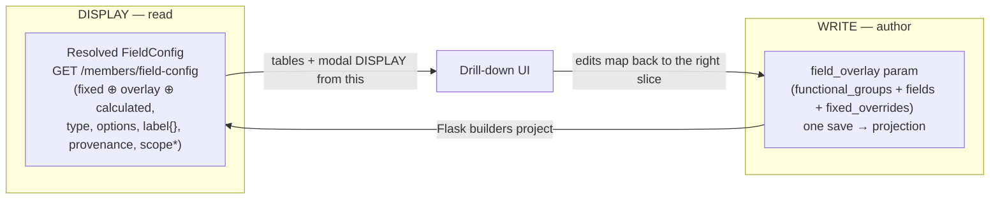

# Design — Members config drill-down remediation

> **Status: DESIGN.** Implements this folder's `requirements.md`. Remediates the drill-down built in
> `Parameter redesign/phase-3-reshape-model-and-ui/` (tasks 4.x). Grounded in a VERIFIED server-truth
> pass (§Server truth) so every task is written against what the server actually does, not against
> assumptions — the mistake that caused these defects in the first place.

## 0. Applicable steering

- **`40-spec-workflow.md`** — this spec's own workflow (requirements → design → tasks); governance
  definition-of-done: steering a change touches MUST be updated in the same change. This spec
  **rewrites `38` rule 6** (the i18n-label guardrail) to match the stored-config label model (R4.5) —
  it is NOT deferred, because an `inclusion: auto` guardrail out of sync with the code would steer the
  next module (Events/Webshop) back into the unsustainable resource-key choice.
- **`38-sam-module-field-config.md`** — the authoring model the drill-down conforms to: catalog-first,
  group → field → attribute, derived order, ONE authoring surface / one save → one re-projection. The
  remediation keeps all of these AND **rewrites rule 6** (the i18n-label guardrail) from "Option (b)
  resource keys" to "tenant labels are plain per-language values stored in config, resolved at runtime;
  shipped resource files are a seed/default for base fields only" — matching R4 (and reality). This is
  a guardrail that steers the next modules, so it is fixed here, not deferred.
- **`35-sam-module-architecture-sam.md`** — the SAM read-side change (populate+serialize
  `ResolvedField.scope`) is a domain/serializer change inside the four seams; the scope RESOLVER edge
  (`handler/app.py`) stays byte-for-byte (R3.8).
- **`36-config-and-parameters.md`** — ONE writer (MySQL `parameters`, Option B) → one-directional
  projection → SAM reads. The `_map_fixed_override` builder fix (R5) and the scope-vocabulary change
  (R3) keep schema + validator + builder + reader moving together (rule 1).
- **`32-frontend-ui.md` + `33-frontend-testing.md`** — the drill-down table/modal/row-click/i18n/a11y
  conventions and Vitest/RTL; Change-With-Tests on every edit.
- **`30-backend-api-flask-mysql.md` + `31-backend-database-flask-mysql.md`** — the Flask builder/
  validator are service-layer; no config-row migration expected (if one is needed it is `31`-compliant).
- **`34-backend-testing.md`** — the SAM/Flask test edits; the catalog drift guard stays green.
- **`43-cicd-deploys.md`** — ship; **`41-shell-environment.md`** — WSL/POSIX, `<<<DONE marker=$?>>>`.

## Server truth (VERIFIED — the baseline for every task)

Read end-to-end: `field_resolver.py`, `_membership_catalog._serialize_field`,
`_projection_config_builders.py`, `members_parameters.json`, the h-dcn seed.

`GET /members/field-config` serves a RESOLVED `FieldConfig` (fixed ⊕ overlay ⊕ calculated). Per-field
keys ALWAYS served: `key`, `group`, `type`, `required`, `label{nl,en}`, `visible`, `read_only`,
`order`, `origin`, `provenance`, `functional_group`, `options`. Conditionally: `show_when`,
`member_number_format`. NEVER served: `scope`, a standalone `choices` key (enum values are ALWAYS under
`options` — rich `{value,label,roles?}` OR a bare string list). Top-level: `fields`, `by_group`,
`functional_groups`, `dimensions` (enabled scope dims incl. region's 10 values), `membership_type_options`,
`default_page_size`, `lifecycle`, `mail_enabled`, `config_status`.

| Attribute | Served (resolved)? | Flask-authorable? | Notes |
|---|---|---|---|
| label | ✅ `label{nl,en}` plain dict | ✅ flat `label_en`/`label_nl` → folded to `label{}` | NO resource-key indirection on the server |
| type | ✅ | ✅ (string/date/enum/reference) | |
| enum values | ✅ **as `options` only** (no `choices` key) | partial — bare `choices` on fields; **dropped on fixed_overrides** (I-9) | region's values come from `scope_vocab` (wired at the handler) |
| scope | ❌ **DEAD on read** (not on `ResolvedField`, never serialized) | ✅ authorable + builder DERIVES `config#scope` (`_scope_dimensions_from_overlay`) | write path complete; read path missing (I-6) |
| functional_group | ✅ | ✅ | |
| member_number_format | ✅ served | ❌ not in schema; dropped by builder | deferred (I-7b) |
| provenance | ✅ derived+served | n/a | |

**Implications baked into this design:** Cluster A is SPA-only (the server already serves everything).
Scope needs a small SAM read-side wire (R3.5) because the WRITE path is already built. Labels need no
server change — only the SPA must stop using the resource-key resolver (R4).

## Architecture — the two data roles

The root cause of the whole I-3 family: the drill-down conflated the **write model** (raw
`field_overlay`, tenant deltas) with the **display model** (resolved `FieldConfig`, full set).

- **Display:** groups table, fields table, and the field modal's initial values come from the resolved
  `FieldConfig`. The full field set, correct `type`, enum `options`, `label{}`, `provenance`, and
  (after R3.5) `scope` all come from here.
- **Write:** a modal edit maps to the right overlay slice: a **tenant-added** field → `fields[key]`; a
  **fixed/calculated** field edit (relabel / reorder / hide / enum options / scope / move group) →
  `fixed_overrides[dottedKey]`; a **calculated** field is read-only. The single-save contract
  (`overlayModel` → one `saveMembersParameter`) is UNCHANGED — only the WRITE TARGET per field becomes
  provenance/origin-dependent.

### Predefined fields are always-present "seeded" items (confirmed decision)

Fixed + calculated fields are **platform-shipped and ALWAYS part of the resolved config** for every
tenant (the resolver merges `fixed base ⊕ overlay ⊕ calculated` unconditionally). They are NOT opt-in
and are NOT created by the tenant:
- A tenant **cannot add or delete** a fixed or calculated field. "Add field" in a group creates ONLY a
  tenant **variable** field (string/number/boolean/date/enum/reference). A **calculated** field is
  executable derivation logic (a code-defined entry in `calculated_fields.py`), so authoring one is a
  PLATFORM change, never tenant config (avoids a formula engine / per-tenant code — `35`/`36`).
- What the tenant DOES control for a predefined field is **presentation**: its `functional_group`
  (placement), `label`, `order`, and **`visible`** (show/hide) — via a `fixed_overrides` entry. A
  calculated field additionally is value/type/inputs read-only.
- **UX consequence (confirmed with the user):** every predefined field simply APPEARS in the
  drill-down (seeded-in), read-only where appropriate; the tenant enables/places it via the visible
  toggle + group, rather than adding it from a catalog picker. No "add predefined field from catalog"
  feature is built — it is unnecessary because the fields are already present.

## Components and the per-cluster change

### Cluster A — display from the resolved config (R1, R2, R4) — SPA only

- Add a **resolved-config read layer** the tables use: group list + per-group field list derived from
  the resolved `FieldConfig` (reuse the existing `groupResolvedFields` / `orderResolvedFields` service
  helpers — they already bucket the resolved config correctly; this is what the SUPERSEDED read-only
  hierarchy used). `overlayModel` stays as the WRITE model (mutations), not the display source.
- `MembersGroupsTable` / `MembersFieldsTable`: display from the resolved config; `groupFieldCount` for
  the delete-guard counts RESOLVED fields (R1.3).
- `MembersFieldModal.formFromField`: seed from the RESOLVED field — `type` from `field.type` (no
  silent `string` default, R2.2), enum vocabulary from `options` (not `choices`, R2.1), label from
  `label{}`.
- **Label resolution (R4):** drop `useMembersLabels`/`resolveShippedLabel`/`LABEL_KEY_SCHEME` as the
  resolution authority in the drill-down; use a plain `label[lang] ?? label.en ?? label.nl ?? key`
  helper over the served `label{}`. (The resolver service functions may remain for the seed/default
  use but are not the drill-down's label source.)
- Write-back: on save, map the field to its overlay slice by origin/provenance (added → `fields`;
  base/base_overridden → `fixed_overrides`). `overlayModel` gains an origin-aware
  create/edit that targets the right slice.

### Cluster B — scope as an editable field attribute + the builder gap (R3, R5)

**Single-vocabulary rule (the heart of R3):** the scope values ARE the field's enum values. ONE editor
(the field's enum-values editor). The scope section is just `enabled` + `required_for`; no separate
values list; the stored `scope` is `{enabled, required_for}` (drop `values`).

- **SAM read wire (R3.5):** `field_resolver._apply_override` / `_as_variable_field` populate
  `ResolvedField.scope` (add the field to `ResolvedField`) from `override.scope` / `of.scope`;
  `_serialize_field` emits a `scope` key `{enabled, required_for}`. Fix the misleading docstrings
  ("carried verbatim" → actually carried). Resolver edge (`handler/app.py`) UNCHANGED (R3.8).
- **Flask vocabulary change (R3.4):** `_scope_dimensions_from_overlay` derives the dimension `values`
  from the field's ENUM VALUES (`choices`/`options[].value`) when `scope.enabled`, not from
  `scope.values`. `members_parameters.json` scope object drops `values`; `_validate_field_scope`
  requires an enum-with-values when scope enabled (legacy `scope.values` honoured as fallback only).
- **Frontend type (R3.6):** add `scope?: { enabled?: boolean; required_for?: string[] }` to
  `FieldConfigField`.
- **Modal (R3.1/R3.2):** scope section = enabled toggle + required_for; the enum-values editor is the
  single vocabulary; enabling scope does not spawn a second list.
- **I-9 builder (R5):** `_map_fixed_override` carries `options`/`choices` and `scope` through to
  `config#fields` (member_number_format deferred, R5.2), preserving presentation-only invariants.

### Cluster C — move-to-group persistence (R6)

- `functional_group` single source of truth: the field's stored value, read live from the working
  overlay. `MembersFieldModal.buildField` STOPS hardcoding `functional_group: groupKey`; it leaves the
  field's current group untouched unless the user changed it in the modal.
- The move action remains the mutator; after a move the modal reflects the new group (or is closed).

## Correctness properties

- **P1 — Display completeness:** for any tenant, the set of fields shown in the drill-down equals the
  resolved `FieldConfig` field set (not a subset). *(R1)*
- **P2 — Scope round-trip:** for any scope-backed field, editing the enum values and saving yields a
  `config#scope` whose dimension `values` equal the field's enum values, and the resolved field's
  enum options equal them too. *(R3.7)*
- **P3 — Scope resolution invariance:** for the same tenant/grants, `allowed_scopes` is unchanged by
  this remediation (resolver edge untouched; the derived `config#scope` is semantically equivalent to
  before for an unchanged vocabulary). *(R3.8)*
- **P4 — Move persistence:** moving a field to group G and saving yields a field whose
  `functional_group == G` in the committed overlay and the re-resolved config. *(R6.3)*
- **P5 — Member-data invariance:** no step reads/writes `sam-members`. *(R8.1)*

## Testing strategy

- **SPA (Vitest/RTL):** groups/fields tables display the resolved config (fixed+calculated+added);
  `status` shows enum + 6 options; `region` shows its scope-sourced values; labels resolve from
  `label{}` with the language selector; scope section (enabled + required_for, single enum-vocabulary);
  move-to-group persists through save; single-save path intact.
- **SAM (pytest):** `ResolvedField.scope` populated + serialized (`test_field_resolver.py`,
  `test_members_resolved_field_surface.py`); `test_scope_access.py` asserts unchanged `allowed_scopes`
  (P3); the scope round-trip (P2) over resolve.
- **Flask (pytest):** `_scope_dimensions_from_overlay` derives values from enum values;
  `_map_fixed_override` carries options/scope (`test_projection_sync` / builder tests);
  `members_config_validation` scope rule change.
- Catalog drift guard stays green. Member-data invariance (P5) by construction (no member-data path).

## Error handling

- Resolved-config fetch failure → "unavailable" note, never blocks (R1.4).
- Scope: an enabled scope axis on a non-enum / value-less field is a validation error at save
  (R3.4) — fail at authoring, not silently.
- `config#fields`/`config#scope` shape changes move schema + validator + builder + reader together
  (`36` rule 1); no member-data migration.

## Governance definition-of-done

This spec **rewrites steering `38-sam-module-field-config.md` rule 6** (the i18n-label guardrail) to the
stored-config label model, in the same change as the code (R4.5) — a guardrail out of sync with the
code would mis-steer the next module. On completion: confirm `38` rule 6 reads the new model; tick the
remediated issues (I-2, I-3, I-4, I-5, I-6, I-8, I-9) in `review-issues.md`; note in Phase-3 `tasks.md`
that the 4.x shipped-with-defects were remediated here. The follow-up spec carries only I-7a (validation
feature) and I-7b (member-number authoring).
