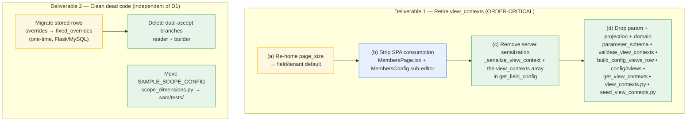

# Phase 2 — Delete the Redundant Surface — Design

> **Status: DESIGN.** Implements this folder's `requirements.md`. Phase 2 of the Members config
> redesign — exactly the two deliverables in `impact-analysis.md` §9: **(6) retire `view_contexts`**
> and **(7) clean dead code** (legacy `overrides` dual-accept + `SAMPLE_SCOPE_CONFIG`). Grounded in
> the current three-plane code:
>
> - **SAM domain:** `sam/members/domain/{view_contexts,seed_view_contexts}.py`,
>   `_membership_writes.py` (`_serialize_view_context` + the `view_contexts` array in
>   `get_field_config`), `field_resolver.py` (`TenantOverlay.overrides` + `_apply_override`),
>   `scope_dimensions.py` (`SAMPLE_SCOPE_CONFIG`).
> - **SAM repository:** `projection_config_reader.py` (`get_view_contexts` + the
>   `fixed_overrides`/`overrides` dual-accept read).
> - **Flask:** `parameter_schema.py` (the `view_contexts` param), `members_config_validation.py`
>   (`validate_view_contexts`), `_projection_config_builders.py` (`build_config_views_row` +
>   `_map_view_context` + the `fixed_overrides`/`overrides` dual-accept), `projection_sync.py`
>   (the `config#views` row assembly + re-exports).
> - **SPA:** `frontend/src/pages/MembersPage.tsx` (`normalizeViewContexts`, `isContextAvailable`,
>   `viewContexts`/`availableContexts`/`selectedContext` machinery) and
>   `frontend/src/components/TenantAdmin/MembersConfig/*` (the view-context sub-editor).
>
> **Design stance:** Phase 2 is *subtractive and order-critical*. Nothing server-side acts on
> view-context CONTENTS (`impact-analysis.md` §1.1 — "the frontend renders these; the module
> enforces nothing off them"), so the deletion carries **no runtime behaviour change** — only the
> field-config *response* loses an inert array, and one tenant-level default (`page_size`) must be
> re-homed before its carrier is removed. The whole risk is **sequencing**: the SPA must stop
> READING `view_contexts` before the server stops SERVING it, or the field-config contract breaks
> mid-rollout (`impact-analysis.md` §6.1 — "Reverse order breaks the field-config contract").

## Overview

Phase 2 ships exactly two deliverables from `impact-analysis.md` §9: **(6) retire `view_contexts`**
across all three planes (SPA, SAM, Flask) after re-homing its one live default (`page_size`) to a
tenant-level `default_page_size`, and **(7) clean dead code** (the legacy `overrides` dual-accept plus
the `SAMPLE_SCOPE_CONFIG` fixture). The change is *subtractive* — no server-side logic acts on
view-context contents, so the deletion carries no runtime behaviour change beyond the field-config
response losing an inert array. The whole risk is **sequencing**: within Deliverable 1 the four steps
(a)→(b)→(c)→(d) are a strict, order-critical chain so the SPA always stops READING `view_contexts`
before the server stops SERVING it; the two deliverables are otherwise independent of each other.

## 0. Applicable steering & reusable patterns (per `40-spec-workflow.md` → "Writing Design")

The spec workflow requires the design to name the platform conventions each plane conforms to. Phase 2
touches all three planes plus a one-time MySQL migration and a ship step; this section binds the
governing steering to the step that uses it (mirroring Phase 1's design §0). Each later section that
touches a plane repeats the one or two files it conforms to inline.

- **`40-spec-workflow.md` — governs this spec itself.** Design-first path (design → requirements →
  tasks); the Change-With-Tests contract; the definition-of-done ("a step isn't done until the
  steering it changes is updated"). Phase 2 updates no steering (it is a deletion inside the model
  `38` already codifies), so the DoD close-out (§10 task group) records "no steering change due" with
  evidence, not a bare tick.
- **`36-config-and-parameters.md` + `38-sam-module-field-config.md` — the heart of Phase 2.** `38`
  rule 3 ("no standalone view/analytics param objects — columns/sort/filter/pagination are runtime
  behaviours of the generic table + per-user prefs, not stored config") is the rule this phase
  *enforces* against the live code: `view_contexts` is exactly the standalone view-param object `38`
  says must not exist. `36` governs the retirement mechanics: MySQL `parameters` is the single writer
  (Option B, unchanged); removing a param means removing it from the schema, the validator, the
  projection builder, AND the reader in one coherent change (rule 1 — no half-removed config surface);
  the removal is *data/config shape*, not strategy (rule 2). Retiring a projection row (`config#views`)
  is a `36` projection-layer edit.
- **`35-sam-module-architecture-sam.md` — governs the SAM-plane deletions (steps c/d).** The
  view-context model + reader + serializer are the storage-agnostic **domain** / **repository**
  seams; removing them keeps the four-seam layering intact (handler edge unchanged, domain shrinks,
  repository loses one reader method). The `TenantOverlay.overrides` / `_apply_override` field model is
  domain-owned; `SAMPLE_SCOPE_CONFIG` is a domain fixture that belongs in `sam/tests/` (35's
  "fixtures live with tests" + Decision D16/D17 "no tenant vocabulary in the domain").
- **`34-backend-testing.md` — governs the SAM + Flask test edits.** Test naming
  (`test_{unit}_{scenario}_{expected}`), `mock_db`/`mock_env` isolation, directory placement
  (`sam/tests/`, `backend/tests/unit/`). The Change-With-Tests contract (`30` §"Change-With-Tests")
  applies to every behavioural edit here — the §7 blast-radius list is the allocated-test map.
- **`32-frontend-ui.md` + `33-frontend-testing.md` — govern the SPA strip (step b).** Removing the
  context dropdown + sub-editor, keeping the generic `useFilterableTable` toolkit (the thing users
  rate TOP). Vitest + RTL test edits per `33`; the Change-With-Tests contract (`32`) applies.
- **`30-backend-api-flask-mysql.md` + `31-backend-database-flask-mysql.md` — govern the Flask param
  removal + the one-time `overrides → fixed_overrides` row migration.** `30`: the param lives in the
  Flask parameter plane; its validator and projection builder are service-layer code; the
  Change-With-Tests contract is `30`'s own rule. `31`: the row migration is a MySQL migration — a JSON
  (or `.py`) file under `backend/src/migrations/`, applied by `DatabaseMigration.run_all_migrations()`
  (NOT auto-applied), parameterized queries, `administration`-scoped, tenant data treated as the
  owner's (rewrite the KEY NAME inside stored JSON, never the member data).
- **`43-cicd-deploys.md` — governs ship.** Branch → env flow, feature branch → PR into `test` →
  promote `test → main` by merge commit; the deploy workflows (`deploy-sam-members.yml`,
  `deploy-frontend.yml`, the Flask/backend path); the DATA-account-only rule; preview the prod
  changeset for unexpected replacements.
- **`41-shell-environment.md` — governs every command.** WSL/POSIX paths, inline `cd`, the
  `<<<DONE marker=$?>>>` success marker, `backend/.venv`, no foreground long-runners.

> **Not applicable this phase (recorded so the omission is deliberate):** `37-shared-building-blocks.md`
> (no new/changed shared block — the generic filter table STAYS, we only stop feeding it stored
> contexts); PBT guidance beyond the existing property suite (Phase 2 adds no new universal property —
> it DELETES surface and RE-HOMES one default; the roundtrip props that remain are *regression locks*,
> covered in §8).

## 1. Prerequisites (given — do not re-verify or re-open)

Phase 2 builds directly on completed work. These are **stated as given**; the design does not
re-verify them and no Phase 2 task re-opens them:

- **Phase 0 (reliability fixes) — DONE** (`impact-analysis.md` §9, PR #89): the
  `CALCULATED_FIELD_KEYS` drift fix, the version-bump-trap fix (per-param revision so edits always
  project), and the read-side delivered/loaded status. Phase 2 relies on the version machinery being
  correct — removing the `config#views` row and the `view_contexts` param will project cleanly because
  the per-param revision already works.
- **Phase 1 (catalog backbone) — DONE** (`phase-1-catalog-backbone/`): the canonical attribute
  catalog, the base functional-group set, the i18n label model (Option b), `BASE_FUNCTIONAL_GROUPS`,
  the drift guard. Phase 2 does NOT touch the catalog; it removes a sibling surface the catalog never
  depended on.

Config home is settled = **Option B** (Flask authors; SAM reads a first-class projection; steering 36
unchanged). Phase 2 is therefore a *symmetric* removal across the Flask writer and the SAM reader — not
a config-home change.

**Explicitly NOT in Phase 2 (deferred to Phase 3, `impact-analysis.md` §9 steps 8–11):** collapsing
fixed/overlay into one list + provenance badge, folding scope-binding into a field attribute, folding
analytics into field attributes/calculated fields, and rebuilding the group → field → attribute UI.
Phase 2 touches the `overrides`/`fixed_overrides` KEY only to delete the legacy dual-accept — it does
NOT collapse the fixed/overlay model (that is Phase 3 step 8).

## Architecture

*The two deliverables and the planes they cross.*



**The two deliverables are independent of each other** (D2 does not depend on D1 and vice-versa), so
they can land in either order or in parallel. **Within D1 the four steps are a strict chain** (a → b →
c → d) — this is the entire risk of the phase and §3 explains why.

### Plane summary

| Step | Plane(s) | Steering |
|------|----------|----------|
| 1(a) re-home `page_size` | Flask (default) + SAM/SPA (read) | `36`, `38`, `30`, `32` |
| 1(b) strip SPA consumption | SPA | `32`, `33` |
| 1(c) remove server serialization | SAM domain | `35`, `34` |
| 1(d) drop param + projection + domain | SAM domain + repo, Flask service | `36`, `38`, `30`, `35`, `34` |
| 2 migrate rows + drop dual-accept | Flask/MySQL migration + Flask builder + SAM reader | `31`, `30`, `35`, `36` |
| 2 move `SAMPLE_SCOPE_CONFIG` | SAM domain → tests | `35`, `34` |

## 3. The ordering contract (the hard part — `impact-analysis.md` §6.1)

`view_contexts` is deleted in a **fixed sequence** because the field-config response is a live
contract between the SAM module (server) and the SPA (client). The invariant to preserve across the
entire rollout:

> **At no point may a deployed SPA READ a `view_contexts` field that a deployed server has stopped
> SERVING, nor may a deployed server stop serving a default (`page_size`) the SPA still needs.**

Because the SPA and the SAM module deploy as **separate artifacts** (`deploy-frontend.yml` vs
`deploy-sam-members.yml`, `43-cicd-deploys.md`), there is a window where one is new and the other is
old. The sequence is engineered so that window is always safe:

```mermaid
sequenceDiagram
    participant SPA as SPA (frontend)
    participant SAM as SAM module (/members/field-config)
    Note over SPA,SAM: START — both read/serve view_contexts
    rect rgb(255,247,224)
    Note over SAM: Step (a) page_size re-homed to a field/tenant default,<br/>served ALONGSIDE view_contexts (additive, both present)
    end
    rect rgb(232,240,254)
    Note over SPA: Step (b) SPA stops reading view_contexts;<br/>reads page_size from the new home. Deploy FIRST.
    end
    Note over SPA,SAM: SAFE WINDOW — server still serves view_contexts (inert),<br/>new SPA ignores it. Old SPA (pre-(b)) still works.
    rect rgb(230,244,234)
    Note over SAM: Step (c) server stops serializing view_contexts<br/>(array removed from the response)
    end
    Note over SPA,SAM: Only reached once EVERY SPA is past (b)
    rect rgb(230,244,234)
    Note over SAM: Step (d) param + projection + domain deleted
    end
    Note over SPA,SAM: END — surface gone on every plane
```

Why each edge is forced:

1. **(a) before (b):** the SPA cannot stop reading `view_contexts` for pagination until `page_size`
   has somewhere else to come from. (a) adds the new home ADDITIVELY (both the new default and the old
   `view_contexts` array are served at once), so (a) alone breaks nothing.
2. **(b) before (c):** the SPA must stop reading `view_contexts` **before** the server stops serving
   it. If (c) shipped first, a not-yet-updated SPA would read `undefined` for `view_contexts` and its
   `normalizeViewContexts`/`availableContexts` machinery would have to fall back — tolerable because
   the code already synthesizes a default, but the point is to make the removal *provably* safe: after
   (b) ships to every client, NO client reads the field, so (c) is a no-op for clients.
3. **(c) before (d):** the server stops *emitting* the array before the data behind it (param,
   projection row, domain provider) is deleted, so there is never a code path that tries to serialize
   from a now-missing provider.

The **backward-compat window** is the gap between (b) and (c): the server still serves the (now inert)
`view_contexts` array, and the new SPA simply ignores it. This window may be as long as needed to be
confident every client has the (b) build; it carries no risk because the array is already
server-inert. The task graph (§ tasks) encodes (a)→(b)→(c)→(d) as hard wave dependencies so a later
step cannot be scheduled before its predecessor.

> **Deployment note (not a member-data migration).** None of (a)–(d) migrates member records. (a)
> introduces a config default; (d) removes config surface. The ONLY data migration in Phase 2 is
> Deliverable 2's one-time `overrides → fixed_overrides` key rename on stored *config* rows (§6).

## Data Models

*Deliverable 1, step (a) — where `page_size`/pagination lives post-retirement: the `default_page_size`
shape and the field-config contract change.*

**Conforms to `36-config-and-parameters.md`, `38-sam-module-field-config.md` rule 3, `30`, `32`.**

### Decision: `page_size` becomes a tenant-level field-config default, with a per-user preference override; it is NOT a stored view object

`38` rule 3 is explicit: pagination is a *runtime behaviour of the generic table + per-user prefs*,
not stored view config. So `view_contexts.page_size` does not migrate to another stored config
object — it collapses to the smallest thing that preserves current behaviour:

| Concern | Today (`view_contexts`) | Phase 2 home |
|---------|------------------------|--------------|
| Default rows-per-page for the Members table | each context's `page_size` (25/50) | **a single tenant-level default** served on the field-config response as `default_page_size` (one scalar), falling back to a platform constant when unset |
| Per-view override | different `page_size` per context | **gone** — there is one table, not N contexts; a user who wants a different page size uses the per-user preference |
| User's own choice | not persisted | the existing per-user **column/table preference** mechanism (`sam/members/domain/column_preferences.py`) carries an optional `page_size` the user picks; absent → the tenant default |

Rationale and scope:

- **One scalar, not an object.** The served contract gains ONE optional field — `default_page_size:
  int | null` — alongside the existing field-config payload. This is strictly additive in step (a)
  (served while `view_contexts` is still present), so an old SPA ignores it and the new SPA reads it.
  This satisfies the "nothing is lost when `view_contexts` goes" requirement with the minimum surface.
- **Where the default is authored.** It is a tenant default, so it rides the Members config the tenant
  already authors (Flask `parameters`, Option B) — the design settles it as a top-level
  `members`-namespace scalar (`members.default_page_size`) OR, equivalently, a field on the existing
  config#fields-adjacent payload; the requirement is that it is a **tenant/field default**, not a view
  object. The exact carrier (standalone `members.default_page_size` param vs a key on an existing
  config row) is a small design detail settled in the design task; both satisfy `38` rule 3. The
  recommendation is a standalone `members.default_page_size` scalar param, because it is the clearest
  "this is a default, not a view" signal and the simplest to validate (a positive int).
- **Platform fallback.** When neither the user preference nor the tenant default is set, the renderer
  uses the existing table toolkit default (the `useFilterableTable` page-size default) — the same
  "renderer applies its own default" behaviour `view_contexts.page_size == None` has today. So an
  unconfigured tenant is unchanged.
- **No per-context page size survives**, by design — there is one Members table after the context
  dropdown is removed (step b), so N page sizes have no meaning. This is a deliberate behaviour
  simplification the requirements call out, not an accident.

### What the SPA reads after (a)+(b)

`MembersPage.tsx`'s pagination reads, in precedence order: `userPreference.pageSize ?? fieldConfig.default_page_size ?? TABLE_DEFAULT_PAGE_SIZE`. No `view_contexts` lookup remains.

## Components and Interfaces

*Deliverable 1, steps (b)–(d) — the deletions, plane by plane: the component/interface changes on each
plane.*

### Step (b) — strip SPA consumption (`32-frontend-ui.md`, `33-frontend-testing.md`)

Remove everything in the SPA that reads or edits view contexts; KEEP the generic filter/sort/paginate
table (the TOP-rated surface — `impact-analysis.md` §10):

- **`frontend/src/pages/MembersPage.tsx`:** delete `normalizeViewContexts`, `isContextAvailable`, the
  `viewContexts` / `availableContexts` / `selectedContext` / `selectedContextKey` memos and the state,
  the context `<Select>` dropdown (the `aria-label={t('viewContext.label')}` control at ~L848), and
  the `ViewContext` import. The table now renders over `FieldConfig.visible_fields()` directly
  (exactly what the `__default__` empty-`columns` context expanded to today — so the *default*
  behaviour is preserved, only the dropdown that let a user pick a narrower context is removed). Column
  visibility/filtering continues through the existing per-user column preferences + the generic
  toolkit.
- **`frontend/src/components/TenantAdmin/MembersConfig/`:** remove the view-context sub-editor
  (the `MembersConfigEditor.tsx` sub-section that edits the `view_contexts` list, and any dedicated
  context editor component/import). The typed Members config editor keeps every other sub-editor
  (fields, overrides, functional groups, scope, mail, analytics, status).
- **Types:** remove `ViewContext` and the `view_contexts` field from `FieldConfig` in
  `frontend/src/types/members.ts`; add the optional `default_page_size` field read in (a).
- **i18n:** remove the now-dead `viewContext.*` keys from the `members`/`admin` resource files.

Change-With-Tests (`32`): the paired SPA tests move with the behaviour — see §7.

### Step (c) — remove server serialization (`35-sam-module-architecture-sam.md`, `34-backend-testing.md`)

In `sam/members/domain/_membership_writes.py` → `get_field_config`:

- Delete the `"view_contexts": [ self._serialize_view_context(vc) for vc in
  self._view_contexts_provider.get_view_contexts(tenant_id) ]` entry from the response dict (~L997).
- Delete the `_serialize_view_context` static method (~L1178).
- Delete the `_view_contexts_provider` dependency on the service and its wiring (constructor
  parameter + the handler/app wiring that injects `MembersProjectionReader` as the provider).
- Add the `default_page_size` scalar to the response (the step-(a) home), read from the tenant config.
- Remove the `from sam.members.domain.view_contexts import ViewContext` import once (d) deletes the
  module (ordering: the import can stay until (d); the serializer method is removed in (c)).

This is where the response contract changes: the `view_contexts` array is gone. Because step (b)
already shipped to every client, no client reads it — the regression lock on the resolved-field
surface (`test_members_resolved_field_surface.py`) is updated to assert the key is ABSENT and that
`default_page_size` is present.

### Step (d) — drop the param, projection, and domain (`36`, `38`, `35`, `30`, `34`)

Symmetric removal across the writer (Flask) and reader (SAM), per `36` rule 1 (no half-removed config):

**Flask (writer side):**
- `backend/src/services/parameter_schema.py` — delete the `view_contexts` param block (~L313).
- `backend/src/services/members_config_validation.py` — delete `validate_view_contexts` and its
  dispatch branch (the `key == "view_contexts"` case in `validate_members_param`), and the
  `view_contexts` entry from `__all__`.
- `backend/src/services/_projection_config_builders.py` — delete `build_config_views_row`,
  `_map_view_context`, `_VIEW_CONTEXTS_PARAM_KEY`, `_VIEW_CONTEXT_DEFAULTS`, and their `__all__`
  entries.
- `backend/src/services/projection_sync.py` — delete the `config_views = build_config_views_row(...)`
  assembly + its `items.append`, the `build_config_views_row` import and re-export.
- `backend/src/services/projection_schema.py` — remove the `config#views` record-type doc/entry
  (`RECORD_TYPE_CONFIG` `config#views`).

**SAM (reader + domain side):**
- `sam/members/repository/projection_config_reader.py` — delete `get_view_contexts`,
  `_build_view_context`, `_CONFIG_ID_VIEWS`, and the `ViewContext`/`default_view_context` import.
- `sam/members/domain/view_contexts.py` — **delete the whole file** (`ViewContext`,
  `ViewContextsProvider`, `StaticViewContextsProvider`, `default_view_context`, `DEFAULT_CONTEXT_KEY`).
- `sam/members/domain/seed_view_contexts.py` — **delete the whole file** (`SEED_VIEW_CONTEXTS`,
  `seed_view_contexts_list`, `build_seed_view_contexts`).
- Any provider wiring in `handler/app.py` that constructed/injected a view-contexts provider.

After (d) there is NO `view_contexts` symbol anywhere in product code — a repo-wide grep is the
close-out check (§8).

## 6. Deliverable 2 — clean dead code

### 6.1 Legacy `overrides` dual-accept — one-time row migration, then delete the branches

**Conforms to `31-backend-database-flask-mysql.md` (migration), `30`, `36`, `35`.**

Two read sites accept BOTH keys today (the authored/validated key is `fixed_overrides`; a legacy
`overrides` key is honoured as a fallback):

- Flask builder: `_projection_config_builders.py` — `raw_overrides = raw_overlay.get("fixed_overrides")
  … fall back to raw_overlay.get("overrides")`.
- SAM reader: `projection_config_reader.py` — `raw_overrides = row.get("fixed_overrides") or
  row.get("overrides") or {}`.

> **Scope guard (important):** the dual-accept being removed is only on the **input key name** read
> from the stored overlay (`fixed_overrides` vs the legacy `overrides`). The SAM-domain
> `TenantOverlay.overrides` ATTRIBUTE and the `config#fields` row's `overrides` attribute name
> downstream of the read are a SEPARATE internal naming and stay unchanged — Phase 2 does NOT rename
> the dataclass field or the projected attribute (that would be churn with no payoff and risks the
> fixed/overlay model that Phase 3 reshapes). We delete the *acceptance of the legacy input key*, not
> the internal `overrides` name.

Order (per `31` + `36` rule 1 — never leave a half-removed read path):

1. **One-time migration FIRST** (`31`): a migration under `backend/src/migrations/` rewrites every
   stored `members.field_overlay` config row whose overlay JSON carries a legacy top-level `overrides`
   key so the data lives under `fixed_overrides` instead (merging into any existing `fixed_overrides`;
   on a key collision the canonical `fixed_overrides` entry WINS, since that is the authored key the
   validator enforces). Mechanics:
   - A `.py` migration (like `migrate_tenant_config_to_parameters.py`) reading the `parameters` table
     via `DatabaseManager` + `ParameterService`, `administration`-scoped, parameterized queries,
     `--dry-run` default, idempotent (re-running after the rename is a no-op because no row still
     carries a top-level `overrides`). It rewrites the KEY NAME inside the stored JSON only — it never
     touches member records, and it treats the override VALUES as the owner's data (copied verbatim).
   - Applied manually via `DatabaseMigration.run_all_migrations()` (NOT auto-applied on startup, `31`).
     It runs against TEST (local Docker) then PRODUCTION (Railway) via the `backend/scripts/railway-db.sh`
     wrapper (`41`/`#database` skill) — operational, out of the spec's code surface but called out in
     the ship tasks.
2. **Then delete the dual-accept branches** in BOTH the Flask builder and the SAM reader, leaving only
   `fixed_overrides`. Because step 1 migrated every stored row, no production row still relies on the
   legacy key when the branches go.

### 6.2 `SAMPLE_SCOPE_CONFIG` → tests

**Conforms to `35-sam-module-architecture-sam.md` (fixtures live with tests; no tenant vocabulary in
the domain — Decision D16/D17), `34`.**

`SAMPLE_SCOPE_CONFIG` (North/South/East/West region dimension) is a synthetic fixture, never a runtime
fallback (`impact-analysis.md` §1.3, D16). It currently lives in
`sam/members/domain/scope_dimensions.py` but is imported only by tests + the parity harness:
`test_scope_normalization_verify.py`, `test_scope_access.py`, `test_scope_dimensions.py`,
`sam/tests/conftest.py`, `members_parity_harness.py`.

Move it into the test tree — a shared fixtures module under `sam/tests/` (e.g.
`sam/tests/_scope_fixtures.py`) that defines `SAMPLE_SCOPE_CONFIG` and is imported by the five
consumers — and delete it from `scope_dimensions.py` (+ its `__all__` entry + the docstring references
that frame it as a domain-provided sample). The scope MODEL (`ScopeDimension`, `ScopeConfig`,
`WILDCARD`, the providers) stays in the domain; only the sample DATA moves. This is a pure relocation —
no behaviour change — so the five importers switch their import path and nothing else changes.

> Note: `scope_dimensions.py` is also mirrored under `sam/members/.aws-sam/build/MembersLayer/python/…`
> — that is a BUILD ARTIFACT (regenerated by `sam build`); it is not edited by hand and is rebuilt on
> deploy. The move touches the source file only.

## 7. Test blast radius (`impact-analysis.md` §7) — the allocated-test map (Change-With-Tests)

Per the Change-With-Tests contract (`30`/`32`/`34`), every behavioural edit updates its paired test in
the SAME change. The map:

**Delete / rewrite (surface removed):**
| Test | Action | Why |
|------|--------|-----|
| `sam/tests/test_seed_view_contexts.py` | **delete** | its subject (`seed_view_contexts.py`) is deleted (step d) |
| `sam/tests/test_config_roundtrip_props.py` | **rewrite** — drop the view-context roundtrip assertions; keep the fields/scope/overrides roundtrips | the `config#views` roundtrip no longer exists (step d) |
| `frontend/.../MembersPage.viewContexts.test.tsx` | **delete** | the context dropdown/selection behaviour it covers is removed (step b) |
| MembersConfig view-context tests (within `MembersConfig/__tests__/MembersConfigEditor.test.tsx`) | **rewrite** — remove the view-context sub-editor cases; keep the other sub-editor cases | the sub-editor is removed (step b) |

**Update (behaviour changed, surface stays):**
| Test | Action | Why |
|------|--------|-----|
| `backend/tests/.../test_projection_sync.py` | drop `build_config_views_row` cases + the `config#views` row assertions; assert the item is no longer emitted | step (d) Flask |
| `backend/tests/.../test_parameter_schema.py` | assert the `members` namespace NO LONGER contains `view_contexts` | step (d) Flask |
| `backend/tests/.../` members_config_validation tests | drop the `validate_view_contexts` cases + the dispatch-branch case | step (d) Flask |
| `sam/tests/test_field_resolver.py` | update any override-resolution case that relied on the legacy `overrides` input key to use `fixed_overrides` (resolution behaviour unchanged) | Deliverable 2 |
| `sam/tests/test_members_resolved_field_surface.py` | assert `view_contexts` is ABSENT from the served field-config and `default_page_size` is PRESENT | steps (a)/(c) |
| `sam/tests/test_scope_normalization_verify.py`, `test_scope_access.py`, `test_scope_dimensions.py`, `conftest.py`, `members_parity_harness.py` | switch the `SAMPLE_SCOPE_CONFIG` import from `sam.members.domain.scope_dimensions` to the new `sam/tests/` fixtures module | §6.2 relocation |

**New:**
| Test | Covers |
|------|--------|
| `page_size` re-home test (SAM + SPA) | tenant default + user-pref precedence `userPref ?? tenantDefault ?? platformDefault`; absent config → platform default (unchanged behaviour) |
| one-time migration test (`backend/tests/`) | a stored overlay with legacy `overrides` is rewritten to `fixed_overrides`; `fixed_overrides` wins on collision; idempotent re-run is a no-op; member records untouched |

**Keep unchanged (per `impact-analysis.md` §7):** `test_calculated_fields.py`,
`test_scope_access.py`/`test_scope_dimensions.py` (logic, only the import path changes),
`test_members_projection_reader.py` (minus the views cases), `test_empty_is_valid_props.py`,
`test_members_resolved_field_surface.py` (except the two assertions above).

> **Contradiction guard (`30` Change-With-Tests rule 3):** if, during the edit, two tests end up
> asserting opposite things about `view_contexts` (one that it is served, one that it is absent), STOP
> and reconcile toward the intended new behaviour (absent) — do not weaken an assertion to go green.

## Testing Strategy

**Conforms to `34-backend-testing.md`, `33-frontend-testing.md`.**

- **SAM unit** (`sam/tests/`): the resolved-field-surface regression lock (no `view_contexts`;
  `default_page_size` present); the config-roundtrip props minus the views roundtrip; field-resolver
  override cases on `fixed_overrides`; the scope fixtures import move. Run:
  `cd sam && pytest tests/test_members_resolved_field_surface.py tests/test_field_resolver.py
  tests/test_config_roundtrip_props.py tests/test_scope_dimensions.py tests/test_scope_access.py -q`.
- **Flask unit** (`backend/tests/unit/`): `test_projection_sync` (no `config#views` item),
  `test_parameter_schema` (no `view_contexts` param), members_config_validation (no view validator),
  and the one-time migration test. Run via `backend/.venv` per `41`.
- **SPA** (Vitest + RTL): the Members table renders over `visible_fields()` with no context dropdown;
  pagination honours `userPref ?? default_page_size ?? platformDefault`; the typed config editor
  renders without the view-context sub-editor.
- **Property regression (not new properties):** the remaining config roundtrip props act as a
  regression lock proving the `config#fields` / `config#scope` roundtrips are unchanged by the
  deletion. Phase 2 adds no NEW universal property (it removes surface) — consistent with the PBT
  guidance that a deletion is not a "for all inputs" property; the two NEW tests above are an
  example-based re-home test and an example-based migration test, which is the correct classification.
- **Close-out greps (the deletion is only "done" when the surface is gone):**
  - `grep -rn "view_contexts\|ViewContext\|get_view_contexts\|build_config_views_row\|config#views\|
    _serialize_view_context" sam/members backend/src frontend/src` → zero matches in product code
    (tests may reference removed names only in deletion-assertion form).
  - `grep -rn "\.get(\"overrides\")\|or row.get(\"overrides\")" sam/members backend/src` → zero (the
    dual-accept branches gone).
  - `grep -rn "SAMPLE_SCOPE_CONFIG" sam/members/domain` → zero (moved to tests).
- **Regression:** the full existing SAM + Flask + frontend field-model suites pass with only the §7
  edits.

## Error Handling

Phase 2 is a deletion plus a re-home, so the error surface is modest but real. Four paths matter:

- **Pagination resolver never yields blank/zero.** The precedence `userPreference ??
  default_page_size ?? platformDefault` (§4, D2, Property 1) is *total*: if the user preference and the
  tenant `default_page_size` are both absent, the resolver falls back to the platform table default
  (`useFilterableTable`'s page-size default). It therefore always resolves to a positive integer — an
  unconfigured tenant is unchanged, and no code path renders a blank or zero page size.
- **The one-time migration fails safe.** The `overrides → fixed_overrides` row migration (§6.1, D6/D7)
  is `--dry-run` by default (no write without an explicit apply), idempotent (re-running after the
  rename is a no-op because no row still carries a top-level `overrides`), and never partially rewrites
  a row — each row's overlay JSON is rewritten atomically. On a key collision the canonical
  `fixed_overrides` entry WINS (it is the key the validator enforces); member records and override
  VALUES are copied verbatim and never touched. A parameterized, `administration`-scoped query guards
  the write.
- **Removing the `view_contexts` array is backward-safe in the (b)→(c) window.** During the gap
  between the SPA ceasing to read the field (b) and the server ceasing to serve it (c), the server
  still emits the inert array and the new SPA ignores it; an old (pre-(b)) SPA that still expects the
  field continues to work because the array is still present. The sequencing contract (§3) guarantees
  no deployed client ever reads a field a deployed server has stopped serving.
- **`default_page_size` validation rejects non-positive values.** On the Flask writer plane, the
  `members.default_page_size` validator (per `30`/`36`) rejects a non-positive or non-integer value,
  surfacing a `MembersConfigError` on the authoring path rather than letting an invalid default reach
  the projection — so the resolver's positive-integer guarantee holds at the source as well.

## 9. What explicitly does NOT change in Phase 2

- **Member records / member data** — no migration, no shape change (`impact-analysis.md` §4.2). The
  only data migration is the config-row key rename (§6.1).
- **The fixed/overlay field model** — `TenantOverlay.overrides` (the dataclass field), `_apply_override`,
  and the `config#fields` `overrides` attribute name stay; Phase 2 removes only the legacy *input-key
  acceptance*. Collapsing fixed/overlay is Phase 3 step 8.
- **Scope resolution** — `handler/app.py` scope access, `ScopeDimension`/`ScopeConfig`/`WILDCARD` stay;
  only the synthetic `SAMPLE_SCOPE_CONFIG` fixture relocates to tests.
- **The catalog** (Phase 1) — untouched.
- **The generic filter/sort/paginate table** — stays; it is the TOP-rated surface. Phase 2 removes the
  stored *contexts* that fed it, not the table.
- **Config home / steering 36** — Option B unchanged; no steering file is edited this phase (`38`
  already codifies the "no view param object" rule Phase 2 enforces).

## 10. Design decisions log (for the record)

| # | Decision | Rationale |
|---|----------|-----------|
| D1 | Delete `view_contexts` in the fixed order (a)→(b)→(c)→(d), enforced by task-wave dependencies | the field-config response is a cross-artifact contract; the SPA must stop reading before the server stops serving (`impact-analysis.md` §6.1) |
| D2 | `page_size` re-homes to a tenant-level `default_page_size` scalar + a per-user preference, NOT a stored view object | `38` rule 3 — pagination is runtime behaviour + prefs, not stored view config; preserves current default behaviour with one scalar |
| D3 | Step (a) serves `default_page_size` ADDITIVELY (alongside `view_contexts`) | makes (a) a no-op for old clients, so the only breaking step is (c), reached only after every client is past (b) |
| D4 | Per-context page sizes do NOT survive | after the dropdown is removed there is one Members table; N page sizes have no meaning (deliberate simplification) |
| D5 | Delete the legacy `overrides` INPUT-KEY dual-accept only; keep the internal `TenantOverlay.overrides` / `config#fields.overrides` names | removing the input alias is the dead-code cleanup; renaming the internal field is Phase-3 churn with no payoff and collides with the fixed/overlay reshape |
| D6 | One-time `overrides → fixed_overrides` migration runs BEFORE the dual-accept branches are deleted; `fixed_overrides` wins on collision; idempotent + dry-run default | `36` rule 1 (no half-removed read path) + `31` migration discipline; the canonical key is what the validator enforces |
| D7 | The migration rewrites the stored JSON KEY NAME only, never member records or override VALUES | `31` data-ownership — config-row key rename, not a member-data migration (`impact-analysis.md` §4.2) |
| D8 | `SAMPLE_SCOPE_CONFIG` moves to a `sam/tests/` fixtures module; the scope MODEL stays in the domain | `35` fixtures-with-tests + D16/D17 (no tenant/synthetic vocabulary in the domain); it was never a runtime fallback |
| D9 | No new steering file; `38` already codifies the enforced rule | Phase 2 is enforcement of an existing rule, not a new convention — the DoD close-out records "no steering change due" with evidence |
| D10 | No new universal property; the retained roundtrip props are regression locks; the two new tests are example-based (re-home + migration) | a deletion + a default re-home are not "for all inputs" properties — correct PBT classification (`40-spec-workflow.md` PBT guidance) |

## 11. Traceability (requirement → design section)

| Req | Design |
|-----|--------|
| R1 (ordering contract) | §3, D1/D3 |
| R2 (re-home `page_size`) | §4, D2/D4 |
| R3 (strip SPA consumption) | §5 step (b) |
| R4 (remove server serialization) | §5 step (c) |
| R5 (drop param + projection + domain) | §5 step (d) |
| R6 (migrate rows + drop dual-accept) | §6.1, D5/D6/D7 |
| R7 (move `SAMPLE_SCOPE_CONFIG`) | §6.2, D8 |
| R8 (non-destructive to member data) | §3 note, §9, D7 |
| R9 (test blast radius / Change-With-Tests) | §7, §8 |
| R10 (ship safely) | §0 (`43`), the ship task group |

## Correctness Properties

*A property is a characteristic or behavior that should hold true across all valid executions of the
system — a formal statement about what the system should do. Properties are the bridge between the
human-readable requirements and machine-verifiable correctness.*

> **PBT classification (prework, per `40-spec-workflow.md`).** Phase 2 is predominantly a *deletion*
> plus a one-time *re-home* and a one-time *migration*. Most acceptance criteria are structural
> ("surface X no longer exists" → SMOKE grep), example-based ("absent config → platform default"), or
> process/ordering constraints (the (a)→(d) sequence, the Change-With-Tests edits, the ship pipeline →
> INTEGRATION, enforced by the task-wave graph and review). Only four criteria genuinely quantify over
> inputs; those are the properties below. The retained config-roundtrip props
> (`test_config_roundtrip_props.py` minus the views roundtrip) act as *regression locks* and are not
> restated here as new properties.

### Property 1: Pagination precedence is total and deterministic

*For any* combination of (user page-size preference present/absent, tenant `default_page_size`
present/absent), the resolved rows-per-page equals the first present of
`userPreference → default_page_size → platformDefault`, and always resolves to a positive integer
(never blank, never zero).

**Validates: Requirements 2.2, 2.3, 2.4, 9.4**

### Property 2: The `overrides → fixed_overrides` migration preserves data and is idempotent

*For any* stored overlay JSON, rewriting its legacy `overrides` key into `fixed_overrides` produces an
overlay whose `fixed_overrides` map contains every override entry present before (with the pre-existing
`fixed_overrides` entry winning on a key collision), leaves all other overlay keys and all member
records unchanged, and is a fixed point — running the migration again yields an identical overlay.

**Validates: Requirements 6.1, 6.2, 6.3, 6.4, 8.1, 8.3**

### Property 3: Member data is invariant across every Phase 2 step

*For any* tenant's member records, applying any Phase 2 step (a config default re-home, a surface
deletion, the config-row key migration) leaves the member records in `sam-members` byte-for-byte
unchanged.

**Validates: Requirements 8.1, 8.3**

### Property 4: The field-config response carries no view-context surface after step (c)

*For any* tenant (configured or unconfigured), the `GET /members/field-config` response produced after
step (c) contains no `view_contexts` key and contains a `default_page_size` entry, and the resolved
field set it serves is identical to the field set served before Phase 2 (the deletion removes an inert
array, not any field).

**Validates: Requirements 4.1, 4.4, 1.6**
