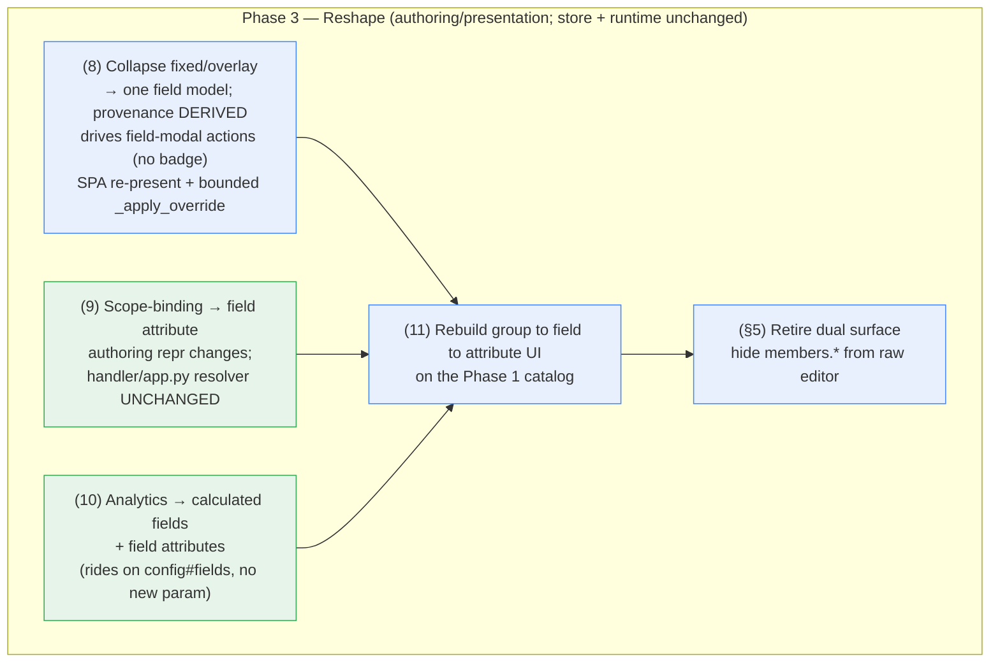

# Phase 3 — Reshape the Model + UI — Design

> **Status: DESIGN.** Implements this folder's `requirements.md`. Phase 3 of the Members config
> redesign — exactly the four deliverables in `impact-analysis.md` §9 steps 8–11, under the model/UI
> stance of §3 ("keep the model, change only the UI/authoring"), §4 ("not a deletion but a reshaping"),
> and §5 ("pure UI changes"). Grounded in the current three-plane code:
>
> - **SAM domain:** `sam/members/domain/field_resolver.py` (`FieldResolver.resolve`,
>   `_as_variable_field`, `_apply_override`, `TenantOverlay`), `attribute_catalog.py` (the Phase 1
>   catalog + drift guard), `calculated_fields.py` (the 9-field registry), `scope_dimensions.py`
>   (`ScopeDimension`/`ScopeConfig` model), the analytics slice (`AnalyticsConfig`/`AnalyticsRole`/
>   `JubileeRule`/`AddressMapping` on `config#fields`).
> - **SAM handler:** `handler/app.py` (`resolve_scope_access_for_config`,
>   `_resolve_scope_access_for_admin`, `_gating_dimension_key`, `allowed_scopes`) — the scope
>   resolver that Phase 3 LEAVES UNCHANGED.
> - **Flask:** `_projection_config_builders.py` (`build_config_fields_row` + the scope/analytics
>   builders), `members_config_validation.py`, `parameter_schema.py`, `projection_sync.py` — the
>   Option-B writer/projection that STAYS.
> - **SPA:** `frontend/src/components/TenantAdmin/MembersConfig/*` (the typed editor + its
>   sub-editors — fields, overrides, functional groups, scope, analytics, status) and
>   `frontend/src/components/TenantAdmin/{ParameterManagement.tsx,AdvancedTab.tsx}` (the raw editor to
>   exclude `members.*` from).
>
> **Design stance:** Phase 3 is *reshaping, not rewriting*. `impact-analysis.md` §3/§4/§5 establish
> that the store already keeps ONE `field_overlay` object (the sub-editors already write it), scope is
> ALREADY field-bound, and analytics ALREADY rides on `config#fields`. So the four deliverables are
> **mostly authoring/presentation re-presentation** on top of an unchanged store, resolver, and
> runtime — the member data and the TOP-rated generic table are untouched. The two genuine model
> simplifications the analysis flags as high blast radius ("only `member_id` is fixed", Option C) are
> **explicitly NOT taken** (requirements Out-of-scope); the only SAM-code change is a *bounded*
> `_apply_override` simplification driven by the provenance re-presentation.

## Overview

Phase 3 ships the four `impact-analysis.md` §9 Phase 3 steps plus the dual-surface retirement:

- **(8)** collapse the fixed/overlay split into one field model; provenance is DERIVED and drives the
  field modal's actions (not a shown badge);
- **(9)** author scope-binding as a field attribute (resolver unchanged);
- **(10)** fold analytics into calculated fields / field attributes (no analytics param — there never
  was one, §0.2);
- **(11)** rebuild the group → field → attribute authoring UI on the Phase 1 catalog;
- plus retire the dual editing surface by hiding `members.*` from the raw parameter editor (§5).

Unlike Phase 2 (subtractive + strictly ordered a→b→c→d), Phase 3's deliverables are **largely
independent presentation changes** that converge in the rebuilt UI (step 11). The sequencing that DOES
matter: the catalog-facing SAM/Flask representation changes (8/9/10 server side) land before or with
the UI that authors against them (11), and the single-save path (step 11 + §5) lands with the raw-editor
exclusion so there is never a window with zero authoring doors.

## 0. Applicable steering & reusable patterns (per `40-spec-workflow.md` → "Writing Design")

The spec workflow requires the design to name the platform conventions each plane conforms to. Phase 3
touches the SAM domain, the Flask projection, and (heaviest) the SPA, plus the governance
definition-of-done; this section binds the governing steering to the step that uses it (mirroring
Phase 1/2 design §0). Each later section repeats inline the one or two files it conforms to.

- **`40-spec-workflow.md` — governs this spec itself.** Requirements-first path here
  (requirements → design → tasks); the definition-of-done ("a step isn't done until the steering it
  changes is updated"). Phase 3 MAY evolve `38`'s reference pattern (group→field→attribute drill-down,
  provenance-driven field actions, scope-as-attribute); the §9 close-out task records either the `38` update or "no steering change
  due" with evidence (R9.5).
- **`38-sam-module-field-config.md` — the heart of Phase 3.** The pattern Phase 3 brings the live
  authoring UI into line with: rule 1 (catalog-first, one derived source + drift guard — the Phase 1
  `attribute_catalog.py` the new UI authors against); rule 2 (group → field → attribute, order DERIVED
  as `(group.order, field.order, key)` — step 11's model, and the ordering the provenance collapse must
  preserve); rule 3 (no view/analytics param objects — analytics folds into calculated fields/attributes,
  step 10); rule 5 (ONE authoring surface, one save → one re-projection — step 11 + the dual-surface
  retirement §5); rule 6 (i18n Option b — resource keys + inline per-language override, the new UI's
  label model); rule 7 (keep the catalog in `sam/members/domain/`, no premature `sam/shared` extraction).
- **`36-config-and-parameters.md` — governs the store/projection that STAYS.** Config has ONE writer
  (MySQL `parameters`, Option B) projecting one-directionally to the SAM-read `config#...` rows; rule 1
  (no half-removed config surface — if a config-row shape changes to fold scope/analytics into fields,
  schema + validator + builder + reader move together); the change is config *shape/strategy*, not a
  config-home change (Phase 4 is decided = B).
- **`35-sam-module-architecture-sam.md` — governs the bounded SAM reshaping.** The four seams stay:
  thin handler edge (the scope resolver is edge/domain glue, LEFT UNCHANGED), domain owns
  `FieldResolver` + the catalog, repository is the only DynamoDB touch-point. The `_apply_override`
  simplification is domain-internal; it must not move a DynamoDB touch-point or push logic to the edge.
  Rule-of-three: do NOT extract a shared field-config library (`38` rule 7).
- **`34-backend-testing.md` — governs the SAM + Flask test edits.** Naming
  (`test_{unit}_{scenario}_{expected}`), `mock_db`/`mock_env` isolation, directory placement
  (`sam/tests/`, `backend/tests/unit/`); the Change-With-Tests contract on every behavioural edit; the
  catalog drift guard stays green (R8.7). The Testing Strategy blast-radius list below is the
  allocated-test map.
- **`32-frontend-ui.md` + `33-frontend-testing.md` — govern the UI rebuild (the biggest piece).**
  `32`: table & modal layout, i18n, row-click-opens-modal, accessibility — the conventions the new
  group → field → attribute editor must meet. `33`: Vitest + RTL for the new flows; the
  Change-With-Tests contract (`32`) applies to every sub-editor edit.
- **`37-shared-building-blocks.md` — governs composition of the new UI.** Reach for the Table Filter
  Framework v2, LazySelect, and the API response/error standard before growing bespoke equivalents
  (R4.5). Do NOT extract a NEW shared block speculatively (rule of three).
- **`30-backend-api-flask-mysql.md` + `31-backend-database-flask-mysql.md` — govern any Flask-side
  config-shape change + a config-row migration IF one is needed.** `30`: the validator/builder are
  service-layer code; the Change-With-Tests contract is `30`'s own rule. `31`: a config-row shape
  change (never member data) migrates via a `backend/src/migrations/` migration applied by
  `DatabaseMigration.run_all_migrations()` (not auto-applied), parameterized, `administration`-scoped,
  dry-run default.
- **`43-cicd-deploys.md` — governs ship.** Feature branch → PR into `test` → promote `test → main` by
  merge commit; `deploy-sam-members.yml` + `deploy-frontend.yml`; DATA-account-only; preview the prod
  changeset for unexpected replacement.
- **`41-shell-environment.md` — governs every command.** WSL/POSIX paths, inline `cd`, the
  `<<<DONE marker=$?>>>` success marker, `backend/.venv`, no foreground long-runners.
- **`22-authentication.md` / scope context — referenced, not changed.** Row-scope access and the
  entitlement edge are the SECURITY backdrop Phase 3 must not weaken; the scope resolver stays
  byte-for-byte (R2.3), so Phase 3 introduces no auth change — called out so the omission is deliberate.

> **Not applicable this phase (recorded so the omission is deliberate):** `20`/`21`/`23`
> (platform/identity/accounts — no identity or account wiring change; deploys hit the data account
> only); `42-local-dynamodb-testing.md` (no new local-DynamoDB harness need beyond the existing SAM
> test fixtures); `11`/`12`/`10` (tech-stack/structure/product — unchanged). `36` config-HOME is
> settled (Option B) — referenced for the store rules, not re-opened.

## 1. Prerequisites (given — do not re-verify or re-open)

- **Phase 0 (reliability) — DONE** (PR #89): calculated-key drift fix, per-param revision (edits always
  project), read-side delivered/loaded status. Phase 3 relies on the projection being observable and
  edits propagating.
- **Phase 1 (catalog backbone) — DONE** (`phase-1-catalog-backbone/`): the canonical
  `attribute_catalog.py`, base functional groups, i18n label model (Option b), the drift guard. **This
  is the backbone the new UI (step 11) authors against** — Phase 3 does not re-derive it.
- **Phase 2 (delete redundant surface) — DONE** (`phase-2-delete-redundant-surface/`): `view_contexts`
  gone across all planes, pagination re-homed to `default_page_size`, legacy `overrides` dual-accept
  removed (reads only `fixed_overrides` / the projected `overrides` attribute, R6.8 names kept),
  `SAMPLE_SCOPE_CONFIG` moved to `sam/tests/`. Phase 3 continues the R6.8 name guard.
- **Config home settled = Option B; Phase 4 DECIDED = Option B** — no config-home work; `36` unchanged.

**Explicitly NOT in Phase 3 (requirements Out-of-scope):** the literal "only `member_id` is fixed"
model change and Option C (SAM-native authoring, which deletes the projection layer and needs a
steering-36 revision). Phase 3 keeps every current fixed field immovable and keeps the projection.

## Architecture

*The four deliverables and the planes they cross.*

**Dependency shape:** 8/9/10 prepare the representation on each plane; 11 is the UI that authors
against all three; §5 (single door) lands with 11. Each of 8/9/10 is independently shippable and
behaviour-preserving; 11 depends on them being in place; §5 depends on 11 being the sole editor.

### Plane summary

| Step | Plane(s) | Steering |
|------|----------|----------|
| (8) collapse fixed/overlay → one field model (provenance derived, drives field-modal actions) | SPA (re-present) + SAM domain (bounded `_apply_override`) | `32`, `33`, `35`, `38`, `34` |
| (9) scope-binding → field attribute | SAM domain (repr) + Flask (builder/validator) + SPA (authoring); resolver UNCHANGED | `35`, `36`, `30`, `38`, `32`, `34` |
| (10) analytics → calculated fields / attributes | SAM domain + Flask (builder) + SPA (authoring) | `35`, `36`, `38`, `32`, `34` |
| (11) rebuild group → field → attribute UI | SPA | `32`, `33`, `37`, `38` |
| (§5) retire dual editing surface | SPA | `32`, `33`, `38` (rule 5) |

## Data Models

*Where the model shape changes (and, mostly, does not) — steps 8/9/10. The store keeps ONE
`field_overlay` object + the existing `config#...` projection rows; Phase 3 changes authoring
representation, not the member-data shape.*

**Conforms to `36-config-and-parameters.md`, `38-sam-module-field-config.md` rules 1/2/3,
`35-sam-module-architecture-sam.md`.**

- **(8) Provenance, not two stores.** The fixed/overlay distinction is a *presentation* fact derived
  from field origin (base registry vs tenant overlay vs base-overridden), not two stored objects — the
  sub-editors already write ONE `field_overlay` object (`impact-analysis.md` §5). The resolved field
  shape (`ResolvedField`) and the `config#fields` row are UNCHANGED; a provenance marker is derived at
  resolve/present time. Ordering stays derived `(group.order, field.order, key)` (`38` rule 2) — no new
  position field.
- **(9) Scope-as-attribute shape.** Today scope is a `config#scope` row (`ScopeConfig` of
  `ScopeDimension{key,label,field,values,enabled,...}`), already field-bound via `ScopeDimension.field`
  (`impact-analysis.md` §3). Phase 3 authors the same facts as attributes on the field; the projected
  config the resolver consumes stays **semantically equivalent** (whether a derived `config#scope` row
  or an equivalent projection). If the stored shape changes, `36` rule 1 applies (schema + validator +
  builder + reader move together) and any config-row migration is `31`-compliant (never member data).
- **(10) Analytics rides on `config#fields` (unchanged).** `AnalyticsConfig`/`AnalyticsRole`/
  `JubileeRule`/`AddressMapping` already live on the `config#fields` row (`impact-analysis.md` §0.2) —
  NOT a `members.*` param. Jubilee-type needs become **calculated fields** (code registry, never
  stored); role aliases become **field attributes**. No new param object is introduced (`38` rule 3).
- **Member data: untouched.** No step changes the `sam-members` member-record shape (Property 4, R7).

## Components and Interfaces

*The deletions/re-presentations plane by plane — the component/interface change per step.*

### Step (8) — collapse fixed/overlay to one field model; provenance DERIVED, drives field-modal actions (`32`, `33`, `35`, `38`, `34`)

- **SPA (primary — re-presentation):** `MembersConfigEditor.tsx` already edits the single
  `field_overlay` object, so collapsing the two sections into one field model is mostly a presentation
  change. There is NO flat "unified list" surface and NO provenance badge: fields are reached through
  the step-11 drill-down (group → field), and each field's provenance (base / tenant-added /
  base-overridden) is DERIVED and used to GOVERN the field modal's actions — a tenant-added field
  offers destructive delete, a base field offers reset-to-default / hide, a base-overridden field
  offers reset-to-default (R1.2/R1.3). Ordering stays `(group.order, field.order, key)` (`38` rule 2).
- **SAM (bounded):** `field_resolver.py` `_apply_override` / `_as_variable_field` keep the merge and
  still DERIVE provenance on the resolved config (the SPA consumes it to pick actions); the
  fixed-vs-overlay branch simplifies only to the extent that derivation needs — WITHOUT adopting
  "only `member_id` is fixed" (every current fixed field stays immovable, R1.6). The resolved field SET
  and order are invariant (Property 1).
- **Store:** unchanged — one `field_overlay` object, one `config#fields` row.

### Step (9) — scope-binding becomes a field attribute (`35`, `36`, `30`, `38`, `32`, `34`)

- **Authoring (SPA + Flask + SAM repr):** express "this field is a scope axis, enabled, with this value
  vocabulary" as attributes ON the field in the typed editor; retire the standalone `scope_dimensions`
  sub-editor. The projection consumed by the resolver stays semantically equivalent.
- **Resolver — UNCHANGED (the hard guarantee):** `handler/app.py`
  (`resolve_scope_access_for_config`, `_resolve_scope_access_for_admin`, `_gating_dimension_key`,
  `allowed_scopes`) and the `scopegrant#<email>#<dim>` grants model are NOT touched. For the same
  tenant/user and grants, `allowed_scopes` is identical before and after (Property 2, R2.5/6).
- **`36` rule 1:** a config-row shape change moves schema + validator + builder + reader together; any
  migration is a `31` config-row migration, never a member-data change (R7.3).

### Step (10) — analytics folds into calculated fields / field attributes (`35`, `36`, `38`, `32`, `34`)

- Represent **jubilee-years-type** needs as **calculated fields** (the code-defined, import-time-guarded
  9-field registry — unchanged in mechanism, `impact-analysis.md` §3). Represent **analytics field-role
  aliases** (cancellation-date, referral-source, address-mapping) as **field attributes**.
- **Remove the separate analytics sub-editor** from the UI; data continues to ride on `config#fields`
  (no new `members.*` analytics param — `38` rule 3). Behaviour-preserving (Property 3).

### Step (11) — rebuild the group → field → attribute authoring UI as a drill-down (`38` 1/2/5/6, `32`, `33`, `37`)

A net-new SPA authoring surface on the settled Phase 1 catalog — the largest piece and the actual
payoff (`impact-analysis.md` §10). The tenant admin DESIGNS the system from a functional view: every
concept is an attribute of a field, every field belongs to a group. The surface is a **drill-down**
(table → modal → table → modal), NOT a flat list:

- **(a) Functional-groups table.** The entry point: a Table/Filter-framework table of functional groups
  (columns = the group's attributes: key, label, order). Supports CREATE a new group, and DELETE a
  group ONLY WHEN it has no fields (the UI guards it; the Flask validator is authoritative on save,
  R4.2). Row-click opens the group modal.
- **(b) Group modal.** Edits the group's own attributes (key, label, order). It has a **Fields** button
  that reveals the group's fields.
- **(c) Fields table (within the group).** A Table/Filter-framework table of the fields in that group
  with their relevant attributes as columns, derived-ordered `(field.order, key)`. Row-click opens the
  field modal.
- **(d) Field modal.** ALL editable field options as attributes — name/key, type, label, required,
  visibility, the scope-binding attribute (step 9), the analytics-role/alias attribute (step 10), and
  calculated-from — with add / edit / delete of attributes, PLUS a **move to another group** action
  (reassigns the field's `functional_group`). Provenance is NOT shown here; it is the DERIVED signal
  (step 8) that selects which destructive/reset actions this modal offers.
- **Display order (`38` rule 2):** derived `(group.order, field.order, key)` — no stored absolute
  position — for both the groups table and each group's fields table.
- **Catalog-first pickers:** every field/group reference (including move-to-group) chosen from the
  catalog-resolvable set (no free-text naming a non-existent key) — the drift guard (`38` rule 1) stays
  green (R8.7).
- **i18n Option b (`38` rule 6):** shipped labels via resource keys (`members.field.<key>`); tenant
  labels via inline per-language override; enum `value` language-neutral, `label` per-language.
- **Composition (`37`):** reach for the Table Filter Framework v2 / LazySelect / the API-error standard;
  do NOT extract a new shared block (rule of three).
- **Single save (`38` rule 5):** one typed save → one re-projection; group create/edit/delete, field
  edits, attribute add/edit/delete, move-to-group, scope-as-attribute (9), and analytics-as-fields (10)
  all author the one `field_overlay` object through this one path.
- **`32`/`33`:** table & modal layout, row-click-opens-modal, i18n, accessibility; Vitest + RTL cover
  the group→field→attribute drill-down, group create/edit/delete-when-empty, field move-to-group,
  provenance-driven field-modal actions, the picker-resolvability guard, and the single-save path.

**Supersedes the earlier build.** The first implementation of step 11 rendered a flat
`MembersFieldProvenanceList` + per-group hierarchy with prominent provenance BADGES. That is replaced by
this drill-down; the badge components are superseded (provenance now drives actions, not a label).

### §5 — retire the dual editing surface (`impact-analysis.md` §5, `38` rule 5, `32`/`33`)

Keep the typed `MembersConfig` editor; **exclude the `members.*` namespace** from the raw generic
parameter editor (`ParameterManagement.tsx`, mounted via `AdvancedTab.tsx`) so there is one door for
Members config. Scope the change to filtering out `members.*` — the component still serves every other
namespace (R5.2). Lands with step 11 so there is never a window with zero authoring surfaces.

## Correctness Properties

The four properties (restated from `requirements.md`) are the behaviour-preservation contract of this
phase; the Testing Strategy section maps each to its test.

### Property 1: The provenance collapse preserves the resolved field set and order

For any tenant config, the resolved field set and its derived order `(group.order, field.order, key)`
after the fixed/overlay presentation is collapsed is identical to before Phase 3.

**Validates: Requirements 1.6, 6.1**

### Property 2: Scope resolution is equivalent across the authoring-representation change

For any tenant scope config and user grants, the `allowed_scopes` the resolver computes after
scope-binding is authored as a field attribute equals the `allowed_scopes` computed before Phase 3.

**Validates: Requirements 2.3, 2.5, 2.6**

### Property 3: Analytics folding is value-equivalent

For any tenant whose analytics config produces a derived value today, the equivalent calculated-field /
field-attribute representation after Phase 3 produces the same derived value for the same member record.

**Validates: Requirements 3.6**

### Property 4: Member data is invariant across every Phase 3 step

For any tenant's member records, applying any Phase 3 step leaves the member records in `sam-members`
byte-for-byte unchanged.

**Validates: Requirements 7.1, 7.2**

## Error Handling

- **Behaviour-preservation is the invariant.** Steps 8/9/10 are equivalences (Properties 1–3);
  member-data invariance is Property 4. Any step that cannot be shown equivalent is a defect, not an
  accepted behaviour change — stop and reconcile (R8.6), never weaken an assertion.
- **No half-removed config surface (`36` rule 1).** If a config-row shape changes (scope/analytics into
  fields), schema + validator + builder + reader move in one change; a config-row migration (if needed)
  is `31`-compliant, dry-run first, TEST then PROD (R9.4), never touching member data.
- **Catalog drift guard stays green (`38` rule 1).** Every change keeps the catalog ⇄ registries drift
  test passing (R8.7).
- **One authoring door at all times.** §5 lands with step 11 so there is never a window where
  `members.*` is editable in neither surface, or in both inconsistently.

## Testing Strategy

Per the Change-With-Tests contract (`30`/`32`/`34`), every behavioural edit updates its paired test in
the SAME change. Allocated-test map (`impact-analysis.md` §7):

**Update (behaviour changed, surface stays):**
| Test | Action | Why |
|------|--------|-----|
| `sam/tests/test_field_resolver.py` | update provenance/override cases to the single-list representation; keep the resolved field SET/order assertions | step 8 |
| `sam/tests/test_scope_access.py`, `test_scope_dimensions.py` | keep asserting the SAME `allowed_scopes`; update only the authoring/config-shape setup | step 9 (resolver unchanged) |
| `backend/tests/.../test_members_config_validation.py`, `test_projection_sync.py`, `test_parameter_schema.py` | update for scope-as-attribute / analytics-as-fields config-shape, if the config row shape changes | steps 9/10 |
| `sam/tests/test_calculated_fields.py` | keep green; extend only if a jubilee calculated field is added | step 10 |
| `MembersConfig/__tests__/MembersConfigEditor.test.tsx` | rewrite the fixed/overlay-split, scope sub-editor, and analytics sub-editor cases to the group→field→attribute drill-down + field-attribute representation (provenance drives field-modal actions, no badge) | steps 8/9/10 |

**New:**
| Test | Covers |
|------|--------|
| provenance-collapse resolver property (`sam/tests/`) | Property 1 |
| scope-equivalence property (`sam/tests/`) | Property 2 |
| analytics value-equivalence test (`sam/tests/`) | Property 3 |
| member-data invariance property (`sam/tests/`) | Property 4 |
| new authoring-UI Vitest/RTL suite (SPA) | group→field→attribute drill-down (groups table → group modal → fields table → field modal), group create/edit/delete-when-empty, field move-to-group, provenance-driven field-modal actions, picker resolvability, single save (R4, R8.4) |
| raw-editor exclusion test (SPA) | `members.*` not editable in `ParameterManagement.tsx`, other namespaces still are (R5, R8.5) |

**Keep unchanged (`impact-analysis.md` §7):** `test_empty_is_valid_props.py`,
`test_members_projection_reader.py` (apart from any config-shape case), the Phase 1 catalog drift-guard
test (must stay green), the Phase 2 regression locks.

Run per `41-shell-environment.md` (inline POSIX `cd`, the `<<<DONE marker=$?>>>` marker, judge by the
marker not the terminal exit code): SAM `cd sam && pytest tests/...`; Flask `source backend/.venv/... &&
cd backend && pytest tests/unit/...`; SPA `cd frontend && npx vitest run ...`.

## Governance definition-of-done (`40-spec-workflow.md`)

Phase 3 may evolve the authoring model `38-sam-module-field-config.md` documents (group→field→attribute
drill-down, provenance-driven field actions, scope-as-attribute, analytics-as-fields as part of the
proven reference pattern). The close-out task
MUST either update `38` (and cross-references in `35`/`37`/`00-index.md`) to match the shipped model, OR
record "no steering change due" with evidence (R9.5). Tick `impact-analysis.md` §9 Phase 3 steps 8–11
done with a pointer to this spec folder.
