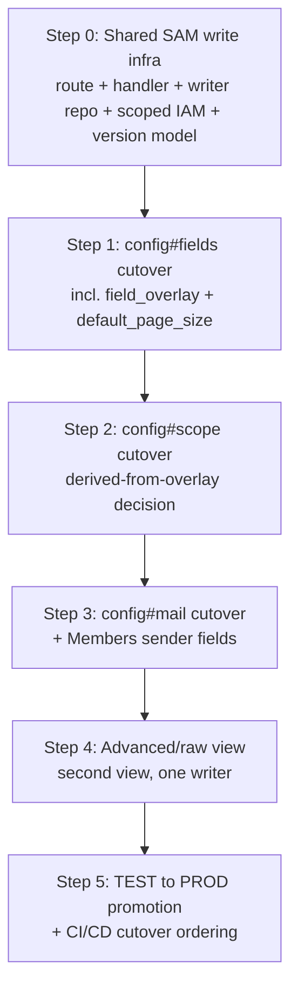
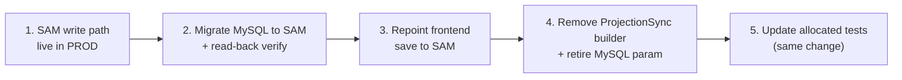

# Redesign Considerations — Members config: SAM-owned projection records + MySQL cleanup

> Status: considerations / assessment + per-record phased approach and roadmap. Scope locked to Phase 1 (Items A+B+C), re-sequenced so each `config#*` record moves in its own step rather than all three at once. Items D + role/scope deferred to a later spec.

## Problem statement
Today all `governance_projection` records are authored on the Flask plane (UI -> MySQL `parameters`/`tenant_modules`/`user_tenant_roles` -> one-directional `ProjectionSync` -> DynamoDB `governance_projection`). SAM reads them read-only and has no config-write path. The goal of this phase is to let the single myAdmin frontend write the Members **tenant-level config** records directly to a new SAM write path, making DynamoDB `governance_projection` the system-of-record for those records, and to retire the corresponding MySQL `members.*` params and `ProjectionSync` config builders.

The "Flask and SAM cannot talk at runtime" rule is preserved: the frontend (one UI plane) talks to each backend plane separately; the planes never call each other.

## Scope (locked)
- **In scope (Phase 1):** `config#scope`, `config#fields`, `config#mail` become SAM-owned. The frontend writes them directly to a new SAM write path. DynamoDB becomes system-of-record for these three rows. MySQL `members.*` params and `ProjectionSync`'s three `config#*` builders are retired. **This phase is now sequenced PER RECORD** — one `config#*` row moves at a time (`config#fields` → `config#scope` → `config#mail`), with all shared write infrastructure front-loaded into the first record's step — rather than moving all three in one atomic change. See *Sort-key / ownership map*, *Roadmap*, and the *Task breakdown* below.
- **Sender (Item B):** only the Members `config#mail` sender fields (domain / local-part + mail-enabled) move, riding with Item A. Invoice SES verification (`SenderSettingsTab`) stays on the Flask/SES plane, untouched.
- **Advanced params (Item C):** a second (raw namespace) editor VIEW over the SAME SAM write path — not a separate store.
- **Out of scope (deferred to a later spec):** `tenant`, `module#<name>`, `role#<email>#<role>`, `scopegrant#<email>#<dimension>`. These stay MySQL-owned and `ProjectionSync`-written exactly as today.
- **Cognito:** unchanged. Flask provisioning keeps writing `custom:tenants` and user invites. No SAM identity-plane writes in this phase.

## Sort-key / ownership map (the 1-to-1 anchor every step traces back to)

Every `governance_projection` record, which plane owns it, and where it lands in the phasing. Each migration step below traces back to exactly one row of this table.

| Sort key (sk) | The JSON record holds | Keyed to | MySQL source | Who manages it | Phase disposition |
| --- | --- | --- | --- | --- | --- |
| `tenant` | the tenant row | tenant | `tenants` | SysAdmin (creates the tenant, invites the Tenant_Admin) | Stays Flask/MySQL-owned (deferred) |
| `module#<name>` | a module-enabled flag for the tenant | tenant | `tenant_modules` | SysAdmin (enables modules at tenant start) | Stays Flask/MySQL-owned (deferred) |
| `role#<email>#<role>` | a user's role grant (login + what they may do) | user | `user_tenant_roles` | Tenant_Admin (grants users their roles) | Deferred (Phase 2, conditional) |
| `scopegrant#<email>#<dimension>` | a user's granted scope values (which slice they may see) | user | `user_tenant_roles` | Tenant_Admin (grants users their scope values) | Deferred (Phase 2, clean) |
| `config#scope` | the tenant's scope dimensions (access axes) | tenant | `parameters` (`members.scope_dimensions`, or derived from overlay scope attrs) | Tenant_Admin | → SAM-owned, **Task 2** |
| `config#fields` | field overlay: fields (added variable fields) + overrides (fixed-field overrides) + functional_groups + default_page_size | tenant | `parameters` (`members.field_overlay` + `members.default_page_size`) | Tenant_Admin | → SAM-owned, **Task 1** |
| `config#mail` | the mail-enabled gate + sender fields (+ versioned bilingual consent notice) | tenant | `parameters` (`members.mail_enabled` + sender + `application_consent_notice`) | Tenant_Admin | → SAM-owned, **Task 3** |
| `config#views` | RETIRED — dead residue; no builder emits it, no code reads it (a cleanup routine only DELETES leftovers) | — | — | nobody (retired) | No migration — assert retired; cleanup is delete-only |

> Note on `config#fields`: it is driven by **two** params — `members.field_overlay` AND `members.default_page_size` (the latter is the re-homed survivor of the retired `config#views`, its `page_size` value). Today `ProjectionSync` stamps the row's `version` as the **max of the two params' per-param revisions** so editing EITHER bumps the row (the "version-bump-trap fix"). That fix is an artifact of the multi-source MySQL→DynamoDB projection and becomes **dead code** once SAM writes the row atomically — see guardrail 3 and flagged item 5.

## Background / verified findings
These are grounded in the current code (verified during analysis):
- **`ProjectionSync` is the sole writer** of `governance_projection` (`backend/src/services/projection_sync.py`). It is one-directional (MySQL -> DynamoDB); there is NO DynamoDB -> MySQL back-sync. It reconciles on a timer and on every MySQL governance change, and `_reconcile_scopegrants` actively DELETES projection rows it doesn't recognize (scoped to the `scopegrant#` prefix).
- **SAM has no config-write path today.** `sam/members/repository/projection_config_reader.py` is read-only (query only). `GET /members/field-config` is the only config-facing route and is GET-only. The Members Lambda IAM role is READ-ONLY on `governance_projection` (per `sam/members/template.yaml`).
- **The pre-token-gen Lambda already reads the projection, not MySQL** (`sam/pretokengen/handler.py`, `sam/pretokengen/projection_governance_reader.py`; "Design amendment A": no `mysql-connector` in the bundle, no Railway egress). So SAM apps' identity path is already decoupled from MySQL.
- **BUT the Flask plane reads `user_tenant_roles` directly from MySQL at request time** (`backend/src/auth/role_cache.py`) to authorize FIN/invoices/etc. So any dual-plane user's role grants must still exist in MySQL. This is why `role#`/`tenant`/`module#` ownership is deferred — it entangles the identity plane and the dual-plane-user problem. Phase 1 deliberately avoids all of that by moving ONLY the three `config#*` rows that ONLY SAM reads.
- **`custom:tenants` is a Cognito user attribute; SysAdmin is a Cognito group.** Whoever writes tenant membership must write Cognito. Today Flask does; Phase 1 keeps it that way.

## The critical consequence: `governance_projection` becomes a split-ownership table
After Phase 1, one DynamoDB table has two writers, split cleanly by sort-key prefix:
- **SAM writes:** `config#scope`, `config#fields`, `config#mail`.
- **`ProjectionSync` (Flask) still writes:** `tenant`, `module#`, `role#`, `scopegrant#`.

The two writers never touch the same rows — the split is clean by prefix. These guardrails apply **from the first per-record step onward**:
1. **`ProjectionSync` stops emitting each `config#*` row as it is migrated.** Its `sync_administration` currently builds all three in the same batch as the base rows; the relevant builder call (`build_config_fields_row` in Task 1, `build_config_scope_row` in Task 2, `build_config_mail_row` in Task 3) is removed **only for the record being migrated in that step**, so a SAM tenant's batch loses exactly that prefix. By the end of Phase 1 the batch contains only `tenant`/`module#`/`role#`/`scopegrant#`.
2. **The residue-cleanup / delete-sweep must not touch SAM-owned rows.** `ProjectionSync`'s `_reconcile_scopegrants` delete-sweep and the `delete_config_views_residue` path must be confirmed scoped to their own prefixes and must never delete `config#scope`/`fields`/`mail`. A sweep that deletes a SAM-authored config row would silently break a tenant's Members config. The `config#views` cleanup is correct as-is — it only deletes the retired residue. **(FLAGGED DESIGN ITEM for execution — verify, do not assume.)**
3. **Version management changes hands and must be REDESIGNED, not ported.** Today `ProjectionSync` stamps `version` on `config#*` — and for `config#fields` it is the **max of the two source params' revisions** (the version-bump-trap fix). That logic is an artifact of the multi-source MySQL→DynamoDB projection: once SAM writes a `config#*` row atomically in a single write there is no second source to reconcile, so the max-of-params logic becomes **dead code — do NOT port it**. The SAM writer instead needs its own deliberate version model — at minimum a monotonic write stamp (e.g. an ISO-8601 updated-at, matching the live `config#scope` convention) the SAM reader's caching/staleness logic can still key off. **Open question (flagged item 5):** what version semantics do SAM-owned config rows actually need, given a successful SAM write is now the authoritative state (no projection lag, so the old delivered-vs-source staleness comparison in `get_config_status()` largely collapses)? Keep this separate from the `config#mail` domain-level `consent_notice.version` (a notice revision stamped on application records — unaffected by the migration).

## Roadmap — how Phase 1 happens (sequenced)

The end-state framing (which rows move) is at the bottom under *Net framing*. This section is the **sequenced "how"**: the ordered steps, what ships on which plane, and the gating between them. The driving insight: each record's cutover is a strict ordered handoff (SAM write live → migrate data → verify → remove the Flask builder), and the three records go **one at a time** so a failure only ever affects one row. Shared infrastructure is built once, with the first record.

### Roadmap at a glance

### Per-record cutover pattern

Every config row follows this exact ordered handoff:

**Safety gate (non-negotiable):** step 4 (removing the Flask builder) never merges to main until steps 1–2 are verified live in PROD. SAM owns the row **before** Flask stops writing it, so there is no window where a tenant has no config.

### Roadmap steps (map onto the task breakdown)

- **Step 0 — shared SAM write infrastructure** (ships once, with Step 1): new write repo + PUT route + Lambda handler, scoped IAM write grant on `config#*`, table resolution via `GOVERNANCE_PROJECTION_TABLE`, and the SAM version model. No standalone demo — proven by Step 1.
- **Step 1 — `config#fields` cutover** (the pioneer): carries `field_overlay` + `default_page_size`, preserves per-field `scope` attrs for Step 2, retires the version-bump-trap. First record through the full cutover pattern.
- **Step 2 — `config#scope` cutover**: reuses the road; decides derive-from-overlay vs own-row; second because it is coupled to the overlay just migrated.
- **Step 3 — `config#mail` cutover**: carries the Members sender fields; third because it drags in the sender-tab question.
- **Step 4 — advanced/raw view**: pure additive view over the finished write path, one writer.
- **Step 5 — TEST→PROD promotion + CI/CD ordering**: SAM-live-in-PROD-before-builder-removal, enforced in the pipeline.

### Deploy-plane split (which pipeline carries what)

- **SAM plane (`deploy-sam-members.yml`):** the write infra + IAM grant (Step 0) and each record's write-path enablement.
- **Flask / full-test-suite plane:** each record's frontend repoint + `ProjectionSync` builder removal + test updates.
- **Operational step (not a deploy):** the MySQL→SAM data migration per record, ordered to run **after** SAM-live and **before** the builder-removal merge.

## Task breakdown (per-record, following the cutover pattern)

- [ ] **Task 1 — Net-new SAM config write path + shared infrastructure, migrating `config#fields` first.**
  - **Objective:** build the one-time shared write infrastructure and prove it end-to-end on `config#fields`.
  - **Guidance:** add a SAM write repository (versioned `put_item` on `config#*` keys) alongside `sam/members/repository/projection_config_reader.py`; add the API Gateway PUT/write route + Lambda handler; grant the Members Lambda role a scoped WRITE on `config#*` keys in `sam/members/template.yaml` (deploy via `deploy-sam-members.yml`); resolve the table via `GOVERNANCE_PROJECTION_TABLE` (fail-fast, no default). Migrate BOTH `members.field_overlay` AND `members.default_page_size` into the SAM-owned `config#fields` row, **preserving the per-field `scope` attribute** (Task 2 derives `config#scope` from it). Read-back verification for every live tenant (h-dcn at minimum) BEFORE removing the Flask builder. Then remove the `build_config_fields_row` call from `ProjectionSync.sync_administration` and retire both `members.field_overlay` and `members.default_page_size` params. **Do NOT port the max-of-params version-bump-trap logic** — a single atomic SAM write replaces it; establish the chosen SAM version model (flagged item 5) as a plain monotonic write stamp instead. Repoint the `field_overlay` (and page-size) save in `frontend/src/services/membersConfigService.ts` to the SAM route; simplify the save-result UX (a successful SAM write is authoritative — no projection step).
  - **Tests:** update `sam/tests/test_config_roundtrip_props.py` (fields round-trip asserts the SAM-authored row carrying overlay + `default_page_size`); update `ProjectionSync` property/preservation tests to assert `config#fields` is NOT emitted; add write-path unit tests (versioned put, table resolution, IAM-scoped key); add/adjust tests for the new SAM version stamp. Verify guardrail 2 for the `config#fields` prefix.
  - **Demo:** a Tenant Admin edits the overlay and page size; the save writes `config#fields` via SAM; `GET /members/field-config` reflects both; `ProjectionSync` no longer emits `config#fields`.

- [ ] **Task 2 — Migrate `config#scope` onto the SAM write path.**
  - **Objective:** make `config#scope` SAM-owned, reusing Task 1's infrastructure.
  - **Guidance:** decide the authoring surface given the coupling — (a) SAM derives `config#scope` from the `scope` attributes on the already-SAM-owned `config#fields` overlay, or (b) it is written as its own row — preserving equivalence with `_scope_dimensions_from_overlay` and the legacy standalone-list fallback. Migrate current scope dimensions with read-back verification before removing the builder. Remove `build_config_scope_row` from `ProjectionSync`; retire `members.scope_dimensions`. Repoint the `scope_dimensions` save in `membersConfigService.ts`. Apply the same SAM version model chosen in Task 1.
  - **Tests:** update `sam/tests/test_scope_equivalence_props.py` + the scope round-trip to assert the SAM-authored/derived row reproduces the same `ScopeConfig`; update `ProjectionSync` tests to assert `config#scope` is NOT emitted. Verify the guardrail for the `config#scope` prefix.
  - **Demo:** editing scope dimensions writes `config#scope` via SAM; the resolver's `ScopeConfig` is unchanged; `ProjectionSync` no longer emits `config#scope`.

- [ ] **Task 3 — Migrate `config#mail` onto the SAM write path, carrying the sender fields (Item B).**
  - **Objective:** make `config#mail` SAM-owned including `mail_enabled`, sender domain/local-part, and the versioned bilingual `application_consent_notice`.
  - **Guidance:** confirm the Members sender tab moves (`MemberSenderIdentitiesTab`, likely) while `SenderSettingsTab` (invoice SES verification) stays on Flask/SES. Preserve `_resolve_application_consent_notice` shaping and the domain-level `consent_notice.version` (unchanged by the migration). Migrate current `config#mail` values with read-back verification before removing the builder. Remove `build_config_mail_row` from `ProjectionSync`; retire the `members.*` mail params. Repoint the mail/sender save to the SAM route; keep exactly one writer for these keys. Apply the Task 1 SAM version model for the row stamp (distinct from the notice version).
  - **Tests:** update `sam/tests/test_members_projection_reader.py` (`_config_mail_item`, `mail_enabled`/consent-notice reads assert SAM-authored rows); update `ProjectionSync` tests to assert `config#mail` is NOT emitted; confirm the invoice SES path is untouched. Verify the guardrail for the `config#mail` prefix.
  - **Demo:** editing Members mail-enabled + sender + consent notice writes `config#mail` via SAM; the Members edge's gate and From-address composition read it; invoice SES verification is unaffected; `ProjectionSync` no longer emits `config#mail`.

- [ ] **Task 4 — Advanced / raw-namespace editor view (Item C) over the single write path.**
  - **Objective:** add a second editor VIEW reading/writing the same three SAM-owned `config#*` rows at the raw-namespace level — no new store, no second writer for the same keys (especially the `config#mail` keys shared with the sender view).
  - **Tests:** view-layer tests that the raw editor posts to the same write API and that there is no conflicting second write path to the same keys.
  - **Demo:** a power user edits any `config#*` row raw, saves through the same SAM write path, and the typed editor reflects it (one writer, two views).

- [ ] **Task 5 — TEST → PROD promotion + CI/CD-to-main cutover ordering.**
  - **Objective:** establish the promotion story and wire the cutover so TEST config reaches PROD (fixing the prior manual 5-row copy) without a gap.
  - **Guidance:** choose the mechanism (copy/promote TEST→PROD vs per-environment authoring + explicit promote step) and document it. Order so SAM is live and verified in PROD BEFORE the merge-to-main that removes each `ProjectionSync` builder (SAM grant + routes via `deploy-sam-members.yml`; frontend rewire + builder removal via the Flask/full-test-suite path; the MySQL→SAM migration ordered relative to that merge). Keep migrations reversible until SAM is verified live in PROD. Satisfy `43-cicd-deploys.md` (CodeQL green, no secrets); note main-branch-protection as a prerequisite given the blast radius.
  - **Tests:** dry-run/verification of the promotion path (TEST/PROD `config#*` read-back parity); rollback rehearsal.
  - **Demo:** config authored in TEST is promoted to PROD and verified present; the pipeline enforces SAM-live-before-builder-removal ordering.

## Item-by-item effort & risk

### Item A — Members config write path (core): MEDIUM effort, MEDIUM risk
- New SAM surface: API Gateway routes (existing GET + new PUT/write) -> Lambda handler -> a new config-writer repository doing versioned `put_item` on the three `config#*` keys. Net-new (no config write exists today).
- IAM: grant the Members Lambda role a scoped WRITE on the `config#*` keys of `governance_projection` (currently read-only). Infra change, needs a deploy.
- Frontend rewire: `MembersConfigEditor` + `MembershipTypesManager` currently call Flask `parameter_admin_routes` via `membersConfigService.ts`. Repoint to the new SAM routes. The save-result UX (today shows `projected`/`projection_error`) simplifies — a successful SAM write IS the authoritative state, there is no projection step.
- One-time data migration: copy current `members.*` values from MySQL into the SAM-owned `config#*` rows for every live tenant (h-dcn at minimum), with verification read-back, BEFORE `ProjectionSync` stops writing them.
- Retire: delete the three `config#*` builders from `ProjectionSync`; drop `members.*` params from MySQL (retire, not freeze).
- Risk drivers: the dual-writer guardrails above; migration cutover ordering (write SAM first, verify, then remove the Flask builder in the same change per the change-with-tests contract); versioning continuity.

### Item B — Sender fields: LOW effort, LOW risk
Rides inside Item A's `config#mail` write. The only real work is NOT touching the invoice SES verification path. **FLAGGED DESIGN ITEM:** confirm whether the UI surface that should move is `MemberSenderIdentitiesTab` (member sender) vs leaving `SenderSettingsTab` (invoice SES verification) alone. The "double things pointing to one item" the user noticed resolves here: invoice SES verification and the Members sender are genuinely different concerns sharing the word "sender"; only the Members one is in scope.

### Item C — Advanced / raw namespace view: LOW effort (given A), LOW-MEDIUM risk
A second editor VIEW over Item A's write path (the user's backlog already notes "Advanced + Members config — one thing at two polish levels"). Risk: it must not offer a conflicting second way to write the same `config#mail` keys as the sender view. One writer, two views: both the typed editor and the raw editor post to the single write API.

## TEST -> PROD config promotion + CI/CD to main (in scope for Phase 1)
The user's backlog already records that config authored in TEST never reached PROD (a manual 5-row `members.*` copy). Moving to SAM-owned config is the moment to fix this rather than repeat it.
- The SAM write path must work against BOTH `test_governance_projection` (TEST) and `governance_projection` (PROD), resolved via `GOVERNANCE_PROJECTION_TABLE` (fail-fast, no default).
- There must be a deliberate promotion story: either (a) a copy/promote path TEST -> PROD for the `config#*` rows, or (b) direct per-environment authoring with an explicit promote step.
- **CI/CD to main:** the promotion/cutover must fit the existing deploy pipeline (steering `43-cicd-deploys.md`: CodeQL must be green, no secrets in CI). Consider: the IAM write-grant change and the new SAM routes ship via the SAM deploy workflow (`deploy-sam-members.yml`); the frontend rewire + `ProjectionSync` builder removal ship via the Flask/full-test-suite path. The migration (MySQL -> SAM copy) is an operational step that must be ordered relative to the merge-to-main that removes the Flask builders — SAM must be live and verified in PROD BEFORE the merge that stops `ProjectionSync` writing `config#*`, or tenants lose their config between deploy and migration. Document the required ordering as part of the promotion design. Note also the related open backlog item "Your main branch isn't protected" — branch protection / required status checks on main are a prerequisite hygiene item for a cutover of this blast radius.

## Cross-cutting risks (whole phase)
- **Rollback story.** Once MySQL `members.*` is dropped and `ProjectionSync` stops writing `config#*`, reverting means re-seeding MySQL and the builder. Keep the migration reversible (don't drop MySQL params until SAM is verified live in PROD) even though the end-state deletes them.
- **Change-with-tests contract (workspace rule).** Retiring the three builders and the `members.*` params is a behavior change with allocated tests: `ProjectionSync` property/preservation tests that currently assert `config#*` rows are emitted must be updated to assert they are NOT; SAM reader tests must point at SAM-authored rows. These move in the SAME change, not after.
- **Account/region.** All writes target `nonprofit-deploy` (506221081911), `eu-west-1`. No identity-account involvement this phase (Cognito stays on Flask), keeping the IAM blast radius small — a genuine benefit of deferring Item D.

## What stays reassuringly unchanged
- Pre-token-gen Lambda: zero changes — it reads `role#`/`module#`, which stay MySQL-fed.
- SAM edge entitlement check: unchanged.
- Flask `role_cache` / FIN / invoices authorization: unchanged — none read `config#*`.
- "Flask and SAM cannot talk at runtime": preserved.

## Bottom line
Phase 1 (A+B+C) is a contained, defensible change: SAM takes ownership of exactly the three rows only SAM reads, so there is no identity entanglement and no dual-plane-user problem (those live entirely in the deferred D + role/scope work). The real engineering is (1) the net-new SAM write path + scoped IAM grant, (2) the clean hand-off from `ProjectionSync` to SAM for `config#*` with the delete-sweep and versioning guardrails, and (3) the migration + TEST->PROD promotion cutover ordering relative to CI/CD to main. Effort: roughly a medium spec. Risk: medium, concentrated in the cutover / dual-writer mechanics rather than in identity or cross-plane coupling.

## Flagged design items to resolve in the execution phase
1. Confirm `ProjectionSync`'s delete-sweep (`_reconcile_scopegrants`) and residue cleanup never touch `config#scope`/`config#fields`/`config#mail` (and that `config#views` cleanup stays delete-only).
2. Confirm which sender UI tab moves: `MemberSenderIdentitiesTab` (likely) vs `SenderSettingsTab` (invoice SES — stays).
3. Decide Task 2's `config#scope` authoring surface: SAM-derived from the already-SAM-owned `config#fields` overlay vs written as its own row.
4. Choose the TEST->PROD promotion mechanism (copy/promote path vs per-environment authoring + promote step) and document the cutover ordering vs merge-to-main.
5. **Version model for SAM-owned `config#*` rows.** The MySQL max-of-params version-bump-trap fix is retired as dead code; decide what version management (if any) the SAM rows need: a plain monotonic write stamp the reader keys off; whether `get_config_status()` / the delivered-vs-source staleness surface still has meaning once a SAM write IS authoritative (likely collapses, since there is no projection lag); and keep it separate from the `config#mail` domain-level `consent_notice.version`.

---

## Option D — split into Phase 2 (possible) and Not possible (stays Flask/MySQL-owned)

Option D is "manage the identity/governance records (`tenant`, `module#<name>`, `role#<email>#<role>`, `scopegrant#<email>#<dimension>`) on the SAM plane." Analysis (code-verified) shows it is NOT one thing — it splits cleanly into a movable part and an irreducible part.

The guiding distinction: **per-module data** (what a module reads — role grants, scope grants) can be plane-routed to the module's owning plane. The **pre-module gate** (tenant existence + module enablement + Cognito membership) is read by the platform's authorization layer *to decide which modules/roles even apply*, so it cannot "decode per plane" — it is read before any single module's plane is selected.

### Per-record verdict (verified against the code)

| Record | Movable to SAM? | Why |
| --- | --- | --- |
| `scopegrant#<email>#<dimension>` | **Yes — clean (Phase 2)** | No Flask request-time reader. The Flask plane only AUTHORS `user_tenant_scope` and PROJECTS it; enforcement (deny-by-default on scope dimensions) is entirely SAM-side. Already Members-specific (a `module` column, filtered to MEMBERS). Moves end-to-end with zero Flask breakage. |
| `role#<email>#<role>` | **Yes, conditional (Phase 2)** | Role names ARE disjoint by module/plane (`Members_*` → MEMBERS/sam; `Finance_*`/`STR_*`/`ZZP_*` → flask; globals `SysAdmin`/`Administrators`/`System_CRUD`/`Tenant_Admin` are not module roles). So a sort-key partition `role#…#Members_*` → SAM vs the rest → Flask is unambiguous. BUT two Flask readers assume MySQL `user_tenant_roles` is COMPLETE and would under-report SAM-only Members roles: (1) the tenant-admin manage-users view `list_tenant_users`; (2) the Flask entitlement FALLBACK `resolve_capabilities_from_db`. The fallback is narrow — the normal path prefers the verified token claim (already built from the projection by the pre-token-gen Lambda), so it only fires when the token has no answer. Movable IF those two readers are made projection-aware (or Flask views accept that they omit Members roles). |
| `module#<name>` | **No — stays Flask/MySQL-owned** | MySQL `tenant_modules` is the LIVE authorization gate: `has_module` / the `module_required` decorator read it directly on every gated Flask request. The SysAdmin module-management view (`get_tenant_modules`) and the entitlement fallback also enumerate modules from it. A module enabled only in SAM would make the Flask plane treat it as NOT enabled. And module enablement is what gates roles (`required_roles` count only when the module is active). Foundational, read as system-of-record by Flask's own authorization. |
| `tenant` | **No — stays Flask/MySQL-owned** | Pre-module. It is the FK target for MySQL `user_tenant_roles.administration`, and tenant membership is carried by the Cognito `custom:tenants` attribute, which the pre-token-gen Lambda reads to decide which tenant partitions to query AT ALL (before any module/role). Creating a tenant inherently requires a Cognito (identity-plane) write, not a DynamoDB write. Gates every plane, SAM included. |

### Phase 2 (possible) — the movable part of D
Move `scopegrant#` (clean) and `role#` (with the two-reader rework above) to SAM ownership, using the same prefix-scoped split pattern Phase 1 uses for `config#*`:
- SAM owns and writes `scopegrant#<email>#<dimension>` and `role#<email>#Members_*`.
- `ProjectionSync` stops writing exactly those rows (and its delete-sweep must not touch SAM-owned prefixes — same guardrail family as Phase 1).
- For `role#`, decide the policy for the two Flask MySQL readers: either make `list_tenant_users` + `resolve_capabilities_from_db` projection-aware for Members roles, or accept that those Flask views do not display Members roles (the SAM plane remains authoritative via the token).
- Pre-token-gen Lambda: unchanged — it already reads `role#`/`scopegrant#` from the projection regardless of who wrote them.

### Not possible — stays Flask/MySQL-owned (SAM reads via the projection as today)
`tenant` and `module#<name>` remain authored on the Flask plane (MySQL + Cognito), projected one-directionally into `governance_projection`, and read by SAM read-only — exactly as today. A SAM SysAdmin surface could DISPLAY these (reading the projection) but must not become their writer. Tenant creation + user invite (the Cognito `custom:tenants` write) and module enablement (`tenant_modules`, the live Flask gate) stay a Flask/identity responsibility, because Flask's own authorization reads them as system-of-record and they gate all planes before any module is selected.

### Net framing
- **Phase 1 (this spec):** `config#scope` / `config#fields` / `config#mail` → SAM-owned, moved **one record at a time** via the per-record cutover pattern (`config#fields` → `config#scope` → `config#mail`), shared write infra built once with the first record.
- **Phase 2 (later spec, possible):** `scopegrant#` (clean) + `role#` Members slice (with reader rework) → SAM-owned, using the same per-record cutover pattern.
- **Not possible / permanent Flask-MySQL ownership:** `tenant` + `module#<name>` — the pre-module gate, projected to SAM read-only.

The insight that drives the split: "a module decodes where to read" is true for per-module data (roles, scope) but NOT for the pre-module gate (tenant existence, module enablement, Cognito membership), which is read by the platform's authorization layer to decide which modules/roles apply in the first place.
