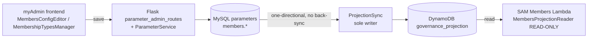
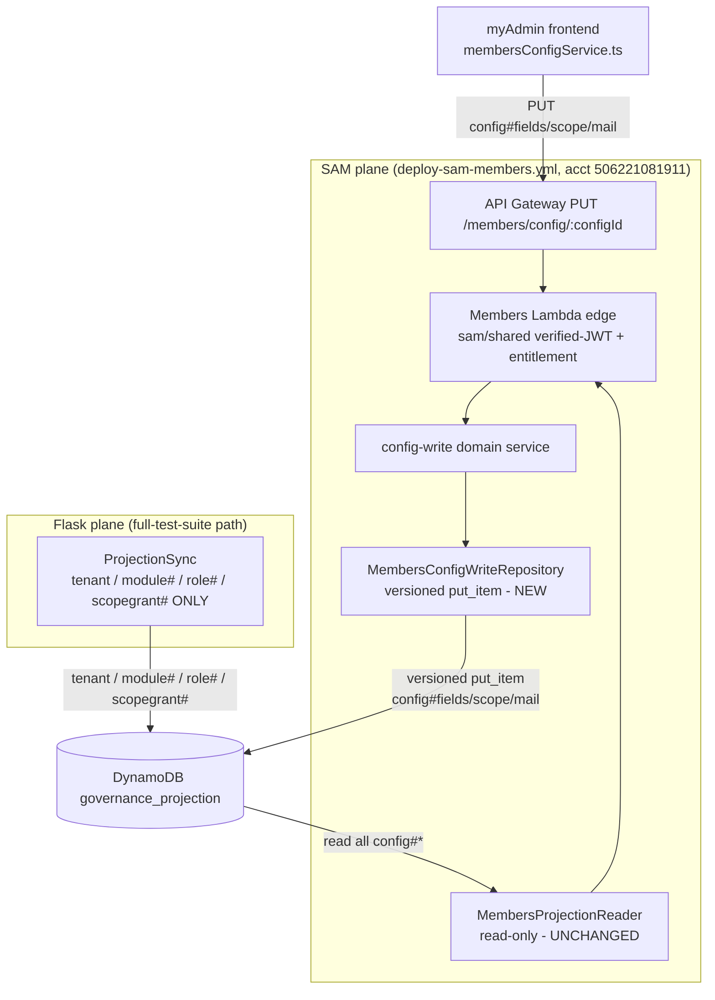
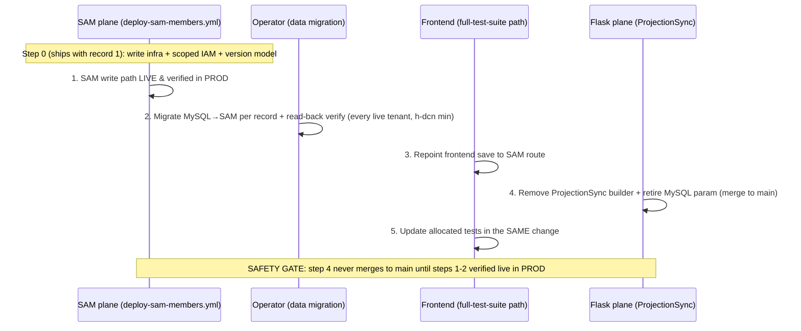

# Design Document: Members config — SAM-owned write path (Phase 1)

## Overview

Today every `governance_projection` row is authored on the Flask plane: the myAdmin frontend edits MySQL `members.*` parameters, and a one-directional `ProjectionSync` (MySQL → DynamoDB, no back-sync) stamps the resulting `config#*` / `tenant` / `module#` / `role#` / `scopegrant#` rows onto the projection. The SAM Members plane reads those rows read-only and has no config-write path.

This feature introduces a **net-new, SAM-owned write path** for exactly three tenant-level rows — `config#fields`, `config#scope`, `config#mail` — so the single myAdmin frontend writes them directly to the SAM plane (API Gateway → Members Lambda handler → config-write domain service → new write repository → DynamoDB). DynamoDB `governance_projection` becomes the **system-of-record** for those three rows, the corresponding MySQL `members.*` params and the three `ProjectionSync` config builders are retired, and the existing read reader (`MembersProjectionReader`) keeps serving them unchanged. The "Flask and SAM cannot talk at runtime" rule is preserved: the frontend talks to each backend plane separately and the planes never call each other.

The cutover is **sequenced per record** — one `config#*` row migrates at a time (`config#fields` → `config#scope` → `config#mail`), with all shared write infrastructure (route, handler, write repository, scoped IAM grant, version model) front-loaded into the first record's step. After Phase 1 the projection table is a **split-ownership** table: SAM writes `config#fields/scope/mail`; `ProjectionSync` (Flask) still writes `tenant`, `module#`, `role#`, `scopegrant#`. Scope is **locked to Phase 1**: `tenant`, `module#<name>`, `role#<email>#<role>`, and `scopegrant#<email>#<dimension>` stay MySQL-owned / ProjectionSync-written, deferred to a later spec. Cognito is unchanged (Flask keeps writing `custom:tenants` and invites). All writes target `nonprofit-deploy` (`506221081911`), `eu-west-1`.

This spec **consumes** SAM-plane capabilities defined by `35-sam-module-architecture-sam.md` (API Gateway → Lambda handler → domain service → repository → DynamoDB; `sam/shared` verified-JWT + entitlement toolkit at the edge; tenant key `tenant_id`) and references those specs rather than redefining them.

## Architecture

### Before (today) — single Flask writer



### After Phase 1 — split-ownership by sort-key prefix



**Split-ownership invariant (guardrail).** After each record migrates, SAM is the only writer of that `config#*` row and `ProjectionSync` no longer emits it. Writers partition cleanly by sort-key prefix:

| Writer | Sort keys written (after Phase 1) |
| --- | --- |
| SAM (`MembersConfigWriteRepository`) | `config#fields`, `config#scope`, `config#mail` |
| ProjectionSync (Flask) | `tenant`, `module#<name>`, `role#<email>#<role>`, `scopegrant#<email>#<dimension>` |
| nobody | `config#views` (RETIRED — delete-only residue cleanup, never authored) |

### Per-record sequenced cutover (strict ordered handoff)

The deploy-plane split and ordering are non-negotiable. SAM owns the row **before** Flask stops writing it — there is no window where a tenant has no config.



- **SAM plane** (`deploy-sam-members.yml`) carries: the write infra + the scoped IAM WRITE grant (Step 0) and each record's write-path enablement.
- **Flask / full-test-suite plane** carries: each record's frontend repoint + the `ProjectionSync` builder removal + test updates.
- **Operational step (not a deploy):** the per-record MySQL → SAM data migration, ordered AFTER SAM-live and BEFORE the builder-removal merge. Keep it reversible (don't drop MySQL params) until SAM is verified live in PROD.

## Sort-key / ownership map (Phase 1 locked scope)

| sk | holds | keyed to | MySQL source | manager | disposition |
| --- | --- | --- | --- | --- | --- |
| `tenant` | tenant row | tenant | `tenants` | SysAdmin | Stays Flask/MySQL (deferred) |
| `module#<name>` | module-enabled flag | tenant | `tenant_modules` | SysAdmin | Stays Flask/MySQL (deferred) |
| `role#<email>#<role>` | role grant | user | `user_tenant_roles` | Tenant_Admin | Deferred (Phase 2, conditional) |
| `scopegrant#<email>#<dimension>` | granted scope values | user | `user_tenant_roles` | Tenant_Admin | Deferred (Phase 2, clean) |
| `config#scope` | scope dimensions | tenant | SAM `config#scope` is authoritative, DERIVED from per-field `scope` attrs on `config#fields` (single source); `members.scope_dimensions` is KEPT as a frontend-written Flask mirror (retired as an authoring surface only), read by Flask grant validators — ODD 3 | Tenant_Admin | → SAM-owned, **Task 2** |
| `config#fields` | field overlay: fields + overrides + functional_groups | tenant | `members.field_overlay` | Tenant_Admin | → SAM-owned, **Task 1** |
| `config#mail` | mail-enabled gate + `mail_domain` + `mail_local_part` + `mail_certified` gate + `mail_reply_to_default` (scheduled Reply-To) (+ versioned bilingual consent notice) | tenant | `members.mail_enabled` + `members.mail_domain` + `members.mail_local_part` + `members.mail_certified` + `members.mail_reply_to_default` + `members.application_consent_notice` | Tenant_Admin | → SAM-owned, **Task 3** |
| `config#views` | RETIRED dead residue; cleanup is delete-only | — | — | nobody | No migration — assert retired |

> `config#fields` now has a **single** source param — `members.field_overlay`. The `default_page_size` scalar (the former re-homed survivor of the retired `config#views` page_size) is **RETIRED**: rows-per-page is the per-user runtime selector (Requirement 25), not a tenant-authored value, so it is no longer carried on `config#fields`. With one source param the ProjectionSync max-of-params version logic (`_config_row_version`, the old "version-bump-trap fix") is **doubly moot** — it was already dead code once SAM writes the row atomically, and there is no longer a second param to take the max of. It is **not** ported.

### Deferred / out of scope (do not re-expand)

- `tenant`, `module#<name>`, `role#<email>#<role>`, `scopegrant#<email>#<dimension>` stay MySQL-owned and ProjectionSync-written exactly as today. The Flask plane reads `user_tenant_roles` directly from MySQL at request time (`backend/src/auth/role_cache.py`), so role#/tenant/module# ownership cannot move yet. Phase 1 moves ONLY the three `config#*` rows that ONLY SAM reads.
- Invoice SES verification (`SenderSettingsTab`) stays on the Flask/SES plane, untouched.
- Cognito writes (`custom:tenants`, invites) stay on Flask. No SAM identity-plane writes.

## Single authoring door per members.* key (the two-writers-one-config guarantee)

The authoring model for Members config is **one typed door per concern, and after a key migrates to SAM that door is the SAM-owned typed function — never the Advanced raw editor / MySQL.** This is the core safety property of the revised design, not a UI nicety.

**The real risk this prevents.** `frontend/src/components/TenantAdmin/ParameterManagement.tsx` (the Advanced raw parameter editor) writes MySQL via `/api/tenant-admin/parameters`. Today it DELIBERATELY serves the Members mail params (`mail_enabled`, `mail_domain`, `mail_local_part`, `mail_certified`, `default_page_size`) to that raw grid — only `members.field_overlay` and `members.scope_dimensions` are hidden via `TYPED_EDITOR_KEYS`, and an in-code comment states the old blanket members-namespace exclusion "wrongly orphaned the mail params and is retired." If `config#mail` migrates to SAM (DynamoDB system-of-record) but the Advanced editor keeps writing `members.mail_*` to MySQL, you get **two writers over one logical config**: the raw editor writing an orphaned, unprojected MySQL row AND SAM writing DynamoDB, silently diverging. That is the failure this spec must make impossible.

**The guarantee.** For every `members.*` key, there is **exactly one authoring door**. After a key is migrated and its MySQL row deleted, the door is the SAM-owned typed function; the Advanced raw editor offers **no** write path for any `members.*` key. This revision therefore **re-instates the blanket `members`-namespace exclusion** in `ParameterManagement.tsx` (reversing the retired-exclusion comment), because every Members concern now has a dedicated typed door (below) and the `members.*` MySQL rows are deleted. The Advanced grid lists ONLY non-Members MySQL params (storage, fin, etc.).

### Three mail-adjacent surfaces — never conflate them

| # | Surface | Dataset | Plane / ownership | Scope |
| --- | --- | --- | --- | --- |
| 1 | `config#mail` scalars — `mail_enabled` / `mail_domain` / `mail_local_part` / `mail_certified` / `mail_reply_to_default` + versioned bilingual `application_consent_notice` | projection `config#mail` row (DynamoDB) | SAM-owned, authored via the **new typed Mail function** | **IN SCOPE** (Task 3) |
| 2 | `MemberSenderIdentitiesTab` — Members SES sender-ADDRESS identities (add / verify / resend verified From addresses) | SES-verified identities via `memberSenderIdentityService` (`email_verifications`, keyed by `administration`) — **NOT a parameter row**, a different dataset from the `config#mail` scalars | Flask routes today (`/api/members/sender-identities`, `members_sender_identity_routes.py`); the SAM Members Lambda implements no sender-identity route | A Members concern that **co-locates in the Mail function UI** but is not a config row — see ODD 2 |
| 3 | `SenderSettingsTab` — invoice SES verification | invoice SES settings | Flask / SES plane | **OUT OF SCOPE** — untouched |

Surfaces 1 and 2 are both Members mail concerns and live together in the Mail function screen, but they write **different stores via different mechanisms**: surface 1 is a SAM `config#mail` put; surface 2 is a Flask SES-identity call. Surface 3 is not a Members concern at all.

### Retired `view_contexts` — no editor, cleanup-only

`members.view_contexts` (named column-layout presets for the Members overview) is **RETIRED** and has **no authoring editor** — it is authored nowhere (not the Advanced raw editor, not a typed function). There is nothing to migrate; it is distinct from the migrated keys (`field_overlay` / `scope_dimensions` / `mail_*`) covered by the per-record cutover. This closes the single-authoring-door guarantee for a retired key, not just migrated ones: a key with **zero** authoring doors and **zero** surviving `members.*` rows cannot have a second writer either.

- **Verified dead in live code.** The SAM field-config response no longer serializes `view_contexts` (`sam/tests` assert `"view_contexts" not in config`); no builder emits `config#views` (`projection_sync.py` `delete_config_views_residue` only DELETES stray rows; `projection_schema.py` documents `config#views` as RETIRED).
- **Its one surviving value, the per-context `page_size`, is now fully RETIRED** (Requirement 25). It was briefly re-homed to a single tenant-level `default_page_size` scalar on `config#fields`, but rows-per-page is now the per-user runtime Rows_Per_Page_Selector, not a tenant-authored value — so `default_page_size` is NOT carried on `config#fields` and NOT migrated to SAM. The old `frontend/src/pages/membersPagination.ts` precedence (`userPreference ?? default_page_size ?? platformDefault`) is superseded by the runtime selector (OQ-6, RESOLVED). See "Rows-per-page + DynamoDB cursor paging (Requirement 25)".
- **Physical cleanup is delete-only** and upholds the zero-`members.*`-rows single-door guarantee: the MySQL rows are deleted via `backend/src/migrations/retire_members_view_contexts.py` (dry-run default), and any stale `config#views` DynamoDB residue via `ProjectionSync.delete_config_views_residue`.
- **Do NOT conflate with Session Columns.** The per-user **Session Columns** column chooser (`ColumnChooser.tsx`, `getColumnPreferences` / `saveColumnPreferences`) is a **separate, still-live per-user preference feature** — it is NOT `view_contexts`, NOT tenant config, NOT a `members.*` parameter, and is left **unchanged** by this feature.

Cross-reference: new **Requirement 21** (Retire `view_contexts` residue) ties to **Requirement 14** (single authoring door) and the `config#views` delete-sweep guardrail (**Requirement 12 / Property 5**).

## Components and Interfaces

### Component 1: API Gateway PUT config route (SAM edge)

**Purpose**: the frontend's single write entry point for the three SAM-owned config rows. Routed into the existing Members Lambda edge (`sam/members/handler/app.py`) under the `ANY /{proxy+}` surface, verified by the `sam/shared` verified-JWT + entitlement toolkit at the edge (tenant key `tenant_id`). The edge resolves the caller's tenant and the required Tenant_Admin capability before any write.

**Responsibilities**:
- Terminate the authenticated PUT, verify the bearer token (`sam/shared`), resolve `tenant_id`, enforce the Tenant_Admin entitlement.
- Validate the `configId` path segment is one of `fields` / `scope` / `mail` (reject anything else — the write surface is closed to exactly the three SAM-owned ids; never `views`).
- Delegate to the config-write domain service; never contain persistence logic.

### Component 2: Config-write domain service (SAM domain)

**Purpose**: the domain seam between the edge and the write repository. Shapes the validated request body into the exact projected attribute shape the existing `MembersProjectionReader` reads back, then calls the repository's versioned put. No business logic in the route; no boto3 in the domain (dependency inversion — the arrow points inward, mirroring the read reader's layering).

**Responsibilities**:
- Validate the per-`configId` body shape (fields/overrides/functional_groups for `fields` — no `default_page_size`, retired per Req 25; dimensions for `scope`; mail_enabled/mail_domain/mail_local_part/mail_certified/mail_reply_to_default/consent-notice for `mail`).
- Compute the monotonic write stamp (version model, below).
- Hand `(tenant_id, config_id, attributes, version)` to the write repository.

### Component 3: `MembersConfigWriteRepository` (SAM infrastructure — NEW)

**Purpose**: the net-new, boto3-backed **writer** sibling to the read-only `sam/members/repository/projection_config_reader.py` (`MembersProjectionReader`). Performs a versioned `put_item` on exactly the `config#*` keys. Resolves the table fail-fast via `services.projection_schema.get_projection_table_resource()` from `GOVERNANCE_PROJECTION_TABLE` (no default). Uses the same schema tokens the reader uses so writer and reader cannot drift: `schema.CONFIG_ID_SCOPE` / `CONFIG_ID_FIELDS` / `CONFIG_ID_MAIL`, `schema.build_sort_key`, `schema.build_key`, `PARTITION_KEY_ATTR` / `SORT_KEY_ATTR` / `VERSION_ATTR`.

**Responsibilities**:
- Build the key via `schema.build_key(tenant_id, schema.build_sort_key(RECORD_TYPE_CONFIG, config_id))`.
- Enforce that `config_id ∈ {scope, fields, mail}` (defense in depth — a second structural guard behind the route check; never write `views`).
- Write a versioned `put_item` (monotonic write stamp, idempotent on unchanged input).
- Round-trip equivalent: a write immediately followed by the reader's `get_overlay` / `get_scope_config` / `is_mail_enabled` et al. returns the written values.

### Component 4: `MembersProjectionReader` (SAM infrastructure — UNCHANGED)

**Purpose**: the existing read-only reader (`sam/members/repository/projection_config_reader.py`) keeps serving the three rows via `get_overlay` (config#fields), `get_scope_config` (config#scope), `is_mail_enabled` / `get_mail_domain` / `get_mail_local_part` (config#mail). No behavioral change — it now reads SAM-authored rows instead of ProjectionSync-authored rows, but the row shape is preserved so the reader is untouched.

> **Superseded by Req 25:** the reader's `get_default_page_size` accessor and the `frontend/src/pages/membersPagination.ts` precedence (`userPreference ?? default_page_size ?? platformDefault`) are **retired** by the per-user runtime Rows_Per_Page_Selector. The reader no longer needs to surface a tenant-level `default_page_size` default; a platform fallback supplies the selector's initial option (an optional persisted per-user default MAY seed it, but is not required). See "Rows-per-page + DynamoDB cursor paging (Requirement 25)" below.

### Component 5: `ProjectionSync` (Flask — reduced, per record)

**Purpose**: `backend/src/services/projection_sync.py` — `ProjectionSync.sync_administration` currently appends rows built by `build_config_scope_row` / `build_config_fields_row` / `build_config_mail_row` (imported from `services._projection_config_builders`). Per record, the relevant builder **call** is removed (`build_config_fields_row` Task 1, `build_config_scope_row` Task 2, `build_config_mail_row` Task 3) — only for the record being migrated in that step. `SyncResult` / `TenantSource` / `SourceProvider` / `DatabaseSourceProvider` public surface is unchanged. `_reconcile_scopegrants` (the `scopegrant#`-scoped delete-sweep) and `delete_config_views_residue` are confirmed to touch only their own prefixes (Open Design Decision 1).

### Component 6: `membersConfigService.ts` (frontend — repointed, per record)

**Purpose**: `frontend/src/services/membersConfigService.ts` today calls Flask `parameter_admin_routes` and carries `MEMBERS_PARAM_KEYS` / `MEMBERS_PARAM_TO_CONFIG_ID`. Per record, the relevant save is repointed to the new SAM PUT route. The save-result UX is simplified: a successful SAM write is authoritative — there is no projection step, so no "pending projection" state. SPA editors `MembersConfigEditor` and `MembershipTypesManager` consume the service unchanged.

### Component 7: typed field/scope editor `MembersConfigEditor` (frontend — repointed)

**Purpose**: the EXISTING typed field/scope editor (`MembersConfigEditor`) owns `field_overlay` + `scope_dimensions` and is the single typed door for those two concerns. This revision repoints its save to the SAM write path (via `membersConfigService.ts`, Component 6) so `config#fields` / `config#scope` are authored on the SAM plane. The editor's typed form surface is unchanged in shape — only the save target moves. No raw JSON grid is introduced for these keys.

**Scope-save mirror flow (the cross-plane bridge — Requirement 26):** on a scope save the editor writes SAM `config#scope` FIRST (authoritative), THEN mirrors the same dimension set into Flask `members.scope_dimensions` via the existing Flask parameter-write surface (or a dedicated scope-mirror route). The mirror-write is **best-effort with surfaced retry**: if the Flask mirror fails, SAM remains authoritative and the UI surfaces the failure and offers retry (eventually-consistent, NOT transactional). The two backends never call each other — the frontend carries the data. Flask's grant validators keep reading the `members.scope_dimensions` mirror **unchanged**. New tenants auto-mirror; grant reconciliation follows the two-tier model (routine → auto-mirror + Tenant-Admin reminder; orphaning → block + contact-SysAdmin message) — see "Cross-plane scope-grant reconciliation".

### Component 8: typed Mail function (frontend — NEW, single door for Members mail config)

**Purpose**: a net-new dedicated **Mail function** (one screen) under Members Tenant Admin that is the single authoring door for ALL Members mail config. It replaces the previously-proposed "Advanced raw-namespace editor as a second VIEW over the single write path" — there is no raw JSON grid for Members mail; everything is typed form fields with validation.

**Owns (surface 1 — `config#mail` scalars, SAM-authored):**
- `mail_enabled` (bool gate), `mail_domain`, `mail_local_part`, `mail_certified` (bool, fail-closed SES-certified gate), `mail_reply_to_default` (optional scheduled/unattended Reply-To fallback — NEW), and the versioned bilingual `application_consent_notice`.
- Saves via `membersConfigService.ts` → `PUT /members/config/mail` (SAM write path). A successful write is authoritative (no projection-lag UX).

**Co-locates (surface 2 — sender identities, NOT a config row):**
- Hosts `MemberSenderIdentitiesTab` (add / verify / resend Members SES sender addresses) in the same screen for the operator's convenience, but that tab manages SES-verified identities via `memberSenderIdentityService` (Flask routes `/api/members/sender-identities`), a DIFFERENT dataset and write mechanism from the `config#mail` scalars. It is not a parameter row and is not part of the SAM `config#mail` put. See ODD 2 for whether its existing Flask route needs attention.

**Conventions (per `32-frontend-ui.md`):** typed Chakra form fields, Formik + Yup validation, bilingual (nl/en) labels — the new Mail function follows the standard myAdmin typed-form conventions, not a raw editor.

### Component 9: `ParameterManagement.tsx` (frontend — Advanced editor drops the entire members namespace)

**Purpose**: `frontend/src/components/TenantAdmin/ParameterManagement.tsx` is the Advanced raw parameter editor (writes MySQL via `/api/tenant-admin/parameters`). Today it hides only `members.field_overlay` + `members.scope_dimensions` (`TYPED_EDITOR_KEYS`) and DELIBERATELY still serves the mail params to the raw grid (the "retired blanket exclusion" comment).

**Change (re-instate the blanket exclusion):** this revision restores the full `members`-namespace exclusion so the Advanced grid serves NO `members.*` rows at all — it lists only non-Members MySQL params (storage, fin, etc.). The in-code comment asserting the blanket exclusion "wrongly orphaned the mail params and is retired" is reversed: the mail params now have the dedicated typed Mail function (Component 8) as their door and their MySQL rows are deleted, so serving them in the raw editor would create a second MySQL writer over a SAM-owned config. After this change there is no raw/MySQL authoring door for any `members.*` key.

**Paired with (data migration, not a frontend change):** the per-record MySQL → SAM migration **deletes** the migrated `members.*` MySQL rows (`mail_enabled`, `mail_domain`, `mail_local_part`, `mail_certified`, `mail_reply_to_default`, and the `field_overlay` already owned by the typed editor) once SAM is verified live. (`members.scope_dimensions` is NOT deleted — it is KEPT as the frontend-written Flask mirror per ODD 3; it is excluded from the Advanced editor as an authoring surface but remains readable by the Flask grant validators.) The namespace exclusion and the row deletion together make the single-door guarantee complete: no source and no door for a `members.*` MySQL write remain. (`members.default_page_size` is RETIRED by Requirement 25, not migrated — it is removed by the same cleanup, not re-homed anywhere.)

### Component 10: Rows-Per-Page selector + DynamoDB cursor paging (frontend table + SAM read path — Requirement 25)

**Purpose**: a per-user runtime rows-per-page control on the Members table and the matching DynamoDB cursor-paging behavior on the SAM Members **read/query** path. This is NOT tenant config — it supersedes the retired tenant-level `default_page_size` (Requirement 25). It spans two surfaces and is a **READ/query-path** change on the SAM Members plane, **distinct from the config WRITE path** this spec otherwise introduces.

**Frontend (Members table):**
- A Rows_Per_Page_Selector with options `50 / 100 / 250 / 500 / Max`, mirroring the FIN Transactions rows-per-page dropdown pattern adapted for DynamoDB.
- Cursor-based prev/next controls (no SQL-style offset / jump-to-page). Next enabled only when the last query returned a `LastEvaluatedKey`; Prev enabled only when a previous-page cursor exists; otherwise each is disabled. For most tenants Max returns one page (no cursor), so it looks like a single page.
- A platform fallback supplies the initial pre-selected option (an optional persisted per-user default MAY seed it, but is not required).

**SAM Members edge/read-query change:**
- Accept the selected page-size/limit parameter: fixed options (50/100/250/500) apply it as the DynamoDB Query `Limit`; `Max` omits `Limit` so DynamoDB returns one page up to its natural ~1 MB response boundary (Max = one Query page, NOT all rows).
- Return the `LastEvaluatedKey` cursor to the frontend for both the fixed options and Max; prev/next walk that cursor.

Reference: **Requirement 25**. See the "Rows-per-page + DynamoDB cursor paging (Requirement 25)" subsection under Data Models.

## Data Models

The projected row shapes are **unchanged** from what `MembersProjectionReader` already reads — the write path must author exactly these shapes so the reader stays untouched. Key attribute names come from `services.projection_schema`: `PARTITION_KEY_ATTR = "tenant_id"`, `SORT_KEY_ATTR = "sk"`, `VERSION_ATTR = "version"`.

### Model: `config#fields` row (Task 1)

```python
# sk = "config#fields"  (build_sort_key(RECORD_TYPE_CONFIG, CONFIG_ID_FIELDS))
{
    "tenant_id": "<administration>",        # PK / tenancy boundary (R5.4)
    "sk": "config#fields",
    "version": "<ISO-8601 write stamp>",    # monotonic; see Version Model
    "fields": {                              # TenantOverlay.fields (added variable fields)
        "<name>": {
            "key": "<canonical key>", "type": "<FieldType token>", "required": False,
            "label": {"nl": "...", "en": "..."}, "choices": [...] | None,
            "options": [{"value": "...", "label": {...}, "roles": [...]}] | None,
            "functional_group": "<group key>" | None, "show_when": {...} | None,
            "visible": True, "order": 0,
            "scope": {"enabled": True, "values": [...], "label": {...}, "required_for": [...]} | None,
            "application_visible": False, "application_required": False,
            "application_choices": [...] | None, "format": {"checker": "EMAIL", "params": {}} | None
        }
    },
    "overrides": {                           # TenantOverlay.overrides (fixed-field presentation)
        "<group.field>": {"label": {...}?, "visible": bool?, "required": bool?, "order": int?,
                          "functional_group": "..."?, "scope": {...}?,
                          "application_visible": bool?, "application_required": bool?,
                          "application_choices": [...]?, "format": {...}?}
    },
    "functional_groups": [{"key": "...", "label": {...}, "order": 0}]
    # NOTE: no default_page_size — rows-per-page is the per-user runtime selector (Req 25); the
    # former re-homed config#views page_size scalar is RETIRED, not carried on config#fields.
}
```

**Validation rules**: the row carries `fields`, `overrides`, and `functional_groups` only — there is **no** `default_page_size` attribute (fully RETIRED; rows-per-page is the per-user runtime selector, Requirement 25). `type` is a `FieldType` token string (unknown → `STRING` on read). `format.checker` must be a platform-registry token (unknown dropped on read). Each per-field `scope` attribute is preserved verbatim (Task 2 derives `config#scope` from it).

### Model: `config#scope` row (Task 2)

```python
# sk = "config#scope"
{
    "tenant_id": "<administration>", "sk": "config#scope", "version": "<ISO-8601 write stamp>",
    "dimensions": [
        {"key": "...", "field": "...", "label": {...}, "enabled": True,
         "values": [...], "required_for": [...]}      # ScopeDimension shape (1:1)
    ]
}
```

**Validation rules**: empty `dimensions` is valid (reader → tenant-wide `ScopeConfig`). No `all_wildcard` / `multi_valued` (s5d clean break). The authoring surface is **RESOLVED** (ODD 3, Requirements 8 + 22): `config#scope.dimensions` is **DERIVED** from the per-field `scope` sub-objects on `config#fields` as the single source — it is NOT written from a standalone source and is NOT "its own row OR derived". The projected row stays semantically equivalent to `_scope_dimensions_from_overlay`, but the **legacy standalone-list fallback is removed** (see single-source note below).

#### Scope single-source derivation (RESOLVED — ODD 3 / Requirements 8 + 22)

The per-field `scope` sub-object on `config#fields` is the **single authoring source** for Members scope dimensions; `config#scope.dimensions` is **derived from it** with no standalone `members.scope_dimensions` source. This removes the dead-toggle defect: previously `build_config_scope_row` fell back to the standalone `members.scope_dimensions` param when the overlay yielded no dimensions, so a per-field scope toggle could write a `scope` attribute the live projection never used (the toggle silently did nothing).

**Mirror model — `members.scope_dimensions` is KEPT as a frontend-written derived mirror (Requirements 22 + 26).** The standalone param is NOT deleted and NOT retired-as-data. SAM `config#scope` is the single AUTHORITATIVE source; `members.scope_dimensions` is kept as a derived **Scope_Dimension_Mirror** on the Flask plane. The three access-control readers of the param keep reading `members.scope_dimensions` **UNCHANGED** — moving them to SAM is "Option D", out of scope:

- `user_tenant_scope_service` — grant validation (Flask seam; see "Cross-plane scope-grant reconciliation" below).
- `_projection_scopegrant` — scopegrant builder.
- the scope picker / validation API.

`members.scope_dimensions` is retired **only as an AUTHORING SURFACE** — it is no longer editable in the Advanced editor and no longer authored by ProjectionSync; its only author is the frontend mirror-write. The **frontend is the cross-plane bridge**: on each scope save it writes SAM `config#scope` FIRST (authoritative), THEN mirrors the same dimension set into Flask `members.scope_dimensions` (via the existing Flask parameter-write surface or a dedicated scope-mirror route). The two backends still never call each other at runtime — the frontend carries the data. The mirror-write is **best-effort with surfaced retry**: SAM is authoritative and written first; if the Flask mirror fails, the UI surfaces it and offers retry (eventually-consistent, NOT transactional). **New tenants auto-mirror** — no manual step for routine scope definition.

#### Cross-plane scope-grant reconciliation (Requirements 22 / 23 / 26 — OQ-7 RESOLVED)

User scope grants live on the **Flask plane** in MySQL `user_tenant_scope` (keyed by `(email, administration, module)`, `scopes` JSON), validated only at write time and storing the canonical dimension vocabulary — there is **no reconciliation** when dimensions later change. User GRANTS are **NOT auto-rewritten** — a grant change is always a human decision; the frontend never auto-rewrites grants. So on an EXISTING tenant, renaming/removing a dimension or dropping a value (now authored via the single per-field `scope` source on the SAM plane, then mirrored to Flask) must be handled explicitly.

**Chosen behavior — two-tier reconciliation (OQ-7 RESOLVED, message-based interim).** A scope change is classified by whether it orphans existing grants:

- **ROUTINE change** (new tenant / add a dimension or value; no orphaned grant) → the frontend **auto-mirrors** the new dimension set into `members.scope_dimensions` (best-effort + surfaced retry), and surfaces a **REMINDER to the Tenant Admin to review/update user scope grants**. Grants are not rewritten automatically.
- **ORPHANING change** (rename/remove a dimension, drop a value that orphans existing grants) → the change is **BLOCKED** and the UI surfaces an interim **message to contact the System Administrator** to align. This is a message-based interim, not an automated mechanism.
- **Invariant:** no applied scope change ever leaves a grant referencing a dimension/value that no longer exists. The new-tenant case is trivial (no grants → routine, auto-mirror).

**OQ-7 is RESOLVED:** the SysAdmin escalation is a surfaced interim MESSAGE for the orphaning case (not an automated mechanism); routine changes auto-mirror and show a user-grant reminder. The **structural fix** — moving user-tenant-role-scope to SAM so grants reconcile natively — is **"Option D", OUT OF SCOPE**.

This is **Flask-plane work paired with the `config#scope` cutover** (Task 2): the Flask grant validators (`user_tenant_scope_service`, `_projection_scopegrant`, scope picker/validation API) keep reading the `members.scope_dimensions` mirror unchanged. References: Requirements 22, 23, and 26.

### Model: `config#mail` row (Task 3)

```python
# sk = "config#mail"
{
    "tenant_id": "<administration>", "sk": "config#mail", "version": "<ISO-8601 write stamp>",
    "mail_enabled": True,                    # gate (read fail-closed: only explicit True opens it)
    "mail_domain": "h-dcn.nl" | absent,      # NO safe default (read → None → send refused)
    "mail_local_part": "info",               # default "noreply" on read when absent
    "mail_certified": True,                   # fail-closed pre-send SES-certified gate (bool)
    "mail_reply_to_default": "info@h-dcn.nl" | absent,  # OPTIONAL scheduled/unattended Reply-To fallback (NEW)
    "application_consent_notice": {          # versioned bilingual notice — shaping preserved
        "version": "<stable per-revision id>",
        "nl": "...", "en": "..."
    }
}
```

**From composition (code-verified — `sam/members/domain/mail_sender_resolver.py` + worker).** The send From address is composed as `<mail_local_part|noreply>@<mail_domain>`: the local-part is authorable and defaults to `"noreply"` on read when absent, is tenant-branded, and **need not be a real inbox**; the domain comes from `mail_domain` (no safe default — absent → send refused). The resolver explicitly treats **Reply-To as not its concern** — see the Reply-To resolution note below.

**Validation rules**: `mail_enabled` fail-closed on read (absent/non-True → `False`). `mail_domain` has no safe default. `mail_reply_to_default` is an **optional** string (the scheduled/unattended Reply-To fallback, below); absent is valid. `mail_certified` is a **required bool** on the projected row and is **fail-closed**: absent/`False` blocks sending at the pre-send certification gate (same discipline as `mail_enabled`). It is required by the projection validator — `backend/src/services/projection_validator.py` `_CONFIG_REQUIRED_ATTRS[schema.CONFIG_ID_MAIL]` lists `{"mail_enabled": (bool,), "mail_local_part": (str,), "mail_certified": (bool,)}` — so a `config#mail` row that omits it (or carries it with the wrong type) fails validation. It is authored via the typed Mail function and validated on the Flask param side today by `validate_mail_certified` (`backend/src/services/members_config_validation.py`; param key `mail_certified` per `_projection_config_builders._MAIL_CERTIFIED_PARAM_KEY`). Note: the SAM reader today exposes `is_mail_enabled` / `get_mail_domain` / `get_mail_local_part` but not a `mail_certified` accessor — `mail_certified` is consumed by the pre-send certification gate, so the write path must **carry it on the written row** to keep the projected shape valid even though the Members reader does not surface it. `application_consent_notice` projected only when well-formed (non-blank `version` + ≥1 non-blank locale). The domain-level `consent_notice.version` is preserved by `_resolve_application_consent_notice` shaping and is kept **separate** from the row's write-stamp `version` — which is an ordering/when-written marker only, not a schema/shape version and not a read gate (ODD 5, RESOLVED; Requirement 6.5/6.6/6.7).

**Reply-To resolution (Requirement 9 / the scheduled Reply-To default).** Reply-To is resolved per send, not baked into From:

- **Interactive send** (triggered by a user) → the **invoking user's verified email**, passed per-send by the caller at runtime. This is a RUNTIME value, **NOT a `config#mail` attribute**, and is **already implemented** (the `MailSenderResolver` explicitly says Reply-To is not its concern; the caller supplies it).
- **Scheduled / unattended send** (no triggering user, so no user email) → the tenant-authored **`config#mail` `mail_reply_to_default`** (NEW). This optional fallback is the only Reply-To value that lives in `config#mail`; it covers the gap where a scheduled send has no invoking user.

So From (`<mail_local_part|noreply>@<mail_domain>`) and the interactive Reply-To are already implemented in the Members mail worker / `MailSenderResolver`; the scheduled Reply-To default (`mail_reply_to_default`) is the new addition, authored via the typed Mail function (Component 8).

### Rows-per-page + DynamoDB cursor paging (Requirement 25)

Rows-per-page for the Members table is a **per-user runtime selector**, not a tenant-authored config value — so it carries **no** `config#fields` attribute and is not migrated to SAM. It is a READ/query-path concern on the SAM Members plane (distinct from the config WRITE path above), plus the frontend table control.

- **Selector options:** `50 / 100 / 250 / 500 / Max` (FIN Transactions pattern, DynamoDB-tuned).
- **Fixed options** (50/100/250/500) apply the value as the DynamoDB Query `Limit`. **Max** omits `Limit` so DynamoDB returns **one page up to its natural ~1 MB response boundary** — Max is one Query page, NOT all rows.
- **Cursor paging (all options, incl. Max):** prev/next is cursor-based on the DynamoDB `LastEvaluatedKey` — no SQL-style offset or jump-to-page. **Next** is enabled only when the last query returned a `LastEvaluatedKey`; **Prev** is enabled only when a previous-page cursor exists; otherwise each control is disabled. For most tenants Max returns one page (no cursor), so it appears as a single page.
- **SAM read-path change:** the SAM Members edge/query accepts the selected page-size/limit and returns the `LastEvaluatedKey` cursor to the frontend for both the fixed options and Max.
- **`default_page_size` retired:** the tenant-level `default_page_size` scalar is RETIRED — not carried on `config#fields`, not migrated to SAM, and the reader no longer surfaces it as a tenant default. A platform fallback seeds the selector's initial option (an optional persisted per-user default MAY seed it, but is not required).

## API Contracts

### PUT config write route

```
PUT /members/config/{configId}
  configId ∈ { fields | scope | mail }      # closed set; "views" and anything else → 400/404
  Auth:    Bearer <Cognito JWT>              # verified by sam/shared at the edge
  Entitlement: Tenant_Admin for the resolved tenant_id
  Tenant:  resolved from the verified token (never from the body — no cross-tenant write)
  Body:    the per-configId attribute shape from Data Models (fields/scope/mail)

200 OK   { "success": true, "configId": "fields", "version": "<ISO-8601 write stamp>" }
400      { "success": false, "error": "<generic validation message>" }   # malformed body / bad configId
401/403  edge rejects (unverified token / missing Tenant_Admin / tenant mismatch)
         # no 409 in Phase 1 — last-writer-wins, no conditional stale-write guard (ODD 5, RESOLVED; Req 6.8)
500      { "success": false, "error": "<generic message>", "error_id": "<uuid>" }  # full exception logged server-side
```

The response surfaces the authoritative `version` so the SPA can reflect the saved state without any projection-lag reasoning. Note: the SAM edge follows SAM-plane error conventions (`35`); the Flask-plane `error_response` + `error_id` convention (`30`) applies to the Flask changes in this spec (the ProjectionSync builder removals and any Flask route the frontend stops calling), not to the new SAM route.

### IAM policy shape — scoped WRITE grant (sam/members/template.yaml)

Today the Members function role is READ-ONLY on the projection (`Sid: MembersReadGovernanceProjection`, actions `dynamodb:Query` + `dynamodb:GetItem`, resource `arn:aws:dynamodb:${Region}:${AWS::AccountId}:table/${GovernanceProjectionTableName}`). Phase 1 adds a **separate, scoped WRITE statement** constrained to the three `config#*` sort keys where feasible, leaving the read statement intact.

```yaml
# NEW statement alongside the existing MembersReadGovernanceProjection (read stays unchanged).
- Sid: MembersWriteGovernanceProjectionConfig
  Effect: Allow
  Action:
    - dynamodb:PutItem          # versioned put on config#* rows (the only write verb needed)
  Resource:
    - !Sub "arn:aws:dynamodb:${Region}:${AWS::AccountId}:table/${GovernanceProjectionTableName}"
  Condition:
    # Constrain the WRITE to exactly the three SAM-owned config#* sort keys — never tenant/
    # module#/role#/scopegrant#/config#views. LeadingKeys pins the partition to the caller's
    # tenant (defense in depth, matching services.projection_schema LEADING_KEYS_IAM_POLICY_PLAN).
    "ForAllValues:StringEquals":
      "dynamodb:LeadingKeys":
        - "${aws:PrincipalTag/tenant_id}"
    "ForAllValues:StringLike":
      "dynamodb:Attributes": []   # placeholder — see note
```

> **IAM scoping note (carry into execution).** DynamoDB's native IAM condition keys scope item-level access by **partition key** (`dynamodb:LeadingKeys`) and by attribute (`dynamodb:Attributes` for projection), but there is **no first-class condition key that constrains writes by a composite sort-key prefix** like `config#*`. So the *primary* enforcement that only `config#{fields,scope,mail}` are ever written is the **application-layer guard in the route + the write repository** (the closed `configId` set), and the IAM statement provides the coarser table-scoped + tenant-partition-scoped grant. The design keeps the write grant as a distinct statement (separate `Sid`) with the minimal `PutItem` action so an audit can see exactly what the write path may do. If finer IAM-level sort-key constraint is later required, that is an execution-phase decision; do not over-claim an IAM guarantee the service does not provide.

## Low-Level Design

Language: Python (the SAM Members plane and the Flask plane are both Python; the frontend service is TypeScript). Code below uses the verified symbols from the existing modules.

### Write repository signature (versioned put_item)

```python
# sam/members/repository/projection_config_write_repository.py   (NEW — sibling of the reader)
from __future__ import annotations
from services import projection_schema as schema

_WRITABLE_CONFIG_IDS = frozenset(
    {schema.CONFIG_ID_SCOPE, schema.CONFIG_ID_FIELDS, schema.CONFIG_ID_MAIL}
)  # closed set — never "views", never a non-config record type

class MembersConfigWriteRepository:
    """SAM-plane WRITER for the three SAM-owned config#* rows (sibling of MembersProjectionReader).

    Mirrors the reader's fail-fast table resolution (GOVERNANCE_PROJECTION_TABLE, no default)
    and schema-token usage so writer and reader cannot drift. Performs a versioned put_item.
    """

    def __init__(self, table=None):
        self._table = table  # injectable for tests / local dynamodb-local

    @property
    def table(self):
        if self._table is None:
            self._table = schema.get_projection_table_resource()  # fail-fast, lazy
        return self._table

    def put_config(
        self,
        tenant_id: str,
        config_id: str,            # must be in _WRITABLE_CONFIG_IDS
        attributes: dict,          # the projected row attrs (minus key + version)
        version: str,              # monotonic ISO-8601 write stamp (see version model)
    ) -> str:
        """Versioned put_item on config#<config_id> for tenant_id. Returns the stamped version.

        Preconditions:
          - tenant_id is non-empty (blank PK is a cross-tenant hazard, R5.4).
          - config_id ∈ _WRITABLE_CONFIG_IDS (else ValueError — defense in depth).
          - attributes matches the reader's shape for this config_id.
          - version is a non-empty, lexicographically-monotonic ISO-8601 string.
        Postconditions:
          - exactly one item exists at (tenant_id, "config#<config_id>") carrying attributes + version.
          - a subsequent reader call returns the written values (round-trip equivalence).
          - re-putting identical attributes+version is idempotent (no observable change).
        """
        if not tenant_id:
            raise ValueError("tenant_id (partition key) must be non-empty (R5.4)")
        if config_id not in _WRITABLE_CONFIG_IDS:
            raise ValueError(f"config_id {config_id!r} is not SAM-writable")
        item = {
            **schema.build_key(tenant_id, schema.build_sort_key(schema.RECORD_TYPE_CONFIG, config_id)),
            schema.VERSION_ATTR: version,
            **attributes,
        }
        # Phase 1 is LAST-WRITER-WINS (ODD 5, RESOLVED; Requirement 6.8): no ConditionExpression /
        # conditional stale-write guard. The write is an unconditional put — the Version_Stamp is an
        # ordering/when-written marker, never a write gate.
        self.table.put_item(Item=item)
        return version
```

### SAM version model (monotonic write stamp)

```python
# The SAM-owned config#* rows need their OWN version model — the Flask max-of-params logic
# (_config_row_version in _projection_config_builders.py) is DEAD CODE once SAM writes atomically
# and is NOT ported. The write stamp is a monotonic ISO-8601 updated-at marker, matching the live
# config#scope convention and sorting lexicographically in chronological order. It records WHEN the
# row was last written for ordering ONLY — it is NOT a schema/shape version and does NOT gate reads
# (Requirement 6.6/6.7; single-codebase latest-reader model, see "Config schema evolution" below).
from datetime import datetime, timezone

def next_write_stamp() -> str:
    """A monotonic ISO-8601 (UTC) write stamp for a SAM config#* put.

    Properties:
      - ordering-only: records when the row was last written; a later write produces a
        lexicographically-greater string. It does NOT encode a config schema/shape version and
        does NOT gate what the Members reader can read (Requirement 6.6/6.7).
      - authoritative: a successful SAM write IS the source of truth — there is no projection
        lag, so get_config_status()'s delivered-vs-source staleness collapses (ODD 5, RESOLVED).
      - last-writer-wins: Phase 1 applies no conditional stale-write guard (Requirement 6.8).
      - kept SEPARATE from config#mail's domain-level application_consent_notice.version.
    """
    return datetime.now(timezone.utc).isoformat()
```

### Config schema evolution (single-codebase, latest-reader) — Requirements 6 & 24

The production system is a **single-codebase multi-tenant SaaS**: one reader runs in production, it is always the latest, and it only ever needs to interpret the latest config shape. Consequently there is **no per-row schema/release version** and no shape-branching in the reader:

- **No schema version on rows.** The row-level `version` is an ordering/when-written marker only; it never encodes the config shape and never gates a read (Requirement 6.6/6.7). Phase 1 writes are last-writer-wins (Requirement 6.8).
- **ADDITIVE DATA is transparent.** A new field, a new enum value, a scope-toggle change, or an edited scalar within an existing row shape is just read back by the single reader — no migration, no version (Requirement 24.2).
- **STRUCTURAL changes ship a tenant-wide migration on deploy.** Introducing or retiring a `config#` row type, or adding/removing/repurposing an attribute in a config row's shape (e.g. field defs gaining application-form-specific attributes), ships a **tenant-wide config migration** that updates ALL tenants to the new shape as part of the deploy that introduces it, run test→prod like `backend/src/migrations` (Requirement 24.3/24.4/24.5). This keeps the single reader always facing exactly one (the latest) shape.
- **Graceful defaulting covers additive shape changes, not removals.** The reader already ignores unknown attributes and defaults missing ones, so an **additive** shape change MAY rely on that defaulting (Requirement 24.6). **Removing, renaming, or repurposing** an attribute or row type is NOT additive and still ships the tenant-wide migration (Requirement 24.7) — graceful defaulting is not sufficient there.

### Flask ProjectionSync builder removal (per record)

```python
# backend/src/services/projection_sync.py  (ProjectionSync.sync_administration)
# Per-record edit — remove ONLY the builder call for the record being migrated in that step:
#   Task 1: remove the build_config_fields_row(...) append
#   Task 2: remove the build_config_scope_row(...) append
#   Task 3: remove the build_config_mail_row(...) append
# Leave the other two in place until their own step. _reconcile_scopegrants (scopegrant#-scoped
# delete-sweep) and delete_config_views_residue are UNCHANGED and must not touch config#fields/
# scope/mail (ODD 1). The max-of-params _config_row_version becomes dead for the removed builder.
```

### Frontend repoint (per record)

```typescript
// frontend/src/services/membersConfigService.ts
// Per record, repoint the save from Flask parameter_admin_routes to the SAM PUT route.
// MEMBERS_PARAM_TO_CONFIG_ID already maps the members.* param key -> config#<id>; reuse it to
// pick the configId path segment. A successful SAM write is authoritative — drop the
// "pending projection" UX state (no projection step to wait on).
async function saveConfig(configId: 'fields' | 'scope' | 'mail', body: unknown): Promise<void> {
  await samClient.put(`/members/config/${configId}`, body);  // vs. old Flask parameter POST
}
```

## Correctness Properties

Suitable for property-based testing (SAM: `sam/tests`, hypothesis/round-trip; Flask: `backend/tests`). Run per `41-shell-environment.md`: `cd backend && source .venv/bin/activate && pytest <paths> -q`.

### Property 1: Round-trip write/read equivalence (per config#* row)

For every valid `(tenant_id, config_id, attributes)` with `config_id ∈ {fields, scope, mail}`: after `MembersConfigWriteRepository.put_config(...)`, the matching `MembersProjectionReader` accessor returns a value equivalent to `attributes`.
- `config#fields` → `get_overlay` (no `get_default_page_size` — retired per Req 25)
- `config#scope` → `get_scope_config`
- `config#mail` → `is_mail_enabled` / `get_mail_domain` / `get_mail_local_part`

**Validates: Requirements 1.4, 1.5, 7.4, 8.1, 9.1** — SAM-owned write path round-trip; covers the `config#*` system-of-record goal and the preserved reader shape per record.

### Property 2: Split-ownership prefix invariant

The write repository only ever writes sort keys with prefix `config#` and id in `{fields, scope, mail}`; it rejects any other `config_id` and never emits `tenant` / `module#` / `role#` / `scopegrant#` / `config#views`.

**Validates: Requirements 2.1, 2.3, 2.4** — closed config-id write surface / split-ownership guardrail.

### Property 3: Idempotent / monotonic ordering-only version stamp

Re-putting identical `attributes` + `version` is observably a no-op. A later write produces a lexicographically-greater `version` than an earlier one (monotonic). The write-stamp `version` is an **ordering/when-written marker only**: it does NOT gate what the reader reads (a read never depends on the stamp) and does NOT encode a config schema/shape version. Phase 1 is last-writer-wins — no conditional stale-write guard. The row's write-stamp `version` is independent of `config#mail`'s `application_consent_notice.version`.

**Validates: Requirements 6.2, 6.4, 6.5, 6.6, 6.7, 6.8** — ordering-only SAM version model, no read gate, no schema version, last-writer-wins (OQ-5, RESOLVED).

### Property 4: ProjectionSync no longer emits a migrated config#* row

After a record's builder call is removed, `ProjectionSync.sync_administration` produces a `SyncResult` whose emitted items contain **no** row for that migrated `config#*` sort key (property/preservation tests assert absence).

**Validates: Requirements 11.2, 11.3** — builder-removal / change-with-tests contract.

### Property 5: Delete-sweep safety (guardrail)

`_reconcile_scopegrants` and `delete_config_views_residue` delete only rows under their own prefixes (`scopegrant#` and `config#views` respectively) and never delete `config#scope` / `config#fields` / `config#mail` for any tenant input.

**VERIFIED (code-confirmed, regression-locked).** This is no longer an open question — it is verified against current code and locked by Requirement 12. `_reconcile_scopegrants` is confined to the `scopegrant#` prefix (`begins_with "scopegrant#"` + a `startswith` re-check); `delete_config_views_residue` addresses only the single exact `config#views` key per tenant; `config#*` rows are **UPSERT-ONLY** (the sole deleter of a `config#` row is the `config#views` residue cleanup). `test_sync_reconcile_never_deletes_non_scopegrant_rows` locks this in, to be extended so a SAM-authored `config#fields`/`scope`/`mail` row survives a full `sync_administration` + reconcile cycle under split ownership.

**Validates: Requirements 12.1, 12.2, 12.3, 12.4, 12.5, 12.6** — delete-sweep safety guardrail: scoped prefixes (12.1–12.3), `config#*` UPSERT-only (12.5), and the existing regression test + split-ownership survival (12.6).

### Property 6: Invoice-SES-untouched invariant

The `config#mail` migration changes only the Members `config#mail` scalars on the SAM plane; the Flask/SES invoice verification path (`SenderSettingsTab`) is observably unchanged (no code path that writes/reads invoice SES settings is altered). (Note: Members SES sender identities — `MemberSenderIdentitiesTab` / `memberSenderIdentityService` — are a separate surface from both `config#mail` and the invoice SES path; this property concerns only the invoice path.)

**Validates: Requirements 15.4, 15.5** — invoice-SES-untouched invariant (OQ-2).

### Property 7: No-gap handoff ordering

For each record, the SAM write path is live and read-back-verified in PROD before the ProjectionSync builder removal is merged — i.e. the row always has exactly one authoritative writer at every point in the cutover (never zero).

**Validates: Requirements 10.1, 10.3, 10.4** — per-record cutover safety gate / no-gap handoff.

### Property 8: Single authoring door / no second writer (replaces the removed raw-second-view property)

After a `members.*` key migrates to SAM, there is **exactly one authoring door** for that key and it is the SAM-owned typed function — never the Advanced raw editor / MySQL:
- `ParameterManagement.tsx` (Advanced raw editor) serves **no** `members.*` row to the raw grid — the blanket `members`-namespace exclusion is re-instated, so `isTypedEditorOwned`-style filtering excludes the entire namespace (property/unit test: given parameters across namespaces, the rendered/served rows contain zero `members.*` keys, including `mail_enabled` / `mail_domain` / `mail_local_part` / `mail_certified`; `members.default_page_size` is retired per Req 25 and no longer exists as a MySQL row).
- The migrated `members.*` MySQL rows are deleted, so no MySQL source remains for a second writer; the only path that mutates the logical config is the SAM `config#*` put.
- Net guarantee: no `members.*` key is writable via Advanced/MySQL after migration; for each key exactly one writer (SAM) over one store (DynamoDB) — the two-writers-one-config divergence is unreachable.

**Validates: Requirements 14.1, 14.2, 14.3, 14.4** — single authoring door / no second writer (redefined Requirement 14: 14.1 Advanced editor offers no `members.*` write path, 14.2 migrated `members.*` MySQL rows deleted, 14.3 exactly one SAM-owned typed door per key, 14.4 both views of `config#mail` write through the single SAM_Write_Path).

### Property 9: Scope single-source — toggle has a real effect, no silent fallback

For every tenant, `config#scope.dimensions` is derived solely from the per-field `scope` sub-objects on `config#fields`: changing a field's `scope` attribute changes the derived `config#scope` (the per-field toggle has an observable effect), and there is NO fallback to a standalone `members.scope_dimensions` *source*. Equivalently: two overlays with identical per-field `scope` attributes derive identical SAM-authoritative `config#scope` regardless of any standalone param value. **Mirror equivalence:** after a *successful* scope save, the Flask `members.scope_dimensions` mirror equals the SAM-authoritative dimension set (SAM written first, then mirrored). **Best-effort mirror:** if the Flask mirror-write fails, SAM `config#scope` is still authoritative and the failure is surfaced with a retry (eventually-consistent, not transactional) — a failed mirror never rolls back the authoritative SAM write.

**Validates: Requirements 8, 22, 26** — single scope-authoring source + frontend derived mirror; dead-toggle defect fixed; best-effort mirror + surfaced retry (ODD 3).

### Property 10: Grant validation rejects undeclared dimensions/values under the single source

Grant validation (reading the `members.scope_dimensions` mirror UNCHANGED) accepts a grant only if every dimension/value it references is declared by the mirror; a grant naming an undeclared dimension or value is rejected. **Two-tier reconciliation:** a ROUTINE scope change (new tenant / add a dimension or value, no orphaned grant) auto-mirrors and surfaces a Tenant-Admin reminder to review grants (grants are never auto-rewritten); an ORPHANING change (rename/remove a dimension, drop a value that orphans an existing grant) is BLOCKED and surfaces a contact-SysAdmin message. Invariant: no applied scope change ever leaves a `user_tenant_scope` grant referencing a dimension/value that no longer exists.

**Validates: Requirements 8, 22, 23, 26** — grant validation against the mirror the Flask validators read unchanged; two-tier routine-reminder / orphaning-block reconciliation invariant (OQ-7 RESOLVED).

### Property 11: Rows-per-page selector + DynamoDB cursor paging

For the Members table read/query: a fixed selector option (50/100/250/500) applies that value as the DynamoDB Query `Limit`, while `Max` omits `Limit` and returns exactly one DynamoDB page bounded by the natural ~1 MB response boundary (one page, not all rows). For every option including Max, prev/next is cursor-based on the `LastEvaluatedKey`: Next is enabled iff the last query returned a `LastEvaluatedKey` and Prev is enabled iff a previous-page cursor exists (else disabled). The rows-per-page value is a per-user runtime choice — no `default_page_size` attribute is read from or written to `config#fields`.

**Validates: Requirements 25.1, 25.2, 25.3, 25.4, 25.5, 25.6, 25.7, 25.9, 25.10** — per-user runtime rows-per-page selector, Max = one ~1 MB DynamoDB page, cursor-based prev/next with cursor-gated enable rules, SAM read-path returns the cursor, tenant `default_page_size` retired.

## Error Handling

- **Route-level validation (SAM edge).** Unknown `configId`, malformed body, or a body that fails per-`configId` shape validation → `400` with a generic, caller-safe message (deliberate validation error, not a caught exception).
- **Auth/entitlement failure.** Unverified token / missing Tenant_Admin / tenant mismatch → `401`/`403` at the `sam/shared` edge; the write repository is never reached.
- **Unexpected exception.** Logged server-side with full stack; client sees a generic message (+ `error_id` on the Flask plane per `30`; SAM edge per `35` conventions). Never echo `str(e)`.
- **Fail-fast table resolution.** A missing/blank `GOVERNANCE_PROJECTION_TABLE` raises at first real DynamoDB call (no dangerous default) — the deploy/run breaks loudly rather than silently pointing at the wrong table or environment.
- **Concurrent write (last-writer-wins, ODD 5 RESOLVED / Req 6.8).** Phase 1 applies NO conditional stale-write guard and returns no `409`: a put is unconditional, the later write wins, and the monotonic write stamp orders them. A SAM write is authoritative (no projection lag), so there is no delivered-vs-source staleness to reject.

## Testing Strategy

Per the change-with-tests contract (`30`, `34`): a behavioral edit updates its allocated test(s) in the SAME change.

- **SAM write-path unit tests (new):** versioned `put_item`, fail-fast table resolution, the closed `config_id` guard, the IAM-scoped key shape; SAM version-stamp monotonicity/idempotence tests.
- **SAM round-trip / equivalence (update):** `sam/tests/test_config_roundtrip_props.py` (Task 1), `sam/tests/test_scope_equivalence_props.py` + scope round-trip (Task 2), `sam/tests/test_members_projection_reader.py` `_config_mail_item` / `mail_enabled` / consent-notice reads (Task 3).
- **Mail From / Reply-To (Task 3, Req 9 / scheduled Reply-To default):** the From composes as `<mail_local_part|noreply>@<mail_domain>`; an **interactive** send uses the invoking user's verified email (runtime, caller-supplied — already implemented), while a **scheduled/unattended** send (no invoking user) falls back to the `config#mail` `mail_reply_to_default`, so a scheduled send with no user still has a Reply-To. `mail_reply_to_default` round-trips on the written `config#mail` row.
- **Flask ProjectionSync (update):** property/preservation tests assert the migrated `config#*` row is NOT emitted (Property 4), per record. Verify guardrail Property 5 for the migrated prefix.
- **Scope mirror + reconciliation (Task 2, Req 22/23/26):** after a successful scope save the Flask `members.scope_dimensions` mirror equals the SAM-authoritative dimension set, and grant validation reading the mirror still rejects undeclared dimensions/values (Property 9/10); a best-effort-mirror test (SAM authoritative + written first; a failed Flask mirror surfaces a retry and never rolls back the SAM write); a two-tier reconciliation test (ROUTINE change → auto-mirror + Tenant-Admin reminder, no grant rewrite; ORPHANING change → block + contact-SysAdmin message).
- **Invoice SES untouched (confirm):** assert the Flask/SES invoice path is unchanged (Property 6).
- **Single authoring door (new, Step 4):** frontend unit test on `ParameterManagement.tsx` asserting the Advanced raw editor serves ZERO `members.*` rows (blanket namespace exclusion re-instated) — including the mail params and `default_page_size` that it serves today (update the existing allocated test that asserts the old per-key `TYPED_EDITOR_KEYS` behavior, per the change-with-tests contract). Typed Mail function tests (`config#mail` field/validation incl. `mail_certified`, Formik/Yup, bilingual) per `32`. This replaces the removed "raw second-view editor" test coverage (Property 8).
- **Retired `view_contexts` cleanup (verify):** a test/verification confirms **zero** `members.view_contexts` rows remain after applying `retire_members_view_contexts.py` + the `delete_config_views_residue` sweep (Requirement 21 / Property 5).
- **Rows-per-page selector + cursor paging (Req 25):** test the fixed options apply a DynamoDB Query `Limit` vs Max omitting it (one ~1 MB page), the `LastEvaluatedKey` prev/next cursor walk, and that Next is disabled when a query returns no `LastEvaluatedKey` (Property 11).
- **Promotion dry-run (Task 5):** TEST/PROD `config#*` read-back parity; rollback rehearsal.
- **Structural config migration (Req 24):** a STRUCTURAL config change (new/retired `config#` row type, or an added/removed/repurposed attribute in a row's shape) ships a tenant-wide config migration verified test→prod — distinct from ADDITIVE DATA changes (new field/enum value, scope toggle, scalar edit), which need no migration and are read directly by the single latest reader.
- **Property-Based Testing library:** hypothesis (Python), per existing `*_props.py` suites.

## Security Considerations

- **Least privilege:** the new WRITE grant is a separate `Sid` with only `dynamodb:PutItem`, `LeadingKeys`-pinned to the caller's tenant partition; the existing read grant is untouched.
- **Tenant isolation:** `tenant_id` is resolved from the verified token at the edge, never from the request body — no cross-tenant write is addressable.
- **Single-writer guarantee (security-relevant):** re-instating the blanket `members`-namespace exclusion in `ParameterManagement.tsx` and deleting the migrated `members.*` MySQL rows removes the Advanced raw editor as a second write path over a SAM-owned config. This is not only UX — a second, unprojected MySQL writer over a logical config that SAM also writes is a correctness/integrity hazard (silent divergence between the store an admin edits and the store the Members plane reads). The design guarantees exactly one authoring door per `members.*` key (the SAM typed function after migration), closing that hazard.
- **Account/region:** all writes target `nonprofit-deploy` (`506221081911`), `eu-west-1`. No identity-account involvement; Cognito unchanged.
- **CI/CD gates (`43`):** SAM write infra + IAM grant ship via `deploy-sam-members.yml` (OIDC `NonprofitDeployRole`, no stored AWS secrets); frontend rewire + ProjectionSync builder removal ride the full-test-suite / Flask path. CodeQL + GitGuardian must be green before any merge; a `test → main` merge is a production deploy. Note the main-branch-protection backlog prerequisite.

## Open Design Decisions

These are carried forward from the redesign considerations to resolve in the execution phase.

1. **Delete-sweep scoping (RESOLVED — VERIFIED against code, regression-locked).** No longer open: verified against current code and now fully covered by **Requirement 12**. `_reconcile_scopegrants` is confined to the `scopegrant#` prefix (`begins_with "scopegrant#"` + a `startswith` re-check on the listed sort keys), so it can only ever address `scopegrant#` rows; `delete_config_views_residue` builds one exact key — `config#views` — per tenant (`build_key(admin, build_sort_key(RECORD_TYPE_CONFIG, CONFIG_ID_VIEWS))`), does a `get_item` then a conditional delete (dry-run default, idempotent) and never addresses `config#fields` / `config#scope` / `config#mail`; `config#*` rows are **UPSERT-ONLY**, the only deleter of a `config#` row being the `config#views`-only residue cleanup. `test_sync_reconcile_never_deletes_non_scopegrant_rows` locks this in (to be extended so a SAM-authored `config#fields`/`scope`/`mail` row survives a full `sync_administration` + reconcile cycle under split ownership). See Requirement 12 (incl. 12.5 UPSERT-only and 12.6 existing-test + split-ownership survival) and Property 5.
2. **Sender-identity surface relationship (NARROWED — three-surface model).** The three mail-adjacent surfaces are now explicitly separated (see "Three mail-adjacent surfaces" above): (1) `config#mail` scalars — SAM-owned, authored via the typed Mail function, IN SCOPE; (2) `MemberSenderIdentitiesTab` — Members SES sender-ADDRESS identities, a different dataset (`memberSenderIdentityService`, Flask `/api/members/sender-identities`, `email_verifications` keyed by `administration`), **co-located in the Mail function UI but not a config row and not part of the SAM `config#mail` put**; (3) `SenderSettingsTab` — invoice SES verification, Flask/SES plane, OUT OF SCOPE, untouched. **Remaining question (narrowed):** confirm `MemberSenderIdentitiesTab` already writes via its existing Flask route and needs no re-pointing for this spec (it does NOT move to SAM), or flag if it needs attention when co-located into the Mail function screen.
3. **`config#scope` authoring surface (Task 2) — RESOLVED (single source = per-field `scope` overlay attribute; `members.scope_dimensions` KEPT as a frontend-written mirror).** The per-field `scope` sub-object on the `config#fields` overlay is the **single AUTHORITATIVE authoring source** for Members scope dimensions; SAM `config#scope.dimensions` is **DERIVED** from it (option (a)). This fixes a code-verified **defect**: `build_config_scope_row` derives `config#scope` from the overlay but FALLS BACK to the standalone `members.scope_dimensions` param when the overlay yields no dimensions — so for tenants that authored dimensions in the standalone param, the per-field scope toggle writes a `scope` attribute the live projection never uses (the toggle silently does nothing / dead-toggle); that fallback is removed. **Mirror model (NOT delete, NOT redirect-then-delete).** The standalone `members.scope_dimensions` param is **NOT deleted** — it is KEPT as a frontend-written **derived mirror** (Scope_Dimension_Mirror) on the Flask plane. Its three access-control readers — `user_tenant_scope_service` (grant validation), `_projection_scopegrant` (scopegrant builder), and the scope picker/validation API — keep reading it **UNCHANGED**; moving them to SAM is "Option D", out of scope. `members.scope_dimensions` is retired **only as an AUTHORING surface** (not editable in the Advanced editor, not authored by ProjectionSync); its only author is the frontend mirror-write, which writes SAM `config#scope` FIRST (authoritative) then mirrors the dimension set into Flask best-effort with surfaced retry. New tenants auto-mirror. See Requirements 8, 22 and 26, the single-source / mirror-model note in Data Models, and Property 9.
4. **TEST → PROD promotion mechanism (RESOLVED — OQ-4).** A **STRUCTURAL** config change (new/retired `config#` row type, or an added/removed/repurposed attribute in a config row's shape) is promoted as a **tenant-wide config migration run test→prod** like the other `backend/src/migrations` (Requirement 24 + Requirement 18), ordered relative to merge-to-main and kept dry-run/reversible, verified in TEST before PROD. **ADDITIVE DATA** changes (new field value, new enum value, scope-toggle change, edited scalar) need **no separate promotion step** — the single latest reader consumes them directly (no per-environment authoring + promote dance). The SAM write path works against both `test_governance_projection` (TEST) and `governance_projection` (PROD), resolved via `GOVERNANCE_PROJECTION_TABLE` (fail-fast, no default). See the "Config schema evolution" subsection and Requirements 18 + 24.
5. **Version model for SAM-owned config#* rows (RESOLVED — OQ-5).** The production system is a **single codebase with one latest reader**, so config rows carry **no schema/release version**: the row-level `version` (Version_Stamp) is an **ordering/when-last-written marker ONLY** — it does NOT encode a config schema/shape version and does NOT gate what the reader reads (Requirement 6.6/6.7). Phase 1 is **last-writer-wins** with **no conditional stale-write guard / no `409`** (Requirement 6.8). `get_config_status()` / delivered-vs-source staleness **collapses** because a SAM write IS authoritative (no projection lag). The row-level write-stamp `version` stays separate from `config#mail`'s domain-level `application_consent_notice.version`. Schema/shape evolution is handled by the tenant-wide structural migration (ODD 4 / Requirement 24), not by a per-row version. See the "Config schema evolution" subsection.
6. **`default_page_size` authoring home (RESOLVED — OQ-6).** Rows-per-page is **not a tenant-authored config value** at all — it is a **per-user runtime Rows_Per_Page_Selector** on the Members table (options `50 / 100 / 250 / 500 / Max`, mirroring the FIN Transactions dropdown adapted for DynamoDB). Fixed options apply a DynamoDB Query `Limit`; `Max` omits `Limit` so DynamoDB returns one page up to its natural ~1 MB response boundary (Max = one Query page, NOT all rows). Every option including Max uses cursor-based prev/next on the `LastEvaluatedKey` (no SQL-style offset / jump-to-page); Next is enabled only when the last query returned a `LastEvaluatedKey` and Prev only when a previous-page cursor exists. Consequently the tenant-level `default_page_size` scalar is **RETIRED**: it is NOT carried on `config#fields`, NOT migrated to SAM, and the reader no longer surfaces it as a tenant default (a platform fallback seeds the selector's initial option; an optional persisted per-user default MAY seed it, but is not required). The SAM Members edge/read-query path accepts the selected page-size/limit and returns the `LastEvaluatedKey` cursor. Settled by **Requirement 25** (and Requirement 7 no longer carrying `default_page_size`). See the "Rows-per-page + DynamoDB cursor paging (Requirement 25)" subsection, Component 10, and Property 11.
7. **Cross-plane scope-grant reconciliation (RESOLVED — OQ-7, two-tier message-based interim).** Resolved to a **two-tier** model (see the "Cross-plane scope-grant reconciliation" subsection): a **ROUTINE change** (new tenant / add a dimension or value, no orphaned grant) **auto-mirrors** the dimension set into `members.scope_dimensions` (best-effort + surfaced retry) and surfaces a **REMINDER to the Tenant Admin** to review/update user scope grants — grants are never auto-rewritten. An **ORPHANING change** (rename/remove a dimension, drop a value that orphans existing grants) is **BLOCKED** and the UI surfaces an interim **message to contact the System Administrator** to align. The SysAdmin escalation is therefore a surfaced interim MESSAGE (not an automated mechanism); the **structural fix** — moving user-tenant-role-scope to SAM so grants reconcile natively — is **"Option D", OUT OF SCOPE**. See Requirements 22, 23 and 26.

## Roadmap (sequenced)

- **Step 0** — Shared SAM write infra (route + handler + writer repo + scoped IAM + version model) ships once, with Step 1.
- **Step 1** — `config#fields` cutover (`field_overlay` only; `default_page_size` is RETIRED per Req 25 — not carried on the row, not migrated).
- **Step 2** — `config#scope` cutover: derive from the single per-field `scope` overlay source (ODD 3, RESOLVED); `members.scope_dimensions` is KEPT as a frontend-written mirror (retired as an authoring surface only), its three access-control readers reading it UNCHANGED (moving them to SAM = Option D, out of scope); frontend writes SAM `config#scope` first then mirrors to Flask (best-effort + surfaced retry; new tenants auto-mirror); paired Flask work — the two-tier `user_tenant_scope` cross-plane scope-grant reconciliation (routine → auto-mirror + Tenant-Admin reminder; orphaning → block + contact-SysAdmin message) (Requirements 22 / 23 / 26, OQ-7 RESOLVED).
- **Step 3** — `config#mail` cutover (incl. `mail_enabled` / `mail_domain` / `mail_local_part` / `mail_certified` / `mail_reply_to_default` + versioned consent notice), authored via the new typed Mail function.
- **Step 4** — dedicated typed Mail function + single-authoring-door enforcement. Ship the typed Mail function (Component 8) as the single door for Members mail config; **re-instate the blanket `members`-namespace exclusion** in `ParameterManagement.tsx` (Component 9) so the Advanced editor offers NO `members.*` write path; and **delete the migrated `members.*` MySQL rows** so no second (MySQL) writer exists for any SAM-owned config key. No raw JSON grid for Members; one typed door per concern; no shared rows.
- **Step 5** — TEST → PROD promotion + CI/CD-to-main cutover ordering (ODD 4, RESOLVED — Req 24): additive data needs no promotion step; a STRUCTURAL config change ships a tenant-wide config migration run test→prod like `backend/src/migrations`. Satisfies `43` (CodeQL green, no secrets; main-branch-protection prerequisite).

## Dependencies

- Existing SAM read reader + schema: `sam/members/repository/projection_config_reader.py`, `services.projection_schema` (tokens `CONFIG_ID_*`, `build_sort_key`, `build_key`, `PARTITION_KEY_ATTR`/`SORT_KEY_ATTR`/`VERSION_ATTR`, `get_projection_table_resource`).
- `sam/shared` verified-JWT + entitlement toolkit (edge auth, tenant key `tenant_id`) — consumed, not redefined (`35`).
- Flask: `backend/src/services/projection_sync.py`, `backend/src/services/_projection_config_builders.py` (builder removals; `_config_row_version` is the dead code NOT ported).
- Frontend: `frontend/src/services/membersConfigService.ts`, editors `MembersConfigEditor` / `MembershipTypesManager`; the new typed Mail function (Component 8) and the re-instated namespace exclusion in `frontend/src/components/TenantAdmin/ParameterManagement.tsx` (Component 9); `MemberSenderIdentitiesTab` + `frontend/src/services/memberSenderIdentityService.ts` (co-located, Flask `/api/members/sender-identities`, unchanged — ODD 2). Typed-form conventions per `32-frontend-ui.md` (Chakra, Formik + Yup, bilingual).
- Flask validation: `backend/src/services/members_config_validation.py` (`validate_mail_certified` et al.); `backend/src/services/projection_validator.py` (`_CONFIG_REQUIRED_ATTRS` requires `mail_certified: (bool,)` on `config#mail`); `backend/src/services/_projection_config_builders.py` (`_MAIL_CERTIFIED_PARAM_KEY`).
- Mail From / Reply-To: `sam/members/domain/mail_sender_resolver.py` + the Members mail worker — From (`<mail_local_part|noreply>@<mail_domain>`) and the interactive Reply-To (invoking user's verified email, runtime) are already implemented; the NEW `config#mail` `mail_reply_to_default` is the scheduled/unattended Reply-To fallback the worker reads when there is no invoking user.
- Scope single-source + mirror + cross-plane reconciliation (ODD 3 / ODD 7, Requirements 8 / 22 / 23 / 26): `build_config_scope_row` (overlay-derivation, standalone fallback removed); `members.scope_dimensions` KEPT as a frontend-written derived mirror (retired as an authoring surface only) — its three access-control readers read it UNCHANGED (moving them to SAM = Option D, out of scope): `user_tenant_scope_service` (Flask grant-validation + `user_tenant_scope` reconciliation seam), `_projection_scopegrant` (scopegrant builder), the scope picker/validation API; the frontend mirror-write surface (existing Flask parameter-write or a dedicated scope-mirror route).
- Infra/CI: `sam/members/template.yaml` (scoped WRITE grant), `.github/workflows/deploy-sam-members.yml` (SAM plane); full-test-suite path for Flask/frontend.
- Retired `view_contexts` cleanup: `backend/src/migrations/retire_members_view_contexts.py` (dry-run default) + `ProjectionSync.delete_config_views_residue` (stale `config#views` residue) are the delete-only cleanup dependencies; `frontend/src/pages/membersPagination.ts` (page-size precedence) is the re-homed survivor's consumer. Unrelated/unchanged: the per-user Session Columns chooser (`ColumnChooser.tsx`, `getColumnPreferences` / `saveColumnPreferences`).
- Data model reference: `sam/members/docs/data-model.md`.
