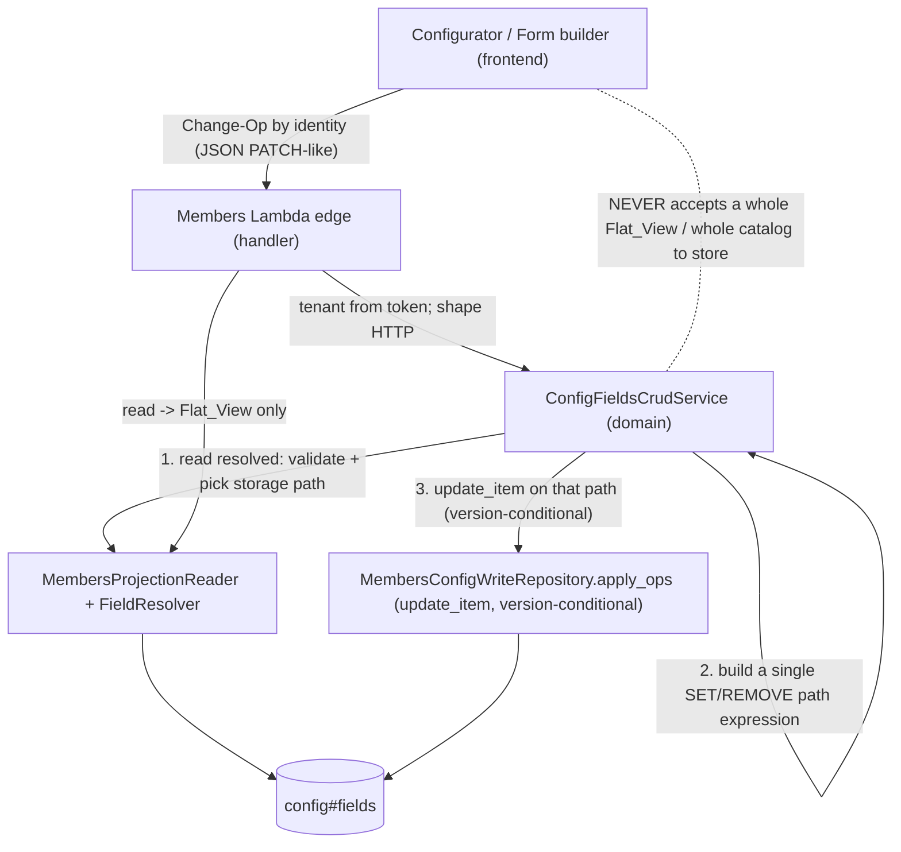

# Design — Foolproof CRUD for `config#fields` (SAM plane)

- Status: **Draft** (design phase — review before tasks). Follows `requirements.md` (R1–R11; R11 is
  the mechanical-enforcement requirement).
- Grounded in verified live code (2026-10-26). Real symbols cited so the design is checkable, not
  aspirational. Governing steering 35/38/39/34/42; proposes ADR 0009 (R10). Incorporates the external
  design review (Must-fix #1–4, Should-fixes) — see `design-review.md` §"External review" for the trail.

## Overview

Make `config#fields` CRUD foolproof by three structural moves, each closing one proven failure:

1. **Change-Op writes, server-owned placement** (R2) — the client sends intent by identity; the
   server decides storage placement. The whole-record replace leaves the client-reachable path.
2. **Write by `update_item` PATH, not whole-record put** (R1/R4) — the server resolves the record
   ONLY to validate the op and decide its storage path, then issues a single `update_item` addressing
   that one path. DynamoDB leaves every other attribute physically untouched, so base definitions and
   untouched slices survive and the `functional_groups` catalog can never be truncated by a partial
   payload — this is structural, not "safe only if an in-memory merge is perfect".
3. **Prove it with an E2E invariant harness** against local DynamoDB seeded with the real `h-dcn`
   row (R9) — read→write→read changes only the named target.

The storage stays the nested delta; the read stays the Flat_View; the one translation (identity →
storage path) lives server-side only.

## What exists today (so the design extends, not reinvents)

- **Write:** `ConfigWriteService.put_config(tenant_id, config_id, body)` → `_validate_fields_body`
  → `_merge_fields_slices` (read-modify-write) → `MembersConfigWriteRepository.put_config` =
  `put_item` FULL REPLACE. Application-attr validation in `_validate_application_attributes`.
- **Read/resolve:** `FieldResolver.resolve` = base ⊕ overlay; `MembersProjectionReader.get_overlay`
  / `get_raw_fields_overlay` (one-key wire contract `overrides`↔`fixed_overrides`).
- **Public read:** `get_public_field_config` / `_serialize_public_field` (filters `application_visible`).
- **Gap:** the write is a whole-row `put_item` with a best-effort service-side merge (reader-dependent);
  `functional_groups` is replace-if-non-empty (a partial list still truncates); the client still sends
  a whole-ish object; there is no version-conditional guard (last-writer-wins); and there is no E2E
  proof. This design replaces the whole-row put + merge with per-path `update_item` (see Components).

## Architecture

## Components

> **This design is authoritative.** The mechanism below (`update_item` PATH expressions;
> `functional_groups` migrated LIST→MAP; a `dynamodb:UpdateItem` IAM grant; a version-conditional
> guard; `ExpressionAttributeNames` for dotted keys; a one-route Change-Op body) is already folded in
> throughout. `design-review.md` is the AUDIT TRAIL — the mechanism-level questions, verified facts,
> and why each choice was made; consult it for the "why", not for a competing design.

### C1 — `ConfigFieldsCrudService` (domain; wraps/extends `ConfigWriteService`) — R1/R2/R4/R6
The single authority for config#fields mutations. Public operations (identity-keyed, no storage
shape). **The DEFINITION ops and the APPLICATION op are disjoint (review Must-fix #3)** — `set_field`
owns field DEFINITION attributes only; `set_field_application` owns the four application attributes
only. They do NOT overlap in name or surface, which is what makes D3(A)'s "narrow surface" stability
argument hold: the form-builder op is structurally unable to touch a field/group definition.

- `set_field(tenant_id, field_key, def_attrs)` — `def_attrs ⊆ {type, label, order, required, visible,
  choices, options, scope, functional_group}` — field DEFINITION only; **NO `application_*`**. Server
  decides `fields` (variable) vs `overrides` (base/calculated) placement via the fixed-field registry
  (`fixed_fields.field_by_key`).
- `set_field_application(tenant_id, field_key, app_attrs)` — `app_attrs ⊆ {application_visible,
  application_required, application_choices, format}` — the four form attributes ONLY (fully-qualified
  names, so no collision with the definition `visible`/`required`/`choices`). This is the ONLY op the
  application-form builder calls (D3(A)); it can never reach a definition attribute.
- `reset_field(tenant_id, field_key)` — remove the tenant override entirely (`REMOVE overrides.<dotted>`),
  reverting a base/calculated field to its code-defined base (review Should-fix; falls out of D4). For a
  variable field, see `delete_field`.
- `delete_field(tenant_id, field_key)` — explicit; only a tenant-added VARIABLE field is deletable (a
  base field is never deleted — use `reset_field` to drop its override). **Safety (review Should-fix):**
  before deleting, check the field is not in use — no member records store a value under that key and no
  group/application reference dangles — and REFUSE with a caller-safe reason if it is; the UI offers
  `visible=false` (hide) as the safe alternative. (Mirrors the group delete-when-empty guard, extended
  to fields so a delete can't orphan member data.)
- `set_group(tenant_id, group_key, attrs)` — `attrs ⊆ {label, order}`. Materializes a base group as a
  tenant override if absent (R4.1).
- `delete_group(tenant_id, group_key)` — explicit; refused when non-empty (existing guard).

**Clear-vs-unchanged semantics (review Should-fix):** within an op's attrs, an ABSENT key means
"leave untouched" (no path written); an explicit `null` means "remove that attribute" (a scoped
`REMOVE` of just that aspect). Reverting a whole override is `reset_field`, not an attrs payload of
nulls.

Mechanics (the foolproof core — corrected per design-review Q2/Q8):
1. **Read the Resolved_Record** (fresh reader per call — no stale cache) to VALIDATE and to DECIDE
   PLACEMENT only — NOT to read-merge-write the whole record.
2. **Resolve placement by identity:** a base/calculated field → `overrides.<dotted>`; a variable
   field → `fields.<key>`; a group → `functional_groups.<gkey>` (post-migration map). Validate the op
   (application attrs, enum/scope/reference subset, platform-required no-relax, delete-when-empty).
3. **Issue a SINGLE path `update_item`** addressing only that identity, e.g.
   `SET #fields.#k.#attr = :v` / `SET #overrides.#dotted.#attr = :v` / `SET #fg.#gkey = :g` /
   `REMOVE …`. DynamoDB leaves every other attribute PHYSICALLY untouched — there is nothing to
   truncate because the write never addresses the parts it doesn't name. Dotted override keys bind
   via `ExpressionAttributeNames` (`#dotted`), never inline (the `.` would be parsed as a path).
   **Parent-map seeding (review Must-fix #1 — `if_not_exists` does NOT work):** DynamoDB REJECTS a
   single expression that both seeds a parent and sets a child path (`SET #fields = if_not_exists(...)`
   together with `SET #fields.#k...` → "Two document paths overlap"), and rejects `SET a.b.c` when
   `a.b` does not exist. So seeding-in-the-same-op is impossible. Instead: (a) **guarantee the row
   skeleton** — `{fields:{}, overrides:{}, functional_groups:{}}` is created at tenant-create time and
   backfilled by the migration, so the parent maps always exist; AND (b) **placement chooses the verb
   by existence** — CREATE a new entry with `SET #o.#k = :whole_entry_map` (the whole entry), UPDATE an
   existing entry's aspect with `SET #o.#k.#attr = :v`. The version/existence condition (step 4) covers
   the create-vs-update race.
4. **Version-conditional** (R6, review Must-fix #2): `ConditionExpression` guards the write AND the
   bump of `version` in the same expression. Three cases: (i) existing row with a `version` →
   `version = :base`; (ii) existing row with NO `version` (legacy, pre-version) → `attribute_not_exists(version)`
   so the first versioned write isn't spuriously rejected (the migration SHOULD backfill `version`, but
   the branch is the belt); (iii) no row yet → `attribute_not_exists(sk)`. Stale base → caller-safe 409,
   NO change. The validate-and-place read in step 1 uses **`ConsistentRead=True`** (review Should-fix)
   so a stale read never produces a spurious 409.

Crucially: there is **no public method that accepts a whole `functional_groups` object or a whole
overlay to replace**. Each op addresses ONE path, so a partial payload physically CANNOT truncate the
catalog or any slice (R1.3/R4.2) — this is structural, not "safe if the merge is perfect".

### C2 — `MembersConfigWriteRepository` — path `update_item` + version-conditional (R2/R6)
Add an `apply_ops(tenant_id, config_id, ops, base_version, client_op_id=None)` method that issues ONE
`update_item` with a combined `UpdateExpression` built from the ops' SET/REMOVE paths, plus the
version `ConditionExpression` (C1 step 4), bumping `version` in the same expression. Uses
`ExpressionAttributeNames` for every key segment (dotted override keys mandatory).

**Multi-op semantics (review Should-fix):** a request MAY carry several ops; they apply
ALL-OR-NOTHING in the single `update_item` (one atomic write). Overlapping paths are REJECTED up
front with a caller-safe error (e.g. `SET overrides.x` + `SET overrides.x.label` is the same
"document paths overlap" class DynamoDB would reject — the service catches it before the call so the
error is intelligible).

**Concurrency + retry (review Should-fix, with a guardrail):** under D3(A) the configurator and
form-builder share one row, so a row-level `version` conflict can arise from UNRELATED edits. On a
409, the service re-reads (ConsistentRead), re-validates, and retries the op set **once** — but ONLY
when the ops are non-overlapping and idempotent by identity; if the retry also conflicts, surface the
409 to the user (never loop, never paper over a genuine concurrent edit to the SAME path). (Note: this
shared-row contention is itself an argument for D3(B) — a separate application-form record removes it.)

**Idempotency (review Should-fix):** an optional `client_op_id` lets a lost-response retry be
recognized — if the same `client_op_id` already produced the current `version`, return success rather
than a spurious self-409.

Keeps the closed writable-id set + fail-fast table + non-empty tenant guard. **IAM:** `template.yaml`
Sid `MembersWriteGovernanceProjectionConfig` gains `dynamodb:UpdateItem` (today PutItem-only —
verified). The legacy whole-row `put_item` is retained ONLY for the deliberate full-record
create/migration primitive (C6), never on the Change-Op path (R1.5). `MembersConfigWriteRepository`
remains the SOLE governance-table writer in `sam/` (verified), which makes the enforcement guard
tractable (R11.2).

### C3 — Read stays the Flat_View; raw shape fenced (R3, steering 39)
`get_field_config` / `get_public_field_config` unchanged (correct today). The raw
`get_raw_fields_overlay` becomes an **internal** read used only by C1's validate-and-place step — it
MUST NOT be surfaced in an API response (steering 39 guard). The frontend stops receiving
`field_overlay`; it reads the Flat_View and writes Change-Ops. (This is the frontend half of decision
B; it retires the overlay-model write path that caused the drift.) The read contract is byte-for-byte
unchanged, so the READ-ONLY consumers — Members Overview, the member Add/Edit/View modal, Members
Analytics — are untouched (requirements → "Impact on Members Overview…").

### C4 — ENUM / SCOPE / REFERENCE (R5)
- **ENUM:** keep + strengthen the `_build_override` `options or choices` fallback so a tenant enum
  value never drops; a `set_field` choices change rewrites only `options`/`choices`, preserving other
  attrs. Resolver keeps `choices` coherent with `options`.
- **SCOPE:** `set_field` preserves the `scope` sub-object verbatim; `config#scope` derivation
  (separate row) is unchanged; a scope-dimension-backed choiceless enum keeps sourcing from
  `config#scope` values (single source). A group/field write never touches `config#scope`.
- **REFERENCE:** `membership_type` subset validates against the live catalog (`application_choices`
  dangling-entry fail-loud), via the shared `application_choices` authority — unchanged, re-used.
- All three validated through ONE path shared by the public read and submit validator (no drift).

### C5 — E2E invariant harness (R9) — the proof + the reusable framework
A new `sam/tests/e2e/` layer:
- **Local DynamoDB fixture:** a pytest fixture that targets the `amazon/dynamodb-local` container
  (steering 42) — `AWS_ENDPOINT_URL_DYNAMODB` + a test table — seeded from a COMMITTED real-`h-dcn`
  fixture (`sam/tests/fixtures/hdcn_config_fields_overlay.json`, already captured) via the seed
  script pattern (`scripts/local/seed-dynamodb-local.py`).
- **Invariant engine:** `assert_change_op_isolated(before, op, after)` — diffs the FULL resolved
  record before/after and asserts only the op's named target changed; everything else (every group,
  every field, every attribute) byte-identical. Reused across op kinds.
- **Truncation tripwire:** the exact occurrence-3 scenario — a partial groups payload MUST NOT reduce
  the catalog; asserted.
- **Reusability:** the harness takes a (reader, writer, record-id, change-op) tuple, so `config#scope`,
  `config#mail`, and member records can reuse the same invariant with new op definitions.
- Fast unit tests (in-memory fakes) stay for signature-level checks; E2E is the authoritative gate.
- **Harness gaps the review flagged (R9):** (i) local DynamoDB does NOT enforce IAM, so a missing
  `dynamodb:UpdateItem` grant PASSES E2E and only fails in AWS — add a **deployed-stage smoke test**
  (a real `update_item` against the TEST stack) so the IAM grant is actually exercised. (ii) Add a
  **stale-writer** case (two clients, one base version → second rejected atomically). (iii) Add a
  **randomized op-sequence** run through `assert_change_op_isolated`. (iv) Add a **migration test**
  (LIST→MAP) asserting the same invariant. (v) Add an **orphaned-override** case: a base field
  renamed/removed in code leaves a dangling tenant override — a harness/startup check surfaces it.

### C6 — Row skeleton + the whole-row primitive (create/migration only) — review Must-fix #1/#4
The path `update_item` model REQUIRES the parent maps to exist (C1 step 3). So the row skeleton
`{fields:{}, overrides:{}, functional_groups:{}}` (+ a seeded `version`) is guaranteed by TWO
write-time paths, which are the ONLY sanctioned uses of the whole-row `put_item` primitive:
- **Tenant create:** a new tenant's `config#fields` is created with the empty skeleton + `version`.
- **Migration:** the LIST→MAP migration (D2a) backfills the skeleton shape AND backfills `version` on
  legacy rows (so C1 step 4 case (ii) is rare, not the norm), as a one-time whole-row write.
Both run through the invariant harness against a **copy of PROD** with a PITR restore point / on-demand
backup taken first (review Must-fix #4). After these, every runtime write is a path `update_item`; the
whole-row `put_item` is unreachable from the Change-Op path and is guarded by R11 (enforcement).

## Key decisions

### D1 — Change-Op, not whole-object (R1/R2)
The client sends intent by identity; the server owns placement and assembles the full item. This is
the only model that makes truncation *structurally impossible* — the whole-record-replace operation
does not exist at the service boundary. (Seed-full-on-load was rejected: it is the failed "client
owns the full shape" model with a bigger seed.)

### D2 — Resolve to VALIDATE + PLACE, then a single path `update_item` — NOT a whole-record merge (R1.4/R4.2)
Because base definitions live in code, the service reads the resolved record (base ⊕ overlay), but it
uses that read ONLY to (a) validate the op and (b) decide the storage path for the named identity
(variable → `fields.<key>`; base/calculated → `overrides.<dotted>`; group → `functional_groups.<gkey>`).
It then issues a single `update_item` on that path — it does NOT read-merge-write the whole record.
This removes the residual "safe only if the in-memory merge is perfect" risk: DynamoDB never writes
the attributes the op did not name, so base definitions and untouched slices survive by construction.
This is the one non-obvious rule specific to config#fields' base⊕overlay model (vs. a plain member
record, where the stored row IS the full record). See `design-review.md` Q2/Q8 for the verified facts.

### D3 — R7 recommendation: **(A) keep application attributes inline, but fully protected** — with (B) as a documented future option
Recommended for v1: keep `application_*` inline on `config#fields`, but route ALL form-builder writes
through a `set_field_application` Change-Op that can ONLY touch the four application attributes of a
named field — it is structurally incapable of writing field/group definitions (R7.2 satisfied by the
op's narrow surface, not by a separate table). Rationale: (A) avoids a data migration + a read-path
split now, and the Change-Op model already delivers the stability guarantee. (B) separate
`config#application_form` record remains the cleaner long-term end-state (full blast-radius isolation)
and is recorded in the ADR as the deferred option; choose it later if form config grows independent
of field defs. **Decision to be ratified at design review** — both satisfy R7.2; (A) is less work now.

### D4 — Minimal-delta authoring (don't fatten the stored row)
When a base field/group is overridden, the path `update_item` SETs ONLY the changed aspect(s) under
`overrides.<dotted>` / `functional_groups.<gkey>` (not a full resolved copy). Keeps the stored row a
true delta, avoids the "fat stored entry" we saw on PROD (which, while not itself the bug, enlarges
blast radius). Because each op is a single path SET/REMOVE, "minimal delta" is the natural outcome,
not something a merge has to be careful to produce.

### D5 — Version-conditional `update_item` for concurrency (R6)
Last-writer-wins silently lost updates is a latent corruption vector (verified absent today — there
is no `ConditionExpression` on the config write). Each Change-Op's `update_item` carries a
`ConditionExpression` on `version` (= the base version read, or `attribute_not_exists(sk)` first
write) and bumps `version` in the same expression, so a stale write fails cleanly (no partial change),
surfaced to the UI as a refresh-and-retry.

## Error handling
- Validation errors (malformed op, subset ⊄ choices, unknown checker, relax of platform-required,
  delete non-empty group) → `ConfigWriteValidationError` → 400/caller-safe (steering 35).
- Stale version → conflict (409) → caller-safe "reload and retry".
- No raw internals leaked (steering 39). Unknown exceptions → generic envelope + error_id.

## Testing strategy (R9, steering 34)
- **E2E (authoritative):** local-DynamoDB, real h-dcn row, the invariant engine over every op kind +
  the truncation tripwire. Change-with-tests: any op behavior change updates its invariant case.
- **Unit (fast):** in-memory fakes (existing pattern) for op placement, validation, conditional-write
  rejection, enum/scope/reference edge cases.
- **Frontend:** the configurator/builder switch to Change-Op calls + Flat_View read; tests assert no
  raw overlay shape is sent or consumed.

## Migration / rollout — shippable slices (adopts the review's phasing)
Sliced so each step ships independently and the SAFETY lands even if the frontend rework slips
(review's phasing suggestion). Slices 1–2 close occurrence 3 server-side on their own.

- **Slice 1 — Harness + row skeleton + migration (safety foundation):** the E2E invariant harness
  (C5); guarantee the `{fields,overrides,functional_groups}` skeleton at tenant-create (C6); the
  `functional_groups` LIST→MAP migration + `version` backfill, run through the harness against a PROD
  copy with a PITR/backup restore point first (C6, review Must-fix #4); add the `dynamodb:UpdateItem`
  IAM grant (today PutItem-only).
- **Slice 2 — Change-Op CRUD + version guard (closes occurrence 3):** `set_field`,
  `set_field_application`, `reset_field`, `delete_field` (with the usage-safety guard), `set_group`,
  `delete_group`, and `apply_ops` (path `update_item`, version-conditional, multi-op atomic,
  one-shot retry, `client_op_id`). Behind the existing route; server-side only. The truncation class
  is now structurally gone even before the frontend changes.
- **Slice 3 — Frontend switch:** configurator + form builder call Change-Ops + read the Flat_View;
  retire the overlay-model write path and the `field_overlay` response key (steering 39). Add the
  deprecation guard: the server rejects a stale SPA bundle that still sends a whole object with a
  clear "reload the app" error for a window (review Should-fix), not an obscure failure.
- **Slice 4 — Retire the whole-object path:** remove the client-reachable whole-object replace (R1.5);
  the whole-row `put_item` remains only the C6 create/migration primitive.
- **Slice 5 — R7(B) ONLY if needed:** migrate inline application attrs → `config#application_form`,
  PROD as source, invariant-harness-verified. (The shared-row contention noted in C2 is the trigger
  that would justify B.)

ADR 0009 + steering 38/39 updates land with the code (change-with-review), across the slices they
touch.

## Risks
- **Frontend rework scope:** switching the configurator/builder off the overlay model is real work —
  phased, with the E2E invariant as the gate so it can't regress.
- **Local-DynamoDB in CI:** the E2E layer needs the container available; gate it so unit tests still
  run without it, and run E2E in the nightly suite (steering 43) if per-PR container is heavy.
- **R7 (A vs B):** pick at review; (A) ships faster, (B) is cleaner — the ADR records whichever and
  why, so it's a deliberate, reviewable decision, not a drift.
