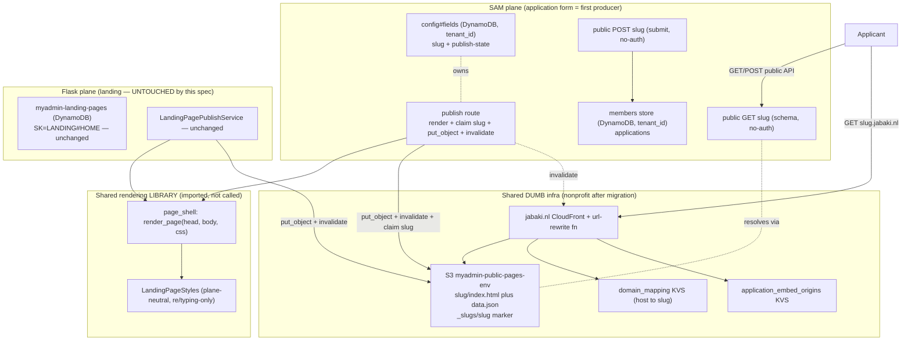

# Design — 14. SAM Public-Pages Platform (application-form-first)

- Status: **Draft** (design phase — review before tasks). Implements `requirements.md`
  (R1–R10, contiguous — renumbered 2026-11-01; old `R2c`→R3, `R3a`→R4, old `R3`→R5, `R4`→R6,
  `R5`→R7, `R6`→R8, `R7`→R9; R10 = security, added 2026-11-01).
- **Reframed 2026-11-01.** This spec builds a **SAM-plane public-pages platform** with the member
  application form as the FIRST producer. It does **NOT** reshape the Flask landing module. The old
  design open questions OQ1 (new `tenant_pages` MySQL table) and OQ2 (re-key the
  `myadmin-landing-pages` DynamoDB store) are **WITHDRAWN** — recorded in the ADR (R8). The
  remaining design decisions (slug marker, shared rendering library, SAM public data path) are
  below.
- **Prerequisite (partial):** `.kiro/specs/myBacklog/jabaki-hosting-migration-to-nonprofit`. Its
  completion gates ONLY this spec's *live-publish* step (the S3 write + CloudFront invalidation
  against the nonprofit-owned bucket/distribution). All account-agnostic work (slug marker, shared
  library, SAM public `GET`/`POST`, prefix validation, tests) proceeds in parallel.

## Overview

A public page is produced by a **producer** — a page kind that owns its own data and publishes an
artifact into shared, dumb infrastructure. The application form is the first producer. Each
producer satisfies FOUR contracts; nothing else reads its store or calls it at request time:

1. **Owns its data** under its plane's own tenancy (`tenant_id` for SAM; the form on its
   `config#fields` row, spec 12).
2. **Claims/resolves its slug** via the shared `_slugs/{slug}` S3 marker (atomic claim,
   resolve-by-body).
3. **Renders** via the shared, dependency-free rendering LIBRARY (`page_shell` + `LandingPageStyles`).
4. **Publishes** its `{slug}/index.html` (+ optional data artifact) into the shared bucket, behind
   the shared `*.jabaki.nl` CloudFront distribution + stateless slug-path rewrite.

"Page is the unit, N pages per tenant" is realized IN THE SAM PLANE. The Flask landing module is
left exactly as-is; it remains a 1:1 landing producer today and is a FUTURE candidate to migrate
INTO this platform on the same four contracts (a later spec, not this one).



## Withdrawn open questions (were OQ1 / OQ2)

> **OQ1 — new Flask `tenant_pages` table: WITHDRAWN.** The Flask landing module is not reshaped by
> this spec (requirements Scope decision). SAM page identity lives on the SAM `config#fields` row
> under `tenant_id`, not in any Flask table.
>
> **OQ2 — re-key `myadmin-landing-pages` to a per-page SK: WITHDRAWN.** The landing DynamoDB key
> shape (`PK=TENANT#{slug}, SK=LANDING#HOME`) is left exactly as-is. A future landing migration
> into this platform will carry landing onto SAM's model; it will not re-key the live Flask store
> in place.
>
> Rationale (recorded in the ADR): the sustainable home for tenant-specific websites is the SAM
> plane; reshaping the Flask store first is work discarded at the SAM move and risks the live
> landing tenants for no lasting gain.

## Resolved design decisions

### D-SLUG — Slug uniqueness + resolution: the S3 `_slugs/{slug}` marker as the atomic cross-plane gate (R4; keep spec 12's mechanism)

> (This was "OQ3" in the earlier draft. With OQ1/OQ2 withdrawn, it is a settled design decision,
> not an open question — relabeled accordingly.)

**Uniqueness (the authoritative gate):** an ATOMIC conditional `put_object _slugs/{slug}` with
`If-None-Match: *`. It succeeds only if the object does not exist; a racing claimer from ANY
plane/kind gets `412 PreconditionFailed` -> `SlugTaken`. The condition IS the check, so there is no
check-then-write race — this is what makes cross-plane uniqueness true without a shared database.

```python
def claim(slug, owner):             # owner = {owner_plane, kind, tenant_id, resource_ref}
    try:
        s3.put_object(Bucket=B, Key=f"_slugs/{slug}",
                      Body=json(owner), IfNoneMatch="*")
    except PreconditionFailed:      # 412
        raise SlugTaken(slug)
```

**The marker body — the extensible producer contract:**

```json
{ "owner_plane": "sam", "kind": "application_form", "tenant_id": "...", "resource_ref": "..." }
```

- `owner_plane` — which plane owns the slug (`sam` for the form; a FUTURE migrated landing flips to
  `sam`). This is how a slug resolved at the SAM edge that is owned by a different plane/kind yields
  a clean, non-probeable 404 — decided from the body, never by parsing the slug.
- `kind` — **an OPEN, extensible set, NOT a closed enum.** `application_form` is implemented now;
  `webshop`, `event_calendar`, and `landing` are named here as EXPECTED FUTURE kinds — **including
  but not limited to these**. Adding a kind is a new `kind` value in the body + a new producer; the
  resolver, the CloudFront function, and the rendering library do NOT change.
- `tenant_id` — the owning tenant in the owner plane's own tenancy vocabulary.
- `resource_ref` — a back-pointer to the producer's own record for this page (for the form, its
  `config#fields` row). Lets the owner find its own data without anyone else knowing the shape.

**Resolution:** the submit/schema edge does `get_object _slugs/{slug}` and decides ownership by
READING THE BODY (`owner_plane`/`kind`), NEVER by parsing the slug string. Scan-free; keeps the SAM
`tenant_id`-PK governance invariant intact (no slug-partitioned item, no GSI backfill).

**Layering:** per-producer `UNIQUE`/validation (SAM config-row slug check) is a FAST-FAIL UX check
only; idempotent same-owner re-publish allowed (body matches); rename claims-new-before-releasing-
old; publish won't clobber a foreign artifact (owner-tag backstop).

- **Verify-before-lock:** confirm S3 `If-None-Match: *` is supported for the target bucket/region
  (broadly GA, but confirm). If not, the sanctioned fallback is a DynamoDB conditional
  `PutItem(attribute_not_exists(pk))` on a dedicated slug-claim table — S3 conditional put
  preferred. This verification is the FIRST task (Task 1).

### D-RENDER — Shared rendering library: extract a plane-neutral `page_shell` + reuse `LandingPageStyles` (R7; VERIFIED extractable)

> (This was "OQ4" in the earlier draft — now a settled design decision.)

Confirmed by reading the code: `LandingPageStyles` imports only `re` + `typing` — **no Flask, no
boto3, no DB** — so it is already a plane-neutral static CSS/HTML-fragment generator and can be
shared as-is. The HTML shell (the SEO/OG/CSS/header/footer scaffold in `generate_index_html`) is a
pure f-string over a `published_data`-shaped dict; extract it into a dependency-free
`page_shell.render_page(head_meta, body_html, css)` module.

- The SAM form renders its shell via `page_shell.render_page` (form body = `ApplicationFormRenderer`
  output shell).
- **The Flask `generate_index_html` is NOT refactored by this spec** (that is a landing-module
  change — Scope decision). Extracting `page_shell` from a COPY of the shell logic is fine; the
  live Flask function keeps calling its own code. Sharing the library back into the landing plane is
  a FUTURE opportunity, noted, not done here.
- **Sharing is as a LIBRARY (pure functions), never a runtime call or a shared store** (R7.3 /
  steering 35 "share the mechanism, not the store"). Packaging: a small plane-neutral module
  vendored where SAM can import it (`sam/shared`-style vendor) — exact packaging decided in Task 2.
- If extraction surfaces a hidden coupling at implementation time, fall back to SAM-renders-own-
  shell for v1 and defer the shared shell (R7.2 — noted, not silently dropped).

## Architecture

The platform is five components over one shared, dumb infrastructure. C1 (slug marker) is the
cross-plane spine; C2 is the first producer (the application form) wiring publish + the two public
endpoints; C3 is the shared rendering library; C4 is the existing serving/custom-domain layer; C5
is the read-only tenant-prefix projection. Data flows (see the Overview diagram): a publish claims
a slug via C1, renders via C3, and writes an artifact into the shared bucket (C4); a public request
resolves the slug via C1 and either returns the whitelisted schema (C2 `GET`) or writes a
submission into the SAM members store (C2 `POST`). No component reads another plane's store or
calls another plane at request time.

## Components and Interfaces

### C1 — Slug marker store (shared mechanism) [R4]
`slug_marker_store` (in `sam/shared`): `claim(slug, owner)` -> conditional `put_object` (412 ->
`SlugTaken`); `resolve(slug)` -> marker body `{owner_plane, kind, tenant_id, resource_ref}`;
`release(slug)`. Ownership decided from the BODY. `kind` open set. This is the one shared surface
that lets any producer — the form now, a webshop/calendar later, a migrated landing page
eventually — claim and resolve a slug atomically without a shared database.
- **SEC — slug squatting / phishing (SEC-4):** the slug namespace is global and first-come, and
  pages serve under trusted `*.jabaki.nl`, so an impersonating slug (`bank-of-x-apply`) is a
  phishing risk. Mitigation is the tenant-prefix rule (C5 / R2.3): a claim must be under the
  AUTHENTICATED tenant's `public_prefix`, enforced on EVERY claim path (the uniqueness gate R4.1 is
  tenant-agnostic, so prefix enforcement is a required SEPARATE layer — if any claim path skips it,
  squatting reopens). The owner-tag clobber backstop (Property 6) is defense-in-depth on top.
- **SEC — marker/artifact integrity (SEC-8):** publish IAM is LEAST-PRIVILEGE and PREFIX-SCOPED —
  a producer may write only its own `{slug}/*` and `_slugs/{slug}` for slugs it owns, never
  bucket-wide `s3:PutObject`. Over-broad write would let one producer overwrite another's marker
  (hijack a live page) or artifact. Scope is pinned in the gated IAM task (Task 9) and reviewed
  Terraform-plan-first (steering 43).

### C2 — SAM application-form producer [R1/R3/R5]
- **Publish** (members:admin, readiness-gated — the existing
  `POST /members/application-form/publish` route): render the form via `get_public_field_config` +
  shared `page_shell`, conditional-claim `_slugs/{slug}` (C1), `put_object {slug}/index.html` +
  `{slug}/form.json`, invalidate. Same-account (nonprofit) IAM — the LIVE write is **gated on the
  hosting migration**; claim + render run now.
- **Public `GET {slug}`** (no auth): resolve slug via the `_slugs/{slug}` marker -> tenant/form,
  publication-gate (unpublished -> non-probeable 404), return the applicant schema through an
  EXPLICIT whitelist (R5.2). No `extract_user_credentials`.
  - **SEC — whitelist completeness (SEC-1):** the whitelist is an allowlist keyed by field; a field
    NOT on it is omitted by default. A new/unknown config attribute therefore defaults to HIDDEN,
    never leaked. Secrets appear at most as a boolean existence flag, never their value. A paired
    test asserts no un-whitelisted field escapes into the `GET` response (fail-closed).
  - **SEC — enumeration safety (SEC-5):** "unpublished" and "unknown" return an IDENTICAL,
    timing-insensitive 404 body/status so a caller cannot enumerate which slugs/tenants exist.
- **Public `POST {slug}`** (no auth): resolve slug AS DATA -> write the application into the
  MEMBERS MODULE's own `tenant_id`-partitioned store via its own Lambda (`create_application`);
  token-less, non-probeable; Lambda role needs PutItem on the applications table (verify — R5.5).
  - **SEC — abuse controls (SEC-2):** because this is an unauthenticated write against a
    pay-per-request table, it carries (a) a per-source rate limit / throttle at the API edge,
    (b) a CAPTCHA or equivalent challenge on the submit (defense against automated flooding),
    (c) strict server-side validation — payload SIZE CAP plus PER-FIELD TYPE / ALLOWED-VALUE
    checks (email is an email, enum values within the published options, required fields present,
    unexpected fields rejected) before the write, and (d) an eye on cost-amplification (throttle is
    the economic-DoS backstop). These are REQUIRED before the public submit goes live, not optional
    hardening.
  - **SEC — applicant PII (SEC-9):** a submission is PERSONAL DATA (name, email, address, possibly
    DOB, free-text). It is handled accordingly: minimized to the fields the form declares, scoped
    to the owning `tenant_id`, and subject to the tenant's retention + a deletion path. For EU
    tenants on `jabaki.nl` this is a GDPR obligation (lawful basis, minimization, erasure), not
    just hygiene.
  - **SEC — stored-XSS on re-display (SEC-10):** applicant-supplied free-text (which may contain
    `<script>`/HTML) is later rendered in the tenant's AUTHENTICATED admin review UI. Submitted
    values are sanitized/encoded at the trust boundary (store raw, encode on output, or sanitize on
    input — decide and record) so a malicious submission cannot execute script in an admin's
    session. This is distinct from SEC-1 (which governs the public READ); SEC-10 governs the
    admin-side re-display of inbound data.
  - **SEC — cross-tenant write safety (SEC-3):** tenant is resolved ONLY from the marker body
    (Property 2 / Property 3), never by parsing the slug; the write is scoped to that
    `tenant_id`. A foreign/cross-plane slug is rejected. This is the highest-impact isolation
    guarantee and is proven by real-behavior tests (T5 + Task 4 cross-tenant rejection), never a
    mock.
- API has **no default authorizer**; public functions carry **no `Auth` block**.
- **SEC — public-API DoS (SEC-6):** the public `GET/POST {slug}` functions sit behind edge
  throttling / WAF; CloudFront fronts the static artifacts but the API compute is the exposed
  surface. No-scan resolution (Property 4) removes the DynamoDB cost-amplifier; throttling bounds
  the Lambda/marker-lookup load from `GET {random-slug}` floods.

> **Pattern source + the one anti-pattern to avoid.** The public no-auth shape above (no default
> authorizer, no `Auth` block, no `extract_user_credentials`, explicit whitelist, publication gate
> in the resolve) is adopted from **h-dcn** — a prior single-tenant public-page app used here as a
> PATTERN SOURCE only (the build target is myAdmin). The ONE thing NOT to copy: h-dcn resolves a
> slug by SCANNING its whole DynamoDB table (its Events table has no slug index). A full-table scan
> on an unauthenticated public path is slow, cost-unbounded as the table grows, and a soft-DoS
> surface — tolerable for h-dcn (single-tenant, tiny table), NOT for myAdmin's large shared tables.
> We resolve by a single keyed `get_object _slugs/{slug}` (O(1), D-SLUG) instead — never a scan.

### C3 — Shared rendering library [R7]
`page_shell.render_page(head_meta, body_html, css)` + the shared `LandingPageStyles`, plane-neutral
and dependency-free, imported by C2 (and available to any future producer). The live Flask landing
renderer is NOT modified.

### C4 — Serving + custom domains [R6]
Existing `*.jabaki.nl` distribution + stateless slug-path rewrite (no new per-tenant infra, no
request-time lookup). Custom domains per page via `tenant_custom_domains` + ACM + CloudFront alias
+ `domain_mapping` KVS, URL preserved (no redirect). CSP `frame-ancestors` from
`application_embed_origins` KVS (deny `'none'` when absent). All of this lives in **nonprofit after
the migration** — the gated dependency for the live write path.
- **SEC — clickjacking / embed (SEC-7):** `frame-ancestors` DEFAULTS CLOSED — a host with no
  `application_embed_origins` entry denies framing (`'none'`), so a missing entry can never
  fall open to allow-all. The embed-origins list is tenant-authored, so each entry is
  INPUT-VALIDATED (well-formed origin, no `*` wildcard-all, no injection) before it is written to
  the KVS. A default-allow bug here is a clickjacking / overlay-phishing surface, so it is a
  stated property, not an assumption.

### C5 — Tenant public prefix (projection, read-only in SAM) [R2]
`tenants.public_prefix` is authored Flask-side as a tenant-record attribute and projected READ-ONLY
onto the already-projected `tenant` row (`SK="tenant"`). SAM reads the prefix from its own projected
row and validates a new slug (`{prefix}` / `{prefix}-{suffix}`) WITHOUT calling Flask. This touches
the tenant record + the projection builder ONLY — not the landing module.

## Data Models

```
config#fields (SAM DDB, tenant_id)  — the form's slug + published_at/version (spec 12); page identity
members applications (SAM DDB, tenant_id) — where POST slug writes the submission
tenant record (MySQL) + projected tenant row (SAM DDB) — + public_prefix (R2, additive)
tenant_custom_domains (MySQL)       — unchanged shape; a row references a page via its slug
S3 myadmin-public-pages-env:
  slug/index.html                   — rendered page (shared page_shell)
  slug/form.json                    — form data artifact
  _slugs/slug                       — slug->owner marker (R4), control-plane, never served

NOT touched by this spec:
  myadmin-landing-pages (DDB)        — Flask landing store, SK=LANDING#HOME — LEFT AS-IS
  tenant_slugs (MySQL)               — Flask landing 1:1 registry — LEFT AS-IS
```

## Correctness Properties

Property 1: Global slug uniqueness (cross-plane, cross-kind)
At most one owner per slug, guaranteed by the atomic conditional `put_object` on `_slugs/{slug}` (D-SLUG) — the S3 condition IS the check, so N concurrent claimers yield exactly one winner and N−1 `SlugTaken` (T2, T3).
**Validates: Requirements 4.1, 4.4, 4.6**

Property 2: Resolve-by-body, never by name
Ownership/kind/tenant are read from the marker BODY; no code infers them by parsing the slug string. A slug owned by a different plane/kind resolved at the SAM edge is a clean, non-probeable 404 (T5).
**Validates: Requirements 4.2, 2.4, 5.3**

Property 3: Plane isolation (steering 35 rule 5a)
A producer touches only its own store. The SAM form reads/writes SAM-owned DynamoDB (`config#fields`, members applications) under `tenant_id`; it never reads/writes Flask's store or calls Flask at request time. The Flask landing module is unmodified (landing-plane non-regression).
**Validates: Requirements 3.2, 3.3, 1.4, 9.5**

Property 4: No scan on the public path
Slug resolution is an O(1) keyed `get_object`, never a full-table scan (the h-dcn anti-pattern, C2).
**Validates: Requirements 5.3**

Property 5: Publication gate is non-probeable
An unpublished or unknown slug returns an indistinguishable 404 — a caller cannot tell "exists but unpublished" from "does not exist."
**Validates: Requirements 5.3**

Property 6: Idempotent, safe republish/rename
A same-owner re-publish is allowed (body matches); a rename claims the new slug BEFORE releasing the old, so a crash mid-rename never double-owns or orphans a slug; a publish never clobbers a `{slug}/` artifact it did not author (owner-tag backstop).
**Validates: Requirements 4.4, 4.5, 4.6**

Property 7: Tenant prefix ownership
A new slug must start with the authenticated tenant's `public_prefix` and cannot borrow another tenant's; live non-conforming slugs are grandfathered, never force-renamed.
**Validates: Requirements 2.3, 2.5**

## Error Handling

- **Slug claim collision** → `SlugTaken` (surfaced from S3 `412 PreconditionFailed`). The publish
  route returns a caller-safe conflict; no internal detail leaked (steering 30 error contract).
- **`If-None-Match: *` unsupported** on the target bucket/region → fall back to the DynamoDB
  conditional `PutItem(attribute_not_exists(pk))` on a dedicated slug-claim table (decided in
  Task 1; the correctness properties above hold either way).
- **Unknown / unpublished slug** on `GET`/`POST {slug}` → non-probeable 404 (never 403/empty-200
  that would reveal existence).
- **Missing submit IAM** (Lambda role lacks PutItem on the applications table) → the submit fails
  loud server-side and is caught in Task 4's test; it is a deploy-time IAM fix, not a runtime
  degrade.
- **`page_shell` extraction snag** (hidden Flask coupling) → do NOT refactor the live Flask
  renderer; fall back to SAM-renders-own-shell for v1 and record the deferral (D-RENDER).
- **Projection builder misses `public_prefix`** → prefix validation would read a null; Task 6
  CONFIRMS the builder carries the attribute before relying on it (fail-loud, not assume).

## Security Considerations

This is a **public, unauthenticated, multi-tenant** surface — the highest-risk area of the spec.
The controls below are indexed here and OWNED by the component noted; they are build requirements,
not optional hardening. Severity: 🔴 critical, 🟠 high, 🟡 medium.

| ID | Risk | Severity | Control | Owned by |
| --- | --- | --- | --- | --- |
| SEC-1 | Over-exposure of tenant data via `GET {slug}` | 🔴 | Allowlist whitelist, fail-closed; unknown field defaults HIDDEN; secrets as boolean-existence only; test asserts no un-whitelisted field escapes | C2 / R5.2 |
| SEC-2 | Unauthenticated write abuse / spam / cost-DoS via `POST {slug}` | 🔴 | Edge rate-limit/throttle, CAPTCHA/challenge, strict server-side schema + payload SIZE CAP, cost-amplification backstop | C2 / R5.5 |
| SEC-3 | Cross-tenant write via slug confusion | 🔴 | Tenant resolved ONLY from marker body (Property 2/3), write scoped to that `tenant_id`, foreign slug rejected; proven by real-behavior tests (T5 + Task 4), never a mock | C2 / Property 2, 3 |
| SEC-4 | Slug squatting / phishing under trusted `*.jabaki.nl` | 🟠 | Tenant-prefix rule enforced on EVERY claim path (R2.3); owner-tag clobber backstop | C1 + C5 / Property 7 |
| SEC-5 | Tenant/page enumeration | 🟠 | Unpublished and unknown return an IDENTICAL, timing-insensitive 404 | C2 / Property 5 |
| SEC-6 | Public-API denial of service | 🟡 | Edge throttling / WAF on `GET/POST {slug}`; no-scan resolution removes the DynamoDB cost-amplifier | C2 / Property 4 |
| SEC-7 | Clickjacking / malicious embed | 🟠 | `frame-ancestors` DEFAULTS CLOSED (`'none'` when no entry); tenant-authored embed origins input-validated (no `*`, no injection) | C4 / R6.3 |
| SEC-8 | Marker/artifact hijack via over-broad publish IAM | 🟠 | Least-privilege, PREFIX-SCOPED publish IAM (own `{slug}/*` + owned `_slugs/{slug}` only, never bucket-wide); Terraform plan-first review | C1 / Task 9 |
| SEC-9 | Applicant PII mishandling (incl. GDPR for EU tenants) | 🟠 | Submission is personal data: minimized to declared fields, scoped to `tenant_id`, tenant retention + deletion path, GDPR lawful-basis/minimization/erasure | C2 / Task 4 |
| SEC-10 | Stored-XSS via applicant free-text re-displayed in admin UI | 🟠 | Sanitize/encode applicant-supplied values at the trust boundary so a submission cannot execute script in an admin session (distinct from SEC-1's public-read whitelist) | C2 / Task 4 |

Scope of this section — platform baseline + application-form, by kind:
- **SEC-1 … SEC-8 are the PLATFORM BASELINE every page kind inherits.** A future producer (webshop,
  event calendar, …) plugs into them for free — they are kind-agnostic (public read, unauthenticated
  write, tenant isolation, slug/IAM/embed/DoS). This is what makes the open `kind` set safe to extend.
- **SEC-9, SEC-10 are APPLICATION-FORM specifics** built here (applicant PII/GDPR; stored-XSS on
  admin re-display of inbound free-text).
- **Kind-specific security for OTHER kinds is DEFERRED to that kind's own spec.** Notably a webshop
  adds commerce controls NOT addressed here: PCI scope / payment-provider delegation (never let card
  data touch the Lambda/store), server-side price/amount integrity (never trust client monetary
  values), payment/order idempotency, inventory concurrency, and payment-webhook signature
  verification. This spec's only implemented producer is the application form; those are explicitly
  out of scope until the webshop kind is built.

Notes:
- **SEC-1, SEC-2, SEC-3 are the critical trio** — they are the unauthenticated public endpoints and
  the tenant-isolation boundary. Their tests MUST run against real behavior (HC6), never mocks.
- **SEC-2's abuse controls gate the public submit going live** — do not expose `POST {slug}`
  publicly without throttle + challenge + per-field validation + payload cap in place.
- These controls flow into the tasks: SEC-1/5/6 with Task 3 (`GET`), SEC-2/3/9/10 with Task 4
  (`POST`), SEC-4 with Task 6 (prefix), SEC-7 with the serving/embed work (R6), SEC-8 with the
  gated IAM Task 9.

## Migration / Rollout

**Parallel track (account-agnostic — proceeds now, NOT gated on the hosting migration):**
1. Slug marker store (`slug_marker_store`, C1); verify `If-None-Match: *` support first.
2. Extract `page_shell` + share `LandingPageStyles`; wire the SAM form to render via it (do NOT
   touch Flask `generate_index_html`).
3. SAM public `GET {slug}` (marker-resolved, whitelist, publication-gated, no-auth).
4. SAM public `POST {slug}` -> members store write; confirm/add submit IAM.
5. `tenants.public_prefix` (MySQL) + additive projection onto the `tenant` row; SAM prefix
   validation from its own projected row.
6. Publish route claims the slug via C1 + renders the shell (live write dormant).
7. Author the NEW ADR; REVIEW ADR 0003/0005; record OQ1/OQ2 withdrawal; reconcile with the hosting
   backlog.

**Gated track (needs the hosting migration complete — nonprofit owns the bucket/dist/KVS):**
8. SAM publish route live-wires `put_object` + invalidate against the **nonprofit** bucket/dist.
9. SAM bucket/CloudFront publish IAM (same-account nonprofit, least-privilege) — Terraform
   plan-first (steering 43).
10. Live end-to-end verify on a real tenant: publish a form slug, load `{slug}.jabaki.nl`, submit.

## Testing Strategy
- Slug-marker tests: same-plane dup, cross-plane/kind dup, concurrency race -> exactly one winner,
  idempotent re-publish, resolve-by-body-not-name, safe rename, format/reserved, clobber backstop.
  T2 + T3 run against REAL S3 (or a conditional-honouring emulator), NEVER a mock (HC6).
- SAM tests: public `GET/POST {slug}` no-auth, whitelist-filtered, marker-resolved (not scan),
  publication-gated, non-probeable 404; `POST` routes to the correct tenant's members store;
  foreign/cross-plane slug rejected.
- Prefix tests: prefix required, can't borrow another prefix, grandfathering, projected-`tenant`-
  row carries `public_prefix`.
- Shared-lib tests: `page_shell`/`LandingPageStyles` output parity against a fixture.
- Frontend tests: the published shell fetches + renders via `ApplicationFormRenderer`.
- Landing-plane NON-regression: assert no landing-module file/table/key is changed by this spec.
- Change-with-tests (steering 30/34/33).

## Non-goals / risks
- No change to the Flask landing module (`landing_page_service.py`, `tenant_slugs`,
  `myadmin-landing-pages`, `get_slug`/`rename_slug`/`migrate_slug`). Old OQ1/OQ2 withdrawn.
- No shared cross-plane database; no Flask<->SAM runtime call (steering 35 rule 5a).
- No `*.{tenant-id}.jabaki.nl` host reshape (parked in the hosting backlog).
- Risk: `page_shell` extraction must be from a COPY of the shell logic — do NOT refactor the live
  Flask `generate_index_html`; if coupling blocks a clean extract, SAM renders its own shell (v1).
- Risk: the projection builder must actually carry the new `public_prefix` attribute — confirm it
  picks up the additive field (Task 6), do not assume.
- Spec 13 R3 dropdown color = final cosmetic step in the one renderer AFTER serving settles.
