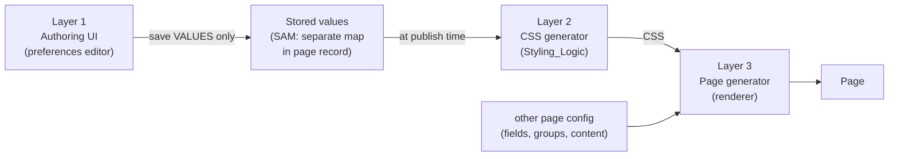
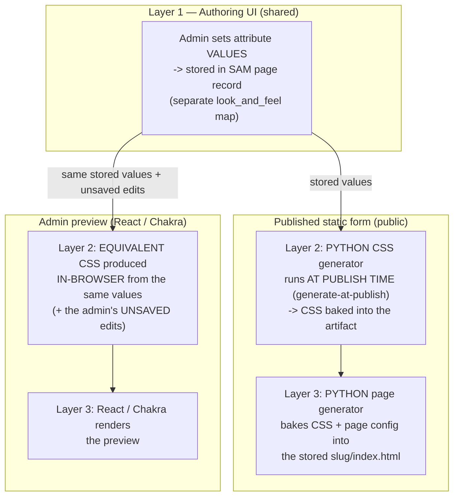
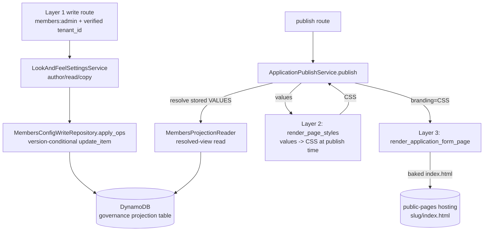

# Design Document

## Overview

This feature introduces `Look_And_Feel_Capability` — a reusable SAM-plane mechanism that turns a
Page's styling attributes into that Page's styling output — and makes the SAM plane the **author
and owner** of both the styling attributes it reads (`Look_And_Feel_Settings`) and the styling
**logic** itself (`Styling_Logic`). It wires the resolved settings into the published application
form so that changing a setting has a visible effect on the live page (Req 5, the current defect),
and defines how the admin live preview reflects the same settings and appearance the publish step
will produce (Req 7).

The design is organized around a **three-layer model** (defined in
[Architecture → Three-layer model](#three-layer-model)). Every component, data model, and decision
in this document maps onto one of those three layers, and the rest of the document references
Layer 1 / Layer 2 / Layer 3 consistently:

- **Layer 1 — Authoring UI (preferences editor).** Where the admin defines attribute preferences.
  On save, the *values* (not CSS) are stored on the SAM plane in a **separate map** within the
  page-definition record. Values-only. Copying settings between pages (Req 9) is a Layer-1 data
  operation on that stored map.
- **Layer 2 — CSS generator (the tool / `Styling_Logic`).** Takes the stored attribute values and
  generates CSS. A pure, reusable, page-type-agnostic mechanism with no page-specific state
  (Req 1 + Req 3).
- **Layer 3 — Page generator (renderer).** Takes the generated CSS *plus* the other page
  configuration data (fields, groups, content) and produces the page — the existing
  `render_application_form_page` / `build_form_body_html`.

Data flows one direction: **Authoring UI → stored values (SAM, map in page record) → (at publish
time) CSS generator → CSS → page generator → page.**

### What is grounded in real code

| Concern | Layer | Real seam read during design |
| --- | --- | --- |
| Render accepts `branding` | 3 | `sam/members/domain/application_form_render.py` → `render_application_form_page(config, head_meta, branding=..., ...)`, `build_form_body_html` |
| The Req 5 defect | 3 | `sam/members/domain/application_publish.py` → `publish()` render step calls the renderer **without** `branding` |
| Styling logic | 2 | `backend/src/services/landing_page_styles.py` → `LandingPageStyles.build_css_variables` / `build_page_css` / `build_font_links` |
| Build-time vendoring (to be removed) | 2 | `sam/members/layer/Makefile` → `cp .../landing_page_styles.py` into the layer |
| Change-Op write contract | 1 | `sam/members/domain/config_fields_crud_service.py` (`set_field_application`, `set_publish_state`, `set_public_prefix`) → `sam/members/repository/projection_config_write_repository.py` (`apply_ops`, version-conditional `update_item`, `StaleVersionError`, `TruncationTripwireError`) |
| Resolved-view read | 1 | `sam/members/repository/projection_config_reader.py` (`MembersProjectionReader`) |
| Fail-fast env resolution | 3 | `application_publish.resolve_public_api_base()` → `services.dynamodb_client.require_env` (`GOVERNANCE_PROJECTION_TABLE` model) |
| Two render paths | 2 + 3 | `frontend/src/components/public/application/ApplicationFormRenderer.tsx` (Chakra renderer) + `frontend/src/components/TenantAdmin/MembersConfig/ApplicationFormPreview.tsx` (pure `buildPreviewConfig`) |

### Design decisions (confirmed)

The requirements left several items as open design decisions. This document records a concrete
decision with rationale for each. **All three (DD-1, DD-2, DD-3) have now been confirmed by the
user** — none remains pending:

- **DD-1 — SAM-owned styling logic approach (Layer 2)** (Req 3) — **CONFIRMED**:
  **relocate/extract** `LandingPageStyles` to a SAM-owned shared home `sam/shared/page_styles/`
  rather than a clean reimplementation, removing the Flask-plane dependency and the build-time
  vendored `cp` in `sam/members/layer/Makefile`. See
  [Decision DD-1](#decision-dd-1--how-layer-2-styling_logic-becomes-sam-owned).
- **DD-2 — settings storage record (Layer 1)** (Req 2, Req 8) — **CONFIRMED**: store the **attribute
  values** (not generated CSS) as a **distinct named `look_and_feel` slice** on the existing
  SAM-owned `config#fields` row (the member field-config row), reusing the existing Change-Op write
  path. The user confirmed the **minimal-now** choice and to **defer the generic page model**. See
  [Decision DD-2](#decision-dd-2--where-layer-1-settings-live-and-their-record-shape).
- **DD-3 — admin preview parity approach (Layer 2/3 React implementation)** (Req 7) — **CONFIRMED**:
  keep the in-browser React path, where the React Layer 2/3 implementation **mirrors** the Python
  Layer 2/3 output from the same values, pinned by a shared parity fixture. See
  [Decision DD-3](#decision-dd-3--how-the-layer-23-react-implementation-achieves-parity).

All design decisions (DD-1, DD-2, DD-3) are now confirmed; none remains pending.

## Architecture

The capability lives entirely on the SAM plane and honors the steering-35 layering
(handler → domain service → repository → DynamoDB) and the steering-39 data-access rules
(resolved-view read, Change-Op write, fail-fast resource resolution, `tenant_id` + `LeadingKeys`
isolation, no raw-shape leak).

### Three-layer model

The capability is structured as three layers with a strict one-directional data flow. This is the
organizing architecture for the whole design.

| Layer | Name | Responsibility | Nature |
| --- | --- | --- | --- |
| **Layer 1** | Authoring UI (preferences editor) | Admin defines attribute preferences; on save the **values** (not CSS) are stored on the SAM plane in a **separate map** within the page-definition record. Copy-from-another-page (Req 9) is a data op on this map. | Values-only, per-page, SAM-owned state |
| **Layer 2** | CSS generator (the tool / `Styling_Logic`) | Takes the stored attribute values and generates CSS. | Pure, reusable, page-type-agnostic; no page-specific state (Req 1 + Req 3) |
| **Layer 3** | Page generator (renderer) | Takes the generated CSS **plus** the other page configuration (fields, groups, content) and produces the page. | The existing `render_application_form_page` / `build_form_body_html` |

**One-directional data flow:**



No arrow points backward: Layer 1 never reads generated CSS, Layer 2 never reads page-specific
state, and the renderer (Layer 3) never writes settings.

### The two render paths share the same three layers

There are two render paths — the published static form and the admin preview. They share the **same
three layers** and differ only in **where Layers 2 and 3 execute**. Parity (Req 7) therefore means
*same appearance from the same values across the two Layer-2/Layer-3 implementations*, **not** one
shared renderer.



- **Published static form (public):** Layer 1 — admin sets values, stored in the SAM page record;
  **Layer 2 is the PYTHON CSS generator running AT PUBLISH TIME (generate-at-publish, option a)**,
  with the CSS **baked into the artifact**; Layer 3 is the PYTHON page generator baking CSS + page
  config into the stored `{slug}/index.html`.
- **Admin preview (React/Chakra):** Layer 1 — the same stored values *plus* the admin's unsaved
  edits; Layer 2 produces the **equivalent CSS in-browser** from the same values; Layer 3 is
  React/Chakra rendering the preview.

So the published form is **Python generate-at-publish**; the preview is **React/Chakra in-browser**.
The two Layer-2/Layer-3 implementations are kept in parity (Req 7) by a shared fixture — a
deliberate two-render-path decision, not accidental doubling (see
[Decision DD-3](#decision-dd-3--how-the-layer-23-react-implementation-achieves-parity)).

### Generate-at-publish wiring (confirmed option a)

Layer 2 for the published form runs **inside `ApplicationPublishService.publish`** — not ahead of
time, not on read. The sequence:



1. `ApplicationPublishService.publish(tenant_id)` runs the existing readiness gate.
2. It resolves the stored `Look_And_Feel_Settings` **values** for the verified tenant from the
   resolved-view reader (`MembersProjectionReader`) via a new injected `LookAndFeelSettingsReader`
   Protocol (mirroring the existing `FormSlugReader` / `PublicPrefixReader` /
   `PublicFieldConfigReader` reader seams).
3. **Layer 2 runs here, at publish time:** `publish()` calls `Look_And_Feel_Capability`
   (`render_page_styles`) to generate CSS from those values.
4. **Layer 3 bakes it in:** the generated CSS is passed into
   `render_application_form_page(..., branding=resolved_styles)` — closing the Req 5 defect — and
   the resulting HTML, with CSS baked in, is written to `{slug}/index.html`.
5. If Layer 2 fails to produce styling, publish **does not** write the artifact and returns a
   failure indication; the previously published artifact is untouched (Req 5.5).

### Layer 1 write path (authoring settings — Req 2, Req 8)

1. React admin (Layer 1 UI) sends a **Change-Op by domain identity** (which Page, which attribute,
   new value) — never a whole record, never generated CSS. Layer 1 is values-only.
2. The `members:admin`-gated handler resolves the **verified `tenant_id`** (never from the body)
   and calls `LookAndFeelSettingsService`.
3. The service validates the attribute against the supported set (Req 3.2/3.4) and the value
   against its permitted set (Req 4.5), then issues a single scoped `SET`/`REMOVE` op through the
   existing `MembersConfigWriteRepository.apply_ops` seam — version-conditional, path-scoped
   `update_item` into the separate `look_and_feel` map, so untouched attributes survive by
   construction (steering 39).
4. A stale version surfaces as a caller-safe 409 (`StaleVersionError`); an invalid value is
   rejected with the stored settings left unchanged (Req 4.5).

## Components and Interfaces

Each component is tagged with the layer it belongs to.

### C1 — `Look_And_Feel_Capability` / `render_page_styles` — Layer 2 (Req 1, Req 6, Req 3)

**New SAM-owned Layer-2 mechanism.** Proposed location: `sam/shared/page_styles/` (see DD-1). It
exposes **exactly one** reusable function — the CSS generator:

```python
# sam/shared/page_styles/__init__.py  (proposed)
def render_page_styles(settings: Mapping[str, Any]) -> PageStyles:
    """Layer 2: produce a Page's CSS from its Look_And_Feel_Settings VALUES.

    Pure and deterministic: identical values -> identical output (Req 1.5).
    Page-type-agnostic: reads only the supplied values mapping; holds no
    Application_Form-specific state (Req 6.3). Absent attribute -> that
    attribute's SAM-owned default (Req 1.3, Req 3.3). Unsupported attribute
    -> raise UnsupportedAttributeError, produce no styling (Req 3.4).
    """
```

- `PageStyles` is a small value object carrying the generated CSS pieces Layer 3 needs (the `:root`
  variables block, the page CSS, the font `<link>` tags) — the three outputs today produced by
  `LandingPageStyles.build_css_variables` / `build_page_css` / `build_font_links`.
- **One function, no per-type variant** (Req 1.1, Req 1.4): both the Application_Form (today) and a
  future Landing_Page (Req 6) call this same Layer-2 function. Page-type lives in the *caller*
  (Layer 3), never in Layer 2.
- **Supported attributes exactly** (Req 3.2): `color_primary`, `color_accent`, `font_heading`,
  `font_body`, `base_spacing`, `border_radius_global`, `shadow_style`. These map 1:1 onto the
  attributes `LandingPageStyles` already consumes (`build_css_variables` reads `font_heading`,
  `font_body`, `base_spacing`, `border_radius_global`, `shadow_style`; `build_page_css` takes
  `color_primary`, `color_accent`).

### C2 — `Styling_Logic` becomes SAM-owned — Layer 2 (Req 3)

The CSS-generation logic (`LandingPageStyles`) is the **Layer-2 tool**. It relocates to the
SAM-owned home behind C1. See
[Decision DD-1](#decision-dd-1--how-layer-2-styling_logic-becomes-sam-owned) for the
relocate-vs-reimplement tradeoff. Regardless of the chosen approach, the **build-time vendored
copy** in `sam/members/layer/Makefile` (`cp .../landing_page_styles.py`) is **removed** — Req 3.1
forbids a Flask-plane module as source of truth, including as a vendored copy. The layer Makefile
instead packages the SAM-owned `sam/shared/page_styles/` the same least-surface way it already
packages `sam/shared/`.

### C3 — `LookAndFeelSettingsService` — Layer 1 (Req 2, Req 4, Req 8, Req 9)

**New SAM domain service** for Layer 1 authoring, proposed
`sam/members/domain/look_and_feel_settings_service.py`, following the `ConfigFieldsCrudService`
pattern (injected reader + Change-Op write repository, no boto3 in the domain). It reads and writes
the application form's presentation **values** — the distinct named `look_and_feel` slice on the
`config#fields` row (DD-2); it never touches CSS (that is Layer 2):

```python
class LookAndFeelSettingsService:
    def __init__(self, reader: LookAndFeelSettingsReader,
                 writer: LookAndFeelSettingsWriter): ...

    def get_settings(self, tenant_id: str, page_id: str) -> Mapping[str, Any]:
        """Resolved-view read of the stored VALUES slice, tenant-scoped (Req 2.4).
        Absent -> empty/defaults."""

    def set_setting(self, tenant_id: str, page_id: str, attribute: str, value) -> None:
        """Author ONE attribute VALUE (Req 8.1). Validate attribute (Req 3.4) and
        value (Req 4.5); reject invalid, leave stored values unchanged. Single
        scoped Change-Op (version-conditional)."""

    def copy_settings(self, tenant_id: str, source_page_id: str,
                      target_page_id: str) -> None:
        """Layer-1 data op: one-time snapshot copy of the VALUES slice within the
        SAME verified tenant (Req 9). Overwrite target; no live link established;
        reject cross-tenant source."""
```

- **`page_id` is a forward-looking seam.** The parameter is kept so the service can one day address
  more than one page type (the per-page-type generalization under DD-2), but **today it resolves to
  the application form's `look_and_feel` slice on `config#fields`** — the only SAM-owned page wired
  in this feature. No generic page abstraction is introduced now (steering 37 rule-of-three).
- **Writer** is a thin adapter over the existing `MembersConfigWriteRepository.apply_ops`
  Change-Op seam (or a sibling `set_look_and_feel` method on `ConfigFieldsCrudService` — same
  version-conditional, path-scoped `update_item`). `config#fields` is already in the closed writable
  set `_WRITABLE_CONFIG_IDS`, so no widening of that guard is needed. No whole-record `put_item` on
  the client path.
- **Reader** is a new resolved-view read on `MembersProjectionReader` (tenant-scoped; absent
  settings resolve to an empty mapping → defaults, never a Flask value — Req 2.1).

### C4 — `LookAndFeelSettingsReader` Protocol in `application_publish.py` — Layer 3 wiring (Req 5)

**New injected Protocol** mirroring the existing reader seams in `application_publish.py`. This is
the Layer-3 wiring that feeds the stored values into Layer 2 at publish time:

```python
@runtime_checkable
class LookAndFeelSettingsReader(Protocol):
    def get_look_and_feel(self, tenant_id: str) -> Mapping[str, Any]:
        """Resolved application-form presentation VALUES (the look_and_feel slice
        on config#fields); absent -> {} (defaults)."""
        ...
```

`ApplicationPublishService.__init__` gains an **optional** `look_and_feel_reader` param (matching
the optional-seam style of `slug_marker_store` / `prefix_reader` / `artifact_writer`). When present,
`publish()` resolves the stored application-form presentation values (the `look_and_feel` slice on
`config#fields`), runs Layer 2 (`render_page_styles`) to generate CSS, and passes
`branding=resolved_styles` into `render_application_form_page` (Layer 3). When absent, the renderer
uses its existing fallback defaults, so the change is backward compatible. Layer 2 itself stays
page-type-agnostic — only this storage binding is application-form-specific today.

### C5 — Admin preview — Layer 2/3 React implementation (Req 7)

`ApplicationFormPreview.tsx` (React) keeps its in-browser render. Under the recommended DD-3, its
**Layer 2/3 React implementation mirrors the Python Layer 2/3 output**: it computes the same
CSS-variable values the Python Layer-2 generator would emit from the same values (plus the admin's
unsaved edits) and injects them into the preview container (Layer 3 React/Chakra render). The result
reflects the *same values* and *same appearance* the publish path produces — pinned to the Python
output by a shared parity fixture (mirroring the existing `buildPreviewConfig` ↔
`get_public_field_config` parity pin described in the component's own docstring).

### C6 — Composition root

`sam/members/handler/app.py` (the single composition root, steering 35/39) wires the real reader
and writer into `LookAndFeelSettingsService` (Layer 1) and injects the real
`LookAndFeelSettingsReader` into `ApplicationPublishService` (Layer 3 wiring). Tests inject
in-memory fakes (the existing `Static*Provider` pattern).

## Data Models

### Look_And_Feel_Settings — Layer 1 stored values, the `look_and_feel` slice on `config#fields` (Req 2, Req 8 — DD-2)

**Confirmed (DD-2):** store the **attribute values** (not generated CSS) as a **distinct named
`look_and_feel` slice** on the existing SAM-owned `config#fields` row on the governance projection
table, under a dedicated attribute path.

`config#fields` is the tenant's **member field-config row** — the configuration of the member
fields themselves. The application form is a **rendering of those member fields**: an iframe
embeddable in a website, or a standalone popup webpage, that presents just those fields in a styled
shell with the icon and a submit-to-Lambda action. It is **not a "form record"** — there is no
separate form entity. The `look_and_feel` slice therefore captures the **application-form PAGE's
PRESENTATION**: a separate presentation concern that *rides on* `config#fields` (the same row
`set_form_slug` / `set_publish_state` already write to via Change-Ops), **not** a member field
attribute and **not** mixed into `fields` / `overrides`:

```jsonc
// item on the governance projection table (conceptual resolved view)
{
  "tenant_id": "h-dcn",          // partition key (verified; LeadingKeys-isolated)
  "sk": "config#fields",         // the MEMBER FIELD-CONFIG row (NOT a form record)
  "version": 42,                 // version-conditional Change-Op target
  "fields": { /* member field config */ },      // member fields (unrelated slice)
  "overrides": { /* ... */ },                    // per-field overrides (unrelated slice)
  "look_and_feel": {             // <-- DISTINCT presentation slice: the application-form PAGE's look-and-feel
    "color_primary": "#2D5F8A",
    "color_accent": "#F4A261",
    "font_heading": "Inter",
    "font_body": "Inter",
    "base_spacing": "normal",
    "border_radius_global": "rounded",
    "shadow_style": "subtle"
  }
}
```

- **Values, not CSS** (DD-2, Req 2/8): Layer 1 stores values only; the CSS is generated by Layer 2
  at publish time. Storing values keeps the record small, lets defaults evolve, and avoids a stale
  generated-CSS snapshot.
- **Distinct presentation slice** (DD-2): the `look_and_feel` slice is its own scoped slice of the
  `config#fields` row, distinct from `fields` / `overrides` / slug / publish-state. It is the
  application-form page's presentation, not a member field attribute — so Layer-1 writes to it never
  disturb the member field config.
- **Low-complexity reuse** (DD-2): `config#fields` is already SAM-owned and already in the closed
  writable set `_WRITABLE_CONFIG_IDS`, so adding a parent-map slice reuses the existing
  version-conditional Change-Op write path (`MembersConfigWriteRepository.apply_ops`) with no new
  schema tokens, reader, skeleton, or access-guard entry.
- **Per-page-type generalization** (DD-2, Req 4.1): the *pattern* is that each page type stores its
  look-and-feel as a `look_and_feel` slice on **its own existing record** — the application form →
  `config#fields` (now); the landing pages → the landing-page records (**when** those become
  SAM-owned, Req 6). No generic Page entity is introduced now (steering 37 rule-of-three).
- **Plane-boundary caveat** (honest dependency, not an assumption): the current landing pages' records
  live on the **Flask plane**. Storing SAM-authored look-and-feel onto a Flask-owned record would
  cross the plane boundary and violate the no-sharing / SAM-authors-its-own-config rules (Req 2/Req 8,
  steering 35/39). So the landing-page reuse becomes real **only when** landing pages are SAM-owned
  (Req 6, out of scope here); **today only the application form (`config#fields`, already SAM-owned)
  is wired.**
- **Absent is valid** (Req 3.3, Req 4.4, Req 5.4): a missing `look_and_feel` slice, or a missing key
  within it, resolves to the Layer-2 default for that attribute.
- **No Flask value** (Req 2.1): the resolved view reads only this SAM-owned attribute; it never
  merges a `landing_page` projection.

> **No seeding from Flask branding.** Existing pages are NOT seeded from Flask branding. A page's
> `Look_And_Feel_Settings` start empty and resolve to Layer-2 defaults until the admin sets them via
> the Layer-1 authoring UI. Transferring existing settings is not part of this feature; if/when the
> Flask landing pages become SAM functions (Req 6, out of scope), that migration carries their
> settings across — this feature adds no separate seed/backfill step and creates no Flask↔SAM
> coupling.

### Change-Op operations — Layer 1 writes (steering 39 write contract)

| Operation | Op shape (by identity) | Physical effect |
| --- | --- | --- |
| Set one attribute value (Req 8.1) | `{page, attribute, value}` | `SET look_and_feel.#attr = :v` + version bump, version-conditional |
| Clear one attribute (revert to default) | `{page, attribute, null}` | `REMOVE look_and_feel.#attr` + version bump |
| Copy (Req 9) | `{source_page, target_page}` | read source resolved view → single `SET look_and_feel = :snapshot` on target + version bump |

All ops are a **single path `update_item`** through `MembersConfigWriteRepository.apply_ops` —
never a whole-record `put_item` on the client path. Untouched attributes (and unrelated slices of
the member field-config row `config#fields` like `fields` / `overrides`) survive by construction
(steering 39; the existing `TruncationTripwireError` backstop applies).

## Correctness Properties

*A property is a characteristic or behavior that should hold true across all valid executions of a
system — essentially, a formal statement about what the system should do. Properties serve as the
bridge between human-readable specifications and machine-verifiable correctness guarantees.*

PBT **is appropriate** for this feature: Layer 2's core (`render_page_styles`) and the Layer-1
settings resolution/copy logic are pure functions over a large, structured input space (settings
value mappings), where universal properties (determinism, defaulting, independence, rejection) hold
across all inputs. The I/O edges (DynamoDB write, S3 publish) are covered by example/integration
tests, not PBT.

### Property 1: Layer-2 output is deterministic in the settings

*For any* valid `Look_And_Feel_Settings` values mapping, invoking `render_page_styles` twice with
that same mapping SHALL produce identical styling output.

**Validates: Requirements 1.2, 1.5**

### Property 2: Layer-2 output depends only on the supplied values (Page-type-agnostic)

*For any* two Pages supplied identical `Look_And_Feel_Settings` values, `render_page_styles` SHALL
produce identical styling output regardless of Page type or any other Page state.

**Validates: Requirements 1.5, 4.3, 6.1, 6.2, 6.3**

### Property 3: Different values produce correspondingly different styling

*For any* two values mappings differing in at least one supported attribute's value,
`render_page_styles` SHALL produce styling that differs in at least the corresponding styling
attribute.

**Validates: Requirements 4.2, 5.3**

### Property 4: Absent attributes fall back to defaults without failing

*For any* values mapping with any subset of the supported attributes omitted, `render_page_styles`
SHALL produce styling using the SAM-owned default for each omitted attribute and SHALL NOT fail.

**Validates: Requirements 1.3, 3.3, 4.4, 5.4**

### Property 5: Unsupported attribute is rejected and produces no styling

*For any* values mapping containing a key that is not one of the seven supported attributes,
`render_page_styles` SHALL reject the request, signal the unsupported attribute, and produce no
Page styling.

**Validates: Requirements 3.4**

### Property 6: Invalid value is rejected and stored values are preserved

*For any* supported attribute supplied a value outside its permitted set, the Layer-1 authoring
operation SHALL reject the setting, leave the Page's previously stored `Look_And_Feel_Settings`
values unchanged, and identify the rejected setting.

**Validates: Requirements 4.5**

### Property 7: Styling is produced entirely from SAM-owned code (no Flask runtime call)

*For any* styling production, no attribute value SHALL originate from the Flask plane and no runtime
read of or call to the Flask plane SHALL occur.

**Validates: Requirements 2.1, 2.2, 3.1, 3.5, 8.4**

### Property 8: Tenant isolation on resolve

*For any* resolve of `Look_And_Feel_Settings` for a verified tenant, the resolved values SHALL be
scoped to that tenant and SHALL exclude any other tenant's settings.

**Validates: Requirements 2.4**

### Property 9: Copy is a one-time independent snapshot

*For any* source and target Page of the same tenant, after a Layer-1 copy the target's values SHALL
equal the source's at copy time, and any subsequent change to either Page's values SHALL NOT alter
the other's.

**Validates: Requirements 9.1, 9.2, 9.3, 9.5**

### Property 10: Publish failure preserves the previously published artifact

*For any* publish in which Layer 2 fails to produce styling, the Publish_Step SHALL NOT replace the
previously published Application_Form and SHALL return a failure indication.

**Validates: Requirements 5.5**

### Property 11: Published form carries styling derived from resolved values

*For any* tenant with resolved `Look_And_Feel_Settings` values, a successful publish SHALL carry
styling produced by Layer 2 from exactly those values (and from defaults where a tenant has none).

**Validates: Requirements 5.1, 5.2, 5.4**

## Error Handling

All client-facing errors are caller-safe (no internals, no `str(e)`), matching the SAM
error-envelope convention (steering 37) and the admin-facing shaping already used by
`application_publish.py`.

| Condition | Layer / where | Behavior | Caller-safe surface |
| --- | --- | --- | --- |
| Unsupported attribute (Req 3.4) | 2 — `render_page_styles` / 1 — `set_setting` | Reject; produce no styling; no write | 422 naming the unsupported attribute key (safe — it is the client's own key) |
| Invalid value (Req 4.5) | 1 — `set_setting` | Reject; stored values unchanged | 422 identifying the rejected setting |
| Unverifiable tenant (Req 2.5) | handler/edge | Resolve nothing; state unchanged | 401/403 "tenant could not be verified"; no settings leaked |
| Cross-tenant copy source (Req 9.4) | 1 — `copy_settings` | Reject; no write | 403 generic "not permitted" |
| Stale version (steering 39) | 1 — `apply_ops` → `StaleVersionError` | No partial write | 409 reload-and-retry |
| Layer 2 fails during publish (Req 5.5) | 3 — `publish()` | Do not write artifact; previous artifact intact | failure indication to caller; no 500 leaking internals |
| Missing table/resource | repository | Fail-fast `require_env` (no silent default) | surfaced as a config error at first real call, never wrong-resource |

Defaults are never an error: an absent settings map or absent attribute is a valid "use defaults"
case (Req 3.3, Req 4.4, Req 5.4), not a failure.

## Testing Strategy

Per-plane, change-with-tests (steering 30/34/39), real-data round-trip (steering 39).

### Property-based tests (SAM Python plane)

- Library: **Hypothesis** (the backend's property-test tool). Minimum **100 iterations** per
  property.
- Each property test tags its design property. Tag format:
  **Feature: sam-page-look-and-feel, Property {number}: {property_text}**.
- One property-based test per correctness property (Properties 1–11). Properties touching the
  publish I/O edge (10, 11) use in-memory fakes for the artifact writer and settings reader so the
  Layer-2/Layer-3 *logic* is exercised 100× without real AWS; a separate 1–2 example integration
  test covers the real write edge.
- Generators produce settings value mappings over the seven supported attributes (including omitted
  subsets, out-of-range values, and unsupported extra keys) to exercise defaulting (Prop 4),
  rejection (Props 5, 6), and difference (Prop 3).

### Example / unit tests

- Layer-3 wiring: `publish()` runs Layer 2 and calls `render_application_form_page` **with**
  `branding=` the generated styling (the Req 5 defect regression test) — assert the baked
  `index.html` differs when a stored value changes (Req 5.3).
- Reader seam: a tenant with no stored values publishes with defaults and does not fail (Req 5.4).
- Copy (Layer 1): same-tenant snapshot overwrites target and establishes no link (Req 9);
  cross-tenant source rejected (Req 9.4).

### Real-data round-trip (steering 39, non-negotiable)

Exercise Layer 1 author → resolve → Layer 2 generate → Layer 3 render against a **real**
`config#fields` row (e.g. `h-dcn`): set a `look_and_feel` value via the Change-Op, resolve it back
through the resolved view, and confirm the published render reflects it — and that unrelated slices
(`fields`, `overrides`, slug, publish state) survive the write by construction. "Tests pass" is not
sufficient evidence; run it against a real row before marking the data-touching change done.

### Frontend preview parity (Req 7)

Pin the React preview's Layer-2/3 implementation (its injected CSS-variable values) to the Python
Layer-2 output via a shared parity fixture (mirroring the existing `buildPreviewConfig` ↔
`get_public_field_config` parity pin), so the two Layer-2/3 implementations cannot drift in
appearance for the same values.

### Not PBT

The DynamoDB write, the S3 publish/invalidation, and the layer packaging change are I/O /
configuration concerns — covered by example/integration/smoke tests, not property tests.

## Design Decisions (DD-1, DD-2, DD-3 all confirmed by the user)

### Decision DD-1 — how Layer 2 (`Styling_Logic`) becomes SAM-owned

**Options**

1. **Clean reimplementation** inside `sam/shared/page_styles/` — rewrite the CSS generation from
   scratch for the seven supported attributes.
2. **Relocate/extract** the existing `LandingPageStyles` logic to `sam/shared/page_styles/` as the
   SAM-owned source of truth, and remove the Flask-plane dependency and the vendored copy.

**Tradeoff**

- Reimplementation (1) is cleanest conceptually but risks visual drift from the proven current
  output and discards battle-tested logic (WCAG contrast, shadow/spacing maps).
- Relocation (2) preserves the exact current appearance (no visual regression on live tenants),
  satisfies Req 3.1 (the SAM-owned copy becomes the source of truth; no Flask module and no
  build-time vendored copy remain), and lets the Flask plane later depend back on the SAM-owned
  module or keep its own — a one-directional ownership flip, not a shared runtime.

**Decision (CONFIRMED):** **Option 2 (relocate/extract)** to
`sam/shared/page_styles/`, removing the `cp .../landing_page_styles.py` line from
`sam/members/layer/Makefile` and packaging the SAM-owned module instead. This honors Req 3.1 while
avoiding a visual regression. Whether the Flask landing plane is refactored to consume the relocated
module is **out of scope** here (it may keep its own copy short-term); this feature only requires the
SAM plane to stop depending on the Flask module.

### Decision DD-2 — where Layer 1 settings live and their record shape — **CONFIRMED**

**Decision (CONFIRMED by the user):** store the **attribute values** (not generated CSS) as a
**distinct named `look_and_feel` slice** on the existing SAM-owned `config#fields` row — the
tenant's member field-config row — written via a single version-conditional Change-Op. This is
Layer-1 storage: values-only. The user confirmed **minimal now** and to **defer the generic page
model** (no generic `Page` entity and no page-type discriminator in this feature — steering 37
rule-of-three, wait for the second real consumer). See [Data Models](#look_and_feel_settings--layer-1-stored-values-the-look_and_feel-slice-on-configfields-req-2-req-8--dd-2).

`config#fields` is the **member field-config** row; the application form is a **rendering** of those
member fields (an iframe/standalone popup — styled fields + icon + submit-to-Lambda), not a separate
form record. The `look_and_feel` slice is the application-form **page's presentation** — a distinct
named slice, **not** a member field attribute and **not** mixed into `fields` / `overrides`. It
rides on `config#fields` purely to reuse the existing Change-Op write path at low complexity, while
staying a separate presentation concern.

**Low vs. higher complexity (why this record, confirmed by reading the code):**

- **Chosen — add a `look_and_feel` slice to `config#fields` (LOW complexity).** The SAM write path
  already supports this cheaply: `MembersConfigWriteRepository.apply_ops` does single-path,
  version-conditional `update_item` Change-Ops, and `config#fields` is already in the **closed**
  writable set `_WRITABLE_CONFIG_IDS = {scope, fields, mail}`. Adding a `look_and_feel` parent-map
  slice to the `config#fields` skeleton and emitting `SET ["look_and_feel", attr] = v` reuses **all**
  existing machinery (`MembersConfigWriteRepository.apply_ops`, the `config#fields` skeleton,
  `MembersProjectionReader`) — no new plumbing.
- **Rejected now — a new dedicated record** (e.g. `config#application_form_presentation` /
  `page#...`). It would require **widening the closed `_WRITABLE_CONFIG_IDS`**, new schema tokens, a
  new skeleton, a new reader, and an access-guard allow-list entry — more plumbing touching the
  deliberate "structurally unwritable" guarantees. Explicitly **not** chosen now.
- Also rejected: storing a generated-CSS snapshot — it duplicates Layer-2 output into storage and
  goes stale when defaults or logic change (Layer 2 regenerates CSS from the values at publish time).

#### DD-2 generalization principle — one flow per page type, stored on that page's own record

Record this as the **pattern**, not a built feature: each page type stores its own look-and-feel as
a `look_and_feel` slice on **its own existing record**, reusing the **same flow** (Layer 1 authoring
→ stored values slice on the record → Layer 2 CSS → Layer 3 render). The flow is reused per page
type; the storage location is whatever record that page type already owns:

- **Application form → `config#fields`** — wired **now** (already SAM-owned).
- **Current landing pages → the landing-page records** — the pattern **applies when** those become
  SAM functions (Req 6, out of scope here).
- **No generic `Page` entity** until a second real consumer forces the extraction (steering 37
  rule-of-three).

**Plane-boundary caveat (recorded honestly — not glossed over):** the current landing pages' records
live on the **Flask plane**. "Reuse the same flow for landing pages, storing settings on the
landing-page records" becomes real **only when landing pages are SAM-owned** (Req 6). Storing
SAM-authored look-and-feel onto a Flask-owned record would cross the plane boundary and violate the
no-sharing / SAM-authors-its-own-config rules (Req 2/Req 8, steering 35/39). So this is a known
**dependency**, not an assumption that it works today — **today only the application form
(`config#fields`, already SAM-owned) is wired.**

### Decision DD-3 — how the Layer-2/3 React implementation achieves parity

The two render paths deliberately have **two implementations of Layers 2 and 3** — Python (publish)
and React/Chakra (preview). This is the two-render-path decision (Req 7 parity = same appearance
from the same values across the two implementations), **not** accidental doubling of one renderer.
The open decision is how the React Layer-2/3 implementation mirrors the Python Layer-2/3 output.

**Options**

1. **React Layer 2/3 mirrors the Python output** (recommended) — the React implementation computes
   the same CSS-variable values the Python Layer-2 generator emits from the same values and renders
   them (Layer 3), keeping the instant, no-round-trip unsaved-edit preview; parity pinned by a
   shared fixture.
2. **Shared cross-language styling source** — a single source of truth both Python and JS consume
   as their Layer-2 tool (e.g. a shared token map). Strongest parity guarantee, largest
   build/tooling cost.
3. **Show the real Python-rendered artifact via iframe** (`src`/`srcdoc`) or a local HTML file —
   collapses the preview onto the Python Layer 2/3 (the admin sees the actual output), eliminating
   cross-language parity entirely, but loses the instant unsaved-edit preview (a change requires a
   Python re-render), and a `file://` page is static-only (no live backend calls).

**Decision (CONFIRMED):** **Option 1** — the **Layer-2/3 React implementation
mirrors the Python Layer-2/3 output** from the same values. The requirements explicitly retain the
two-render-path split and the instant unsaved-edit preview; parity is *same values and appearance*,
not one renderer. The shared parity fixture (as in the existing preview↔server pin) guards against
drift between the two implementations. Option 3 is the honest "real artifact" choice if the team
later decides the unsaved-edit immediacy is not worth the parity risk — worth revisiting when the
Landing_Page becomes a SAM function.

## Governance and Steering Impact

Per steering 40 (spec-workflow) governance definition-of-done, the following steering/ADR updates
are **owed by this spec's completion** (obligation in scope here; exact edits are an
implementation concern):

- **Steering 36 (config & parameters) — REWRITE.** This feature **supersedes**, for SAM-owned
  look-and-feel config, steering 36's model ("MySQL `parameters` is the single source of truth;
  Flask authors it; SAM reads a one-directional projection; never two writers"). Under Req 8, SAM
  authors and owns its own Layer-1 look-and-feel values (SAM becomes a writer). Steering 36 must be
  rewritten to record **SAM config-authoring autonomy for SAM-owned config**, and that the previous
  one-directional projection interface proved too weak to depend on. (Note: there is no Flask↔SAM
  dual-write to govern — a page owns its own values and starts from Layer-2 defaults; existing pages
  are not seeded from Flask branding, so this feature introduces no ongoing Flask↔SAM coupling.)
- **Steering 35 (SAM module architecture) & 39 (SAM data access) — REVIEW.** Both must be reviewed
  for any wording that assumes Flask-writes/SAM-reads for this config and updated for consistency
  where they govern SAM-owned config authoring. The Change-Op write contract (39) and layering (35)
  already accommodate a SAM Layer-1 writer; the review confirms no residual "SAM reads only its own
  projection *of Flask-authored config*" phrasing contradicts Req 8.
- **ADRs 0005 / 0006 (projection) — REVIEW.** The projection ADRs that frame SAM as a read-only
  projection consumer for this config must be reviewed and annotated (or superseded) to reflect that
  look-and-feel config is now SAM-authored and SAM-owned (Layer 1), not a Flask projection.
- **Layer packaging (`sam/members/layer/Makefile`)** — the `landing_page_styles.py` vendored `cp`
  line is removed as part of DD-1 (Req 3.1 forbids the build-time vendored copy of the Layer-2
  tool).

> The design decisions (DD-1, DD-2, DD-3) are all confirmed; the governance obligations above stand
> regardless of them — the supersession of steering 36 follows from Req 8, not from a particular
> storage or logic choice.
