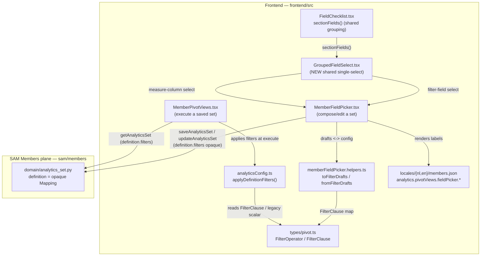
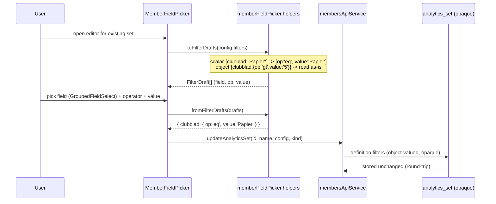

# Design Document: Member Analytics Pivot Filter Operators & Grouped Field Selectors

## Overview

This feature makes two improvements to the SAM Member Analytics "Dynamic Pivot Views" field-picker UX, both **frontend-first**.

1. **Consistent, grouped field selectors.** Today `MemberFieldPicker.tsx` renders its *Group by* and *List columns* field surfaces through the shared, sectioned `FieldChecklist` (functional-group sections, bilingual labels, dark theme, orange headings), but the *Filter field* and *Measure column* surfaces are flat, ungrouped native `<Select>`s built from `fields.map(...)`. This feature introduces a shared single-select control, `GroupedFieldSelect`, that derives its `<optgroup>` structure from the SAME `sectionFields()` the checklist uses, and reuses it at both call sites so the field surfaces never drift again.

2. **Type-adaptive, backward-compatible filter operators.** Today a filter is a flat `{ fieldKey: value }` map meaning case-insensitive, trimmed STRING EQUALITY only (`applyDefinitionFilters`). This feature adds a per-row operator (`eq, ne, gt, gte, lt, lte, contains, notContains, regex, notRegex, empty, notEmpty`), a type-adaptive operator list derived from the resolved field type, numeric vs string comparison, an invalid-regex guard, negated text operators (`notContains`/`notRegex`, each the boolean negation of its positive counterpart on a present value), and no-value operators (`empty`/`notEmpty`). It preserves full backward compatibility: a legacy scalar entry `{ clubblad: "Papier" }` reads as `{ op: 'eq', value: 'Papier' }`, and the new persisted shape `{ clubblad: { op: 'eq', value: 'Papier' } }` round-trips through both the client filter engine and the picker helpers.

The whole feature is **read-only w.r.t. member data** — it composes a saved *view definition*, never mutating a member. The persisted `definition.filters` stays **opaque to the SAM Members module**: `sam/members/domain/analytics_set.py` validates `definition` is a `Mapping` and never inspects the filter shape, so an object-valued filter entry round-trips through `to_item`/`from_item` with **no backend change** (verified below in §12).

## Architecture



Both improvements are additive to existing modules; the only new file is `GroupedFieldSelect.tsx`. The data contract (`FilterClause`) is the one place the picker, the helpers, and the client filter engine agree on the filter shape.

## Sequence Diagrams

### Compose/edit a set with operators (Improvement 2 write path)



### Execute a saved set applying operators (Improvement 2 read path)

```mermaid
sequenceDiagram
    participant U as User
    participant PV as MemberPivotViews
    participant SAM as analytics_set (opaque)
    participant AC as applyDefinitionFilters
    participant AD as client pivot adapter

    U->>PV: click Execute on a saved set
    PV->>SAM: getAnalyticsSet(id)
    SAM-->>PV: definition.filters (object and/or legacy scalar)
    PV->>AC: applyDefinitionFilters(rows, filters, fieldConfig)
    Note over AC: normalize each entry -> {op,value};<br/>legacy scalar -> {op:'eq'};<br/>type-adaptive compare; (not)regex guard;<br/>contains/notContains; empty/notEmpty; AND across entries
    AC-->>PV: narrowed rows (order preserved, pure)
    PV->>AD: executeMemberPivot(narrowed rows)
```

## Components and Interfaces

### Component 1: `GroupedFieldSelect` (NEW — `frontend/src/components/members/GroupedFieldSelect.tsx`)

**Purpose**: A single-select field picker whose options are grouped by functional group, as the native `<optgroup>` analogue of `FieldChecklist`. It derives its grouping from the SAME `sectionFields()` the checklist uses so the three field surfaces (checklist, filter-field, measure-column) stay consistent.

**Interface**:

```typescript
export interface GroupedFieldSelectProps {
  /** The candidate fields to offer — already filtered to the caller's set (e.g. pickableFields). */
  fields: FieldConfigField[];
  /** The currently-selected field key, or '' for the no-selection sentinel. */
  value: string;
  /** Fired with the newly-selected field key (or '' when the placeholder is chosen). */
  onChange: (key: string) => void;
  /** The tenant's functional-group catalog (drives optgroup order + headings). */
  functionalGroups: FunctionalGroup[] | undefined;
  /** Active language for bilingual label resolution. */
  lang: string;
  /** Accessible label for the native <select> (required — no visible <label> at some call sites). */
  ariaLabel: string;
  /**
   * The placeholder option label shown as the first, value='' entry (e.g.
   * "Field" / "All rows"). When omitted, no placeholder option is rendered and
   * the first real field is the default — callers that must allow an empty
   * value MUST pass this.
   */
  placeholder?: string;
  /** data-testid for the rendered <select>. */
  testId?: string;
  /** Optional max width passthrough for dark-theme layout parity with existing selects. */
  maxW?: string;
}
```

**Responsibilities**:
- Call `sectionFields(fields, functionalGroups, lang)` (imported from `FieldChecklist`) to produce ordered sections (catalog order, alphabetical within, ungrouped section last).
- Render a Chakra `Select` (dark theme, `bg="gray.900"`, white text) with one `<optgroup label=...>` per section (heading resolved via `resolveLabel`), and one `<option value={f.key}>` per field (bilingual label via `resolveLabel`). The ungrouped fallback section renders its options with no enclosing `<optgroup>` (or an untitled group), so a field without a functional group never disappears.
- Render the placeholder as the first `value=''` option when `placeholder` is supplied.
- Be keyboard accessible: native `<select>` + `<optgroup>` are natively navigable; `aria-label` is always set.

**Reuse / call sites** (three field surfaces, one grouping rule):
1. `MemberFieldPicker` *Filter field* select — replaces the flat `fields.map(...)` `<Select>`, placeholder = `filterField` label.
2. `MemberFieldPicker` *Measure column* select — replaces the flat `fields.map(...)` `<Select>`, placeholder = `countAll` label (the COUNT(*) sentinel, value `''`).
3. The existing `FieldChecklist` continues to own the *Group by* and *List columns* multi-select surfaces; `GroupedFieldSelect` is its single-select sibling, importing the same `sectionFields()` so the two never drift (mirrors the R4.1 "one checklist" rationale).

### Component 2: `MemberFieldPicker` (MODIFIED — filter rows gain an operator)

**Purpose**: Compose/edit a `PivotConfig`. The filter row changes from `[field-select | value-input | remove]` to `[GroupedFieldSelect | operator-select | value-input | remove]`, where the value input is hidden/disabled for `empty`/`notEmpty`, and the operator-select offers only the operators valid for the chosen field's type.

**Responsibilities (delta only)**:
- Render each filter row with `GroupedFieldSelect` (field), a Chakra `Select` of operators filtered by `operatorsForField(field, fieldConfig)`, and the value `Input` (hidden when `operatorTakesNoValue(op)`).
- Default a new row to `op: 'eq'`.
- When the selected field changes and the current operator is no longer valid for the new field type, reset the operator to `eq` (always valid).
- Show an inline bilingual error on a filter row whose operator is `regex` and whose value is an invalid pattern (never block the whole save on it — the row simply matches nothing at execute, consistent with the engine guard).

### Component 3: `applyDefinitionFilters` (MODIFIED — operator semantics)

See §6 for full semantics. The signature is unchanged (`filters: Record<string, unknown>`), so both legacy scalar and new object entries flow through the same parameter.

## Data Models

### Model 1: `FilterOperator` + `FilterClause` (NEW — `frontend/src/types/pivot.ts`)

```typescript
/** The per-filter comparison operators. Type-adaptive availability is a UI concern
 *  (operatorsForField); the engine implements semantics for all of them. */
export type FilterOperator =
  | 'eq'        // equals (case-insensitive, trimmed string compare) — the legacy default
  | 'ne'        // not equals
  | 'gt'        // greater than
  | 'gte'       // greater than or equal
  | 'lt'        // less than
  | 'lte'       // less than or equal
  | 'contains'    // substring (case-insensitive)
  | 'notContains' // does NOT contain substring (case-insensitive) — exact negation of `contains` for a present value
  | 'regex'       // JS RegExp, case-insensitive default, invalid-pattern guarded
  | 'notRegex'    // does NOT match the pattern (case-insensitive); same invalid-pattern guard as `regex`
  | 'empty'       // field value is blank/absent (no value input)
  | 'notEmpty';   // field value is present/non-blank (no value input)

/** The new, explicit object form of a single filter entry. */
export interface FilterClause {
  op: FilterOperator;
  /** The comparison value as a string (as entered). Ignored for empty/notEmpty. */
  value?: string;
}

/**
 * The persisted filters map. BACKWARD-COMPATIBLE and OPAQUE to the backend:
 *   - new form:    { clubblad: { op: 'eq', value: 'Papier' } }
 *   - legacy form: { clubblad: 'Papier' }  (reads as { op: 'eq', value: 'Papier' })
 * A value may therefore be a FilterClause OR a legacy scalar; `unknown`-tolerant
 * readers (normalizeClause) accept both. NO key is special-cased — every entry,
 * including `years_member` / `joined_after_year`, is an ordinary filterable field
 * (a legacy scalar `years_member: 25` reads as an editable `{ op: 'eq', value: '25' }`
 * row, so a jubilee / new-member list is now expressible generically, e.g.
 * `years_member gte 25`).
 */
export type FilterMap = Record<string, FilterClause | string | number | null>;
```

`PivotConfig.filters` stays typed `Record<string, any>` at its declaration (to avoid a sweeping breaking change across the SQL pivot framework that also uses `filters`), but the Member Analytics surface treats it as a `FilterMap` and all member-analytics reads go through `normalizeClause` (below). This keeps the richer structure opaque to the backend and to the non-member pivot framework.

**Validation / normalization rule** (`normalizeClause`, a new pure helper — colocated in `pivot.ts` or `analyticsConfig.ts`):

```typescript
/** Read either the new object form or the legacy scalar form into a FilterClause.
 *  Legacy scalar  -> { op: 'eq', value: String(scalar) }
 *  Object w/ op   -> clamped to a known FilterOperator (unknown op -> 'eq')
 *  null/undefined -> null (caller treats as "no narrowing"). */
export function normalizeClause(raw: unknown): FilterClause | null;
```

### Model 2: `FilterDraft` (MODIFIED — `memberFieldPicker.helpers.ts`)

```typescript
export interface FilterDraft {
  id: string;
  /** Field key the filter matches on, or '' (unset row). */
  field: string;
  /** The operator for this row (defaults to 'eq'). NEW. */
  op: FilterOperator;
  /** The comparison value (string). Empty/unused for empty/notEmpty operators. */
  value: string;
}
```

**Validation rules**:
- A row with `field === ''` is dropped on compose (unset row).
- For `empty`/`notEmpty`, `value` is ignored and the row is kept even with an empty value.
- For all other operators, a row with a blank `value` is dropped on compose (consistent with "a blank filter never narrows").

## Type → Operator Mapping

The operator list offered per field is derived from the resolved `FieldConfigField.type` (`"string" | "number" | "date" | "enum" | "reference" | "email" | undefined`). The mapping is defined as a pure helper `operatorsForField(field, fieldConfig)`:

| Field `type`                         | Offered operators                                             | Rationale |
|--------------------------------------|---------------------------------------------------------------|-----------|
| `number`                             | `eq, ne, gt, gte, lt, lte, empty, notEmpty`                   | numeric compare; no substring/regex on numbers |
| `date`                               | `eq, ne, gt, gte, lt, lte, empty, notEmpty`                   | ISO date lexical/temporal ordering (compares as `Date` when parseable, else string) |
| `string`, `enum`, `reference`, `email`, missing/other | `eq, ne, contains, notContains, regex, notRegex, empty, notEmpty`     | text ops incl. substring + regex, each with its negated form |
| ALL types                            | `eq, ne, empty, notEmpty` are always present                 | universal ops |

`operatorsForField` is the single source the operator-select renders from, and the engine’s per-operator semantics (below) are defined for all operators regardless of field type (so a hand-edited/legacy object with an unexpected op still has a defined behavior).

## Algorithmic Pseudocode

### `applyDefinitionFilters` — operator-aware narrowing

```typescript
function applyDefinitionFilters(rows, filters, fieldConfig): MemberRow[]
```

**Preconditions:**
- `rows` may be any value; a non-array is treated as `[]` (never crash).
- `filters` may be `undefined`, a legacy scalar map, a new object map, or a mix.
- `fieldConfig` may be `undefined`.

**Postconditions:**
- Returns a new array (inputs never mutated), row order preserved.
- A member row is included iff ALL active clauses match (AND semantics).
- A clause with a blank comparison value (for value-taking operators) is inactive (no narrowing).
- A `regex` clause with an invalid pattern matches NOTHING for that clause (never throws).
- A `notRegex` clause with an invalid pattern ALSO matches NOTHING for that clause (NOT "match everything") — consistent with `regex`, so an invalid pattern yields no narrowing-by-exclusion and never throws.

**Loop invariants:**
- `active` holds only clauses that can narrow (value-taking ops with a non-blank value, plus every `empty`/`notEmpty` clause, plus every `regex`/`notRegex` clause — a bad pattern is kept but pre-compiled to a never-match sentinel for both forms).
- During the row filter, a row still present has matched every clause examined so far.

```pascal
ALGORITHM applyDefinitionFilters(rows, filters, fieldConfig)
BEGIN
  safeRows <- isArray(rows) ? rows : []
  IF filters = null THEN RETURN safeRows

  active <- empty list
  FOR each (key, raw) IN entries(filters) DO
    clause <- normalizeClause(raw)          // legacy scalar -> {op:'eq', value}
    IF clause = null THEN CONTINUE           // null/undefined entry -> no narrowing
    op <- clause.op
    IF op IN {eq, ne, gt, gte, lt, lte, contains, notContains, regex, notRegex} THEN
      v <- trim(clause.value ?? '')
      IF v = '' THEN CONTINUE                // blank value -> no narrowing
    END IF
    group <- groupForKey(fieldConfig, key)
    fieldType <- typeForKey(fieldConfig, key)
    compiled <- (op = regex OR op = notRegex) ? tryCompileRegex(v) : null  // null sentinel if invalid (both forms)
    active.add({ group, key, op, value: v, fieldType, compiled })
  END FOR

  IF active.length = 0 THEN RETURN safeRows

  RETURN safeRows.filter(row =>
    active.every(clause => matchesClause(valueFor(row, clause.group, clause.key), clause)))
END

ALGORITHM matchesClause(cellValue, clause)
BEGIN
  present <- cellValue != null AND trim(String(cellValue)) != ''
  SWITCH clause.op
    CASE empty:    RETURN NOT present
    CASE notEmpty: RETURN present
  END SWITCH
  IF NOT present THEN RETURN false            // value-taking ops never match an absent cell

  cell <- String(cellValue)
  SWITCH clause.op
    CASE eq:       RETURN norm(cell) = norm(clause.value)
    CASE ne:       RETURN norm(cell) != norm(clause.value)
    CASE contains:    RETURN includes(lower(cell), lower(trim(clause.value)))
    CASE notContains: RETURN NOT includes(lower(cell), lower(trim(clause.value)))  // exact negation of contains for a present value
    CASE regex:       RETURN clause.compiled != null AND clause.compiled.test(cell)
    CASE notRegex:    RETURN clause.compiled != null AND NOT clause.compiled.test(cell)
                      // invalid pattern -> compiled is null -> matches NO row (same guard as regex; never "match everything")
    CASE gt|gte|lt|lte:
       (a, b) <- numericPair(cell, clause.value, clause.fieldType)
       RETURN compare(op, a, b)
  END SWITCH
END

// norm = trim + lowercase (preserves the legacy eq semantics exactly)
// numericPair: if fieldType = 'number' and both parse as finite numbers -> numeric compare;
//              if fieldType = 'date' and both parse as valid dates -> Date-ms compare;
//              otherwise -> locale string compare of the trimmed values.
//
// ABSENT-CELL RULE (holds for notContains / notRegex too): the `IF NOT present THEN RETURN false`
// guard runs BEFORE the value-op switch, so a value-taking op NEVER matches an absent cell. An
// absent cell is therefore EXCLUDED (not returned) for notContains / notRegex, exactly as it is
// for contains / regex — the NOT applies only to the comparison of a PRESENT value, not to presence.
```

### `tryCompileRegex`

```pascal
ALGORITHM tryCompileRegex(pattern)
BEGIN
  TRY
    RETURN new RegExp(pattern, 'i')   // case-insensitive default
  CATCH
    RETURN null                        // invalid -> never-match sentinel (no crash)
  END TRY
END
// Both `regex` and `notRegex` compile through this one helper. A null sentinel means
// `clause.compiled != null` is false, so BOTH forms match NO row for an invalid pattern
// (regex: never matches; notRegex: never excludes-and-returns) — consistent and never throws.
```

## Key Functions with Formal Specifications

### `toFilterDrafts(filters): FilterDraft[]`

**Preconditions:** `filters` is `undefined`, a legacy scalar map, a new object map, or a mix.
**Postconditions:**
- NO key is skipped — every non-null entry (including `years_member` / `joined_after_year`) becomes an editable `FilterDraft`.
- Each entry becomes a `FilterDraft`: `normalizeClause(raw)` → `{ field: key, op: clause.op, value: clause.value ?? '' }`.
- A legacy scalar `"Papier"` yields `{ op: 'eq', value: 'Papier' }`; a legacy scalar `years_member: 25` yields `{ field: 'years_member', op: 'eq', value: '25' }` (an ordinary editable row).
- `null`/`undefined` entries are skipped.

### `fromFilterDrafts(drafts): FilterMap`

**Preconditions:** `drafts` is the editor state. (The former `base` parameter existed ONLY to carry reserved year keys through untouched; with the reserved-key carve-out retired, `fromFilterDrafts` no longer needs `base` — the composed map is built purely from the editor rows. The implementer SHOULD remove the `base` parameter cleanly.)
**Postconditions:**
- The composed map is built purely from the editor rows; no key is carried through from any external source.
- Each kept draft composes to the NEW object form: `result[field] = { op, ...(takesValue ? { value } : {}) }`.
- A row with `field === ''` is dropped; for value-taking ops a blank `value` row is dropped; `empty`/`notEmpty` rows are kept with no `value`.
- Last row wins on a duplicate field key.

**Round-trip property:** `toFilterDrafts(fromFilterDrafts(drafts))` yields drafts equivalent in `(field, op, value)` for every kept row; `fromFilterDrafts(toFilterDrafts(legacyScalarMap))` yields the object form whose `applyDefinitionFilters` behavior is identical to the legacy map (eq).

## Example Usage

```typescript
// Legacy scalar set loads, runs, and re-saves identically (backward compatibility).
const legacy = { clubblad: 'Papier' };
toFilterDrafts(legacy);
// -> [{ id, field: 'clubblad', op: 'eq', value: 'Papier' }]
applyDefinitionFilters(rows, legacy, fieldConfig);          // runs as eq
fromFilterDrafts(toFilterDrafts(legacy));
// -> { clubblad: { op: 'eq', value: 'Papier' } }  (re-saves in the new form; still eq)

// A legacy scalar year key is now an ordinary editable row (no carve-out).
const legacyJubilee = { years_member: 25 };
toFilterDrafts(legacyJubilee);
// -> [{ id, field: 'years_member', op: 'eq', value: '25' }]  (editable eq row)
applyDefinitionFilters(rows, legacyJubilee, fieldConfig);   // runs as eq (identical narrowing)
// The user can then edit the row to express the jubilee list generically:
fromFilterDrafts([{ id, field: 'years_member', op: 'gte', value: '25' }]);
// -> { years_member: { op: 'gte', value: '25' } }

// New operator set.
const config = { years_member: { op: 'gte', value: '25' }, clubblad: { op: 'contains', value: 'pap' } };
applyDefinitionFilters(rows, config, fieldConfig);
// years_member compared numerically (>= 25) AND clubblad contains 'pap' (case-insensitive)

// Invalid regex never crashes.
applyDefinitionFilters(rows, { name: { op: 'regex', value: '([' } }, fieldConfig);
// -> [] matches for that clause (no-match), no throw

// Grouped single-select reuse.
<GroupedFieldSelect
  fields={pickableFields(fieldConfig)}
  value={draft.field}
  onChange={(k) => updateFilter(draft.id, { field: k })}
  functionalGroups={fieldConfig?.functional_groups}
  lang={lang}
  ariaLabel={t(`${T}.filterField`)}
  placeholder={t(`${T}.filterField`)}
  testId={`field-picker-filter-field-${draft.id}`}
/>
```

## i18n

New keys under `analytics.pivotViews.fieldPicker.*` in BOTH `frontend/src/locales/nl/members.json` and `frontend/src/locales/en/members.json` (no hardcoded English — the members namespace is bilingual):

- `filterOperator` — accessible label for the operator select ("Operator" / "Operator").
- `operators.eq`, `operators.ne`, `operators.gt`, `operators.gte`, `operators.lt`, `operators.lte`, `operators.contains`, `operators.notContains`, `operators.regex`, `operators.notRegex`, `operators.empty`, `operators.notEmpty` — the bilingual operator labels (e.g. nl: "is gelijk aan", "is niet gelijk aan", "groter dan", …, "bevat niet", "komt niet overeen met patroon"; en: "equals", "not equals", "greater than", …, "does not contain", "does not match pattern").
- `filterRegexInvalid` — the inline invalid-pattern error ("Ongeldig patroon" / "Invalid pattern").
- The existing `filtersHint` is updated to reflect operators (e.g. "Narrow the set with a field, an operator, and a value…").
- `GroupedFieldSelect` reuses existing labels (`filterField`, `countAll`) passed in as `ariaLabel`/`placeholder` by the caller — it introduces no English of its own.

## Correctness Properties

> *A property is a characteristic or behavior that should hold true across all valid executions of a system — a formal, machine-verifiable statement about what the system should do.*

### Property 1: eq / ne semantics preserved

For any field key and any non-blank string value, an `eq` clause matches a row iff the row's value for that key equals the clause value under trim + case-insensitive compare (the exact legacy semantics), and a `ne` clause matches iff the `eq` clause does not (for a present value).

**Validates: Requirements 5.1, 5.2**

### Property 2: contains is case-insensitive substring

For any field key and any non-blank clause value, a `contains` clause matches a row iff the row's value for that key contains the clause value as a case-insensitive substring.

**Validates: Requirements 5.3**

### Property 15: notContains is the exact complement of contains for present values

For any field key and any non-blank clause value, a `notContains` clause matches a present row value iff the corresponding `contains` clause does NOT (exact boolean negation on a present value), and an absent cell is excluded by both — so `contains` and `notContains` partition the present-valued rows. (Sibling of Property 2.)

**Validates: Requirements 5.12, 5.13**

### Property 3: Typed ordering comparison

For any ordering operator (`gt/gte/lt/lte`): on a `number`-typed field with both values finite-numeric the comparison is numeric (e.g. `'9' lt '10'` is true); on a `date`-typed field with both values valid dates the comparison is by date; otherwise the trimmed values compare as locale strings.

**Validates: Requirements 5.4, 5.5, 5.6**

### Property 4: empty / notEmpty partition rows by presence

For any field key, every row is matched by exactly one of `empty` / `notEmpty` for that key, where a row is "present" iff its trimmed string value is non-empty, and neither operator consumes a value input.

**Validates: Requirements 4.1, 5.7, 5.8**

### Property 5: AND across clauses

For any filters map with multiple active clauses, `applyDefinitionFilters` includes a row iff it matches every active clause.

**Validates: Requirements 5.9**

### Property 6: Blank value never narrows

For any value-taking operator and any filters map where a clause has a blank value (or a null/undefined entry), `applyDefinitionFilters` returns the same rows as if that clause were absent.

**Validates: Requirements 6.1, 6.3**

### Property 7: Regex is total (valid matches case-insensitively; invalid matches nothing, never throws)

For any string pattern (valid or invalid) and any rows, a `regex` clause either matches by the compiled case-insensitive RegExp or — when the pattern is invalid — matches no row, and `applyDefinitionFilters` always returns without throwing.

**Validates: Requirements 7.1, 7.2**

### Property 16: notRegex is total (valid is the complement of regex for present values; invalid matches nothing, never throws)

For any string pattern and any rows, a `notRegex` clause with a VALID pattern matches a present row value iff the corresponding `regex` clause does NOT (exact complement on a present value), and with an INVALID pattern matches NO row (same guard as `regex`, never "match everything"); `applyDefinitionFilters` always returns without throwing. (Sibling of Property 7.)

**Validates: Requirements 7.5, 7.6**

### Property 8: Legacy scalar is equivalent to object-eq (backward compatibility)

For any filters map containing a legacy scalar entry `{ key: scalar }` (scalar non-blank, for ANY key — including `years_member` / `joined_after_year`), `applyDefinitionFilters` narrows rows identically to the same map rewritten as `{ key: { op: 'eq', value: String(scalar) } }`, and `toFilterDrafts` reads the scalar entry as an editable row with operator `eq` and the stringified value — so a pre-feature set (including a jubilee/new-member list) loads, runs, and re-saves with equivalent narrowing.

**Validates: Requirements 8.1, 8.2, 8.8, 8.9**

### Property 9: Filter round-trip preserves field/op/value

For any editor filter rows, composing them with `fromFilterDrafts(drafts)` then reading back with `toFilterDrafts(result)` yields rows equivalent on `(field, op, value)` for EVERY kept row — including year keys (`years_member` / `joined_after_year`), which are ordinary rows with no special carry-through; the composed map emits the object form with `value` present only for value-taking operators, drops empty-field and blank value-taking rows, and keeps valueless `empty`/`notEmpty` rows.

**Validates: Requirements 8.4, 8.5, 8.6, 8.7**

### Property 10: Unknown operator clamps to eq

For any stored clause whose `op` is outside the `FilterOperator` set, `normalizeClause` interprets it as `eq`, so `applyDefinitionFilters` narrows as an `eq` clause.

**Validates: Requirements 8.3**

### Property 11: Operator availability by field type

For any resolved field, `operatorsForField` offers exactly the operators the type→operator mapping defines: the numeric/date set (`eq, ne, gt, gte, lt, lte, empty, notEmpty`) for `number`/`date`, the text set (`eq, ne, contains, notContains, regex, notRegex, empty, notEmpty`) for `string`/`enum`/`reference`/`email`/absent, always including `eq, ne, empty, notEmpty`; and changing a row's field to a type that excludes its current operator resets the operator to `eq`.

**Validates: Requirements 3.1, 3.2, 3.3, 3.4, 3.6**

### Property 12: GroupedFieldSelect grouping mirrors the checklist

For any field set, functional-group catalog, and language, the option groups and in-group ordering `GroupedFieldSelect` renders equal the sections `sectionFields()` produces for the same inputs (same catalog order, same alphabetical-within-group order, same ungrouped-last fallback, no field omitted).

**Validates: Requirements 1.1, 1.2, 2.4**

### Property 13: Engine is pure and order-preserving

For any rows and filters, `applyDefinitionFilters` returns a new array in the original row order, resolves each row value through the shared nested-or-flat accessor using the field's storage group, never mutates its inputs, and returns an empty array when the rows input is not an array.

**Validates: Requirements 5.10, 5.11, 6.4, 11.4**

### Property 14: SAM definition round-trip is opaque to filter shape

For any saved-set `definition` whose `filters` entry is an object-valued `FilterClause`, the SAM `AnalyticsSetEntry.to_item`/`from_item` serialization round-trips the entry unchanged, and `validate` accepts the definition as a mapping without inspecting the filter shape.

**Validates: Requirements 9.1, 9.2**

## Error Handling

### Error Scenario 1: Invalid regex pattern (`regex` or `notRegex`)
**Condition**: A `regex` or `notRegex` clause carries a pattern `new RegExp` rejects.
**Response**: `tryCompileRegex` returns a never-match sentinel; the clause matches no row (for `notRegex` this means it performs no narrowing-by-exclusion rather than "match everything"); the picker shows the same inline bilingual `filterRegexInvalid` on that row.
**Recovery**: Save is not blocked; the user corrects the pattern. At execute the set simply returns no rows for that clause until fixed.

### Error Scenario 2: Operator invalid for a (changed) field type
**Condition**: The user changes a filter row's field to one whose type does not offer the current operator.
**Response**: The picker resets that row's operator to `eq`.
**Recovery**: Automatic; the operator select re-renders with the new field's valid operators.

### Error Scenario 3: Hand-edited / unknown operator in a stored set
**Condition**: A stored object clause carries an `op` outside `FilterOperator`.
**Response**: `normalizeClause` clamps the unknown op to `eq`.
**Recovery**: The set runs as eq (safe default); re-save persists the clamped form.

### Error Scenario 4: Field with no functional group in `GroupedFieldSelect`
**Condition**: A candidate field has no `functional_group` or one absent from the catalog.
**Response**: It falls into the ungrouped fallback section (rendered as un-grouped options), never dropped.
**Recovery**: N/A — presentation only.

## Testing Strategy

### Unit Testing Approach
- `applyDefinitionFilters`: per-operator examples incl. legacy-scalar-as-eq, blank-value no-narrowing, invalid-regex no-match, numeric vs string compare, `empty`/`notEmpty`, AND across clauses, non-array rows, nested storage-group reads. These extend `frontend/src/__tests__/analyticsConfig.test.ts` (the current paired test that encodes eq-only behavior — updated to the new behavior while staying green; existing eq cases must still pass).
- `memberFieldPicker.helpers`: `toFilterDrafts`/`fromFilterDrafts` round-trip incl. legacy scalar read, a legacy scalar `years_member: 25` read as an editable `eq` row (NO reserved-key carve-out — year keys are ordinary editable rows), blank-row dropping, empty/notEmpty value handling.
- `GroupedFieldSelect`: optgroup order and in-group ordering match `sectionFields`, ungrouped fallback, placeholder option, bilingual labels, `aria-label` present, `onChange` key.
- `MemberFieldPicker.test.tsx`: filter row now renders field (GroupedFieldSelect) + operator + value, value hidden for empty/notEmpty, operator reset on incompatible field change, filter-field and measure-column surfaces are grouped. Existing eq-based filter assertions updated to the new object shape while remaining green.
- `MemberPivotViews.test.tsx`: the "applies a saved set's generic DEFINITION filter at execute (issue 3)" test updated so the executed set carries the new object form; a NEW legacy-compat case asserts a scalar `{ field: value }` set still runs as eq.
- A NEW backward-compatibility test asserts a legacy scalar set loads → runs (eq) → re-saves to the object form without behavior change.

### Property-Based Testing Approach
PBT fits the pure engine/helpers (`applyDefinitionFilters`, `normalizeClause`, `toFilterDrafts`/`fromFilterDrafts`, `operatorsForField`, `sectionFields`-equality). It is NOT appropriate for the Chakra modal rendering (use example/snapshot tests there).
**Property Test Library**: `fast-check` (the frontend's existing PBT library; align with `33-frontend-testing.md`).

### Integration Testing Approach
The SAM `analytics_set` definition round-trip (`to_item`/`from_item`) is verified by the existing Python domain tests; a NEW case asserts a `definition.filters` object-valued entry round-trips unchanged (opaque), confirming no backend shape constraint rejects it.

## Backward Compatibility & Change-With-Tests Contract

Per workspace rule `30-backend-api-flask-mysql` (change-with-tests) and `33-frontend-testing`:

- **Paired tests that encode current behavior and MUST be updated to the new behavior in the same change, remaining green:**
  - `frontend/src/__tests__/analyticsConfig.test.ts` — `applyDefinitionFilters` eq-only cases.
  - `frontend/src/components/members/analytics/MemberFieldPicker.test.tsx` — filter-row shape + flat selects, AND the existing case "a reserved year filter … must NOT appear as an editable row" (filters `{ clubblad: 'Papier', years_member: 25 }`), which encodes the retired carve-out and MUST be FLIPPED to assert `years_member` DOES appear as an editable `eq` row.
  - `frontend/src/components/members/analytics/MemberPivotViews.test.tsx` — the issue-3 "applies a saved set's generic DEFINITION filter at execute" test.
  - `memberFieldPicker.helpers` tests (co-located with the helpers; add if the helper edit introduces one) — `toFilterDrafts`/`fromFilterDrafts`; any reserved-key assertion expecting `years_member` / `joined_after_year` to be skipped on read or carried untouched on compose MUST be updated to assert they are ordinary editable rows composed generically.
  - SAM `analytics_set` definition round-trip tests (Python domain tests for `to_item`/`from_item`) — `analyticsConfig.test.ts`'s jubilee-as-generic-`years_member`-equality case already matches the new world and stays green (only the object-shape update already planned applies; no reserved-key change needed).
- **New assertion:** a legacy scalar `{ field: value }` set still runs as `eq` (frontend), a legacy scalar `years_member: 25` loads as an editable `eq` row and re-saves in the object form, and an object-valued `definition.filters` entry round-trips opaquely (SAM).
- No assertion may be weakened/deleted to go green; align each to the deliberate new behavior. If two tests contradict (one asserts old eq-only, one asserts new), surface the conflict rather than pick a side silently.

## SAM Module Architecture Compliance

Per `35-sam-module-architecture-sam.md`:
- The Members module plane is API Gateway → Lambda handler → domain service → repository → DynamoDB; the saved-set tenant key is **`tenant_id`** (not `administration`). This feature does not touch the handler/service/repository — the `definition` stays an opaque `Mapping`.
- **Verified: no SAM change required.** `AnalyticsSetEntry.validate` only checks `definition` is a `Mapping` (`ANALYTICS_SET_DEFINITION`); it never inspects `filters`. `to_item` does `dict(self.definition)` and `from_item` reads it back as a dict, so a nested object-valued `filters` entry (e.g. `{ clubblad: { op, value } }`) round-trips unchanged. The design keeps the definition opaque; a SAM change would be made ONLY if a shape constraint actually rejected object-valued entries, which it does not.
- Read-only w.r.t. member data: the feature composes a view definition and narrows rows client-side at execute; it never mutates a member.

## Dependencies

- Existing: `@chakra-ui/react` (`Select`, modal controls), `react-i18next` via `useTypedTranslation`, `fast-check` (frontend PBT), the shared `FieldChecklist.sectionFields` / `resolveLabel`, `fieldValue.valueFor` / `groupForKey`.
- New files: `frontend/src/components/members/GroupedFieldSelect.tsx` (+ its test).
- Modified files: `frontend/src/types/pivot.ts`, `frontend/src/components/members/analytics/analyticsConfig.ts`, `frontend/src/components/members/analytics/memberFieldPicker.helpers.ts`, `frontend/src/components/members/analytics/MemberFieldPicker.tsx`, `frontend/src/locales/{nl,en}/members.json`.
- No new runtime dependencies; no backend/SAM changes.
