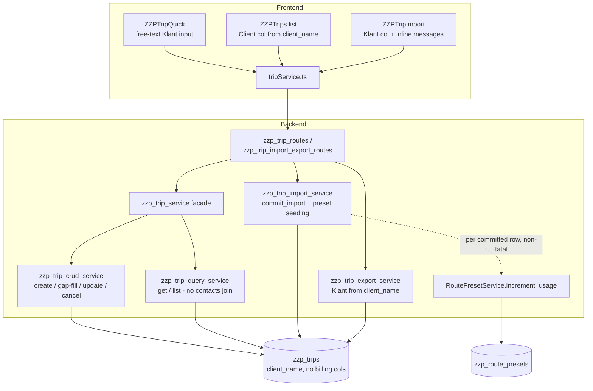

# Design Document

## Overview

This redesign turns the ZZP **Rittenregistratie** (trip/mileage) module into a pure,
Belastingdienst-compliant kilometer log. It removes the never-approved trip-billing model
(`is_billable`, `is_billed`, `invoice_id`, the trip `contact_id` link, invoice-from-trips,
unbilled-trips, and their indexes, routes, guards, and UI) and replaces the formal contact
link with a free-text `client_name` (Klant) field. It also wires route-preset learning to
run on import, and fixes the import preview so rejected rows explain themselves inline.

The simple tax-log experience — quick entry, odometer chaining, gap detection, category and
purpose selection — is preserved and must not regress (Req 10).

**Scope boundary (from Requirements Introduction):** this touches ONLY the trip module
(`zzp_trips` table + its routes/services + `ZZPTrips`, `ZZPTripQuick`, `ZZPTripImport`).
It does NOT touch the `contacts` table / Contacts_Feature, nor the standalone
TimeTracking_Feature (`ZZPTimeTracking`, `ZZPInvoices`, `zzp_invoice_service`). The only
contacts-adjacent change is dropping the `contact_id` link from `zzp_trips`; the `contacts`
table itself is left byte-for-byte unchanged (Req 3.5, Req 5.6).

### Goals

- Pure tax log: date, from/to address, start/end odometer, generated distance, category,
  purpose, optional free-text Klant note (Req 1.1, Req 2).
- Zero billing concepts in data, backend, or frontend (Req 3, Req 4, Req 5).
- Import seeds route presets from real imported routes (Req 6).
- Import preview shows per-row validation messages inline (Req 7).
- Yearless/ambiguous dates stay rejected with a clear reason (Req 8).
- Safe column-dropping migration with a human-confirmation gate before production (Req 9).
- Tax-log behavior and tenant isolation preserved (Req 10).

### Non-Goals

- No change to the `contacts` table or Contacts_Feature.
- No change to `ZZPTimeTracking`, `ZZPInvoices`, or `zzp_invoice_service`.
- Not dropping `zzp_route_presets.contact_id` (see Design Decisions — kept, but no longer
  relied upon).
- No change to the generated `distance_km` column, `is_gap_fill`, `is_cancelled`,
  `cancel_reason`, or `version` — these are tax-log / audit data, not billing (Req 3.4,
  Req 1.7).

## Architecture

The trip module keeps its existing layering (routes → facade service → focused services →
`DatabaseManager`). This redesign removes billing branches and the contacts JOIN; it adds
one field end-to-end (`client_name`) and one cross-service call (import → preset learning).



Key architectural changes:

- **No contacts JOIN** anywhere in the trip read/export path — trips carry `client_name`
  directly (Req 4.5, Req 2.9).
- **Import becomes a preset producer**: `commit_import` calls
  `RoutePresetService.increment_usage` once per committed non-error row, non-fatally
  (Req 6.1, Req 6.4).
- **Billing branches removed** from CRUD (no `is_billed` guards), query (no `is_billed` /
  `contact_id` filters, no `get_unbilled_trips`), routes (no `from-trips`, no `unbilled`),
  and all frontend trip surfaces.

## Data Model Change (Migration)

### Current `zzp_trips` schema

From migration `20260714120100_create_zzp_trips_table.json` (verified). Columns:
`id, administration, vehicle_id, trip_date, start_time, end_time, start_address,
end_address, start_odometer, end_odometer, distance_km (GENERATED STORED = end-start),
trip_category, trip_purpose, route_description, contact_id (FK→contacts), project_name,
notes, is_billable, is_billed, invoice_id (FK→invoices), is_gap_fill, is_cancelled,
cancel_reason, version, created_at, updated_at, created_by`.

Foreign keys: `vehicle_id→zzp_vehicles(id)`, `contact_id→contacts(id)`,
`invoice_id→invoices(id)`.

Indexes created by `20260714120100`: `idx_administration`, `idx_admin_vehicle_date`,
`idx_admin_contact (administration, contact_id)`, `idx_admin_billed (administration,
is_billed)`, `idx_admin_category`, `idx_vehicle_odometer`. A later migration
`20260714120500` added `idx_zzp_trips_admin_billable_contact (administration, is_billable,
is_billed, contact_id)`.

> Note on requirements naming: Req 3.3 names the index to drop as
> `idx_admin_billable_contact`. The actual DB index created by `20260714120500` is
> `idx_zzp_trips_admin_billable_contact`. The migration MUST drop the **actual** index
> name present in the database (`idx_zzp_trips_admin_billable_contact`); Req 3.3 refers to
> the same index by a shortened label.

### Target schema

Add one column, drop two FKs, drop three indexes, drop four columns. Keep everything else —
notably the generated `distance_km`, `is_gap_fill`, `is_cancelled`, `cancel_reason`,
`version`, `project_name`, `notes` (Req 1.7, Req 3.4). These are tax-log/audit fields, not
billing.

```
+ client_name  VARCHAR(255) DEFAULT NULL         -- Req 2.1
- FOREIGN KEY (contact_id) → contacts(id)        -- Req 3.1 (drop before columns)
- FOREIGN KEY (invoice_id) → invoices(id)        -- must drop before dropping invoice_id
- INDEX idx_admin_contact                        -- Req 3.3
- INDEX idx_admin_billed                         -- Req 3.3
- INDEX idx_zzp_trips_admin_billable_contact     -- Req 3.3 (actual name)
- COLUMN is_billable                             -- Req 3.2
- COLUMN is_billed                               -- Req 3.2
- COLUMN invoice_id                              -- Req 3.2
- COLUMN contact_id                              -- Req 3.2
```

### New migration file

A new JSON migration in `backend/src/migrations/` with a timestamped filename
(e.g. `20260715120000_zzp_trips_tax_log_redesign.json`), following the existing format:
object with `name`, `description`, `timestamp`, `up` (array of SQL strings executed in
order), `down` (array; the runner executes `down` in **reverse** order via
`rollback_migration`), and `version` (Req 9.7).

**Ordering constraint (Req 3.1):** the runner executes each `up` statement sequentially,
committing each. FKs and indexes MUST be dropped **before** their columns, or MySQL rejects
the column drop. Correct order:

1. `ALTER TABLE zzp_trips ADD COLUMN client_name VARCHAR(255) DEFAULT NULL` (Req 2.1).
2. Drop FK on `contact_id` (Req 3.1), then FK on `invoice_id`.
3. Drop the three indexes (Req 3.3) — plain `DROP INDEX name ON zzp_trips`, **no
   `IF EXISTS`** (MySQL 9.4 does not support it — Req 3.7).
4. Drop the four columns `contact_id`, `invoice_id`, `is_billable`, `is_billed` (Req 3.2).

> **Index-before-column:** `idx_admin_contact`, `idx_admin_billed`, and
> `idx_zzp_trips_admin_billable_contact` reference the columns being dropped, so they must
> be dropped first (step 3 before step 4), independent of the FK drops.

**`down` (Req 3.6):** reverse everything to the pre-migration definition — re-add the four
columns with their original definitions (`is_billable BOOLEAN DEFAULT FALSE`,
`is_billed BOOLEAN DEFAULT FALSE`, `invoice_id INT DEFAULT NULL`,
`contact_id INT DEFAULT NULL`), re-create the three indexes, re-create both FKs
(`contact_id→contacts(id)`, `invoice_id→invoices(id)`), and `DROP COLUMN client_name`.
Because `rollback_migration` runs `down` in reverse array order, author `down` so that
reversed execution yields: add columns → add indexes → add FKs → drop `client_name` (i.e.
list them in the inverse of that in the array). The simplest, least error-prone approach is
to write each `down` statement to be order-independent where possible and verify with the
up/down round-trip test (see Testing Strategy).

#### Design risk: FK constraint-name discovery

MySQL auto-names foreign keys (conventionally `zzp_trips_ibfk_1`, `zzp_trips_ibfk_2`,
`zzp_trips_ibfk_3` for the three FKs in creation order: vehicle, contact, invoice).
`ALTER TABLE ... DROP FOREIGN KEY <name>` requires the **exact** constraint name, which is
not guaranteed across environments if the table was ever recreated in a different FK order.
Dropping by a hardcoded guessed name risks an abort on Railway if the name differs.

**Resolution (two-tier, concrete):**

- **Preferred — discover at migration time.** The migration file format is a static SQL
  array and cannot run a lookup by itself. Introduce a small discovery step so the dropped
  name is the real one: query
  `information_schema.KEY_COLUMN_USAGE` /
  `information_schema.TABLE_CONSTRAINTS` for the constraint names, e.g.

  ```sql
  SELECT CONSTRAINT_NAME
  FROM information_schema.KEY_COLUMN_USAGE
  WHERE TABLE_SCHEMA = 'finance'
    AND TABLE_NAME = 'zzp_trips'
    AND COLUMN_NAME = 'contact_id'
    AND REFERENCED_TABLE_NAME = 'contacts';
  ```

  Since a pure-JSON migration can't branch on a query result, the implementation options
  are: (a) a one-line pre-check run by the operator/rollout script that confirms the FK
  names match the conventional `zzp_trips_ibfk_2` / `zzp_trips_ibfk_3` before applying; or
  (b) a tiny companion Python migration helper in `backend/src/migrations/` (same directory,
  `.py` seed-style, like the existing `seed_*`/`backfill_*` scripts) that looks up the
  constraint name and issues the `DROP FOREIGN KEY` dynamically, then the JSON migration
  handles the index/column drops.

- **Fallback — convention with a verified pre-check.** Hardcode the conventional names
  (`zzp_trips_ibfk_2` for `contact_id`, `zzp_trips_ibfk_3` for `invoice_id`) in the JSON
  `up`, and make the rollout plan's Step-1 local run the authoritative verification: if the
  local drop fails because the name differs, the migration aborts (leaving `zzp_trips`
  unchanged — Req 3.1) and the implementer substitutes the discovered name before
  retrying. Because Local_Docker and Railway are created by the same migrations in the same
  order, the auto-generated FK names should match; the local run proves it before Railway.

The design mandates: **determine the actual FK names on Local_Docker first** (via the
`information_schema` query above), then pin those names in the migration before the
production run. Never apply to Railway with an unverified FK name.

#### What is NOT billing (keep)

`distance_km` (generated), `is_gap_fill`, `is_cancelled`, `cancel_reason`, `version`,
`project_name`, `notes` are explicitly retained (Req 1.7, Req 3.4). The `contacts` table is
untouched (Req 3.5).

## Data Models

This section documents the data models **after** the redesign (the migration steps that get
us there are in *Data Model Change (Migration)* above). The net shape change is: the trip
model gains a free-text `client_name` and loses every billing/contact-link field end to end
(DB → frontend type → import type).

### `zzp_trips` (post-migration logical model)

Adds `client_name VARCHAR(255) DEFAULT NULL` (Req 2.1) and removes `contact_id`,
`invoice_id`, `is_billable`, `is_billed` along with their foreign keys
(`contact_id→contacts`, `invoice_id→invoices`) and indexes (`idx_admin_contact`,
`idx_admin_billed`, `idx_zzp_trips_admin_billable_contact`) — Req 3.2. Everything else is
retained unchanged.

| Field | Type | Notes |
| --- | --- | --- |
| `id` | INT, PK, auto-increment | |
| `administration` | tenant identifier | tenant scope on every query (Req 10.5) |
| `vehicle_id` | INT | FK → `zzp_vehicles(id)` (retained) |
| `trip_date` | DATE | |
| `start_time` | TIME, nullable | |
| `end_time` | TIME, nullable | |
| `start_address` | VARCHAR | |
| `end_address` | VARCHAR | |
| `start_odometer` | INT | |
| `end_odometer` | INT | |
| `distance_km` | INT, GENERATED STORED | `end_odometer - start_odometer` (unchanged) |
| `trip_category` | ENUM/VARCHAR | {Zakelijk, Privé, Woon-werk} |
| `trip_purpose` | VARCHAR | |
| `route_description` | VARCHAR, nullable | |
| **`client_name`** | **VARCHAR(255), DEFAULT NULL** | **ADDED — free-text Klant (Req 2.1)** |
| `project_name` | VARCHAR, nullable | tax-log data, retained (Req 3.4) |
| `notes` | TEXT, nullable | retained (Req 3.4) |
| `is_gap_fill` | BOOLEAN | audit/tax-log data, retained (Req 1.7) |
| `is_cancelled` | BOOLEAN | retained |
| `cancel_reason` | VARCHAR, nullable | retained |
| `version` | INT | optimistic-lock version, retained |
| `created_at` | DATETIME | |
| `updated_at` | DATETIME | |
| `created_by` | tenant/user identifier | |

Removed: ~~`contact_id`~~, ~~`invoice_id`~~, ~~`is_billable`~~, ~~`is_billed`~~ and their FKs
and indexes (Req 3.2). Trips carry the Klant value directly in `client_name`; there is no
contacts JOIN on any read/export path (Req 5.5).

### Frontend `Trip` type (`frontend/src/types/zzpTrips.ts`)

Mirrors the DB change: drop `contact_id`, `contact?`, `is_billable`, `is_billed`,
`invoice_id`; add `client_name: string | null` (Req 5.5, Req 2.1).

```ts
interface Trip {
  // ...retained tax-log fields (id, administration, vehicle_id, trip_date,
  // start/end_time, start/end_address, start/end_odometer, distance_km,
  // trip_category, trip_purpose, route_description, project_name, notes,
  // is_gap_fill, is_cancelled, cancel_reason, version, created_at,
  // updated_at, created_by)...
  client_name: string | null;   // ADDED (Req 2.1, Req 5.5)
  // REMOVED: contact_id, contact?, is_billable, is_billed, invoice_id
}
```

### Frontend `ImportRow` type (`frontend/src/types/zzpTrips.ts`)

The optional `contact_name?: string` field is renamed to `client_name?: string` (Req 3.2),
matching the import mapping change `"Klant" -> "client_name"`.

### Unchanged models

- **`zzp_route_presets`** — not altered by this redesign. Its nullable `contact_id` column
  stays in place per Design Decision D3 (kept but no longer relied upon); preset learning
  from import does not populate it.
- **`contacts`** — left byte-for-byte unchanged (Req 3.5). The only contacts-adjacent change
  is dropping the `contact_id` link from `zzp_trips`.

## Components and Interfaces

Grouped as deletions / modifications / additions. These describe the changes;
implementation follows in the tasks phase.

### Backend — modifications

**`backend/src/services/zzp_trip_import_service.py`**

- `DEFAULT_COLUMN_MAPPING`: change `"Klant" -> "contact_name"` to `"Klant" -> "client_name"`
  (Req 2.7).
- `commit_import` INSERT: the current column list writes `contact_id` (always `None`) plus
  `is_billable`. Change the column list + params to write `client_name` instead of
  `contact_id`, and remove `is_billable`/`is_billed`/`invoice_id` from the insert (Req 2.7,
  Req 4.6). Keep `is_gap_fill`, `is_cancelled`, `version`, `created_by`, `project_name`,
  `notes`, `route_description`.
- Klant length validation (Req 2.8): before persisting a row, if `client_name` length > 255,
  mark that row as an error with a message naming the 255-character limit; do not persist it,
  and do not abort the batch — other valid rows still commit.
- Empty/blank Klant → `None` (Req 2.7, Req 2.1); trim whitespace on persisted values.
- `_normalize_date`: **no change needed** (Req 8). Verified it rejects yearless values
  (`5-mei`), non-numeric months (`mei`, `jan`), performs no year inference, and accepts
  `YYYY-MM-DD`, `DD-MM-YYYY`, `DD/MM/YYYY` (padded or not) and `datetime`/`date` objects.
  Confirm the existing error message already names the value and reason
  (`Ongeldig datumformaat: '{value}' (verwacht: ...)`) — Req 8.3. No edit beyond confirming.
- **Add preset seeding (Req 6.1–6.4):** after the commit loop, iterate the rows that were
  committed as non-error and call
  `RoutePresetService.increment_usage(tenant, start_address, end_address,
  default_category=trip_category, default_purpose=trip_purpose,
  typical_distance_km=(end_odometer - start_odometer))` once per row. The signature already
  exists exactly (verified). Each call is wrapped in `try/except`: on failure, log a warning
  and attach a **non-fatal** note to that row's result; never roll back the committed trip
  (Req 6.4). Seed **after** successful commit (not inside the per-row insert), so a preset
  failure can never roll back the import. Error rows are skipped entirely (Req 6.1).

**`backend/src/services/zzp_trip_crud_service.py`**

- `create_trip` INSERT: remove `contact_id` and `is_billable`; add `client_name` (Req 4.6,
  Req 2.1).
- gap-fill INSERT (same file): remove `contact_id` and `is_billable`; add `client_name`;
  keep `is_gap_fill = TRUE` (Req 4.6, Req 10.2).
- `update_trip`: remove the "block editing billed trips" guard that checks
  `existing.get("is_billed")` (Req 4.7).
- `cancel_trip`: remove the "block cancellation of billed trips" guard (Req 4.8).
- `UPDATABLE_FIELDS`: remove `contact_id` and `is_billable`; add `client_name`.
  `ALWAYS_REQUIRED` stays as-is (no billing fields present).

**`backend/src/services/zzp_trip_service.py`** (facade)

- `UPDATABLE_FIELDS` (facade copy) also lists `contact_id` → replace with `client_name`.
- Remove the `get_unbilled_trips` delegation (Req 4.4).

**`backend/src/services/zzp_trip_query_service.py`**

- Delete `enrich_with_contacts` (the method that JOINs `contacts` to add a nested contact
  object) and all its call sites in `get_trip`, `list`, and the former `get_unbilled_trips`
  path (Req 4.5). Trips return `client_name` directly, no nested contact object.
- Delete `get_unbilled_trips` (Req 4.4).
- Remove `is_billed` and `contact_id` from the list-trips filter building (Req 4.3) — unknown
  billing filters are simply ignored, returning the full unfiltered set.
- The trip SELECT list returns `client_name` (and the existing non-billing columns); no
  `contact_id`, no contacts JOIN (Req 4.5).
- Preserve `WHERE administration = %s` on every query path (Req 10.5, Req 10.6).

**`backend/src/services/zzp_trip_export_service.py`**

- Currently derives Klant via `LEFT JOIN contacts c ON t.contact_id = c.id`, selecting
  `c.company_name AS contact_name`, with column maps `"contact_name" -> "Klant"`. Change to
  `SELECT t.client_name` directly (drop the contacts JOIN), and map `client_name -> "Klant"`
  (Req 2.9).
- Remove the `contact_id` export filter.
- Keep the PDF/CSV/XLSX Klant column, sourced from `client_name`; empty when null (Req 2.9).

### Backend — deletions

**`backend/src/routes/zzp_trip_import_export_routes.py`**

- Delete the `create_invoice_from_trips` endpoint (`POST /api/zzp/invoices/from-trips`) so
  it returns 404 (Req 4.1).
- Delete the `_get_invoice_service` helper if it is unused elsewhere after that removal.
- Remove the `contact_id` export filter passthrough (Req 4.3).

**`backend/src/routes/zzp_trip_routes.py`**

- Delete the `get_unbilled_trips` endpoint (`GET /api/zzp/trips/unbilled`) so it returns 404
  (Req 4.2).
- Remove the `is_billed` / `contact_id` filter passthroughs in the list route (Req 4.3).

### Frontend — modifications

**`frontend/src/pages/ZZPTrips.tsx`**

- Remove the `"Fact."` (`is_billable`) `FilterableHeader` column and its cell badge
  (Req 5.1).
- Change the Client column source from `trip.contact?.company_name` to `trip.client_name`;
  render an empty cell when null (Req 2.6).
- Remove `billableTrips` useMemo, `handleInvoiceSelected`, the invoice button, the
  `createInvoiceFromTrips` import, and all `is_billed` / `is_billable` / `contact_id` usages
  (Req 5.2, Req 5.4).

**`frontend/src/pages/ZZPTripQuick.tsx`**

- Add a free-text Klant input (`client_name`) to the form state and to the `tripData`
  payload sent to `createTrip` (Req 2.3). Empty input → `null` / omitted (Req 2.5).
- Client-side length guard: reject submission when the Klant value exceeds 255 chars, retain
  the entered value, show an error (Req 2.4). (Server still enforces — Req 2.1.)
- Keep everything else: vehicle select, presets, odometer chaining/pre-fill (Req 10.1),
  category/purpose selects with required-one validation (Req 10.3, Req 10.4).

**`frontend/src/pages/ZZPTripImport.tsx`**

- Add a Klant column to the preview table, populated from each row's `client_name`; empty
  cell when blank/absent (Req 7.5).
- Render per-row `_messages` **inline and visibly** (currently only shown in a hover Tooltip
  on the status badge). Show each message as a separate, visually distinct inline entry
  (e.g. a messages column or an expandable error line under the row), so rejected rows show
  the reason without hover/focus (Req 7.1–7.4). Clean rows (0 messages) show no message
  block (Req 7.4).

**`frontend/src/services/tripService.ts`**

- Remove `getUnbilledTrips` (Req 5.4) and the trip-side usage of `createInvoiceFromTrips`
  (the function lives in `zzpInvoiceService`/the TimeTracking feature — remove only the
  trip usage/import; do not modify the TimeTracking service file — Req 5.6).

**`frontend/src/types/zzpTrips.ts`**

- `Trip` interface: drop `contact_id`, `contact?`, `is_billable`, `is_billed`, `invoice_id`;
  add `client_name: string | null` (Req 5.5, Req 2.1).
- `ImportRow`: rename `contact_name?: string` to `client_name?: string` (Req 2.7).

### Frontend — out of scope (unchanged)

`ZZPTimeTracking.tsx`, `ZZPInvoices.tsx`, and `zzpInvoiceService` are not modified
(Req 5.6). The only interaction is removing the trip module's *import/usage* of
`createInvoiceFromTrips`, not editing the function's own file.

## Correctness Properties

*A property is a characteristic or behavior that should hold true across all valid
executions of a system — essentially, a formal statement about what the system should do.
Properties serve as the bridge between human-readable specifications and machine-verifiable
correctness guarantees.*

These properties were derived from the acceptance-criteria prework and de-duplicated via
property reflection. Each is universally quantified and maps back to requirements.

### Property 1: Trip persistence and generated distance

*For any* valid trip (odometers in `[0, 9_999_999]` with `end >= start`, a valid category,
a purpose, and arbitrary `project_name`/`notes`), creating it SHALL persist a record that
preserves the date, from/to addresses, odometers, category, purpose, `project_name`, and
`notes`, with `distance_km == end_odometer - start_odometer`.

**Validates: Requirements 1.1, 1.2, 1.7**

### Property 2: End-before-start odometer is rejected

*For any* trip where `end_odometer < start_odometer`, creating or updating it SHALL be
rejected with an odometer error and SHALL persist nothing, retaining the input values.

**Validates: Requirements 1.3**

### Property 3: Invalid category is rejected

*For any* `trip_category` value not in {Zakelijk, Privé, Woon-werk}, creating or updating the
trip SHALL be rejected with a category error and SHALL persist nothing.

**Validates: Requirements 1.5**

### Property 4: Client_Name import round-trip

*For any* Klant cell value, committing the row SHALL persist `client_name` equal to the
trimmed input, and SHALL persist `null` when the cell is empty or blank.

**Validates: Requirements 2.1, 2.7**

### Property 5: Over-length Klant row rejected, others preserved

*For any* import batch mixing rows whose Klant value exceeds 255 characters with otherwise
valid rows, the over-length rows SHALL become error rows carrying the 255-character-limit
message and SHALL NOT persist, while every other valid row in the batch SHALL still commit.

**Validates: Requirements 2.8**

### Property 6: Export Klant mirrors Client_Name

*For any* set of exported trips, the exported Klant column value SHALL equal each trip's
`client_name` (empty when `client_name` is null), produced without any contacts join.

**Validates: Requirements 2.9**

### Property 7: Billing filters are ignored (metamorphic)

*For any* trip dataset and tenant, listing trips with an `is_billed` and/or `contact_id`
query filter SHALL return the same result set as listing without those filters, raising no
error.

**Validates: Requirements 4.3**

### Property 8: Billing-free invariant (records and responses)

*For any* trip that is created, gap-filled, retrieved, or listed, neither the stored record
nor the response SHALL contain `contact_id`, a nested `contact` object, `is_billable`,
`is_billed`, or `invoice_id`.

**Validates: Requirements 4.5, 4.6**

### Property 9: Mutations never blocked by billing state

*For any* existing trip and any mutation in {update with a valid payload, cancel}, the
operation SHALL complete and persist, applying no `is_billed`-based rejection regardless of
any prior billing-related value.

**Validates: Requirements 4.7, 4.8**

### Property 10: Preset learning runs once per committed non-error row

*For any* import batch, `RoutePresetService.increment_usage` SHALL be invoked exactly once
for each committed non-error row and zero times for each error row.

**Validates: Requirements 6.1**

### Property 11: Preset use_count equals occurrence count

*For any* multiset of normalized (case-insensitive, trimmed) from/to address pairs across the
committed non-error rows of an import, each resulting auto-learned preset's `use_count` SHALL
equal the number of committed rows carrying that pair (a first occurrence yielding
`use_count == 1`), and distinct pairs SHALL yield distinct presets.

**Validates: Requirements 6.2, 6.3**

### Property 12: Preset learning failure is non-fatal

*For any* committed row whose preset learning raises, the trip SHALL remain committed, the
import result SHALL remain committed, and a non-fatal note SHALL be recorded for that row.

**Validates: Requirements 6.4**

### Property 13: Invalid dates are rejected without inference

*For any* date value that is yearless (lacks a 4-digit year, e.g. `5-mei`, `17-mei`) or uses
a non-numeric month (e.g. `mei`, `jan`, `dec`), the import SHALL reject that row and SHALL
NOT infer or substitute any year.

**Validates: Requirements 8.1, 8.2**

### Property 14: Rejected-date message names the value and is bounded

*For any* row rejected for an invalid date, the per-row error message SHALL contain the exact
offending value and the expected date format, with length at most 500 characters.

**Validates: Requirements 8.3**

### Property 15: Rejected rows are retained in the preview

*For any* import batch, every input row SHALL appear in the preview; rows rejected for an
invalid date SHALL be present and marked as errors, never dropped or omitted.

**Validates: Requirements 8.4**

### Property 16: Accepted date formats normalize to ISO

*For any* date in an accepted format (`YYYY-MM-DD`; `DD-MM-YYYY` or `DD/MM/YYYY` with day and
month zero-padded or not; or a `datetime`/`date` object), the import SHALL accept it and
normalize it to the equivalent `YYYY-MM-DD` string, rejecting none of these for date
validity.

**Validates: Requirements 8.5**

### Property 17: Gap-detection flag reflects odometer continuity

*For any* saved trip whose `start_odometer` differs from the `end_odometer` of the most
recent prior trip for the same vehicle, the gap-detection flag SHALL be set; when they are
equal, it SHALL NOT be set.

**Validates: Requirements 10.2**

### Property 18: Tenant isolation on every trip query

*For any* trip query path (get, list, create, update, cancel, import, export), the executed
SQL SHALL include `WHERE administration = %s` bound to the requesting tenant, and SHALL never
return rows from another tenant.

**Validates: Requirements 10.5**

### Property 19: Missing tenant yields no rows

*For any* trip query issued without a bound tenant identifier for the `administration`
clause, the module SHALL reject the query and return no trip rows.

**Validates: Requirements 10.6**

## Error Handling

- **Odometer / category validation (Req 1.3, 1.5):** `create_trip` / `update_trip` raise a
  `ValueError`-style validation error surfaced by the route as a 4xx with a message naming
  the offending field; nothing is persisted and the user-entered values are returned for
  correction.
- **Klant over-length (Req 2.4, 2.8):** Quick entry blocks client-side and the server
  rejects on persist. On import, the over-length row becomes an error row with the
  255-character-limit message; the batch continues and other rows commit.
- **Invalid date on import (Req 8):** `_normalize_date` rejects; the row is marked as an
  error, retained in the preview, and the message names the value and expected format
  (≤ 500 chars). No year is inferred.
- **Preset learning failure (Req 6.4):** caught per row, logged as a warning, recorded as a
  non-fatal note; never rolls back the committed trip or the import.
- **Removed routes (Req 4.1, 4.2):** the endpoints are unregistered, so the framework
  returns 404 within the 2-second bound; no custom handling needed.
- **Ignored billing filters (Req 4.3):** unknown `is_billed` / `contact_id` filters are
  simply not wired into the WHERE builder — they produce neither an error nor a narrowing of
  results.
- **Migration failure (Req 3.1, 3.7, 9):** the runner records a failed migration and raises;
  because each `up` statement commits individually, if a later statement fails the earlier
  ones are already applied — the rollout plan's local-first step is what catches this before
  Railway, and `down`/`rollback_migration` is the recovery path. The FK-name pre-check
  prevents the most likely failure (wrong constraint name).
- **Missing tenant (Req 10.6):** query paths require a bound `administration`; a missing or
  empty tenant is rejected (raise) rather than defaulting, consistent with the no-silent-
  default tenancy rule.

## Testing Strategy

The project uses pytest (backend) and vitest (frontend). Property-based tests use a Python
PBT library (Hypothesis) for the backend pure-logic properties; a Hypothesis library must be
used rather than hand-rolling input generation. Each property test runs a minimum of 100
iterations and is tagged with a comment referencing its design property, in the form:
`# Feature: rittenregistratie-tax-log-redesign, Property N: <property text>`.

### Dual approach

- **Property tests** cover the universal properties above (persistence/distance, odometer &
  category rejection, client_name round-trip, over-length rejection, export passthrough,
  metamorphic billing-filter ignore, billing-free invariant, mutation-not-blocked, preset
  learning count / non-fatal, date reject/accept/normalize, gap flag, tenant isolation).
  These are the parts whose behavior varies meaningfully with input and test our own logic.
- **Example / component tests** cover UI wiring and specific scenarios: category/purpose
  three values (Req 1.4), Quick_Entry Klant input writes `client_name` (Req 2.3), empty →
  null (Req 2.5), list shows `client_name` / empty cell (Req 2.6), no Fact. column /
  no invoice button (Req 5.1, 5.2), import preview Klant column + inline messages
  (Req 7.1–7.5), category/purpose required-one and missing-selection errors (Req 10.3,
  10.4).
- **Integration / migration tests** cover the migration and route removals.
- **Smoke / static tests** cover absences: no `km_rate`/`0.23` in trip UI or service
  (Req 5.3), frontend `Trip` type has no billing fields and has `client_name` (Req 5.5),
  zero diff on TimeTracking files (Req 5.6), presets in a separate table (Req 6.6), migration
  file present and picked up by `run_all_migrations` (Req 9.7).

### Backend (change-with-tests contract — Req 10.7)

Update existing suites to the new model so they execute against the changed schema and pass:
`test_zzp_trip_import_service.py`, `test_zzp_trip_import_validate.py`,
`test_zzp_route_preset_service.py`, and the trip service/query tests. Add:

- `client_name` persistence (create, gap-fill, import) and empty → null.
- Preset-from-import counting + non-fatal failure.
- Removed endpoints return 404 (`POST /api/zzp/invoices/from-trips`,
  `GET /api/zzp/trips/unbilled`).
- Update and cancel succeed regardless of any prior `is_billed` value.
- Date accept/reject/normalize (reuse and extend the existing `_normalize_date` property set
  — confirm no behavior change).
- Billing-free invariant on created/retrieved/listed trips.
- Tenant-isolation assertions (SQL includes `WHERE administration = %s`; missing tenant →
  no rows).

### Frontend

Follow `.kiro/steering/33-frontend-testing.md`. Update/extend vitest tests:

- `ZZPTrips`: no Fact. column, Client column sourced from `client_name` (value + empty),
  no invoice button, no `createInvoiceFromTrips` usage.
- `ZZPTripQuick`: Klant input present, writes `client_name`, empty → null, >255 blocked;
  category/purpose required-one preserved.
- `ZZPTripImport`: Klant column present, per-row messages rendered inline (visible without
  hover), multiple messages shown as distinct entries, clean rows show none.

### Migration test

A test that, on a scratch/local DB, captures the `zzp_trips` schema, applies `up`, asserts
the four columns and three indexes are gone and `client_name` is present (Req 3.2, 3.3,
2.1), then applies `down` and asserts the schema equals the captured pre-migration
definition (Req 3.6). Also assert the `contacts` table definition is identical before and
after (Req 3.5), and that the migration SQL contains no `IF EXISTS` on index drops
(Req 3.7). A second apply reports "already applied" and does not re-run (Req 9.6).

### Why some criteria are not property tests

The migration (Req 3), route removals (Req 4.1/4.2), UI rendering (Req 5, Req 7), and the
rollout process (Req 9) are deterministic or structural — their behavior does not vary with
generated input, so they use migration/integration tests, component/snapshot tests, and
operational procedure respectively, not PBT. PBT is reserved for the input-varying pure
logic (import parsing/validation, persistence shape, preset counting, tenant scoping).

## Migration & Rollout Plan (Req 9)

The migration drops columns on a live production database, so it follows a strict
local-first, human-gated sequence. Migrations are tracked in the `database_migrations` table
and are not re-run (Req 9.6); the `down` migration is the rollback.

### Step 1 — Local_Docker first (Req 9.1, 9.2)

Determine the actual FK constraint names, then apply:

```bash
# From repo root (POSIX path), venv active:
cd /home/peter/projects/myAdmin/backend && source .venv/bin/activate \
  && PYTHONPATH=src python -c "from database_migrations import DatabaseMigration; DatabaseMigration().run_all_migrations()"
```

Pre-check the FK names before relying on the migration's hardcoded names:

```sql
SELECT CONSTRAINT_NAME, COLUMN_NAME, REFERENCED_TABLE_NAME
FROM information_schema.KEY_COLUMN_USAGE
WHERE TABLE_SCHEMA = 'finance' AND TABLE_NAME = 'zzp_trips'
  AND REFERENCED_TABLE_NAME IS NOT NULL;
```

Verify after apply (Req 9.2 — report within 10s whether columns were removed and records
remain readable):

- `client_name` present; `is_billable`, `is_billed`, `invoice_id`, `contact_id` absent
  (schema inspection).
- Existing trips still readable (`SELECT ... FROM zzp_trips WHERE administration = %s`
  returns rows without error).

### Step 2 — Human-confirmation gate (Req 9.3, 9.4, 9.5)

Do **not** target Railway until the Step-1 verification confirms all four columns are absent
AND all pre-existing trip records are readable. Then require an **explicit human go-ahead**
recorded for this specific migration. With no recorded go-ahead, the Railway run is aborted,
Railway data is left unchanged, and an error indicating human confirmation is required is
returned. This gate is operator-enforced, not automated.

### Step 3 — Railway_Production (Req 9.1, 9.4)

Pre-check for real data loss before dropping columns on Railway — confirm the billing columns
hold no meaningful data (the billing model was never exposed in the trip UI, so this is
expected to be zero; **this assumption is stated explicitly** and must be verified, not
assumed):

```bash
PYTHONPATH=backend/src backend/scripts/railway-db.sh python -c "..."
# equivalent query: SELECT COUNT(*) FROM zzp_trips WHERE contact_id IS NOT NULL OR is_billed = 1;
```

If the count is 0, proceed; the column drop loses no real data. Then apply via the Railway
wrapper (maps `RAILWAY_DB_*` onto `DB_*` for one command, leaving local dev config
untouched):

```bash
PYTHONPATH=backend/src backend/scripts/railway-db.sh python -c "from database_migrations import DatabaseMigration; DatabaseMigration().run_all_migrations()"
```

Re-run the Step-1 verification queries against Railway.

### Irreversibility note

Dropping columns on live Railway is irreversible for any data those columns held. The `down`
migration restores the column *structure* (and FKs/indexes) but cannot restore dropped row
values. The explicit assumption — to be verified by the pre-check above — is that
`zzp_trips` carries no real billing data because trip billing was never exposed to users. If
the pre-check returns a non-zero count, stop and escalate before dropping.

## Design Decisions

### D1 — Replace the contact FK with free-text `client_name`

The trip `contact_id → contacts(id)` link was part of the never-approved billing model and
is not meaningfully used in the trip UI. A free-text `client_name VARCHAR(255)` (Req 2.1,
2.2) matches a Belastingdienst kilometer log's optional client note and removes a cross-
feature coupling. Rationale: the tax log needs a note, not a relational link; this also
lets import populate the field directly from the `Klant` column without a contacts lookup.

### D2 — Seed presets *after* commit, iterating committed rows

Preset learning runs after the trip is committed, per committed non-error row, wrapped in
`try/except` (Req 6.1, 6.4). Alternative considered: seeding inside the per-row insert
transaction. Rejected because a preset failure could then roll back a valid trip, violating
Req 6.4's non-fatal guarantee. Seeding after commit isolates preset failures from trip
persistence.

### D3 — Keep `zzp_route_presets.contact_id` (stop relying on it) — owner may override

`zzp_route_presets` has an optional, nullable `contact_id` column used by
`create_preset`/`update_preset`. **Decision: leave it in place for now but stop relying on
it.** Rationale: it is a separate, small, nullable column that is not part of the trip-
billing-removal scope; dropping it would force edits to `create_preset`/`update_preset` and
the frontend `RoutePreset` type for no tax-log benefit. Import-driven learning
(`increment_usage`) does not set it. This is a reversible decision — the owner may choose to
drop it later; it is explicitly **not** a requirement of this redesign.

### D4 — Keep the generated `distance_km` and audit/gap fields

`distance_km` (generated stored), `is_gap_fill`, `is_cancelled`, `cancel_reason`, and
`version` are tax-log / audit data, not billing (Req 1.7, Req 3.4, Req 10.2). They stay. Only
the four billing columns and their FKs/indexes are dropped.

### D5 — FK-name discovery before production

MySQL auto-names FKs; dropping by a guessed name risks an abort on Railway. Decision: verify
the actual constraint names on Local_Docker via `information_schema` and pin them in the
migration before the production run, with the local-first apply as the proving ground (D-risk
detailed under Data Model Change). This keeps Req 3.1's "abort and leave unchanged on FK
failure" as a genuine safety net rather than an expected outcome.

### D6 — Billing filters ignored, not errored (Req 4.3)

Rather than returning an error for `is_billed`/`contact_id` query params, the list route
simply does not wire them into the WHERE builder. This keeps old clients/bookmarks working
(no 4xx) while guaranteeing a full, unfiltered result — a metamorphic guarantee (Property 7).
