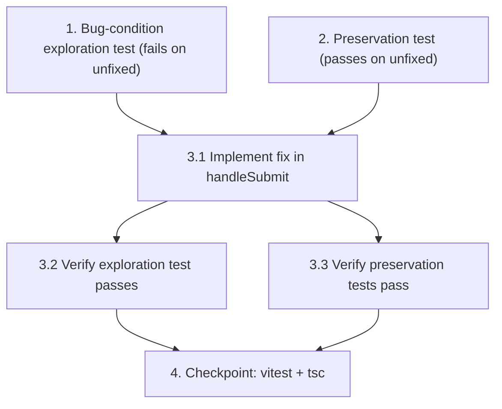

# Implementation Plan

## Overview

A narrow, test-first bugfix for the silent save failure in `ZZPTripQuick.handleSubmit`. The exploration test (Property 1) is written first and must FAIL on the unfixed component, a preservation test (Property 2) is confirmed passing on unfixed code, then the fix is applied and both are re-run.

## Task Dependency Graph



```json
{
  "waves": [
    { "wave": 1, "tasks": ["1", "2"] },
    { "wave": 2, "tasks": ["3.1"] },
    { "wave": 3, "tasks": ["3.2", "3.3"] },
    { "wave": 4, "tasks": ["4"] }
  ]
}
```

## Tasks

- [x] 1. Write bug condition exploration test
  - **Property 1: Bug Condition** - Rejected create must not report success
  - **IMPORTANT**: Write this property-based/exploration test BEFORE implementing the fix
  - **CRITICAL**: This test MUST FAIL on the unfixed `ZZPTripQuick` — failure confirms the silent-save bug exists. DO NOT fix the test or the code when it fails at this step.
  - **NOTE**: This test encodes the expected behavior — it will validate the fix when it passes after implementation.
  - **GOAL**: Surface a counterexample where a `{success:false}` response is treated as success (form reset / data lost).
  - **Scoped PBT Approach**: The bug condition reduces to the single discrete branch `createTrip resolves with success === false` (Bug Condition in design); scope the test to that concrete case: mock `createTrip` to resolve with `{ success: false, error: 'end_odometer must be greater than start_odometer' }` (HTTP-400-style body — the service resolves, does NOT throw).
  - Add to the existing `frontend/src/__tests__/ZZPTripQuick.test.tsx`, following its patterns (Vitest + jsdom + RTL, services mocked, `render` from `@/test-utils`, Chakra auto-mock per `.kiro/steering/33-frontend-testing.md`).
  - Fill a valid-looking quick-entry form (addresses "Van"/"Naar", end km-stand, purpose), click "REGISTREER RIT".
  - Assert the bug: because the Chakra mock does not render toast content, assert on the observable **form-reset side effect** — after a `success:false` response the end km-stand field and the Van/Naar address fields are NOT cleared (they retain the entered values), and `createTrip` was called once with the rejected payload. The assertions match Property 1 / Expected Behavior 2.3 in design.
  - Run `cd frontend && npx vitest run src/__tests__/ZZPTripQuick.test.tsx`
  - **EXPECTED OUTCOME**: Test FAILS (unfixed code wrongly resets the form after a `success:false` response — proving the bug).
  - Document the counterexample (e.g. "end km-stand field is empty / addresses blank after `createTrip` resolved `{success:false}` → component ran its success+reset path").
  - Mark complete when the test is written, run, and the failure is documented.
  - _Requirements: 1.1, 1.2_

- [x] 2. Write preservation test (BEFORE implementing the fix)
  - **Property 2: Preservation** - Success and error-path behavior unchanged
  - **IMPORTANT**: Follow the observation-first methodology.
  - Observe on the UNFIXED component: when `createTrip` resolves `{ success: true, data: {...} }`, after submit the end km-stand clears and the start km-stand advances to the entered end value (happy-path reset).
  - Add/keep a positive test in `ZZPTripQuick.test.tsx` asserting that behavior; rely on the already-present validation, Klant, and odometer-pre-fill tests to cover the rest of the non-bug domain (Preservation Requirements in design).
  - Run `cd frontend && npx vitest run src/__tests__/ZZPTripQuick.test.tsx`
  - **EXPECTED OUTCOME**: This preservation test and all existing tests PASS on the unfixed code (baseline to preserve). The only failing test should be the Property 1 exploration test from task 1.
  - Mark complete when the preservation test is written/confirmed and passing on unfixed code.
  - _Requirements: 3.1, 3.2, 3.3, 3.4_

- [x] 3. Fix silent save failure in `ZZPTripQuick.handleSubmit`

  - [x] 3.1 Implement the fix (branch on the create response `success` flag)
    - In `frontend/src/pages/ZZPTripQuick.tsx` `handleSubmit`, capture the response: `const resp = await createTrip(tripData);`.
    - If `!resp.success`: show an error toast (`status: 'error'`) with description `resp.error` when truthy, else a generic Dutch fallback (e.g. "De rit kon niet worden opgeslagen. Controleer de gegevens en probeer opnieuw."); then return early WITHOUT resetting the form and WITHOUT advancing `startOdometer`.
    - Only when `resp.success` is truthy: show the existing "Rit geregistreerd!" success toast and run the existing reset block (advance `startOdometer`, clear `endOdometer`, `startAddress`, `endAddress`, `tripPurpose`, `clientName`, `klantError`, `selectedPresetId`).
    - Leave the existing `catch` (network/parse errors → "Fout bij registreren") and `finally` (`setSubmitting(false)`) unchanged.
    - NARROW scope: do not change the backend, do not change `apiService` throw behavior, do not touch other callers of `tripService`.
    - _Bug_Condition: isBugCondition(resp) where createTrip resolved AND resp.success === false (design Bug Details)_
    - _Expected_Behavior: Property 1 / expectedBehavior from design — error toast with resp.error or Dutch fallback, no reset, no odometer advance_
    - _Preservation: Preservation Requirements from design — success path reset, catch path, validation guards unchanged_
    - _Requirements: 2.1, 2.2, 2.3, 3.1, 3.2, 3.3, 3.4_

  - [x] 3.2 Verify bug condition exploration test now passes
    - **Property 1: Expected Behavior** - Rejected create must not report success
    - **IMPORTANT**: Re-run the SAME test from task 1 — do NOT write a new test.
    - Run `cd frontend && npx vitest run src/__tests__/ZZPTripQuick.test.tsx`
    - **EXPECTED OUTCOME**: The Property 1 test now PASSES (form retained on `success:false`), confirming the bug is fixed.
    - _Requirements: 2.1, 2.2, 2.3_

  - [x] 3.3 Verify preservation tests still pass
    - **Property 2: Preservation** - Success and error-path behavior unchanged
    - **IMPORTANT**: Re-run the SAME tests from task 2 and the existing suite — do NOT write new tests.
    - Run `cd frontend && npx vitest run src/__tests__/ZZPTripQuick.test.tsx`
    - **EXPECTED OUTCOME**: The happy-path reset test and all existing validation/Klant/odometer tests still PASS (no regressions).
    - _Requirements: 3.1, 3.2, 3.3, 3.4_

- [x] 4. Checkpoint - Ensure all tests pass and types are clean
  - Run `cd frontend && npx vitest run src/__tests__/ZZPTripQuick.test.tsx` — all tests pass (exploration + preservation + existing).
  - Run `cd frontend && npx tsc --noEmit` — clean for the touched files.
  - Leave changes in the working tree (do not commit). Ask the user if questions arise.

## Notes

- Scope is strictly `frontend/src/pages/ZZPTripQuick.tsx` `handleSubmit`. Do NOT change the backend, `apiService` throw behavior, or other `tripService` callers (explicit user decision).
- Tests are added to the existing `frontend/src/__tests__/ZZPTripQuick.test.tsx` (change-with-tests contract).
- The Chakra mock's `useToast` returns a fresh `vi.fn()` and does not render toast content, so assertions target the observable form-reset side effect rather than toast text.
- Recovery of the two already-lost trips is out of scope.
