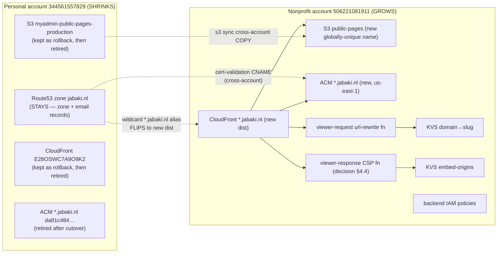

# Design Document: jabaki.nl Hosting Migration to Nonprofit Account

## Overview

This is an **infrastructure migration runbook**, not an application-code design. The goal is
to consolidate ownership of all `jabaki.nl` public-pages hosting (S3 + CloudFront + the
supporting ACM certificate, CloudFront functions, KeyValueStores, and backend IAM) from the
**personal / identity AWS account (`344561557829`)** onto the **nonprofit / deploy AWS account
(`506221081911`)**, matching the account where the rest of the deployable infrastructure
(SAM modules, DynamoDB, API Gateway, Lambda) already lives.

The user's words: *"I would like all s3 and cloudfront jabaki.nl related to be migrated to the
non-profit account."* This is infra consolidation — explicitly **not** merely the form-404 fix.

Because this migration touches **live DNS**, **live tenant content** (7 published landing-page
tenants), and **production email** (MX/DKIM/DMARC) that all share the single `jabaki.nl` hosted
zone, the design is weighted toward **sequencing, blast-radius control, verification, and
rollback**. The guiding principle throughout: **build the new stack fully in nonprofit, verify
it on a non-production hostname, flip only the `*.jabaki.nl` wildcard alias, and keep the old
personal stack intact as a rollback target until post-cutover verification passes.**

> **Authoring-time constraint:** This spec is documentation only. No Terraform is applied, no S3
> data is copied, and no DNS is touched while authoring. Every mutating step below is gated on
> explicit user confirmation **at execution time**, and every live AWS read must be re-verified
> against the account before any corresponding apply.

---

## Current State (verified ground truth)

All facts below were gathered live and are to be treated as ground truth for design; they
**must be re-verified with AWS reads immediately before any apply**, since the window between
authoring and execution may change them.

### Accounts, profiles, regions (steering `23-aws-accounts.md`, `41-shell-environment.md`)

| Role | Account | Profile | Notes |
| --- | --- | --- | --- |
| Identity / personal | `344561557829` | `personal` | Currently owns ALL jabaki.nl hosting + the Route53 zone |
| Nonprofit / deploy | `506221081911` | `nonprofit-deploy` (role `NonprofitDeployRole`) | Target account; owns SAM/DynamoDB/API GW/Lambda |

- Primary region: `eu-west-1`. CloudFront & ACM control plane: `us-east-1`.
- `NonprofitDeployRole` currently has **no Route53 permission** (`route53:ListHostedZones` →
  `AccessDenied`) and the nonprofit account has **no public-pages bucket** and **no
  `*.jabaki.nl` distribution** today.

### Hosting resources — all currently on PERSONAL (`344561557829`)

**S3 bucket** `myadmin-public-pages-production` (eu-west-1). Holds Python-rendered **static**
`index.html` + `landing.json` per tenant slug prefix (NOT a React SPA). Written by
`backend/src/services/landing_page_publish_service.py`. Live slug prefixes (7):

```
GoodwinSolutions/   PeterPrive/   kimgeers/   mytest/
peter/   thecategorystudio/   vandenheuvelhoveniers/
```

> H-DCN has **never** published — there is no `h-dcn/` or `hdcn-application-form/` prefix.

**CloudFront distribution** `E28OSWC7A9O9K2`:
- Alias: `*.jabaki.nl`
- Origin: `myadmin-public-pages-production.s3.eu-west-1.amazonaws.com` (via OAC)
- Viewer cert: ACM `arn:aws:acm:us-east-1:344561557829:certificate/da81c484-b508-498f-8cad-fe4d87b8da57`
  (`*.jabaki.nl`, sni-only, `TLSv1.2_2021`)
- Function associations on the live distribution: **one** — viewer-request
  `myadmin-public-pages-url-rewrite-production`.
- The viewer-**response** CSP/frame-ancestors function (`infrastructure/application-form.tf`,
  `myadmin-application-form-frame-ancestors`) is **NOT deployed** on the live distribution —
  so `application-form.tf` is also currently unapplied here.

**Route53 hosted zone** `jabaki.nl` — on the personal account. Carries the **hosting records**
(`*.jabaki.nl` wildcard A/AAAA alias to the distribution, and root `jabaki.nl` A/AAAA alias)
**and production email records** (MX → ImprovMX; SPF/Stripe/Google TXT; `_dmarc`; Stripe DKIM
CNAMEs ×6; SES verification TXT + SES DKIM CNAMEs). The cutover must touch **only the
`*.jabaki.nl` wildcard A/AAAA alias** and must **never** change any email record.

### Existing Terraform (written; appears UNAPPLIED in nonprofit)

Root module: `infrastructure/`. Key files and what they declare:

| File | Declares |
| --- | --- |
| `infrastructure/main.tf` | Provider(s) + **S3 state backend** (see below) |
| `infrastructure/landing-pages.tf` | `aws_s3_bucket.public_pages` (`myadmin-public-pages-${var.environment}`), OAC, `aws_cloudfront_distribution.public_pages` (alias `*.jabaki.nl`), viewer-request `public_pages_url_rewrite` fn, `domain_mapping` KVS, bucket policy, backend IAM policies, DynamoDB landing-pages table |
| `infrastructure/acm-jabaki.tf` | `aws_acm_certificate.jabaki_wildcard` (`*.jabaki.nl`, us-east-1 via `aws.us_east_1`), Route53 DNS-validation records, `aws_acm_certificate_validation.jabaki_wildcard` |
| `infrastructure/application-form.tf` | `application_embed_origins` KVS, viewer-response `application_form_frame_ancestors` fn, embed-origins backend IAM policy |
| `infrastructure/route53-jabaki.tf` | `aws_route53_zone.jabaki` + root A/AAAA alias + `*.jabaki.nl` wildcard alias + ALL email records (MX/TXT/DMARC/Stripe DKIM/SES) |

**Terraform state/provider reality (the crux of "how is TF applied"):**

- `main.tf` configures a single default `provider "aws" { region = var.aws_region }` plus a
  `us_east_1` alias — **neither pins an account** (no `profile`, no `assume_role`). Whatever
  credentials the shell resolves decide the target account.
- The backend is `backend "s3" { bucket = "myadmin-terraform-state-eu-west-1", key =
  "infrastructure/terraform.tfstate", region = "eu-west-1" }` — a **single state file**, with
  no account/workspace separation.
- `route53-jabaki.tf` wires the `*.jabaki.nl` wildcard alias **and** the root alias **and** the
  cert-validation record all to `aws_route53_zone.jabaki` in the **same module**. As written,
  a plain `terraform apply` of this module would try to create the zone + hosting + email + the
  distribution **in one account** — which is exactly what we must NOT do (it would recreate the
  live zone and risk the email records). **Resolving this is a first-class design decision
  (§4 and §9), not an assumption that `terraform apply` "just works."**

### Backend coupling (must be repointed as part of cutover)

- `backend/src/services/landing_page_publish_service.py` — writes published pages to env
  `LANDING_PAGES_BUCKET` (default `myadmin-public-pages-{env}`); invalidates
  `CLOUDFRONT_PUBLIC_PAGES_DISTRIBUTION_ID`; reads `CLOUDFRONT_PUBLIC_PAGES_DOMAIN`.
- `backend/src/services/cloudfront_domain_service.py` — writes the domain→slug KVS and the
  embed-origins KVS via env `CLOUDFRONT_KVS_ARN` and `CLOUDFRONT_EMBED_ORIGINS_KVS_ARN`.
- These run **from Railway** with whatever AWS credentials resolve there (currently personal).
- The frontend build injects `VITE_CLOUDFRONT_PUBLIC_PAGES_URL` (`deploy-frontend.yml`).

All of the above must point at the **new nonprofit** bucket / distribution / KVS after cutover.

### Explicitly out of scope (downstream follow-up, NOT this spec)

The frontend `/apply` route fix and the `deriveApplicationFormUrl` change (uncommitted on branch
`fix/members-tenant-mock`) are a **different concern**. The application form still needs a
publish path into the bucket, but that is a downstream follow-up — it is **not** folded into
this migration.

---

## Architecture

The architecture is a **two-account AWS hosting topology**. Today everything lives in the
personal account; the target splits ownership so the nonprofit account owns the hosting data
plane (S3 origin + CloudFront + ACM + CloudFront functions + KVS + backend IAM) while the
personal account retains only the DNS control plane (the `jabaki.nl` hosted zone and its email
records). Request flow after cutover: a browser resolves `<slug>.jabaki.nl` via the personal
Route53 zone's wildcard alias → the **nonprofit** CloudFront distribution → viewer-request
url-rewrite function (slug-path routing, KVS lookup for custom domains) → OAC → the **nonprofit**
S3 origin. The backend publish path (Railway) writes rendered pages into the nonprofit bucket and
issues invalidations against the nonprofit distribution.

The diagram under **Target State** below is the authoritative architecture view.

## Target State



**End state:** the `jabaki.nl` **zone and all email records stay in the personal account**;
only the `*.jabaki.nl` wildcard alias points at the **new nonprofit distribution**, whose origin
is the **new nonprofit bucket** holding a copy of all 7 tenants' content. The old personal
bucket + distribution + ACM cert are retired only **after** verification.

---

## Components and Interfaces

The "components" of this migration are the AWS resources being moved and the interfaces are the
account/profile boundaries and the config env vars that couple the backend to them.

### Component: S3 origin bucket
- **Current (personal):** `myadmin-public-pages-production`, eu-west-1, OAC-read-only, SSE AES256,
  full public-access-block. Holds per-slug `index.html` + `landing.json`.
- **Target (nonprofit):** new globally-unique bucket (D3), same security posture, same per-slug
  object layout (copied in Phase 3).
- **Interface:** read by CloudFront via OAC; written by the backend publish service via env
  `LANDING_PAGES_BUCKET`.

### Component: CloudFront distribution
- **Current (personal):** `E28OSWC7A9O9K2`, alias `*.jabaki.nl`, one viewer-request function.
- **Target (nonprofit):** new distribution, alias `*.jabaki.nl`, viewer-request url-rewrite
  function (parity, D4), new OAC, new viewer cert.
- **Interface:** fronted by the personal zone's `*.jabaki.nl` wildcard alias; invalidated by the
  backend via env `CLOUDFRONT_PUBLIC_PAGES_DISTRIBUTION_ID`; its domain read via
  `CLOUDFRONT_PUBLIC_PAGES_DOMAIN` / frontend `VITE_CLOUDFRONT_PUBLIC_PAGES_URL`.

### Component: ACM certificate (`*.jabaki.nl`, us-east-1)
- **Current (personal):** `arn:aws:acm:us-east-1:344561557829:certificate/da81c484-…`.
- **Target (nonprofit):** new cert in nonprofit us-east-1, DNS-validated by a CNAME in the
  **personal** zone (cross-account, D2).

### Component: CloudFront functions
- viewer-request `myadmin-public-pages-url-rewrite-*` (deployed today, moved as-is).
- viewer-response `myadmin-application-form-frame-ancestors-*` (undeployed today; deferred, D4).

### Component: CloudFront KeyValueStores
- `domain_mapping` (custom domain → slug) and `application_embed_origins` (form host → embed
  origins). Recreated in nonprofit and re-seeded from the personal export (Phase 0 → Phase 6).
- **Interface:** written by the backend via env `CLOUDFRONT_KVS_ARN` and
  `CLOUDFRONT_EMBED_ORIGINS_KVS_ARN`.

### Component: Route53 zone `jabaki.nl` (stays personal)
- **Interface for this migration:** exactly two mutable records — the `*.jabaki.nl` A and AAAA
  alias (flipped in Phase 5) plus an additive cert-validation CNAME (Phase 2). Every email record
  is read-only for this migration.

### Component: backend IAM policies (nonprofit)
- S3-write, CloudFront-invalidation, KVS-access, (DynamoDB if needed) policies recreated in
  nonprofit and attached to whatever principal Railway assumes.

### Account/profile interface boundary
- Personal profile `personal` (`344561557829`) — used for all personal-zone edits and reads of
  the old stack / source bucket.
- Nonprofit profile `nonprofit-deploy` (`506221081911`, `NonprofitDeployRole`) — used for all new
  hosting resource creation.

## Data Models

The migration itself has no application data model; the relevant "data models" are the shapes of
the content and config being moved.

### Published tenant object layout (S3)
```
<bucket>/
  <slug>/index.html      # Python-rendered static HTML (per tenant)
  <slug>/landing.json    # rendered landing config
```
Validation: the 7 live slugs (`GoodwinSolutions`, `PeterPrive`, `kimgeers`, `mytest`, `peter`,
`thecategorystudio`, `vandenheuvelhoveniers`) must each retain both objects after the Phase 3
copy; per-slug count and byte totals must match the Phase 0 baseline.

### CloudFront KeyValueStore entries
```
domain_mapping:            key = custom domain host      -> value = tenant slug
application_embed_origins: key = application-form host   -> value = space-separated allowed origins
```
Validation: re-seeded entry count in nonprofit equals the Phase 0 export from personal.

### Backend / frontend configuration contract (env vars repointed in Phase 6)
```
LANDING_PAGES_BUCKET                        -> new nonprofit bucket name
CLOUDFRONT_PUBLIC_PAGES_DISTRIBUTION_ID     -> new nonprofit distribution id
CLOUDFRONT_PUBLIC_PAGES_DOMAIN              -> new nonprofit distribution domain
CLOUDFRONT_KVS_ARN                          -> new nonprofit domain_mapping KVS ARN
CLOUDFRONT_EMBED_ORIGINS_KVS_ARN            -> new nonprofit embed_origins KVS ARN
VITE_CLOUDFRONT_PUBLIC_PAGES_URL (frontend) -> new nonprofit distribution URL
```
Validation: after repoint, a backend republish writes to the nonprofit bucket and invalidates the
nonprofit distribution.

### Route53 record model (personal zone — mutation scope)
```
MUTABLE (this migration):  *.jabaki.nl  A/AAAA alias  (Phase 5 flip)
                           _<acm>.jabaki.nl CNAME     (Phase 2 additive validation record)
READ-ONLY (must not change): MX, SPF/TXT, _dmarc, Stripe DKIM x6, SES verification TXT, SES DKIM
```
Validation: a full-zone record diff against the Phase 0 baseline shows changes ONLY to the two
mutable record sets.

## Key Decisions (confirm with user)

### D1 — Domain registration/zone stays in personal Route53 (only the wildcard alias repoints)

**Decision:** Keep `jabaki.nl` registered and its hosted zone in the **personal** account. Change
**only** the `*.jabaki.nl` wildcard A/AAAA alias to target the new nonprofit distribution. The
new ACM cert's DNS-validation CNAME is also added to this personal zone (cross-account
validation, D2).

**Why not move the whole zone to nonprofit?** Heavier and riskier because the same zone carries
**production email** (MX → ImprovMX, Stripe DKIM ×6, SES DKIM ×3, SPF/DMARC). Migrating a zone
means recreating every record in the new account and switching nameservers at the registrar — a
multi-hour propagation window during which a single missed record breaks mail. The user accepts
keeping the zone in personal; this contains blast radius to one wildcard record. *(Documented
alternative — full zone move — is explicitly rejected for this reason.)*

> **Consequence for Terraform:** the `route53-jabaki.tf` module (zone + email + root alias) must
> **not** be applied in nonprofit. Only a **single wildcard-alias record change** is applied in
> the **personal** zone, and it must be surgical (see §4.1 and §9).

### D2 — New ACM cert in nonprofit us-east-1, cross-account DNS validation

Request a **new** `*.jabaki.nl` certificate in **nonprofit `us-east-1`** (`DNS` validation). The
validation record is a CNAME that must be created in the **personal** `jabaki.nl` zone (the zone
owner), while the certificate resides in **nonprofit**. This is a deliberate **cross-account**
split: validation record in personal, cert in nonprofit. The old personal cert
(`da81c484…`) stays until the new distribution is live and verified.

### D3 — New globally-unique S3 bucket name (names are global)

S3 bucket names are globally unique; `myadmin-public-pages-production` is **taken by the old
bucket** and cannot be recreated in nonprofit while the old one exists. Two options:

- **(Recommended) New bucket name** in nonprofit (e.g. `myadmin-public-pages-prod-np` or a
  nonprofit-scoped name — exact name chosen at execution). The rewrite function logic is
  **unchanged** because it routes purely on the **slug path** (`/<slug>/index.html`), never on
  the bucket name. This keeps old and new buckets coexisting for safe rollback.
- *(Rejected)* Delete-the-old-then-recreate-same-name — destroys the rollback target and forces
  a name collision window. Not acceptable for a live migration.

### D4 — Deploy the viewer-response CSP function now? (confirm)

The viewer-response CSP/frame-ancestors function in `application-form.tf` is currently
**undeployed** on the live distribution. When recreating the distribution in nonprofit we can
either:

- **(Recommended) Recreate parity-first:** deploy the new distribution with **only** the
  viewer-request url-rewrite function (matching today's live behavior), and treat deploying the
  viewer-response CSP function as a **separate** follow-up tied to the application-form work
  (which is already out of scope here). This keeps the migration a true like-for-like move and
  avoids introducing a new header behavior mid-cutover.
- *(Alternative)* Deploy both functions now. Rejected as default because it changes response
  behavior during a migration whose goal is parity, and the CSP function belongs to the
  out-of-scope application-form concern.

### D5 — Terraform application model (state + provider)

Because the current root module has no account separation and bundles the zone/email, the
migration will **not** run a blanket `terraform apply` of `infrastructure/`. The design resolves
this in §9 (Terraform Strategy). Confirmation point: whether to (a) introduce a nonprofit
provider via `assume_role`/profile + a **separate state key** scoped to only the hosting
resources, or (b) manage the nonprofit hosting as a new scoped module. Either way, the
`route53-jabaki.tf` zone/email resources are excluded from the nonprofit apply, and the personal
wildcard-alias edit is done as its own targeted change.

---

## Migration Runbook

Each phase lists **preconditions**, **actions**, **verification**, and **rollback**. Mutating
steps (marked ⚠) require **explicit user confirmation at execution time** and a fresh AWS
identity sanity-check (`sts get-caller-identity` must print the expected account).

### Phase 0 — Preflight & inventory (read-only, no confirmation needed)

**Actions (reads only):**
- Confirm identity for both profiles:
  `aws sts get-caller-identity --profile personal --region eu-west-1 --output json` →
  `344561557829`; same for `nonprofit-deploy` → `506221081911`.
- Re-verify the old distribution config, its function association, cert ARN, and origin
  (`aws cloudfront get-distribution --id E28OSWC7A9O9K2 --profile personal`).
- Re-list the S3 slug prefixes (`aws s3 ls s3://myadmin-public-pages-production/ --profile personal`)
  and record object count/size per slug for a post-copy integrity check.
- Export the domain→slug KVS contents (if any) and embed-origins KVS contents from personal, to
  re-seed later.
- Confirm the personal `jabaki.nl` zone id and dump all record sets to a file (baseline for
  "email untouched" verification).

**Verification:** inventory snapshot captured under `.agent-output/` (git-ignored); every figure
to be used as a cutover acceptance baseline.

**Rollback:** none (read-only).

### Phase 1 — Grant nonprofit the permissions it lacks ⚠

**Precondition:** Phase 0 complete.

**Actions:** Ensure `NonprofitDeployRole` can manage the new hosting (S3, CloudFront, ACM,
CloudFront KVS). Route53 access is needed **only in the personal account** for the wildcard flip
and cert-validation CNAME — decide whether that is done via the personal profile directly
(simplest, recommended) or via a narrow cross-account role. (Granting the nonprofit role write
access into the personal zone is broader than needed; prefer doing personal-zone edits with the
`personal` profile.)

**Verification:** `nonprofit-deploy` can create ACM/S3/CloudFront resources (dry-run or a
scoped describe); `personal` profile can edit the `jabaki.nl` zone.

**Rollback:** remove any added IAM policy statements.

### Phase 2 — Provision the new nonprofit stack (no DNS, no traffic) ⚠

**Precondition:** Phases 0–1 complete; Terraform strategy (§9) decided.

**Actions (in nonprofit `506221081911`):**
1. Request the new ACM `*.jabaki.nl` cert in **us-east-1** (D2).
2. Add its DNS-validation CNAME to the **personal** `jabaki.nl` zone (⚠ personal-zone write —
   additive CNAME only, no change to any existing record). Wait for ACM `ISSUED`.
3. Create the new S3 bucket (D3 name), SSE AES256, full public-access-block, OAC-only read.
4. Create the new CloudFront distribution: origin = new bucket (OAC), alias `*.jabaki.nl`,
   viewer cert = new ACM cert, viewer-request url-rewrite function (parity, D4), the two KVS
   (domain→slug, embed-origins) and bucket policy restricting `s3:GetObject` to the new dist ARN.
5. Create the backend IAM policies (S3 write, CloudFront invalidation, KVS, DynamoDB if needed)
   in nonprofit.

**Verification:** the new distribution deploys to `Deployed` status and serves the default root
on its own `*.cloudfront.net` domain; cert shows `ISSUED`.

**Rollback:** destroy the newly created nonprofit resources (nothing is serving `*.jabaki.nl`
yet, so no user impact).

### Phase 3 — Cross-account content copy (personal → nonprofit) ⚠

**Precondition:** new bucket exists (Phase 2).

**Actions:**
1. Apply a **temporary** cross-account bucket policy allowing the nonprofit principal to read
   the old personal bucket (or run the sync with the `personal` profile writing into nonprofit
   via a temporary grant — chosen at execution to minimize cross-account trust).
2. `aws s3 sync s3://myadmin-public-pages-production/ s3://<new-bucket>/` copying all 7 slug
   prefixes and their `index.html` + `landing.json`.
3. **Remove** the temporary cross-account policy immediately after.

**Verification:** per-slug object count and total bytes match the Phase 0 baseline; spot-fetch a
known object via the new distribution's `*.cloudfront.net` + a test Host header
(`curl -H 'Host: peter.jabaki.nl' https://<new-dist>.cloudfront.net/`) to confirm the rewrite
function resolves `/<slug>/index.html` against the new bucket.

**Rollback:** delete copied objects from the new bucket; the old bucket is untouched (source
only).

### Phase 4 — Blue/green validation before any DNS flip (read/test) ⚠(test host only)

**Precondition:** Phase 3 copy verified.

**Actions:** Validate the new distribution end-to-end **without** touching production DNS, by
sending requests with each tenant's Host header to the new `*.cloudfront.net` endpoint. Optional:
a single disposable test subdomain (e.g. `migration-test.jabaki.nl`) pointed at the new dist to
exercise real TLS/SNI against the new cert — created and deleted in isolation, never the
wildcard.

**Verification:** all 7 slugs render correctly through the new stack; TLS serves the new cert for
`*.jabaki.nl`.

**Rollback:** delete the disposable test record; no production impact.

### Phase 5 — DNS cutover: flip ONLY the `*.jabaki.nl` wildcard alias ⚠⚠ (highest risk)

**Precondition:** Phases 2–4 fully verified; user gives explicit go.

**Pre-flip TTL note:** the wildcard alias is a Route53 **alias** (no classic TTL knob; Route53
answers with a short TTL for alias targets). Even so, resolver/browser caches mean a
**propagation window** of minutes; expect both old and new distributions to receive traffic
during overlap. Because both serve identical content (Phase 3 copy), overlap is safe.

**Actions (personal profile, personal zone):**
- `UPSERT` **only** the `*.jabaki.nl` **A** and **AAAA** alias records to target the **new
  nonprofit distribution** domain + its CloudFront hosted-zone-id. **No other record** in the
  change batch. The root `jabaki.nl` alias and every email record are left exactly as-is.

**Verification:**
- `dig +short <slug>.jabaki.nl` resolves to the new distribution; `curl -sI
  https://peter.jabaki.nl/` returns 200 and the content matches.
- All 7 tenant slugs serve over `<slug>.jabaki.nl`.
- **Email records unchanged** — diff the live zone against the Phase 0 baseline; MX/DKIM/DMARC
  must be byte-identical.

**Rollback (immediate):** `UPSERT` the `*.jabaki.nl` A/AAAA alias **back** to the old personal
distribution (`E28OSWC7A9O9K2`). Because the old stack was never modified or deleted, this is a
clean, fast revert.

### Phase 6 — Backend & frontend repoint ⚠

**Precondition:** Phase 5 verified and stable.

**Actions:**
- Update Railway env vars to the new nonprofit resources: `LANDING_PAGES_BUCKET`,
  `CLOUDFRONT_PUBLIC_PAGES_DISTRIBUTION_ID`, `CLOUDFRONT_PUBLIC_PAGES_DOMAIN`,
  `CLOUDFRONT_KVS_ARN`, `CLOUDFRONT_EMBED_ORIGINS_KVS_ARN`.
- Update the Railway **AWS credentials/role** so publishes and invalidations target **nonprofit**
  (not personal).
- Re-seed the domain→slug KVS (the custom-domain mappings captured in Phase 0, if any) into the
  **new** KVS; re-seed embed-origins KVS if applicable.
- Update `VITE_CLOUDFRONT_PUBLIC_PAGES_URL` in the frontend deploy (`deploy-frontend.yml`).

**Verification:** trigger a **republish of one disposable test tenant** from the backend and
confirm the object lands in the **new** bucket and the invalidation hits the **new** distribution;
confirm the published URL serves correctly.

**Rollback:** restore the previous Railway env values + credentials (publishes revert to
personal). Content already served from nonprofit via DNS is unaffected (read path is independent
of the publish path).

### Phase 7 — Post-cutover verification & retirement ⚠ (deletes — do LAST)

**Precondition:** Phases 5–6 verified and stable for an agreed soak period.

**Actions:**
- Final full verification: all 7 slugs serve from nonprofit; a fresh publish round-trips through
  nonprofit; email diff still clean.
- **Only then**, with explicit confirmation, retire the old personal stack: old distribution
  disable→delete, old bucket delete (after a final content diff), old ACM cert delete. **Do NOT
  delete the old personal bucket/distribution until this point** (steering hard constraint).

**Verification:** old resources removed; nonprofit stack sole owner; no `*.jabaki.nl` references
to personal remain.

**Rollback:** once deletions happen, rollback is no longer trivial — hence this phase is gated on
a soak period and explicit confirmation. Up to and including Phase 6, rollback is always clean.

---

## Terraform Strategy (resolving "it's unapplied / no account separation")

**Problem:** the `infrastructure/` root module (a) pins no account on either provider, (b) uses a
single `eu-west-1` S3 state file, and (c) bundles the `jabaki.nl` zone + email + root alias in
`route53-jabaki.tf` with the hosting. A naive `terraform apply` under nonprofit creds would try
to create the zone/email in nonprofit (wrong — D1) and collide with live reality.

**Resolution (to confirm, D5):**
- **Target the nonprofit account explicitly** for the hosting resources — a nonprofit `provider`
  (profile `nonprofit-deploy` / `assume_role` `NonprofitDeployRole`) plus the `us_east_1` alias
  likewise in nonprofit for ACM.
- **Exclude the zone/email from the nonprofit apply.** The `*.jabaki.nl` wildcard alias and the
  ACM-validation CNAME live in the **personal** zone and are applied/edited with the **personal**
  profile, as a **separate, targeted** change (or done via CLI `UPSERT` for the single wildcard
  flip to keep it surgical). The `route53-jabaki.tf` zone + email + root-alias resources are
  **not** part of this migration's apply.
- **Separate state** for the nonprofit hosting (distinct backend key, e.g.
  `infrastructure/nonprofit-hosting.tfstate`, or a dedicated scoped module) so it never commingles
  with the personal-account state.
- The CloudFront url-rewrite function body is reused **verbatim** from `landing-pages.tf` (it is
  slug-path based and bucket-name agnostic — D3).
- Bucket name parameterized to the new globally-unique name (D3).

This section is a **strategy to be finalized before Phase 2**, not an assumption that the current
module applies cleanly.

---

## Risk Register & Blast Radius

| Risk | Likelihood | Impact | Mitigation |
| --- | --- | --- | --- |
| Email (MX/DKIM/DMARC) broken by a stray zone edit | Low | **Critical** (mail outage) | Change batch touches ONLY `*.jabaki.nl` A/AAAA; diff zone vs Phase 0 baseline after every zone write |
| Tenant content missing after flip | Low | High | Phase 3 cross-account copy + per-slug count/byte verification BEFORE flip; both stacks serve identical content during overlap |
| Wrong-account apply (personal vs nonprofit) | Medium | High | `sts get-caller-identity` gate before every ⚠ step; `env -u` strip of stray static keys (steering 41) |
| Cert not validated / TLS errors on new dist | Low | High | Validate cert `ISSUED` + Phase 4 SNI test before flip |
| Old stack deleted too early | Low | High | Deletion is Phase 7 only, gated on soak + explicit confirmation |
| Backend still publishing to personal after flip | Medium | Medium | Phase 6 env + credential repoint; test republish into new bucket |
| DNS propagation confusion during overlap | High | Low | Expected and safe (identical content both sides); documented window |

**Cross-account operational guardrails (steering `41-shell-environment.md`):** terminal always
reports `Exit Code: -1` — judge success by **stdout** + the in-band `<<<DONE marker=$?>>>`
sentinel; always pass `--profile` + `--region` + `--output json`; strip stray static AWS keys
with `env -u AWS_ACCESS_KEY_ID -u AWS_SECRET_ACCESS_KEY -u AWS_SESSION_TOKEN …` so `AWS_PROFILE`
resolves the intended account; run inline POSIX `cd /home/peter/projects/myAdmin && …`.

---

## Error Handling

Error handling for a migration is **failure containment and rollback**, phase by phase. Every
mutating action has a defined failure response and a reversible undo while the old stack lives.

| Failure scenario | Detection | Response / rollback |
| --- | --- | --- |
| Wrong AWS account targeted | `sts get-caller-identity` ≠ expected account before the step | Abort the step; fix profile / `env -u` the stray static keys; re-verify identity |
| ACM cert fails to validate | Cert stuck `PENDING_VALIDATION` after wait | Re-check the validation CNAME in the personal zone; do NOT proceed until `ISSUED` |
| S3 cross-account copy incomplete | Per-slug count/byte diff vs Phase 0 baseline fails | Re-run `s3 sync`; do NOT flip DNS until counts match; delete partial objects if abandoning |
| New distribution serves wrong/empty content | Phase 4 Host-header test returns non-200 or mismatch | Fix origin/OAC/bucket-policy/function; new stack carries no traffic yet, so no user impact |
| DNS flip breaks a tenant | Post-flip `curl`/`dig` per slug fails | Immediate rollback: re-`UPSERT` `*.jabaki.nl` A/AAAA back to old dist `E28OSWC7A9O9K2` |
| Email record accidentally changed | Zone diff vs Phase 0 baseline shows a non-wildcard change | Immediate rollback of that record to the baseline value; email is Critical-severity |
| Backend still publishing to personal | Test republish lands in old bucket | Correct Railway env + credentials (Phase 6); the read path already served from nonprofit is unaffected |
| Premature deletion of old stack | N/A — prevented by gating | Deletion is Phase 7 only, after soak + explicit confirmation; not performed if any verification is outstanding |

**Principle:** up to and including Phase 6, every change is cleanly reversible because the old
personal stack is never modified (only read) or deleted. Irreversibility begins only at Phase 7
retirement, which is explicitly gated.

---

## Testing Strategy

Because this is infrastructure (declarative config + live cloud state) with no pure-function
logic under test, testing is **integration/verification-based**, not property-based. There is no
meaningful "for all inputs" property here, so this design intentionally has **no Correctness
Properties section** (per PBT applicability guidance), and the task plan will use
integration/verification tasks only — no property-test sub-tasks.

### Acceptance verification

1. **Tenant continuity:** each of the 7 live slugs (`GoodwinSolutions`, `PeterPrive`, `kimgeers`,
   `mytest`, `peter`, `thecategorystudio`, `vandenheuvelhoveniers`) serves correct content over
   `<slug>.jabaki.nl` after cutover (200 + content match vs baseline).
2. **Email untouched:** post-cutover live zone record set diffs clean against the Phase 0 baseline
   for every MX/TXT/DMARC/DKIM/SES record.
3. **Account ownership:** the new bucket, distribution, ACM cert, and both KVS reside in
   `506221081911`; the `*.jabaki.nl` wildcard resolves to the nonprofit distribution.
4. **Publish path:** a backend republish of a disposable test tenant writes to the new bucket and
   invalidates the new distribution.
5. **Rollback drill (pre-flip):** confirm the documented Phase-5 revert (re-UPSERT wildcard to the
   old dist) is a single, reversible change while the old stack still exists.

---

## Dependencies

- AWS profiles `personal` (`344561557829`) and `nonprofit-deploy` (`506221081911`, role
  `NonprofitDeployRole`); regions `eu-west-1` + `us-east-1` (ACM/CloudFront).
- Terraform (existing `infrastructure/` module; new scoped nonprofit state/provider per §9).
- AWS CLI (S3 sync, CloudFront, ACM, Route53, CloudFront KVS).
- Railway (backend env vars + AWS credential/role for the publish path).
- GitHub Actions `deploy-frontend.yml` (for `VITE_CLOUDFRONT_PUBLIC_PAGES_URL`).

## Out of Scope (restated)

- The frontend `/apply` route fix and `deriveApplicationFormUrl` change (branch
  `fix/members-tenant-mock`) — downstream follow-up; the form still needs a publish path into the
  (new) bucket, tracked separately.
- Moving the `jabaki.nl` zone or any email records to nonprofit (explicitly rejected, D1).
- Deploying the viewer-response CSP function as part of this migration (deferred, D4 recommended).
